<div dir="rtl" markdown="1">

# آموزش کار با نرم‌افزار FoXray

در این صفحه یاد می‌گیرید چطور لینک اشتراک هیدیفای‌منیجر خود را به برنامه **FoXray** در آیفون و آیپد اضافه کنید و از تنظیمات اصلی آن استفاده کنید. FoXray را تیم سازنده برنامه WingsX منتشر کرد و پس از حذف WingsX از App Store جایگزین آن شد.

!!! warning "FoXray دیگر در App Store نیست"
    از مهر 1405 (اکتبر 2026) صفحه FoXray در App Store (شناسه id6448898396) وجود ندارد و دیگر نمی‌توانید آن را نصب کنید. اگر برنامه را از قبل دارید، مراحل زیر همچنان نحوه کار با آن را توضیح می‌دهد. برای نصب جدید از **اپ هیدیفای** ([App Store](https://apps.apple.com/us/app/hiddify-proxy-vpn/id6596777532)، راهنما: [نصب اپ هیدیفای](/fa/app/How-to-install-Hiddify-app/)) یا یکی دیگر از برنامه‌های [فهرست کلاینت‌های iOS](/fa/manager/client-software-on-ios/) استفاده کنید.

## پیش از شروع

- برنامه FoXray که از قبل روی آیفون یا آیپد نصب شده باشد.
- **لینک صفحه کاربری** شما. این همان لینکی است که مدیر سرور برایتان فرستاده و صفحه شخصی هیدیفای‌منیجر شما را باز می‌کند.

**لینک اشتراک** (سابسکریپشن) یک لینک است که همه تنظیمات اتصال (کانفیگ‌ها) را در خود دارد. FoXray می‌تواند بعداً آن را به‌روز کند و تنظیمات جدید را از سرور بگیرد.

## افزودن لینک اشتراک

1. لینک صفحه کاربری خود را باز کنید.
2. منو را باز کنید و «همه تنظیمات» (**All Configs**) را بزنید.
3. در بخش «لینک‌های اشتراک»، ردیف **Subscription link b64** را پیدا کنید و «دریافت لینک» را بزنید.
4. «کپی لینک» را بزنید.

    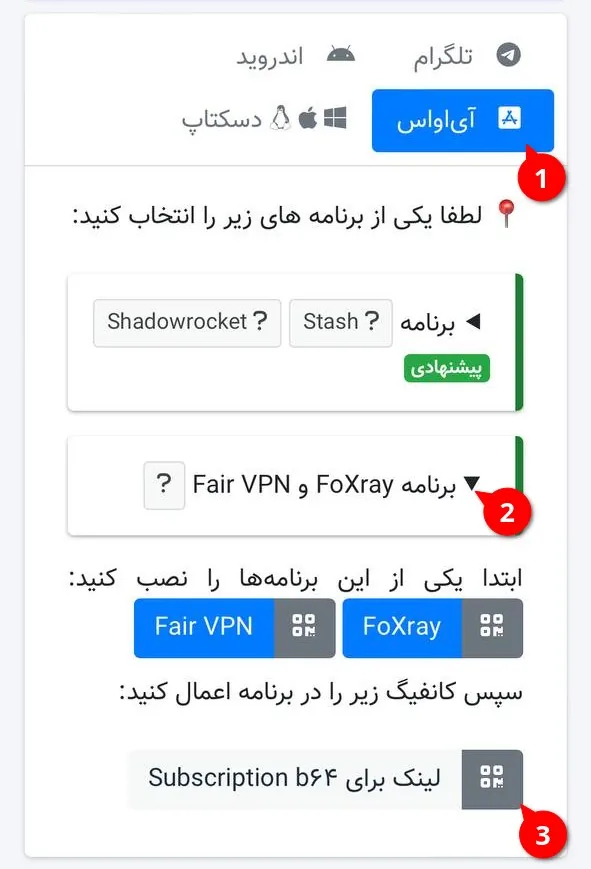

    این تصویر مربوط به نسخه قدیمی صفحه کاربری است که تب **آی‌اواس** داشت. ظاهر صفحه فعلی فرق دارد.

5. برنامه FoXray را باز کنید و از منوی پایین `Subscriptions` را بزنید.
6. دکمه `+` را بزنید.

    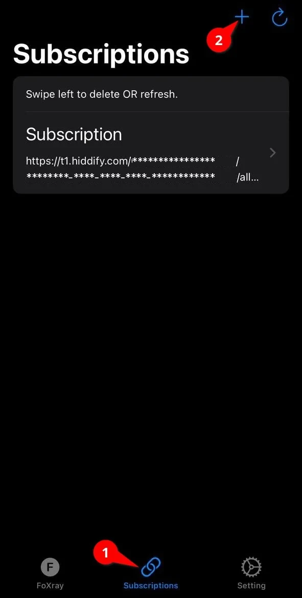

7. یک نام دلخواه بنویسید.
8. لینک را در فیلد `URL` بچسبانید.
9. `Subscribe` را بزنید. کانفیگ‌ها به برنامه اضافه می‌شوند.

    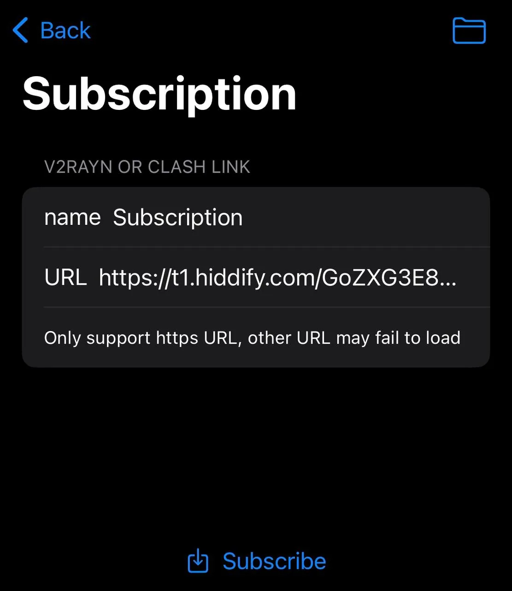

## به‌روزرسانی لینک اشتراک

در منوی `Subscriptions` روی نماد `↪️` بزنید. لینک‌ها به‌روز می‌شوند.

<div align=center markdown=1>
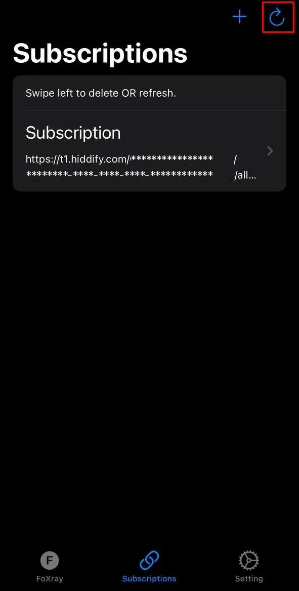
</div>

## افزودن لینک با QR code

1. در منوی `FoXray` دکمه QR code را بزنید.
2. دوربین را روی QR code لینک یا کانفیگ بگیرید. به برنامه اضافه می‌شود.

<div align=center markdown=1>
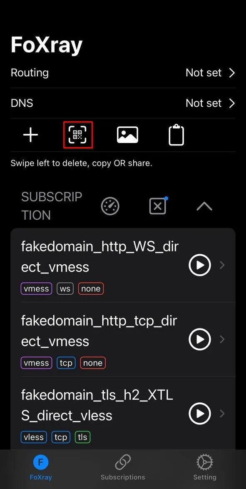
</div>

اگر QR code را به‌صورت عکس در گالری گوشی ذخیره کرده‌اید:

1. در منوی `FoXray` دکمه عکس را بزنید.
2. عکس را انتخاب کنید. کانفیگ‌ها اضافه می‌شوند.

<div align=center markdown=1>
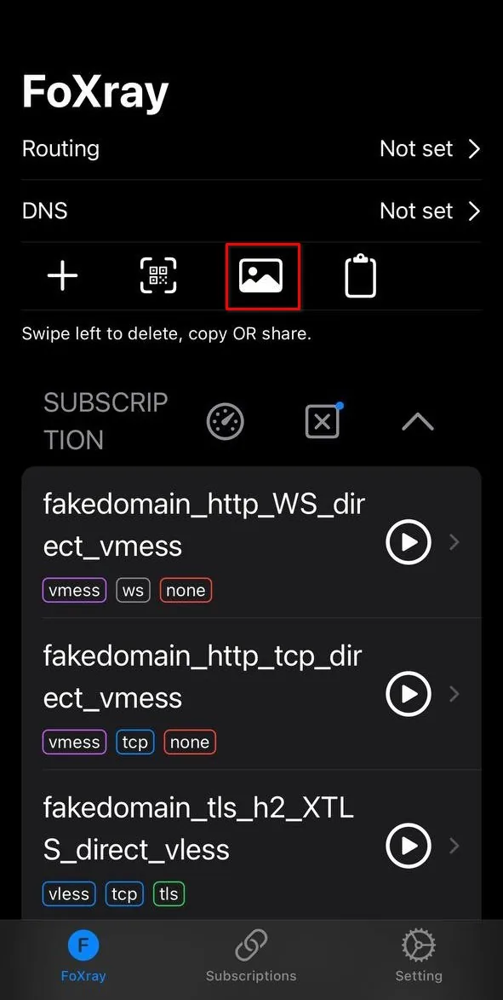
</div>

## افزودن کانفیگ تکی

این روش را پیشنهاد نمی‌کنیم، چون کانفیگ تکی به‌روز نمی‌شود. فقط در صورت نیاز از آن استفاده کنید.

1. در صفحه کاربری، «همه تنظیمات» را باز کنید و یکی از کانفیگ‌های بخش «کانفیگ‌های تکی» را کپی کنید.
2. در منوی `FoXray` روی نماد `Clipboard` بزنید. کانفیگ کپی‌شده اضافه می‌شود.

<div align=center markdown=1>
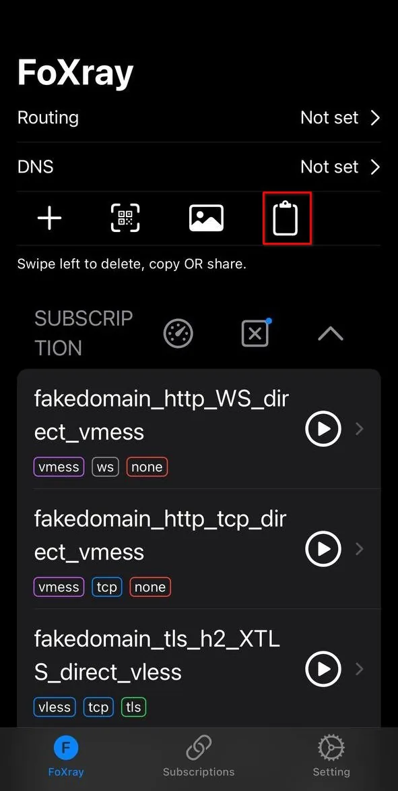
</div>

## تست کانکشن‌ها

ابتدا نوع تست را انتخاب کنید:

1. به `Setting` و سپس بخش `Speed Test` بروید.
2. در `PingType` یکی از `TCPPing`، `TLSPing` یا `RealPing` را انتخاب کنید. `RealPing` واقعی‌ترین نتیجه را می‌دهد.

<div align=center markdown=1>
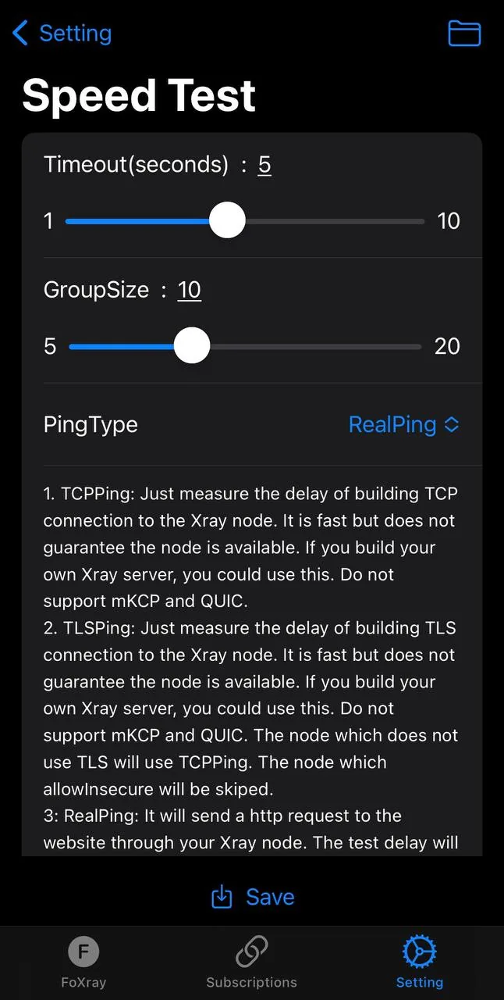
</div>

سپس در صفحه اصلی برنامه روی نماد تست کانکشن بزنید.

<div align=center markdown=1>
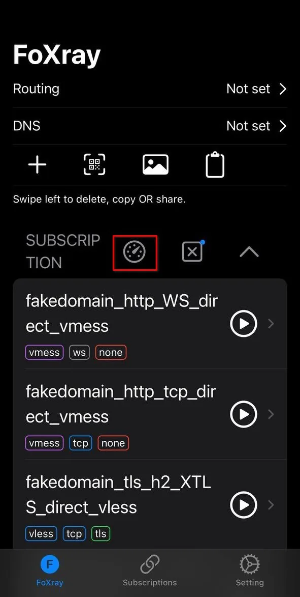
</div>

## محدود کردن مصرف حافظه

به `Setting` و سپس بخش `ToolBox` بروید و `Limit Memory Usage` را روشن کنید.

<div align=center markdown=1>
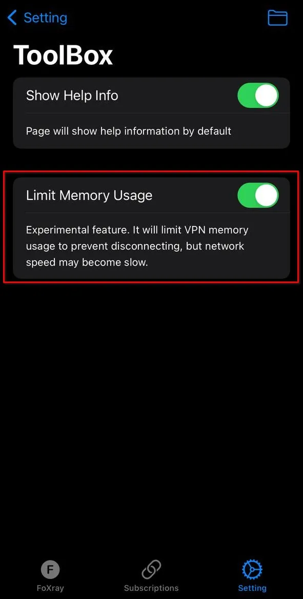
</div>

## افزودن سرور DNS

**سرور DNS** نام سایت‌ها را به آدرس IP تبدیل می‌کند.

1. در منوی `FoXray` بخش `DNS` را باز کنید.
2. `+` را بزنید.
3. یک نام دلخواه بنویسید.
4. آدرس DNS مورد نظر را در فیلد `Default DNS Address` وارد کنید.
5. بقیه فیلدها را تغییر ندهید و ذخیره کنید.

<div align=center markdown=1>
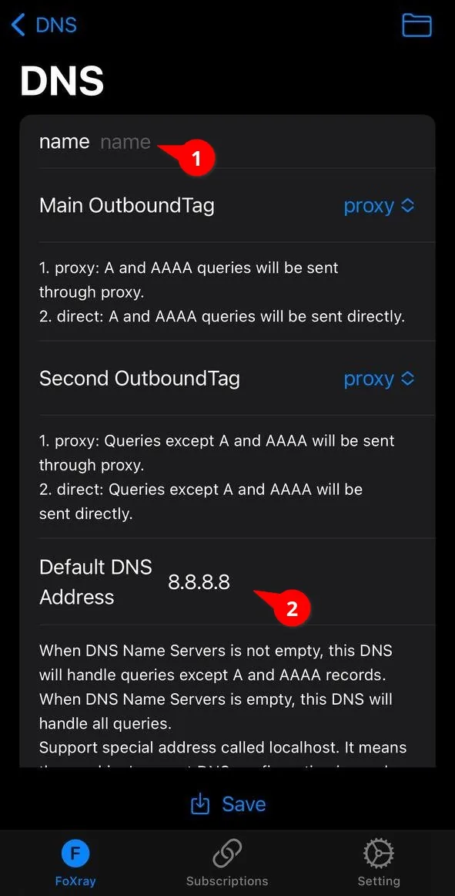
</div>

## قابلیت‌های پرمیوم

قابلیت‌های زیر فقط در صورتی در دسترس هستند که نسخه پرمیوم برنامه را خریده باشید.

### به‌روزرسانی خودکار لینک‌های اشتراک

به `Setting` بروید و `Auto Update Subscription` را روشن کنید.

<div align=center markdown=1>
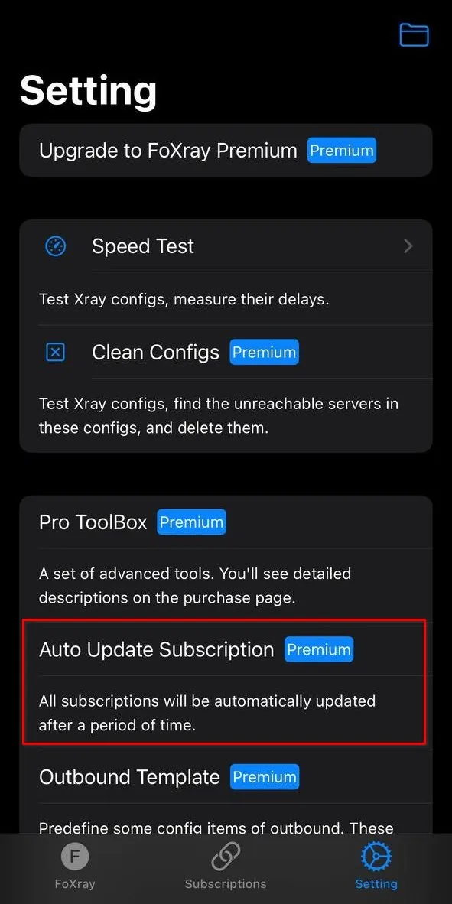
</div>

### روشن بودن همیشگی VPN

به `Setting` و سپس بخش `Pro ToolBox` بروید و `Always On` را روشن کنید. VPN شما همیشه روشن می‌ماند.

<div align=center markdown=1>
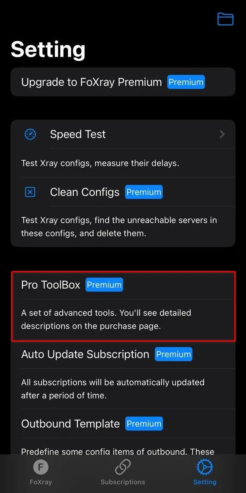
</div>

### نمایش موقعیت سرور

در `Setting` ← `Pro ToolBox` گزینه `Show Location` را روشن کنید. پس از اتصال، برنامه نشان می‌دهد سرور کجاست.

### پین کردن کانفیگ متصل

در `Setting` ← `Pro ToolBox` گزینه `Pin Outbound` را روشن کنید. کانفیگ متصل در بالای صفحه اصلی پین می‌شود.

### تست کانفیگ‌ها پیش از اتصال

در `Setting` ← `Pro ToolBox` گزینه `Test Outbound before Start` را روشن کنید. برنامه پیش از اتصال کانفیگ‌ها را تست می‌کند.

## فعال‌سازی فرگمنت

**فرگمنت** (Fragment) اولین بسته TLS را به چند تکه کوچک تقسیم می‌کند و می‌تواند به عبور از فیلترینگ کمک کند. توضیح بیشتر: [ترفند TLS چطور کار می‌کند](/fa/manager/basic-concepts-and-troubleshooting/How-the-TLS-Trick-works-and-its-usage/).

1. در برنامه روی کانکشن بزنید.
2. گزینه `Fragment` را روشن کنید.
3. این مقادیر پیشنهادی را وارد کنید:

    ```text
    packets: tlshello
    length: 100-200
    interval: 10-20
    ```

<div align=center markdown=1>
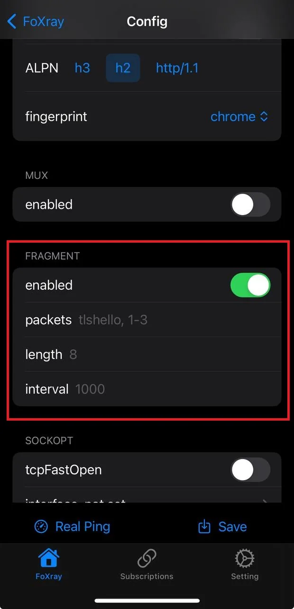

</div>

بسته به اپراتور اینترنت ممکن است به مقادیر دیگری نیاز داشته باشید. همچنین می‌توانید نوع بسته‌ها را از `tlshello` به TCP segment با مقدار `1-3` تغییر دهید، هرچند ممکن است فیلترینگ این حالت را زودتر شناسایی کند:

```text
packets: 1-3
```

## مقاله‌های مرتبط

- [sing-box](/fa/manager/client-software-on-ios/Tutorial-for-SingBox-app/)
- [Streisand](/fa/manager/client-software-on-ios/Tutorial-for-Streisand/)
- [V2Box](/fa/manager/client-software-on-ios/Tutorial-for-V2Box-app/)
- [Shadowrocket](/fa/manager/client-software-on-ios/Tutorial-for-ShadowRocket-app/)

</div>
