

# آموزش کار با نرم‌افزار ShadowRocket شدوراکت

در این صفحه یاد می‌گیرید چطور لینک اشتراک هیدیفای‌منیجر خود را به برنامه **Shadowrocket** (شدوراکت) در آیفون و آیپد اضافه کنید و از تنظیمات مهم آن استفاده کنید. شدوراکت یک برنامه پولی است که با کانفیگ‌های مبتنی بر Xray کار می‌کند.

<b>Shadowrocket</b><small>v2.2.93iOS 13+پولیآبان ۱۴۰۵</small>

<a class="hi-store" href="https://apps.apple.com/us/app/shadowrocket/id932747118"><small>Download on the</small><b>App Store</b></a>

<a class="hi-alt" href="/fa/app/How-to-install-Hiddify-app/"><b>پیشنهاد ما: اپ هیدیفای</b><small>رایگان، ساده‌تر و با پشتیبانی از همهٔ پروتکل‌های هیدیفای‌منیجر</small>نصب اپ ←</a>

## پیش از شروع

- برنامه **Shadowrocket** را از [App Store](https://apps.apple.com/us/app/shadowrocket/id932747118) بخرید و نصب کنید.
- **لینک صفحه کاربری** خود را آماده داشته باشید. این همان لینکی است که مدیر سرور برایتان فرستاده و صفحه شخصی هیدیفای‌منیجر شما را باز می‌کند.

**لینک اشتراک** (سابسکریپشن) یک لینک است که همه تنظیمات اتصال (کانفیگ‌ها) را در خود دارد. شدوراکت می‌تواند بعداً آن را به‌روز کند و تنظیمات جدید را از سرور بگیرد.

## افزودن لینک اشتراک: روش سریع

1. در آیفون، لینک صفحه کاربری خود را در Safari باز کنید.
2. روی دکمه گرد بزرگ وسط صفحه بزنید. پنجره «VPN خود را پیکربندی کنید» باز می‌شود.
3. در بخش «یکی از برنامه‌های زیر را انتخاب کنید»، روی **Shadowrocket** بزنید. اگر آن را نمی‌بینید، «بیشتر...» را بزنید. از همین‌جا می‌توانید برنامه را دانلود هم بکنید.

    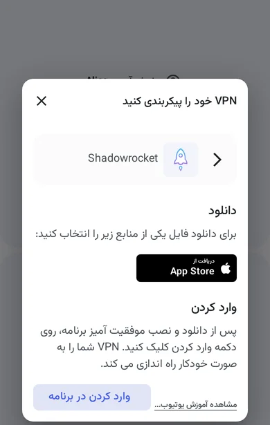

4. «وارد کردن در برنامه» را بزنید. شدوراکت باز می‌شود و لینک اشتراک را اضافه می‌کند.

اگر این روش کار نکرد، طبق مراحل زیر لینک را دستی اضافه کنید.

!!! note "کانفیگ‌های Lite و Normal دیگر وجود ندارند"
    در نسخه‌های قدیمی صفحه کاربری، در تب **آی‌اواس** دو نوع کانفیگ بود: **Lite** (فقط سایت‌های فیلترشده از VPN عبور می‌کنند) و **Normal** (همه ترافیک از VPN عبور می‌کند). صفحه کاربری فعلی تب iOS و انتخاب Lite/Normal ندارد. اگر می‌خواهید سایت‌های ایرانی بدون VPN باز شوند، از مدیر سرور بپرسید؛ این مورد روی سرور تنظیم می‌شود. اگر مدیر، [وارپ](/fa/manager/configuration-and-advanced-settings/How-to-activate-WARP-on-the-Hiddify-panel/) را فعال کرده باشد، سایت‌های ایرانی می‌توانند از طریق وارپ باز شوند.

## افزودن لینک اشتراک به‌صورت دستی

ابتدا لینک را بگیرید:

1. در صفحه کاربری، منو را باز کنید و «همه تنظیمات» (**All Configs**) را بزنید.
2. در بخش «لینک‌های اشتراک»، ردیف **Subscription link** را پیدا کنید و «دریافت لینک» را بزنید. پنجره‌ای با QR code و دکمه «کپی لینک» باز می‌شود.

سپس آن را به یکی از دو روش زیر به شدوراکت اضافه کنید.

### کپی کردن لینک در شدوراکت

1. «کپی لینک» را بزنید.
2. شدوراکت را باز کنید و دکمه `+` را در گوشه بالا سمت راست بزنید.

    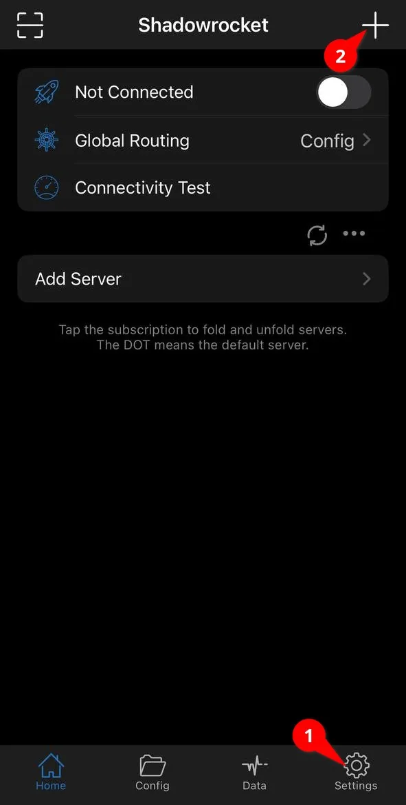

3. `Type` را روی `Subscribe` بگذارید.
4. لینک را در فیلد `URL` بچسبانید.
5. `Save` را بزنید.

    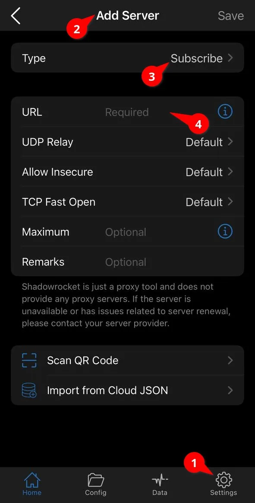

همه کانفیگ‌ها در برنامه بارگذاری می‌شوند.

### اسکن QR code در شدوراکت

1. در صفحه اصلی شدوراکت، دکمه اسکنر را بزنید.

    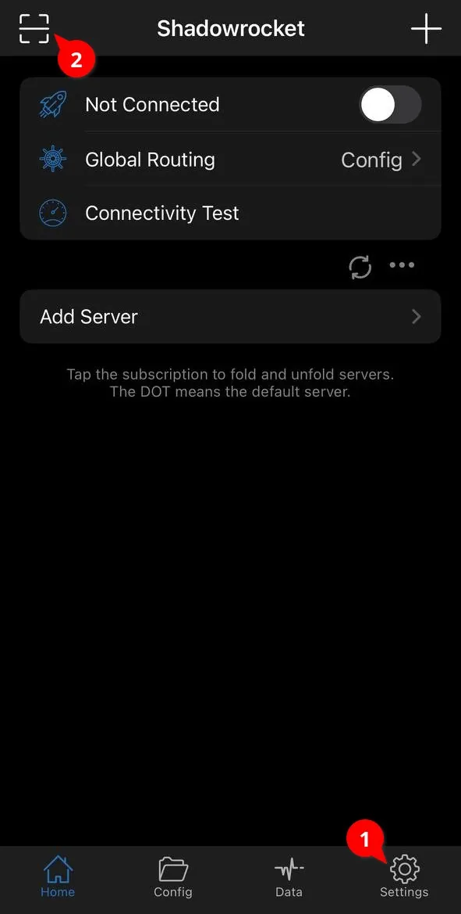

2. QR code صفحه کاربری را اسکن کنید. کانفیگ‌ها به برنامه اضافه می‌شوند.

## تست کانفیگ‌ها

در صفحه اصلی برنامه، `Connectivity Test` را بزنید. برنامه همه کانفیگ‌ها را تست می‌کند.

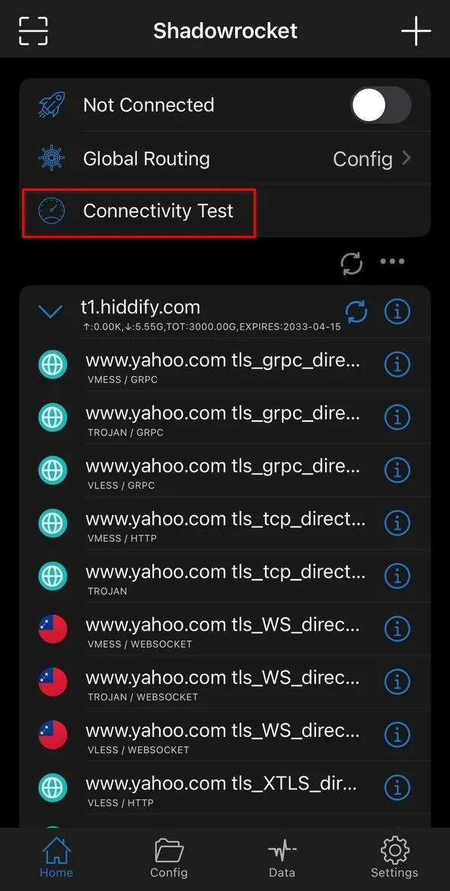

برای نتیجه واقعی‌تر:

1. از منوی پایین `Settings` را بزنید.
2. `Test Method` را روی `Connect` بگذارید.
3. دوباره تست بگیرید.

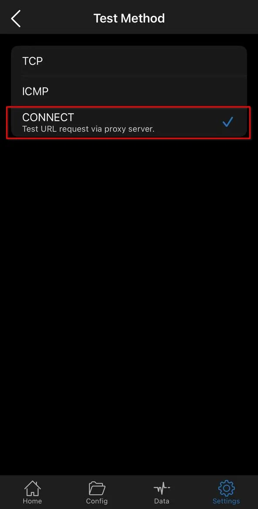

## به‌روزرسانی لینک اشتراک و کانفیگ‌ها

روی نماد به‌روزرسانی بالای کانفیگ‌های هر لینک اشتراک بزنید. کانفیگ‌ها با آخرین اطلاعات سرور به‌روز می‌شوند.

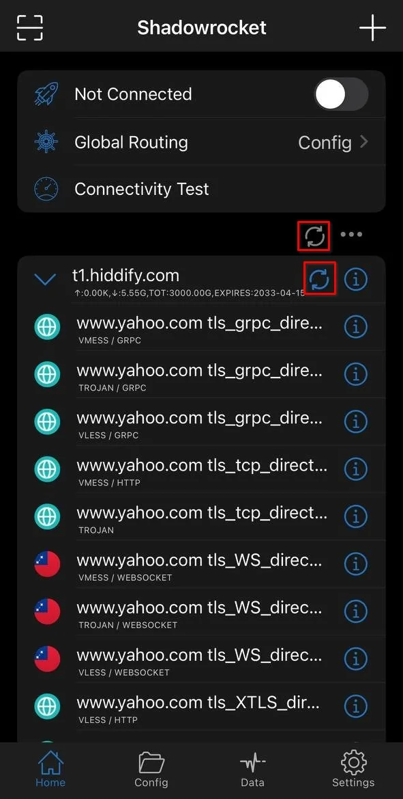

## تنظیمات لینک اشتراک

به `Settings` بروید و پایین صفحه `Subscribe` را بزنید. در اینجا این موارد را می‌توانید تنظیم کنید:

### به‌روزرسانی هنگام باز شدن برنامه

گزینه `Update on Open` را روشن کنید.

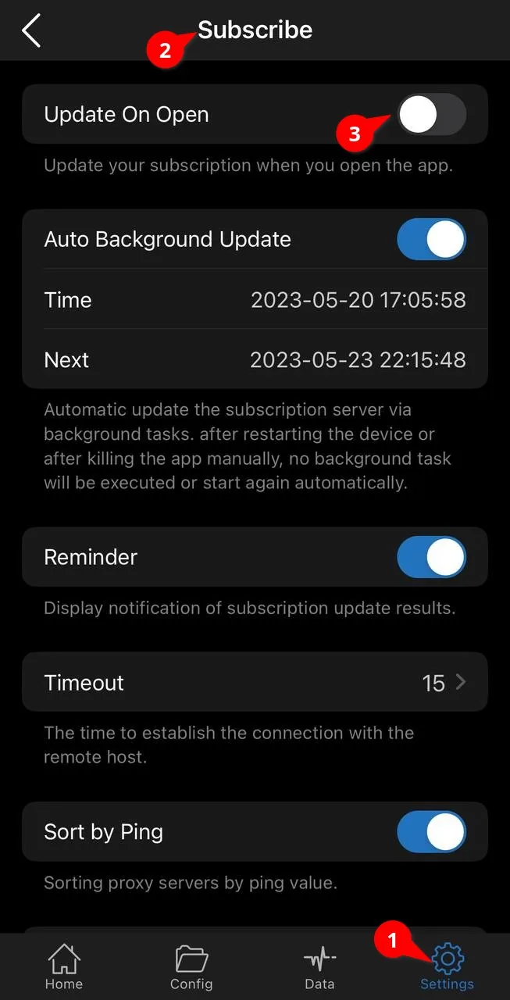

### به‌روزرسانی خودکار در پس‌زمینه

گزینه `Auto Background Update` را روشن کنید. برنامه در فاصله‌های زمانی مشخص لینک‌های اشتراک را به‌روز می‌کند.

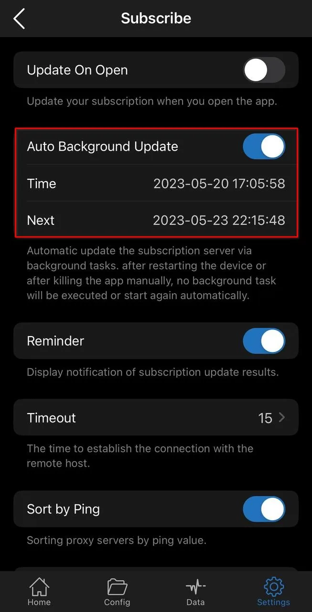

### مرتب‌سازی بر اساس پینگ

گزینه `Sort by ping` را روشن کنید تا کانفیگ‌ها بر اساس نتیجه تست مرتب شوند و بهترین‌ها بالا بیایند.

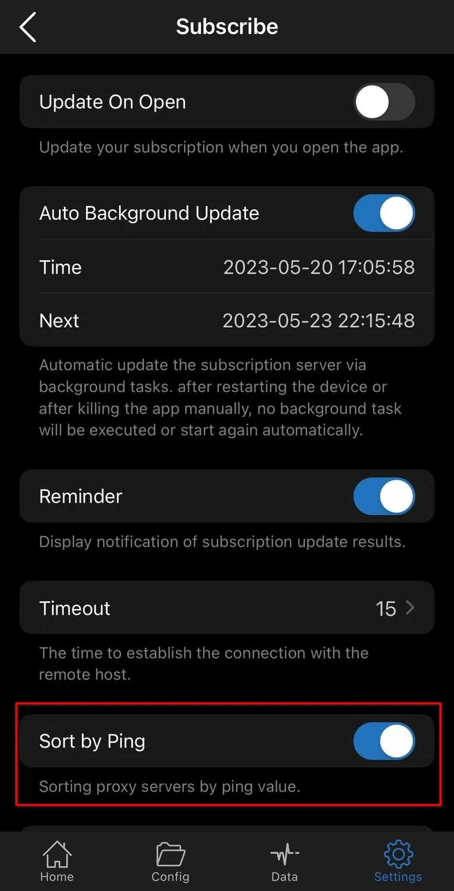

## جلوگیری از نشت IP

**نشت IP** یعنی سایت‌ها با وجود روشن بودن VPN، IP واقعی شما را ببینند.

1. به `Settings` و سپس بخش `UDP` بروید.
2. گزینه `Disable STUN` را روشن کنید.

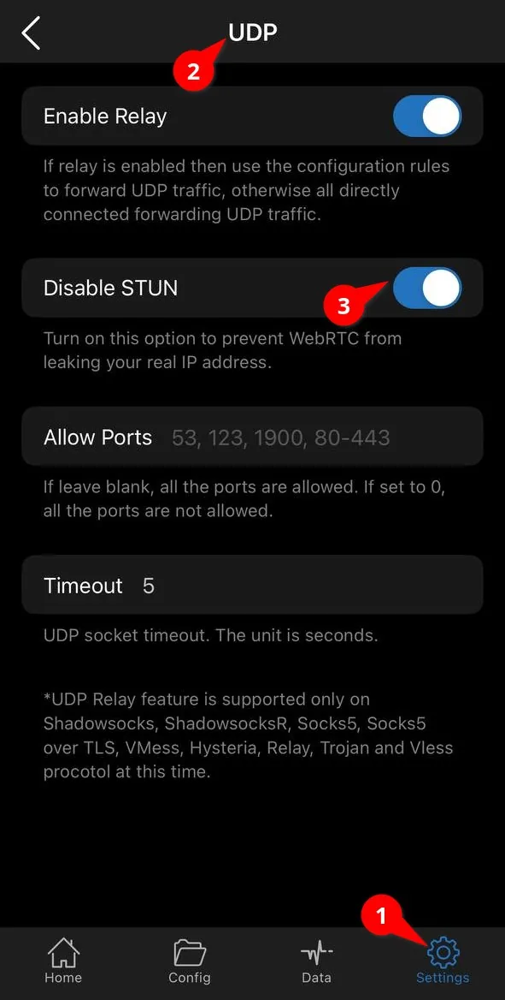

## رفع مشکل پخش نشدن صدا در بعضی برنامه‌ها

اگر در بعضی برنامه‌ها (مثلاً Clubhouse) صدا پخش نمی‌شود:

1. به `Settings` و سپس بخش `TCP` بروید.
2. مقدار `Fingerprint` را تغییر دهید.

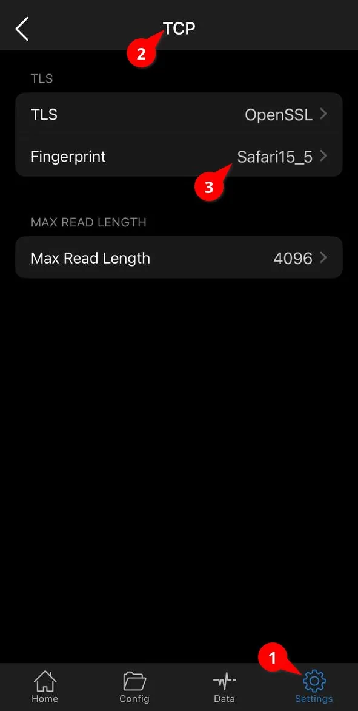

## میان‌برها (Shortcuts)

به `Settings` و سپس بخش `Shortcuts` بروید. در اینجا می‌توانید برای یک کار، مثلاً روشن کردن VPN، یک فرمان صوتی تعیین کنید.

## روشن نگه داشتن VPN (On Demand)

به `Settings` و سپس بخش `On Demand` بروید.

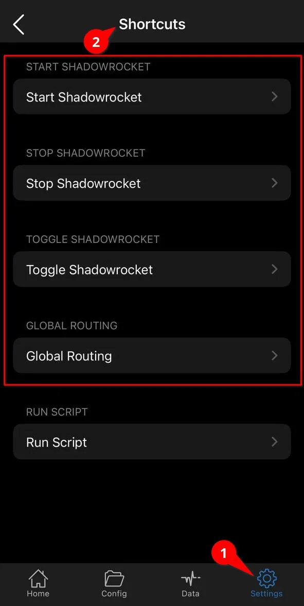

### Always On
با روشن کردن این گزینه، VPN شما همیشه روشن می‌ماند.

### On Demand
با روشن کردن این گزینه، اگر اتصال شما قطع شود، شدوراکت کل اینترنت را قطع می‌کند تا IP واقعی شما لو نرود.

### Disconnect on Sleep
با روشن کردن این گزینه، وقتی گوشی به حالت خواب (Sleep) می‌رود، VPN قطع می‌شود.

## اشتراک‌گذاری VPN با دستگاه‌های دیگر

می‌توانید VPN خود را با دستگاه دیگری در همان شبکه به اشتراک بگذارید؛ مثلاً دستگاهی که نمی‌توان روی آن برنامه VPN نصب کرد.

1. به `Settings` و سپس بخش `Proxy` بروید.
2. `Proxy Share` را بزنید.
3. گزینه `Enable Share` را روشن کنید. برنامه یک آدرس IP و یک پورت نشان می‌دهد.

    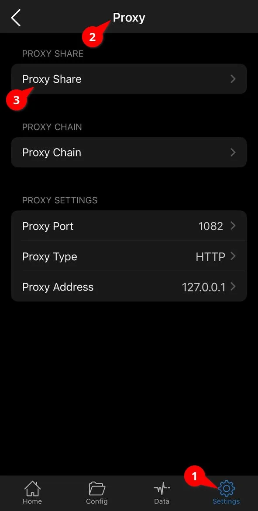

4. در دستگاه دیگر، تنظیمات پروکسی شبکه را باز کنید و همان IP و پورت را وارد کنید.

اکنون دستگاه دوم بدون نصب هیچ برنامه‌ای از VPN شما استفاده می‌کند.

## ساخت لودبالانس

**لودبالانس** (Load Balance) ترافیک شما را بین چند کانفیگ پخش می‌کند تا اگر یک کانفیگ کند یا مسدود شد، اتصال شما قطع نشود.

1. در صفحه اصلی، انگشت خود را روی صفحه نگه دارید و به پایین بکشید. یک منوی مخفی باز می‌شود.

    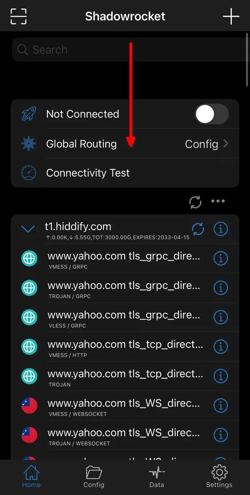

2. دکمه `+` را بزنید.

    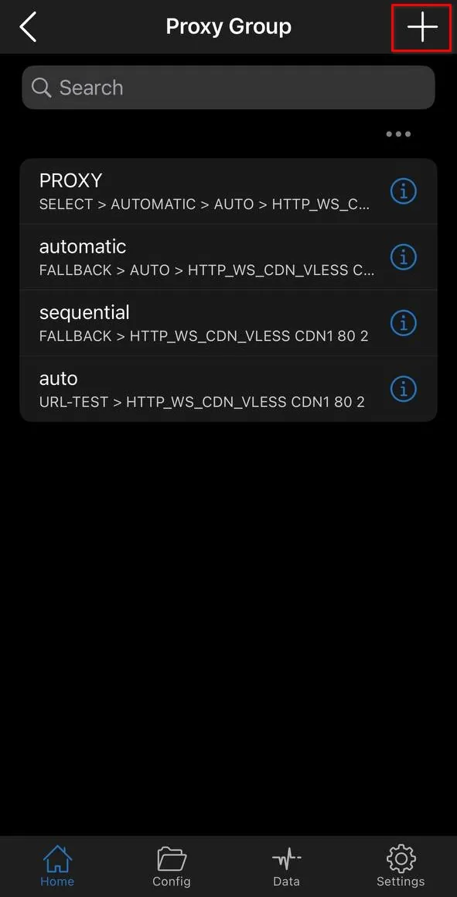

3. یک نام دلخواه بنویسید.
4. `Type` را روی `load-balance` بگذارید.
5. در بخش `Policy`، کانفیگ‌هایی را که پینگ بهتری دارند یا همه کانفیگ‌ها را انتخاب کنید.
6. `Interval` (فاصله بین تست‌ها) و `Timeout` (مدتی که یک کانفیگ می‌تواند قطع باشد و هنوز سالم حساب شود) را روی مقدار پیش‌فرض بگذارید، مگر اینکه دقیقاً بدانید چه می‌خواهید.
7. `Save` را بزنید.

    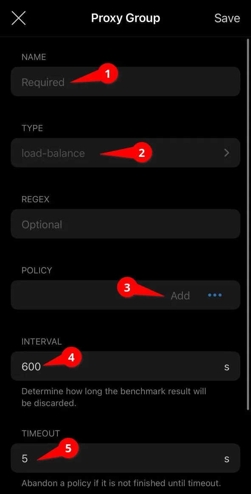

8. روی لودبالانس ساخته‌شده بزنید و سپس `Test` را بزنید. این کار آن را تست می‌کند و از طریق آن وصل می‌شود.

    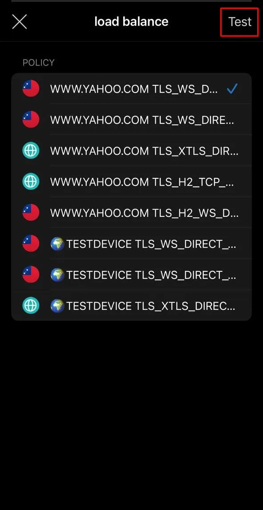

با روشن یا خاموش کردن شدوراکت، لودبالانس هم روشن یا خاموش می‌شود.

## رفع مشکل باز نشدن بعضی سایت‌ها و برنامه‌ها

اگر بعضی سایت‌ها یا برنامه‌ها باز نمی‌شوند یا گیف‌های تلگرام بارگذاری نمی‌شوند:

1. به منوی `Settings` بروید.
2. بخش `TCP` را باز کنید.
3. `TLS` را روی `Network` بگذارید.
4. `Fingerprint` را روی `Safari15_5` بگذارید.
5. `Max Read Length` را روی `16384` بگذارید.
6. به `Home` برگردید.
7. `Global Routing` را روی `Proxy` بگذارید.

## مقاله‌های مرتبط

- [sing-box](/fa/manager/client-software-on-ios/Tutorial-for-SingBox-app/)
- [Streisand](/fa/manager/client-software-on-ios/Tutorial-for-Streisand/)
- [V2Box](/fa/manager/client-software-on-ios/Tutorial-for-V2Box-app/)
- [FoXray](/fa/manager/client-software-on-ios/Tutorial-for-FoXray-app/)

