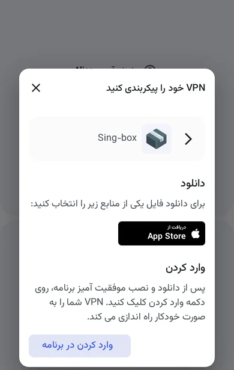
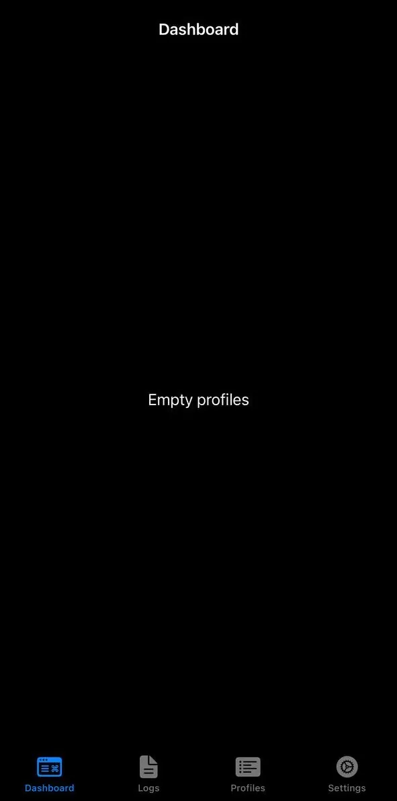
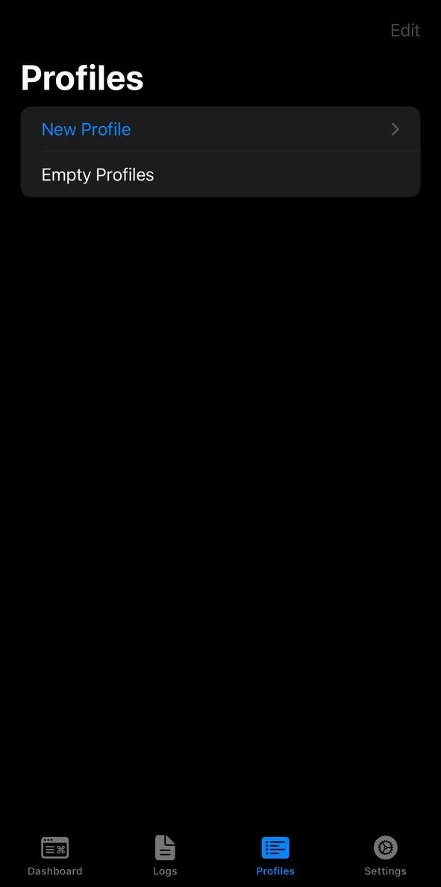
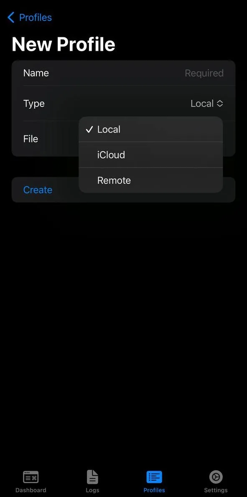
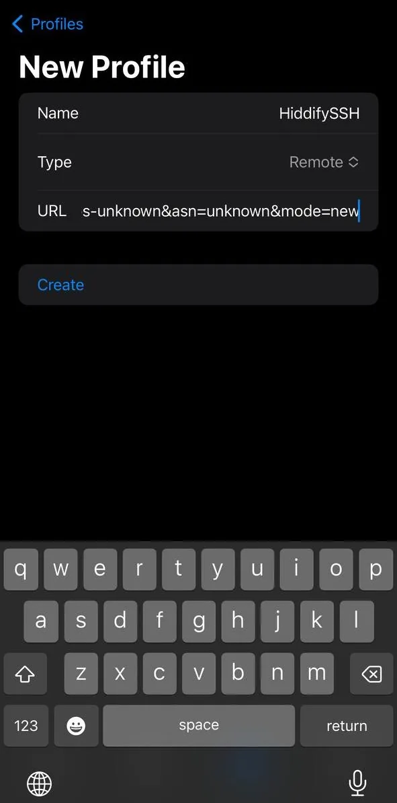
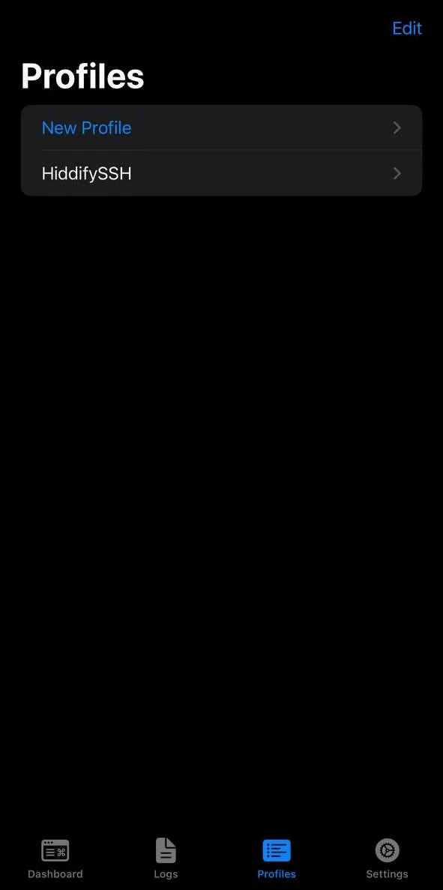
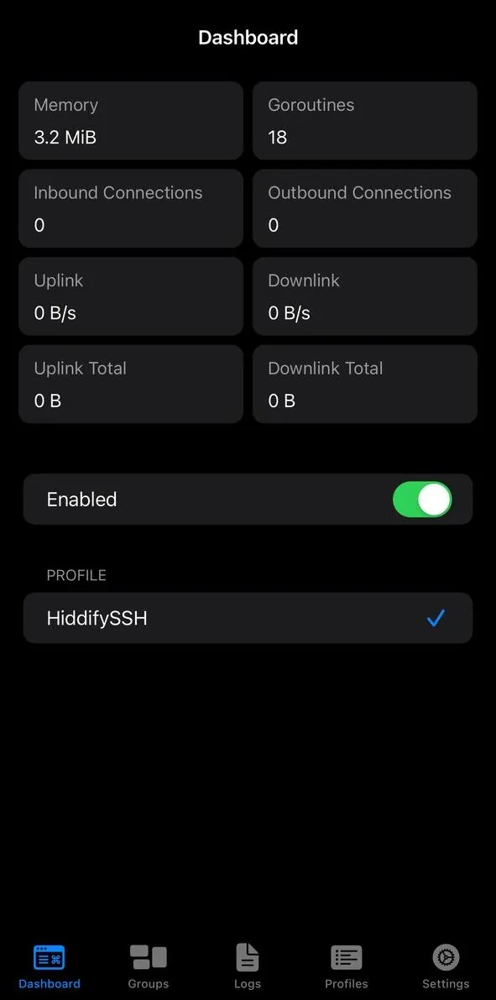

# آموزش کار با نرم‌افزار SingBox

در این صفحه یاد می‌گیرید چطور لینک اشتراک هیدیفای‌منیجر خود را به برنامه رسمی **sing-box** در آیفون و آیپد اضافه کنید و وصل شوید. این آموزش برای کاربرانی است که به جای اپ هیدیفای می‌خواهند از sing-box استفاده کنند.

!!! warning "این صفحه قبلاً درباره پروکسی SSH بود"
    نسخه‌های قبلی این صفحه نحوه افزودن **پروکسی SSH** پنل هیدیفای‌منیجر به sing-box را آموزش می‌داد. سرویس پروکسی SSH از نسخه v13 هیدیفای‌منیجر حذف شده است و آن بخش دیگر کاربرد ندارد. مراحل زیر لینک اشتراک معمولی هیدیفای‌منیجر را اضافه می‌کند.

<b>sing-box</b><small>v1.14.8iOS 15+رایگانآبان ۱۴۰۵</small>

<a class="hi-store" href="https://apps.apple.com/us/app/sing-box-mt/id6785326793"><small>Download on the</small><b>App Store</b></a>

<a class="hi-alt" href="/fa/app/How-to-install-Hiddify-app/"><b>پیشنهاد ما: اپ هیدیفای</b><small>رایگان، ساده‌تر و با پشتیبانی از همهٔ پروتکل‌های هیدیفای‌منیجر</small>نصب اپ ←</a>

## پیش از شروع

- آیفون یا آیپد با iOS 15 یا بالاتر.
- **لینک صفحه کاربری** شما. این همان لینکی است که مدیر سرور برایتان فرستاده است. با باز کردن آن، صفحه شخصی هیدیفای‌منیجر شما با لینک‌های اشتراک باز می‌شود.

**لینک اشتراک** (سابسکریپشن) یک لینک است که همه تنظیمات اتصال (کانفیگ‌ها) را در خود دارد. برنامه می‌تواند بعداً آن را به‌روز کند و تنظیمات جدید را از سرور بگیرد.

## دانلود برنامه

نام برنامه رسمی sing-box برای آیفون، آیپد و Apple TV اکنون **sing-box MT** است. صفحه قبلی آن در App Store (شناسه id6451272673) دیگر وجود ندارد.

- [iOS و iPadOS (App Store: sing-box MT)](https://apps.apple.com/us/app/sing-box-mt/id6785326793)
- [اندروید (Google Play)](https://play.google.com/store/apps/details?id=io.nekohasekai.sfa)
- سایر سیستم‌عامل‌ها: [صفحه رسمی دانلود sing-box](https://sing-box.sagernet.org/clients/apple/)

## افزودن لینک اشتراک: روش سریع

1. در آیفون، لینک صفحه کاربری خود را در Safari باز کنید.
2. روی دکمه گرد بزرگ وسط صفحه بزنید. پنجره‌ای با عنوان «VPN خود را پیکربندی کنید» (**Configure your VPN**) باز می‌شود.
3. در بخش «یکی از برنامه‌های زیر را انتخاب کنید»، روی **sing-box** بزنید. اگر آن را نمی‌بینید، روی «بیشتر...» (**View More**) بزنید.

    

4. روی «وارد کردن در برنامه» (**Import To App**) بزنید. برنامه sing-box باز می‌شود و برای افزودن پروفایل سؤال می‌کند.
5. تأیید کنید. پروفایل جدید در فهرست **Profiles** برنامه نمایش داده می‌شود.

اگر برنامه باز نشد، از روش دستی زیر استفاده کنید.

## افزودن لینک اشتراک: روش دستی

1. در صفحه کاربری، منو را باز کنید و «همه تنظیمات» (**All Configs**) را بزنید.
2. در بخش «لینک‌های اشتراک»، ردیف **Hiddify / Singbox** را پیدا کنید و «دریافت لینک» را بزنید.
3. «کپی لینک» را بزنید.
4. برنامه sing-box را باز کنید و به منوی `Profiles` بروید.

    

5. گزینه `New Profile` را بزنید.

    

6. `Type` را روی `Remote` بگذارید.

    

7. در فیلد `Name` یک نام دلخواه بنویسید.
8. لینکی را که کپی کرده‌اید در فیلد `URL` بچسبانید.
9. `Create` را بزنید.

    

اکنون پروفایل در فهرست پروفایل‌های برنامه دیده می‌شود.

!!! note "نکته"
    تصویرهای این صفحه مربوط به نسخه قدیمی‌تر sing-box هستند. ممکن است نام منوها در نسخه فعلی کمی فرق داشته باشد.

## اتصال

1. به منوی `Dashboard` بروید.
2. پروفایلی را که اضافه کرده‌اید انتخاب کنید.
3. کلید `Enabled` را روشن کنید. اگر iOS برای افزودن پیکربندی VPN اجازه خواست، `Allow` را بزنید.

اگر اتصال برقرار شود، نماد VPN بالای صفحه آیفون نمایش داده می‌شود و سایت‌ها باز می‌شوند. اگر وصل نشد، به `Profiles` برگردید، پروفایل را به‌روز کنید و دوباره امتحان کنید. اگر باز هم مشکل داشتید، از مدیر سرور بخواهید حساب شما را بررسی کند.

## مقاله‌های مرتبط

- [Streisand](/fa/manager/client-software-on-ios/Tutorial-for-Streisand/)
- [V2Box](/fa/manager/client-software-on-ios/Tutorial-for-V2Box-app/)
- [FoXray](/fa/manager/client-software-on-ios/Tutorial-for-FoXray-app/)
- [Shadowrocket](/fa/manager/client-software-on-ios/Tutorial-for-ShadowRocket-app/)

