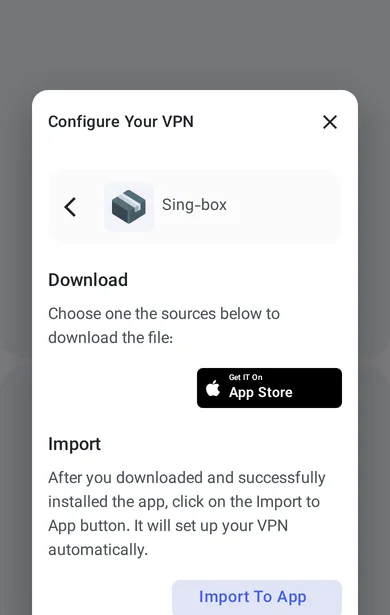
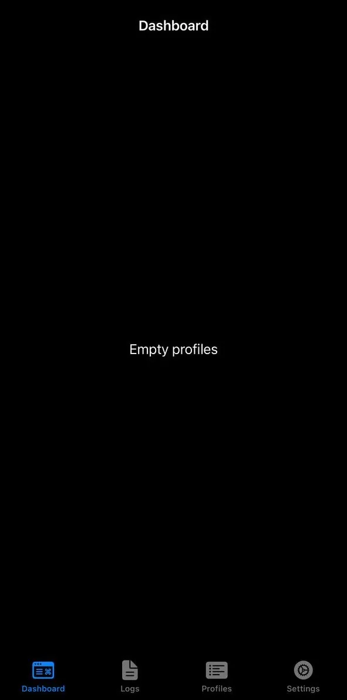
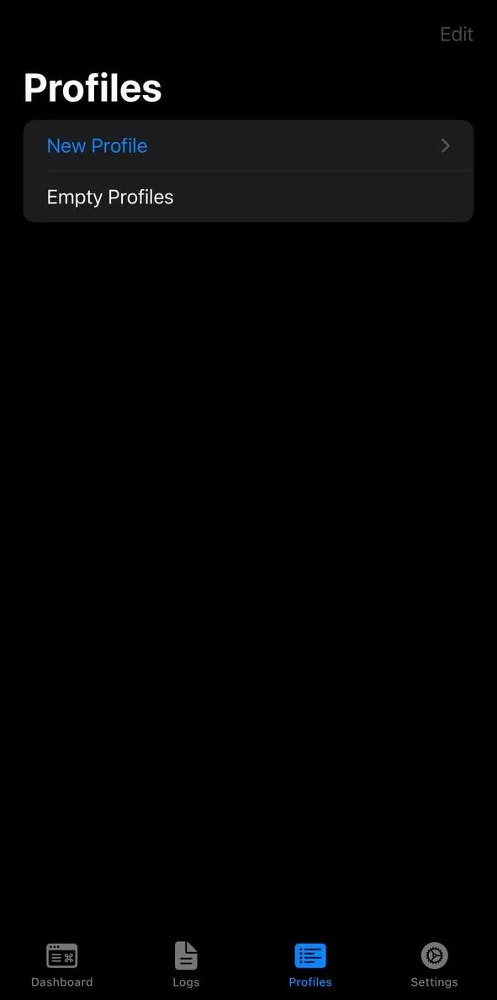
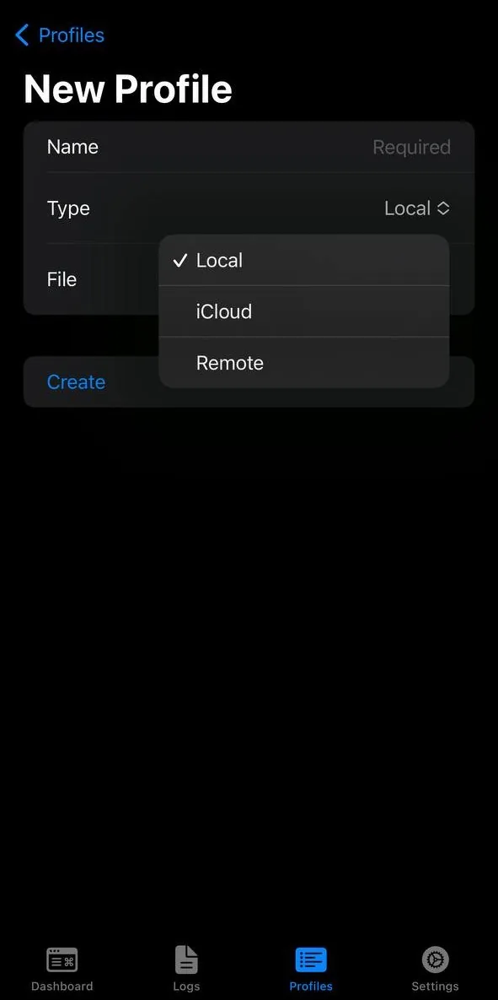
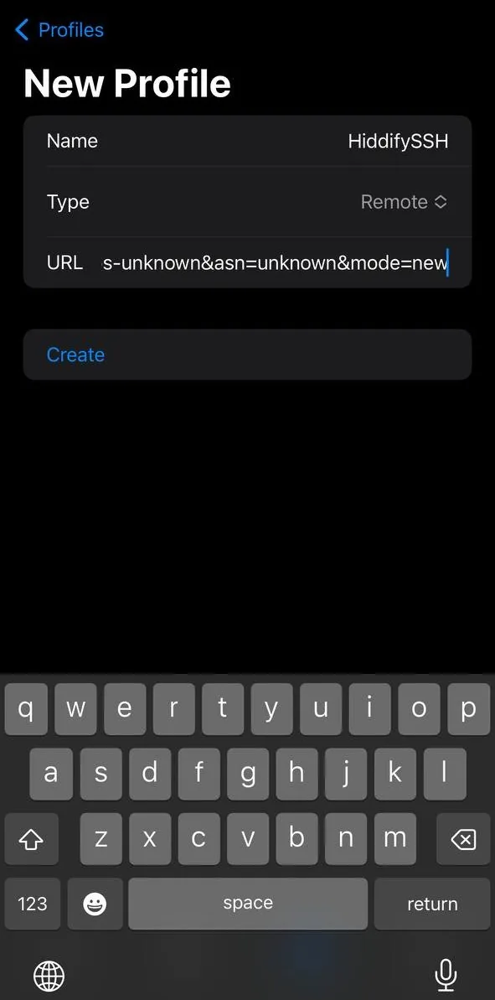
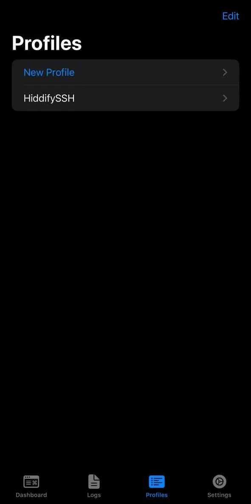
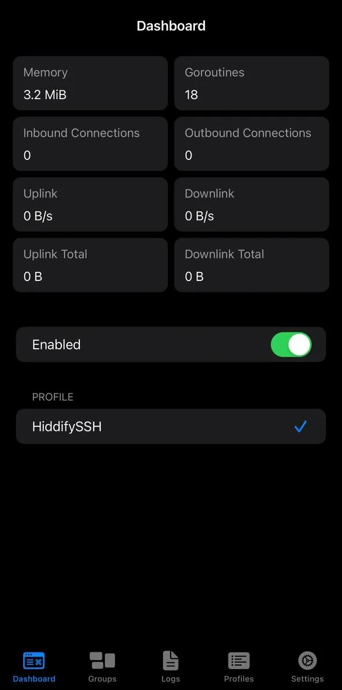

# Tutorial for SingBox app

This page shows you how to add your HiddifyManager subscription to the official **sing-box** app on iPhone and iPad, and how to connect. It is for users of a Hiddify Manager server who want to use sing-box instead of the Hiddify app.

!!! warning "This page used to be about the SSH proxy"
    Older versions of this page showed how to add the HiddifyManager panel's **SSH proxy** to sing-box. The SSH proxy service was removed in Hiddify Manager v13, so that part no longer applies. The steps below add your normal HiddifyManager subscription instead.

<b>sing-box</b><small>v1.14.8iOS 15+FreeNov 2026</small>

<a class="hi-store" href="https://apps.apple.com/us/app/sing-box-mt/id6785326793"><small>Download on the</small><b>App Store</b></a>

<a class="hi-alt" href="/app/How-to-install-Hiddify-app/"><b>Our suggestion: the Hiddify app</b><small>Free, simpler, and supports every Hiddify Manager protocol</small>Install →</a>

## Before you start

- An iPhone or iPad with iOS 15 or later.
- Your **user page link**. This is the link your server admin sent you. It opens your personal HiddifyManager page, where your subscription links are.

A **subscription link** is one link that holds all your connection settings (configs). The app can refresh it later to get new settings from the server.

## Download the app

The official sing-box app for iPhone, iPad and Apple TV is now called **sing-box MT**. The old App Store listing (id6451272673) no longer exists.

- [iOS / iPadOS (App Store: sing-box MT)](https://apps.apple.com/us/app/sing-box-mt/id6785326793)
- [Android (Google Play)](https://play.google.com/store/apps/details?id=io.nekohasekai.sfa)
- Other platforms: see the [official sing-box download page](https://sing-box.sagernet.org/clients/apple/).

## Add your subscription: the quick way

1. On your iPhone, open your user page link in Safari.
2. Tap the large round button in the middle of the page. A window called **Configure your VPN** opens.
3. Under **Choose one of the apps below**, tap **sing-box**. If you don't see it, tap **View More**.

    

4. Tap **Import To App**. The sing-box app opens and asks to add the profile.
5. Confirm. The new profile now appears in the app's **Profiles** list.

If the app doesn't open, use the manual way below.

## Add your subscription: the manual way

1. On your user page, open the menu and tap **All Configs**.
2. In the **Subscription Links** section, find **Hiddify / Singbox** and tap **Get Link**.
3. Tap **Copy Link**.
4. Open the sing-box app and go to the **Profiles** menu.

    

5. Tap **New Profile**.

    

6. Set **Type** to **Remote**.

    

7. Type any name you like in the **Name** field.
8. Paste the link you copied into the **URL** field.
9. Tap **Create**.

    

The profile now appears in the list of profiles.

!!! note
    The screenshots on this page come from an older version of sing-box. Menu names in the current app may look slightly different.

## Connect

1. Go to the **Dashboard** menu.
2. Select the profile you added.
3. Turn on the **Enabled** switch. If iOS asks to add a VPN configuration, tap **Allow**.

When it works, the VPN icon appears at the top of your iPhone screen and websites open normally. If it doesn't connect, go back to **Profiles**, update the profile, and try again. If it still fails, ask your server admin to check your account.

## Related articles

- [Streisand](/manager/client-software-on-ios/Tutorial-for-Streisand/)
- [V2Box](/manager/client-software-on-ios/Tutorial-for-V2Box-app/)
- [FoXray](/manager/client-software-on-ios/Tutorial-for-FoXray-app/)
- [Shadowrocket](/manager/client-software-on-ios/Tutorial-for-ShadowRocket-app/)

