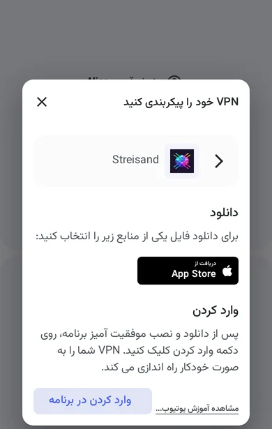
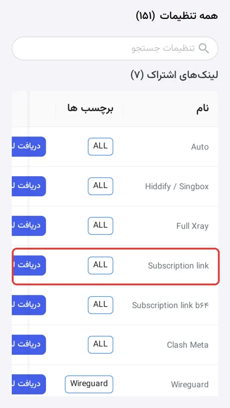
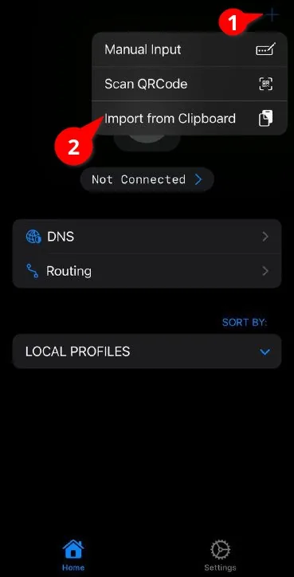
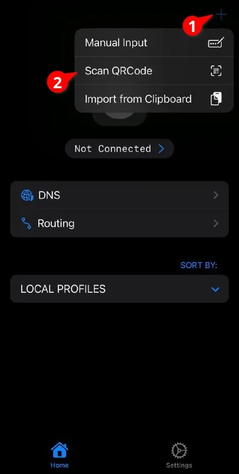
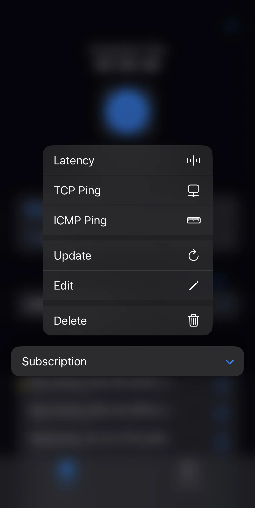
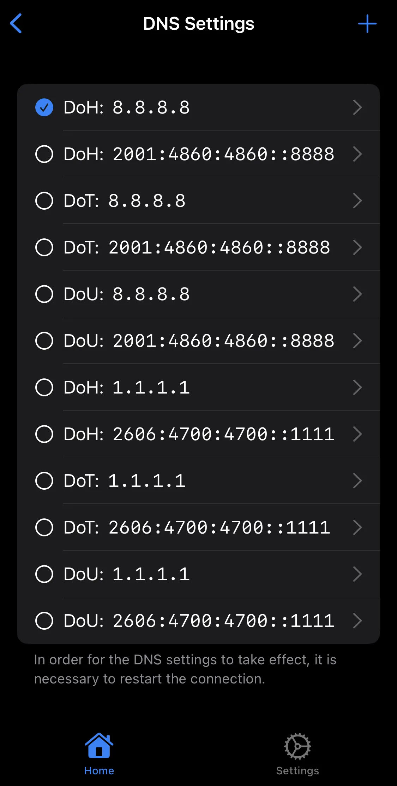
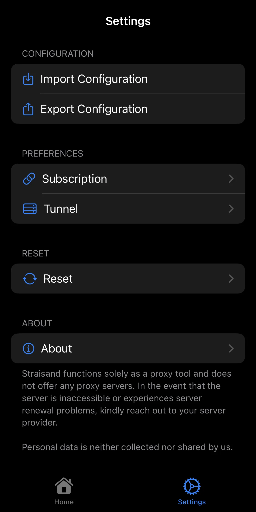
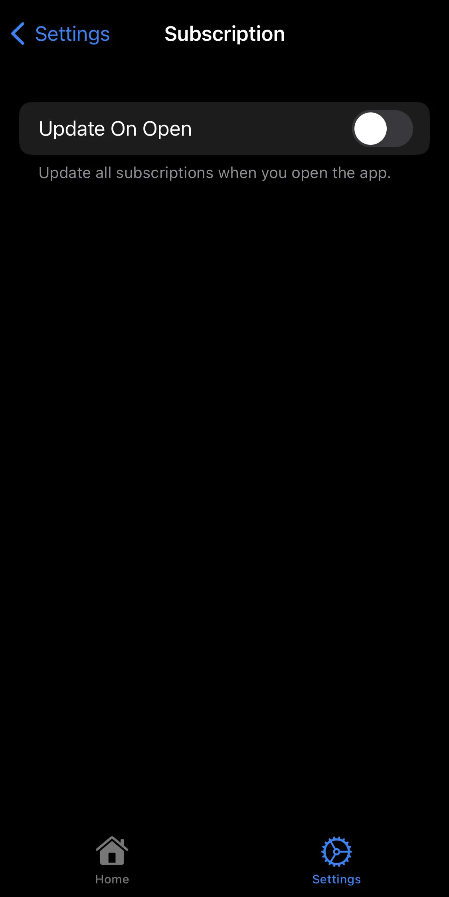
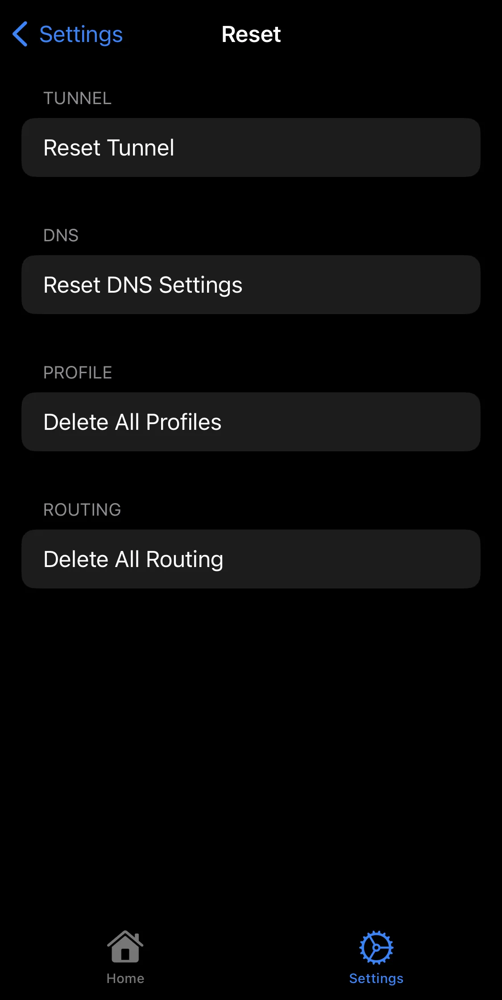
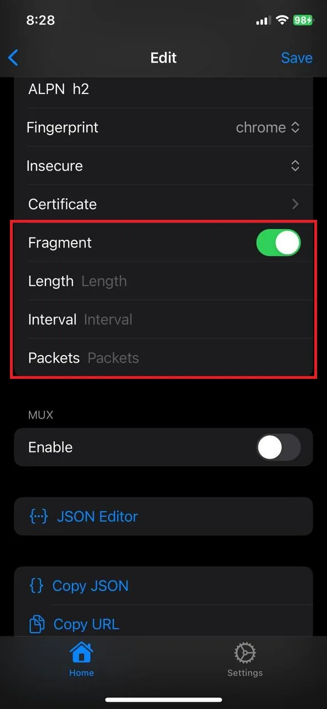

<div dir="rtl" markdown="1">

# آموزش کار با نرم‌افزار Streisand

در این صفحه یاد می‌گیرید چطور لینک اشتراک هیدیفای‌منیجر خود را به برنامه رایگان **Streisand** (استرایسند) در آیفون و آیپد اضافه کنید، کانفیگ‌ها را تست کنید و از تنظیمات مهم آن، یعنی DNS و فرگمنت TLS، استفاده کنید. استرایسند روی iOS 14 و بالاتر کار می‌کند.

<div class="hi-get"><div class="meta"><b>Streisand</b><small><span>v1.7.1</span><span>iOS 15+</span><span>رایگان</span><span>آبان ۱۴۰۵</span></small></div><div class="stores"><a class="hi-store" href="https://apps.apple.com/us/app/streisand/id6450534064"><span><small>Download on the</small><b>App Store</b></span></a></div></div>
<a class="hi-alt" href="/fa/app/How-to-install-Hiddify-app/"><span class="mk"></span><span><b>پیشنهاد ما: اپ هیدیفای</b><small>رایگان، ساده‌تر و با پشتیبانی از همهٔ پروتکل‌های هیدیفای‌منیجر</small></span><span class="go">نصب اپ ←</span></a>

## پیش از شروع

- برنامه **Streisand** را از [App Store](https://apps.apple.com/us/app/streisand/id6450534064) نصب کنید. رایگان است.
- **لینک صفحه کاربری** خود را آماده داشته باشید. این همان لینکی است که مدیر سرور برایتان فرستاده و صفحه شخصی هیدیفای‌منیجر شما را باز می‌کند.

**لینک اشتراک** (سابسکریپشن) یک لینک است که همه تنظیمات اتصال (کانفیگ‌ها) را در خود دارد. **کانفیگ** یعنی تنظیمات یک اتصال به سرور. استرایسند می‌تواند بعداً لینک اشتراک را به‌روز کند و کانفیگ‌های جدید را از سرور بگیرد.

!!! note
    تصویرهای صفحهٔ کاربری تازه‌اند (هیدیفای‌منیجر ۱۴.۵). تصویرهای خود برنامه از نسخه‌های قدیمی‌ترند؛ صفحه‌های فعلی کمی فرق دارند، ولی مراحل همین است. صفحه‌های فعلی کمی فرق دارند، ولی مراحل همین است.

## افزودن لینک اشتراک: روش سریع

1. در آیفون، لینک صفحه کاربری خود را در Safari باز کنید.
2. روی دکمه گرد بزرگ وسط صفحه بزنید. پنجره «VPN خود را پیکربندی کنید» باز می‌شود.
3. در بخش «یکی از برنامه‌های زیر را انتخاب کنید»، روی **Streisand** بزنید. اگر آن را نمی‌بینید، «بیشتر...» را بزنید. از همین‌جا می‌توانید برنامه را دانلود هم بکنید.

    

4. «وارد کردن در برنامه» را بزنید. استرایسند باز می‌شود و لینک اشتراک را اضافه می‌کند.

اگر این روش کار نکرد، طبق مراحل زیر لینک را دستی اضافه کنید.

## افزودن لینک اشتراک به‌صورت دستی

ابتدا لینک را بگیرید:

1. در صفحه کاربری، منو را باز کنید و «همه تنظیمات» (**All Configs**) را بزنید.
2. در بخش «لینک‌های اشتراک»، ردیف **Subscription link** را پیدا کنید و «دریافت لینک» را بزنید. پنجره‌ای با QR code و دکمه «کپی لینک» باز می‌شود.

<div align=center markdown=1>

</div>

سپس آن را به یکی از دو روش زیر به استرایسند اضافه کنید.

### کپی کردن لینک

1. «کپی لینک» را بزنید.

    

2. استرایسند را باز کنید و دکمه `+` را بزنید. استرایسند لینک را از کلیپ‌بورد می‌خواند، لینک اشتراک را اضافه می‌کند و کانفیگ‌ها را بارگذاری می‌کند.

    

### اسکن QR code

این روش برای وقتی است که صفحه کاربری روی صفحه دیگری، مثلاً کامپیوتر، باز است.

1. QR code لینک اشتراک را روی صفحه دیگر نمایش دهید.

    

2. در استرایسند `+` و سپس **Scan QRCode** را بزنید و دوربین را روی QR code بگیرید. لینک اشتراک اضافه و کانفیگ‌ها بارگذاری می‌شوند.

    

## تست، به‌روزرسانی و مدیریت لینک اشتراک

انگشت خود را روی لینک اشتراک در استرایسند نگه دارید. منویی با این گزینه‌ها باز می‌شود:

<div align=center markdown=1>

</div>

- **Latency**: هر کانفیگ را با یک اتصال واقعی تست می‌کند. این مفیدترین تست است. هرچه عدد کمتر، بهتر.
- **TCP Ping**: فقط بررسی می‌کند که پورت سرور جواب می‌دهد. سریع است، ولی ممکن است کانفیگی این تست را رد کند و باز هم کار نکند.
- **ICMP Ping**: پینگ معمولی به سرور. خیلی از سرورها به آن جواب نمی‌دهند، پس رد شدن آن به این معنی نیست که کانفیگ خراب است.
- **Update**: آخرین کانفیگ‌ها را از سرور می‌گیرد. هر وقت مدیر چیزی را تغییر داد یا کانفیگ‌ها از کار افتادند، این را بزنید.
- **Edit**: نام یا لینک اشتراک را تغییر می‌دهد.
- **Delete**: لینک اشتراک و کانفیگ‌هایش را حذف می‌کند.

برای اتصال، روی کانفیگی که نتیجه تست خوبی داشته بزنید و سپس کلید صفحه اصلی را روشن کنید. بار اول، iOS برای افزودن پیکربندی VPN اجازه می‌خواهد؛ **Allow** را بزنید.

## تنظیمات DNS

در صفحه اصلی، تنظیمات DNS را باز کنید. اینجا انتخاب می‌کنید استرایسند برای پیدا کردن آدرس سایت‌ها از کدام سرور DNS و به چه روشی استفاده کند:

<div align=center markdown=1>

</div>

- **DoH** (DNS روی HTTPS): درخواست‌های DNS رمزنگاری می‌شوند و شبیه ترافیک معمولی وب هستند. معمولاً بهترین انتخاب است.
- **DoT** (DNS روی TLS): درخواست‌های DNS با TLS رمزنگاری می‌شوند، روی یک پورت جداگانه (۸۵۳). مسدود کردن آن از DoH ساده‌تر است.
- **DoU** (DNS روی UDP): همان DNS معمولی و بدون رمزنگاری. اپراتور اینترنت می‌تواند آن را ببیند و تغییر دهد؛ فقط وقتی از آن استفاده کنید که بقیه کار نکنند.

## تنظیمات برنامه

صفحه **Settings** تنظیمات کلی برنامه را دارد:

<div align=center markdown=1>

</div>

- **Import Configuration**: یک فایل تنظیمات استرایسند را از دستگاه بارگذاری می‌کند.
- **Export Configuration**: تنظیمات استرایسند را در یک فایل ذخیره می‌کند، مثلاً برای انتقال به دستگاه دیگر.
- **Subscription**: گزینه **Update On Open** را روشن کنید تا هر بار که برنامه را باز می‌کنید، لینک‌های اشتراک به‌روز شوند.

    

- **Reset**: تنظیمات برنامه را به حالت پیش‌فرض برمی‌گرداند.

    

## فعال‌سازی فرگمنت TLS

**فرگمنت** اولین بسته اتصال TLS را به تکه‌های کوچک تقسیم می‌کند تا فیلتر نتواند نام سایت را در آن به‌راحتی بخواند. وقتی کانفیگ‌های TLS وصل نمی‌شوند، ممکن است کمک کند. برای اطلاعات بیشتر، [ترفند TLS چطور کار می‌کند](/fa/manager/basic-concepts-and-troubleshooting/How-the-TLS-Trick-works-and-its-usage/) را ببینید.

1. روی کانفیگ بزنید تا تنظیماتش باز شود.
2. گزینه **Fragment** را روشن کنید.
3. این مقادیر را به‌عنوان نقطه شروع وارد کنید:

    ```
    packets: tlshello
    length: 100-200
    interval: 10-20
    ```

<div align=center markdown=1>

</div>

بهترین مقادیر به اپراتور اینترنت شما بستگی دارد. اگر کمکی نکرد، طول‌ها و فاصله‌های دیگر را امتحان کنید، یا **packets** را به‌جای `tlshello` روی `1-3` (سه بخش اول TCP) بگذارید. حالت `1-3` ممکن است زودتر توسط فیلتر شناسایی شود.

## مقاله‌های مرتبط

<div class="hi-related" markdown="1">

- [sing-box](/fa/manager/client-software-on-ios/Tutorial-for-SingBox-app/)
- [V2Box](/fa/manager/client-software-on-ios/Tutorial-for-V2Box-app/)
- [FoXray](/fa/manager/client-software-on-ios/Tutorial-for-FoXray-app/)
- [Shadowrocket](/fa/manager/client-software-on-ios/Tutorial-for-ShadowRocket-app/)

</div>

</div>
