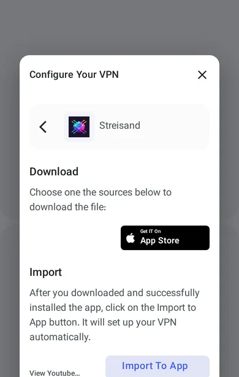
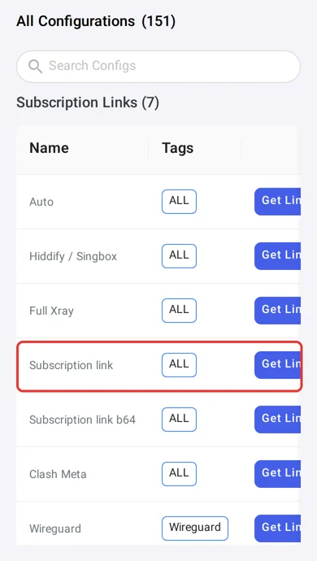
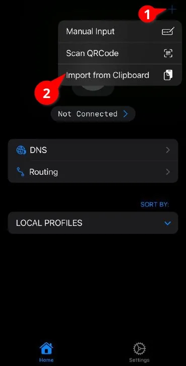
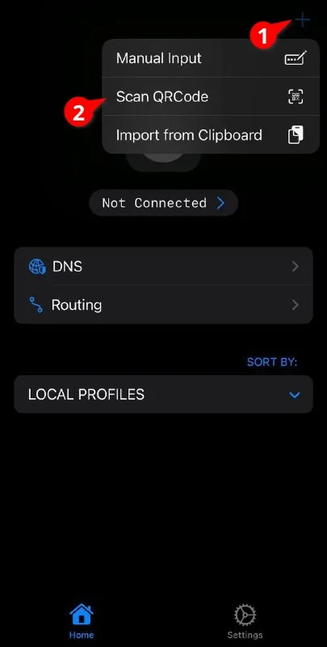
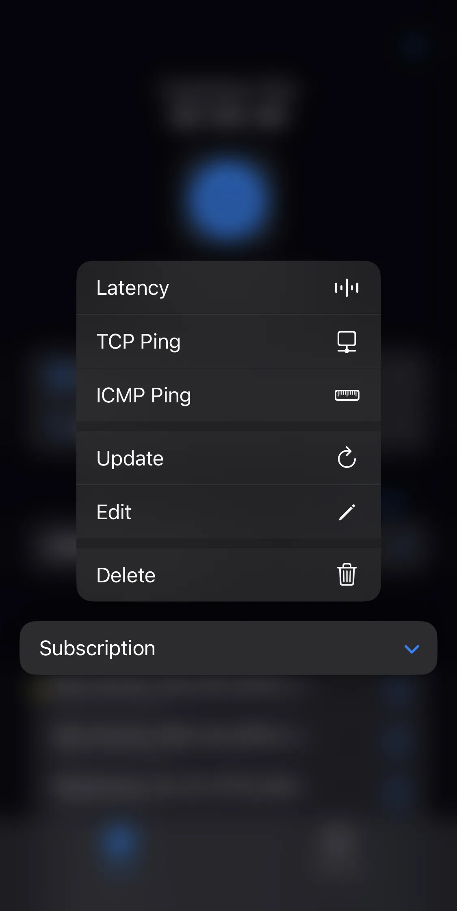
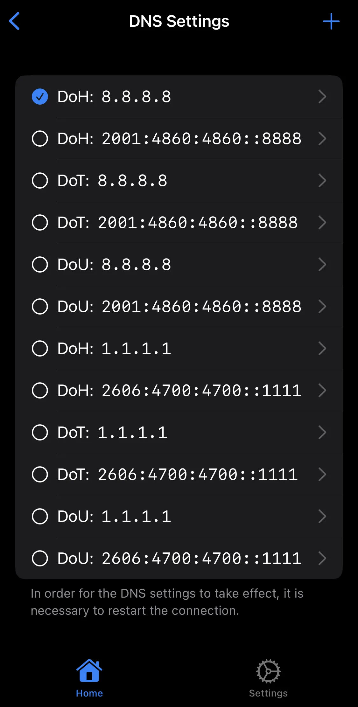
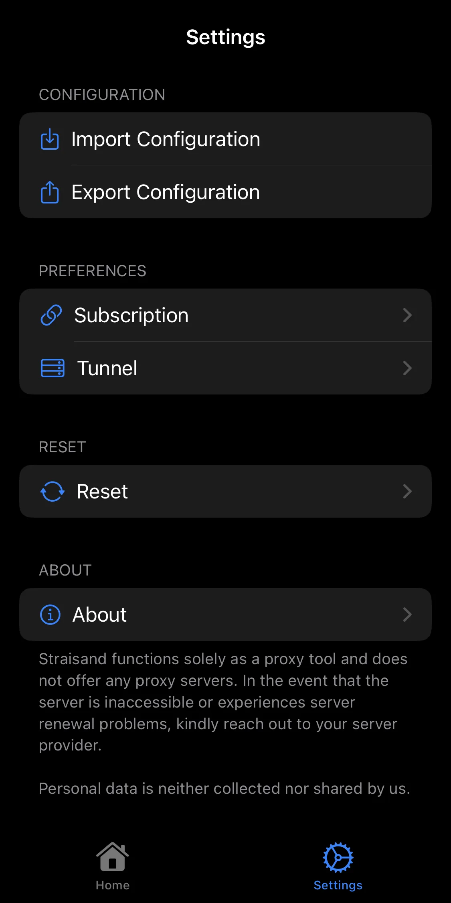
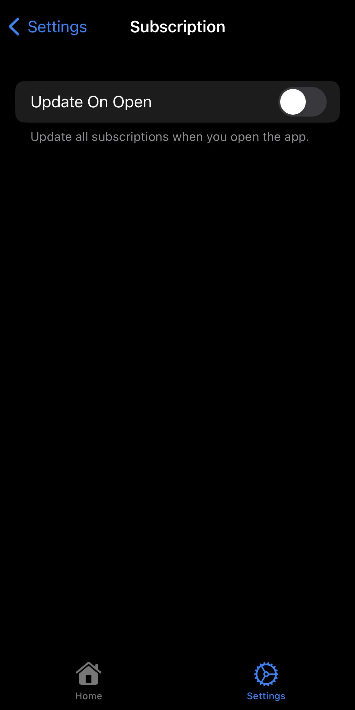
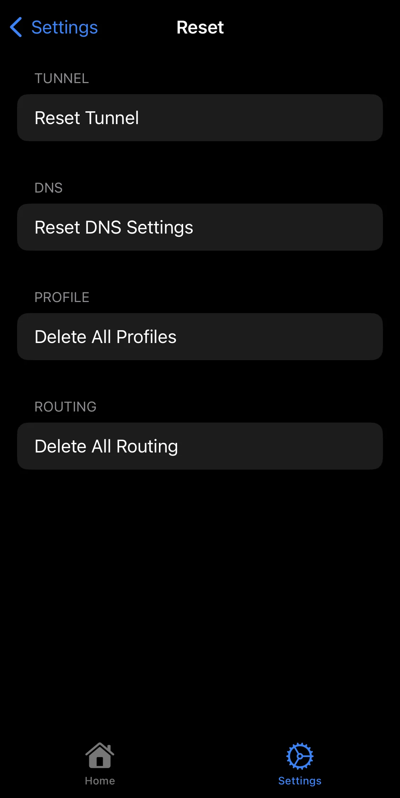
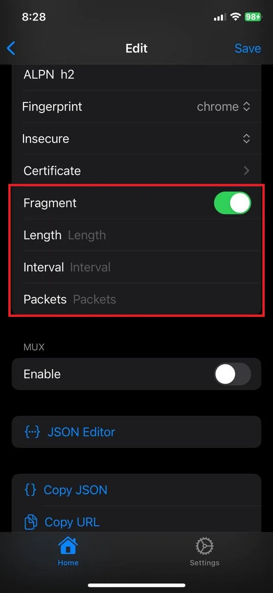

<div dir="ltr" markdown="1">

# Tutorial for Streisand

This page shows you how to add your HiddifyManager subscription to the free **Streisand** app on iPhone and iPad, test the connections, and use its most useful settings: DNS and TLS fragment. Streisand works on iOS 14 and later.

<div class="hi-get"><div class="meta"><b>Streisand</b><small><span>v1.7.1</span><span>iOS 15+</span><span>Free</span><span>Nov 2026</span></small></div><div class="stores"><a class="hi-store" href="https://apps.apple.com/us/app/streisand/id6450534064"><span><small>Download on the</small><b>App Store</b></span></a></div></div>
<a class="hi-alt" href="/app/How-to-install-Hiddify-app/"><span class="mk"></span><span><b>Our suggestion: the Hiddify app</b><small>Free, simpler, and supports every Hiddify Manager protocol</small></span><span class="go">Install →</span></a>

## Before you start

- Install **Streisand** from the [App Store](https://apps.apple.com/us/app/streisand/id6450534064). It is free.
- Have your **user page link** ready. This is the link your server admin sent you. It opens your personal HiddifyManager page.

A **subscription link** is one link that holds all your connection settings (configs). A **config** is the settings for one connection to the server. Streisand can refresh the subscription later to get new configs from the server.

!!! note
    The user page pictures are current (Hiddify Manager v14.5). The app screenshots come from older versions of the app; the current screens look a little different, but the steps are the same. The current screens look different, but the steps are the same.

## Add your subscription: the quick way

1. On your iPhone, open your user page link in Safari.
2. Tap the large round button in the middle of the page. A window called **Configure your VPN** opens.
3. Under **Choose one of the apps below**, tap **Streisand**. If you don't see it, tap **View More**. You can also download the app from here.

    

4. Tap **Import To App**. Streisand opens and adds your subscription.

If that doesn't work, add the link by hand as shown below.

## Add your subscription by hand

First get the link:

1. On your user page, open the menu and tap **All Configs**.
2. In the **Subscription Links** section, find **Subscription link** and tap **Get Link**. A window with a QR code and a **Copy Link** button opens.

<div align=center markdown=1>

</div>

Then add it to Streisand in one of two ways.

### Copy and paste the link

1. Tap **Copy Link**.

    

2. Open Streisand and tap the **+** button. Streisand reads the link from the clipboard, adds the subscription and loads your configs.

    

### Scan the QR code

Use this if the user page is open on another screen, such as a computer.

1. Show the QR code of the subscription link on the other screen.

    

2. In Streisand, tap **+**, then **Scan QRCode**, and point the camera at the QR code. The subscription is added and your configs load.

    

## Test, update and manage the subscription

Touch and hold the subscription in Streisand. A menu opens with these options:

<div align=center markdown=1>

</div>

- **Latency**: tests each config with a real connection. This is the most useful test. Lower is better.
- **TCP Ping**: only checks that the server's port answers. It is quick, but a config can pass it and still not work.
- **ICMP Ping**: a normal ping to the server. Many servers don't answer it, so a failed ICMP ping does not mean the config is broken.
- **Update**: gets the latest configs from the server. Do this when the admin changes something, or when configs stop working.
- **Edit**: change the name or the link of the subscription.
- **Delete**: remove the subscription and its configs.

To connect, tap a config that tested well, then turn on the switch on the main screen. The first time, iOS asks you to allow a VPN configuration; tap **Allow**.

## DNS settings

On the main screen, open the DNS settings. Here you choose which DNS server Streisand uses to look up website addresses, and how it talks to it:

<div align=center markdown=1>

</div>

- **DoH** (DNS over HTTPS): DNS requests are encrypted and look like normal web traffic. Usually the best choice.
- **DoT** (DNS over TLS): DNS requests are encrypted with TLS, on a separate port (853). Easier to block than DoH.
- **DoU** (DNS over UDP): plain, unencrypted DNS. Your internet provider can see and change it, so use it only if the others don't work.

## App settings

The **Settings** page has the general settings of the app:

<div align=center markdown=1>

</div>

- **Import Configuration**: load a Streisand settings file from your device.
- **Export Configuration**: save your Streisand settings to a file, for example to move them to another device.
- **Subscription**: turn on **Update On Open** so that your subscriptions update every time you open the app.

    

- **Reset**: set the app's settings back to the defaults.

    

## Turn on TLS fragment

**Fragment** splits the first packet of a TLS connection into small pieces, so the filter has a harder time reading the website name in it. It can help when TLS configs don't connect. To learn more, see [How the TLS trick works](/manager/basic-concepts-and-troubleshooting/How-the-TLS-Trick-works-and-its-usage/).

1. Tap the config to open its settings.
2. Turn on **Fragment**.
3. Enter these values as a starting point:

    ```
    packets: tlshello
    length: 100-200
    interval: 10-20
    ```

<div align=center markdown=1>

</div>

The best values depend on your internet provider. If it doesn't help, try other lengths and intervals, or set **packets** to `1-3` (the first three TCP segments) instead of `tlshello`. The `1-3` mode may be detected by the filter sooner.

## Related articles

<div class="hi-related" markdown="1">

- [sing-box](/manager/client-software-on-ios/Tutorial-for-SingBox-app/)
- [V2Box](/manager/client-software-on-ios/Tutorial-for-V2Box-app/)
- [FoXray](/manager/client-software-on-ios/Tutorial-for-FoXray-app/)
- [Shadowrocket](/manager/client-software-on-ios/Tutorial-for-ShadowRocket-app/)

</div>

</div>
