

# آموزش کار با نرم‌افزار V2Box

در این صفحه یاد می‌گیرید چطور لینک اشتراک هیدیفای‌منیجر خود را به برنامه رایگان **V2Box** در آیفون و آیپد اضافه کنید، کانفیگ‌ها را تست کنید، وصل شوید و کانفیگ‌ها را به‌روز نگه دارید. V2Box با کانفیگ‌های مبتنی بر Xray کار می‌کند.

<b>V2Box</b><small>v10.2.0iOS 15+رایگانآبان ۱۴۰۵</small>

<a class="hi-store" href="https://apps.apple.com/us/app/v2box-v2ray-client/id6446814690"><small>Download on the</small><b>App Store</b></a>

<a class="hi-alt" href="/fa/app/How-to-install-Hiddify-app/"><b>پیشنهاد ما: اپ هیدیفای</b><small>رایگان، ساده‌تر و با پشتیبانی از همهٔ پروتکل‌های هیدیفای‌منیجر</small>نصب اپ ←</a>

## پیش از شروع

- برنامه **V2Box** را از [App Store](https://apps.apple.com/us/app/v2box-v2ray-client/id6446814690) نصب کنید. رایگان است.
- **لینک صفحه کاربری** خود را آماده داشته باشید. این همان لینکی است که مدیر سرور برایتان فرستاده و صفحه شخصی هیدیفای‌منیجر شما را باز می‌کند.

**لینک اشتراک** (سابسکریپشن) یک لینک است که همه تنظیمات اتصال (کانفیگ‌ها) را در خود دارد. **کانفیگ** یعنی تنظیمات یک اتصال به سرور.

!!! note
    تصویرهای صفحهٔ کاربری تازه‌اند (هیدیفای‌منیجر ۱۴.۵). تصویرهای خود برنامه از نسخه‌های قدیمی‌ترند؛ صفحه‌های فعلی کمی فرق دارند، ولی مراحل همین است. صفحه‌های فعلی کمی فرق دارند، ولی مراحل همین است.

## گرفتن لینک اشتراک

در صفحهٔ کاربری، دکمهٔ گرد بزرگ را بزنید. در پایین پنجرهٔ باز شده، زیر **ورود دستی**، دکمهٔ **کپی لینک** لینک اشتراک را کپی می‌کند. این برنامه در فهرست برنامه‌های صفحهٔ کاربری نیست، برای همین از این دکمه استفاده کنید.

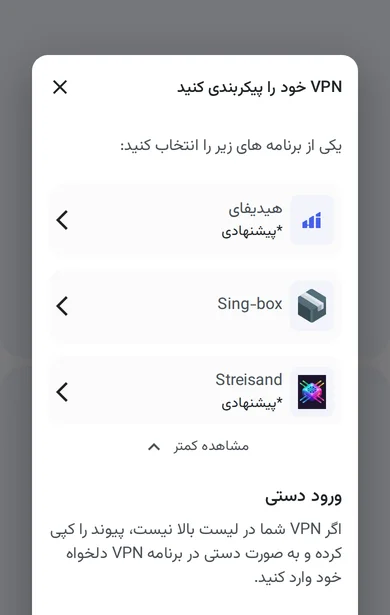

V2Box در فهرست برنامه‌های صفحه کاربری هیدیفای‌منیجر نیست، پس لینک را دستی اضافه می‌کنید.

1. لینک صفحه کاربری خود را باز کنید.
2. منو را باز کنید و «همه تنظیمات» (**All Configs**) را بزنید.
3. در بخش «لینک‌های اشتراک»، ردیف **Subscription link b64** را پیدا کنید و «دریافت لینک» را بزنید. پنجره کوچکی با QR code و دکمه «کپی لینک» باز می‌شود.

حالا می‌توانید لینک را کپی کنید یا QR code آن را اسکن کنید.

## روش ۱: کپی کردن لینک

1. «کپی لینک» را بزنید.

    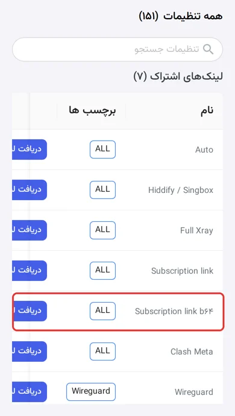

2. V2Box را باز کنید و در منوی پایین **Configs** را بزنید.
3. دکمه `+` را بزنید.

    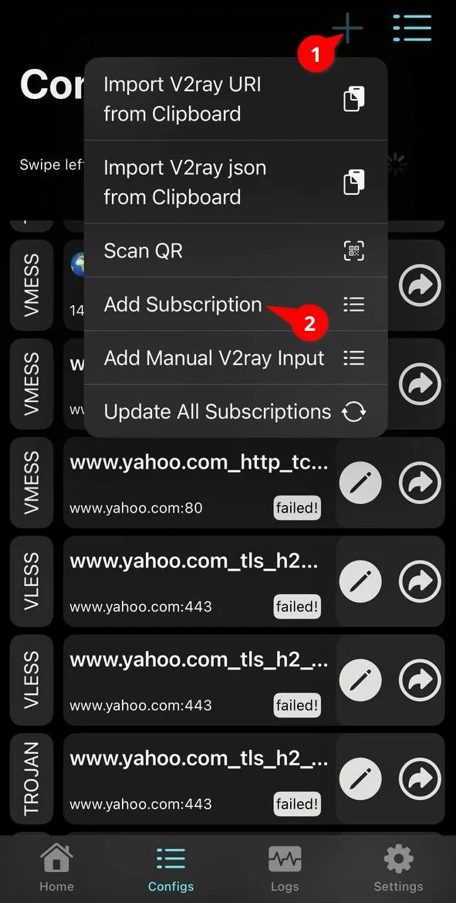

4. **Add Subscription** را بزنید.
5. یک نام دلخواه بنویسید، مثلاً نام سرورتان، و لینک را در فیلد **URL** بگذارید.

    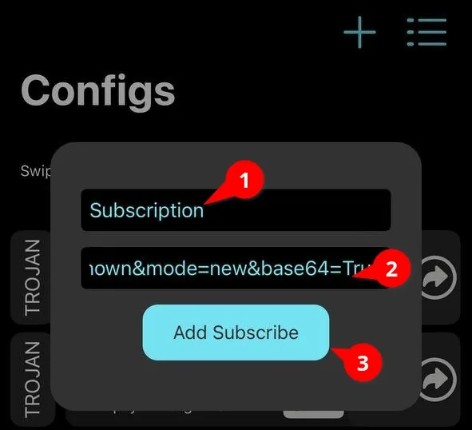

6. **Add Subscribe** را بزنید. کانفیگ‌ها در فهرست ظاهر می‌شوند و V2Box خودش آن‌ها را تست می‌کند.

    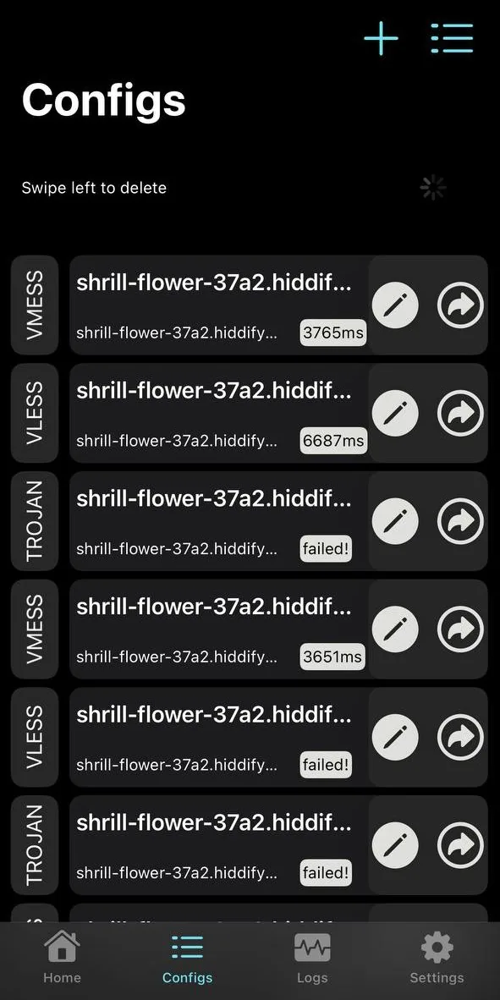

## روش ۲: اسکن QR code

این روش برای وقتی است که صفحه کاربری روی صفحه دیگری، مثلاً کامپیوتر، باز است.

1. در V2Box، بخش **Configs** را باز کنید و `+` را بزنید.
2. **Scan QR** را بزنید.
3. دوربین گوشی را روی QR code صفحه کاربری بگیرید. کانفیگ‌ها مثل روش ۱ اضافه و تست می‌شوند.

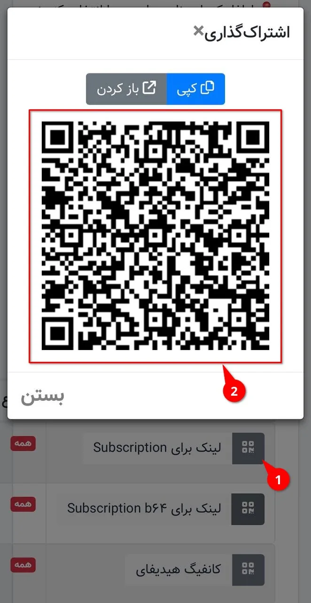

## تست کانفیگ‌ها

در فهرست **Configs**، گزینه **Ping All** را بزنید. نتیجه کنار هر کانفیگ نمایش داده می‌شود. هرچه عدد کمتر، بهتر؛ کانفیگی که خطا یا timeout نشان می‌دهد فعلاً کار نمی‌کند.

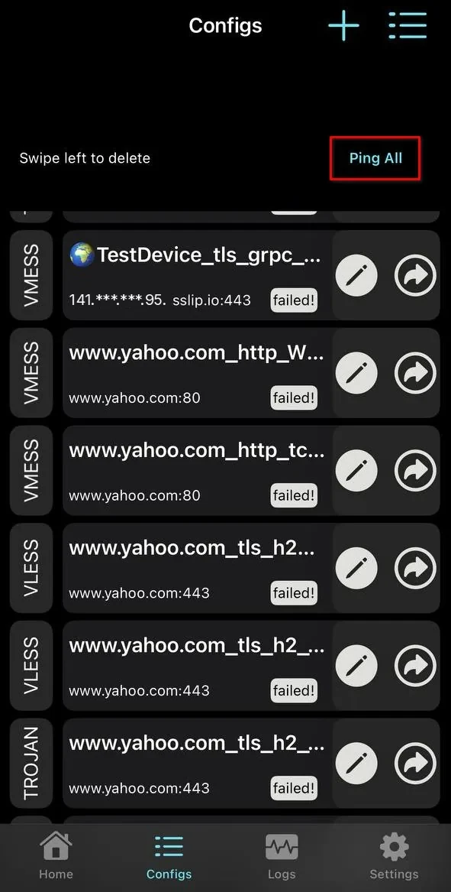

## اتصال

1. در **Configs**، روی کانفیگی که نتیجه تست خوبی داشته بزنید تا انتخاب شود.
2. به **Home** بروید و دکمه پایین صفحه را به سمت راست بکشید. بار اول، iOS برای افزودن پیکربندی VPN اجازه می‌خواهد؛ **Allow** را بزنید.

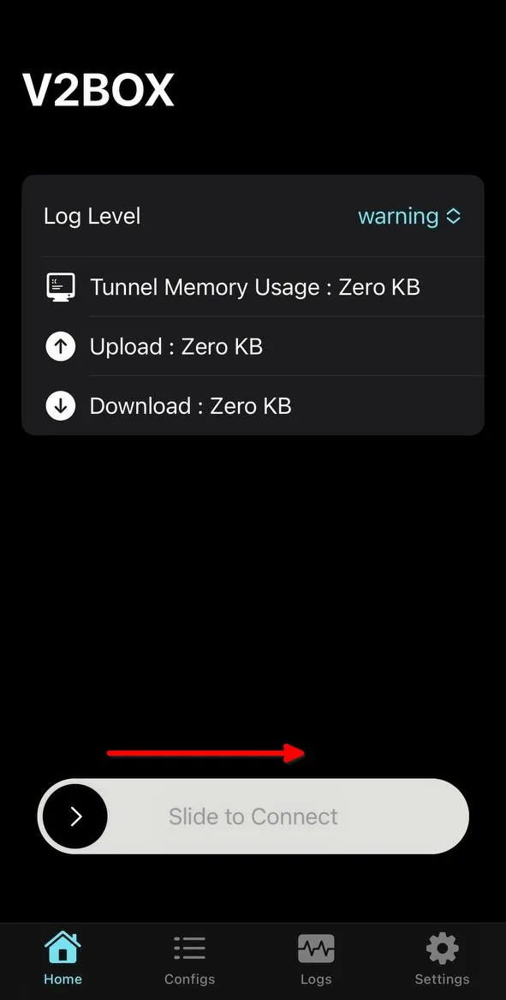

وقتی وصل هستید، صفحه Home میزان آپلود، دانلود و حافظه مصرفی را نشان می‌دهد.

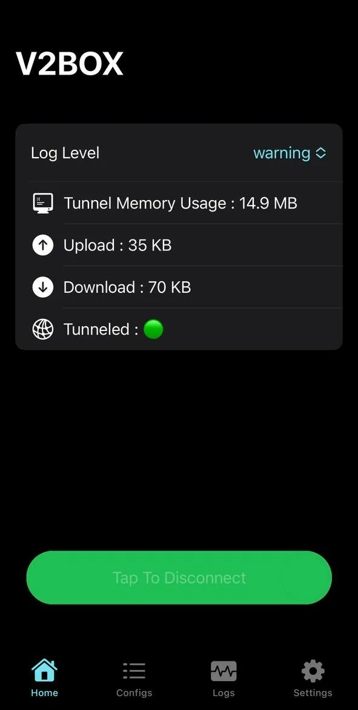

## به‌روزرسانی لینک اشتراک

وقتی مدیر چیزی را روی سرور تغییر می‌دهد، لینک اشتراک را به‌روز کنید تا کانفیگ‌های جدید را بگیرید:

1. در **Configs**، دکمه `+` را بزنید.
2. **Update All Subscriptions** را بزنید.

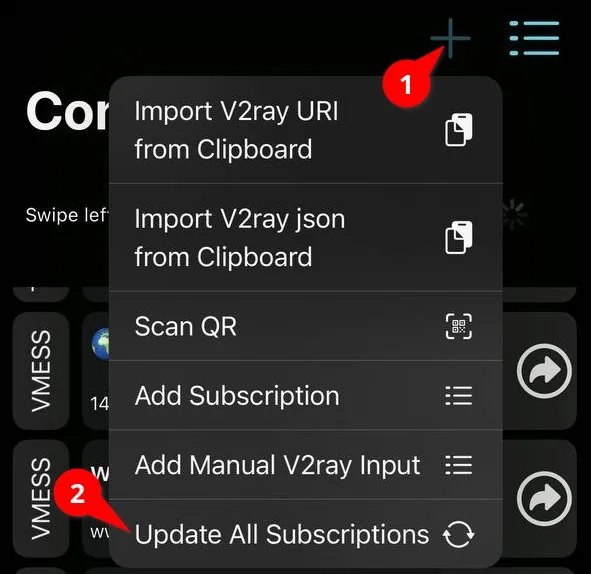

برای اینکه V2Box خودش به‌روز کند، منوی سه خط بالای صفحه **Configs** را بزنید و **Auto Update** را روشن کنید.

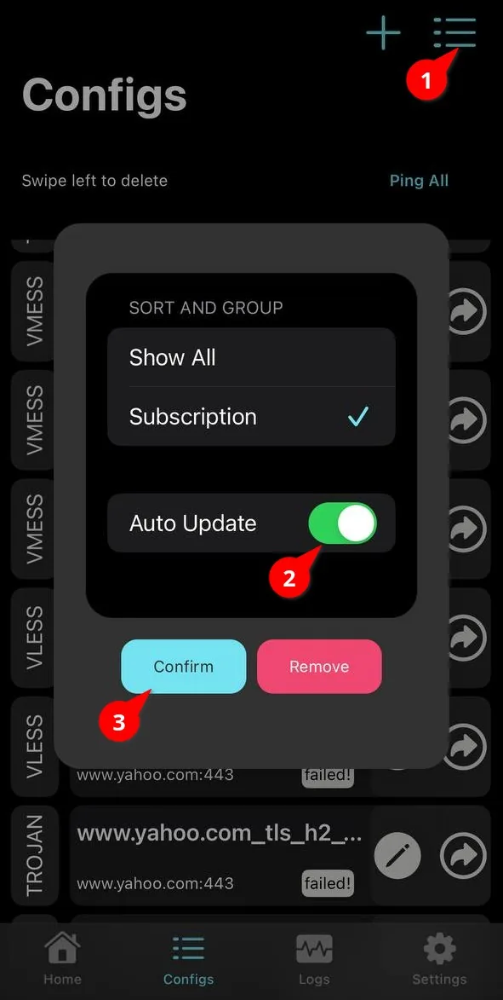

## افزودن یک کانفیگ تکی

می‌توانید به‌جای کل لینک اشتراک فقط یک کانفیگ اضافه کنید: لینک کانفیگ را کپی کنید، سپس در **Configs** دکمه `+` و بعد **Import V2ray URL from Clipboard** را بزنید. این روش پیشنهاد نمی‌شود، چون کانفیگ تکی با تغییرات سرور به‌روز نمی‌شود.

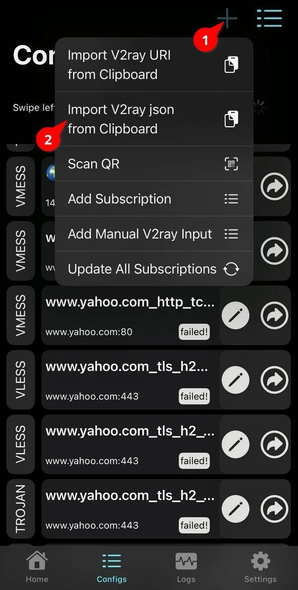

## اگر وصل نشد

- لینک اشتراک را به‌روز کنید و دوباره تست کنید. کانفیگ دیگری با نتیجه خوب انتخاب کنید.
- بعضی کانفیگ‌ها، مثلاً آن‌هایی که پروتکل‌های جدیدتر دارند، ممکن است در V2Box کار نکنند. [اپ هیدیفای](/fa/app/How-to-install-Hiddify-app/) را امتحان کنید.
- راهنمای [رفع مشکلات اتصال](/fa/manager/basic-concepts-and-troubleshooting/Troubleshooting-connectivity-issues-with-HiddifyManager-and-proxies/) را ببینید.

## مقاله‌های مرتبط

- [sing-box](/fa/manager/client-software-on-ios/Tutorial-for-SingBox-app/)
- [Streisand](/fa/manager/client-software-on-ios/Tutorial-for-Streisand/)
- [FoXray](/fa/manager/client-software-on-ios/Tutorial-for-FoXray-app/)
- [Shadowrocket](/fa/manager/client-software-on-ios/Tutorial-for-ShadowRocket-app/)

