

# Tutorial for V2Box app

This page shows you how to add your HiddifyManager subscription to the free **V2Box** app on iPhone and iPad, test the connections, connect, and keep your configs up to date. V2Box works with Xray-based configs.

<b>V2Box</b><small>v10.2.0iOS 15+FreeNov 2026</small>

<a class="hi-store" href="https://apps.apple.com/us/app/v2box-v2ray-client/id6446814690"><small>Download on the</small><b>App Store</b></a>

<a class="hi-alt" href="/app/How-to-install-Hiddify-app/"><b>Our suggestion: the Hiddify app</b><small>Free, simpler, and supports every Hiddify Manager protocol</small>Install →</a>

## Before you start

- Install **V2Box** from the [App Store](https://apps.apple.com/us/app/v2box-v2ray-client/id6446814690). It is free.
- Have your **user page link** ready. This is the link your server admin sent you. It opens your personal HiddifyManager page.

A **subscription link** is one link that holds all your connection settings (configs). A **config** is the settings for one connection to the server.

!!! note
    The user page pictures are current (Hiddify Manager v14.5). The app screenshots come from older versions of the app; the current screens look a little different, but the steps are the same. The current screens look different, but the steps are the same.

## Get your subscription link

On the user page, tap the big round button. At the bottom of the window, under **Import Manually**, **Copy Link** copies your subscription link. This app is not in the user page’s app list, so use this button.

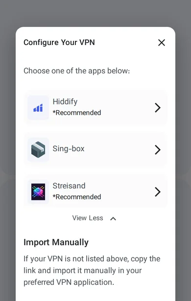

V2Box is not in the app list on the HiddifyManager user page, so you add the link by hand.

1. Open your user page link.
2. Open the menu and tap **All Configs**.
3. In the **Subscription Links** section, find **Subscription link b64** and tap **Get Link**. A small window opens with a QR code and a **Copy Link** button.

Now you can either copy the link or scan its QR code.

## Option 1: Copy the link

1. Tap **Copy Link**.

    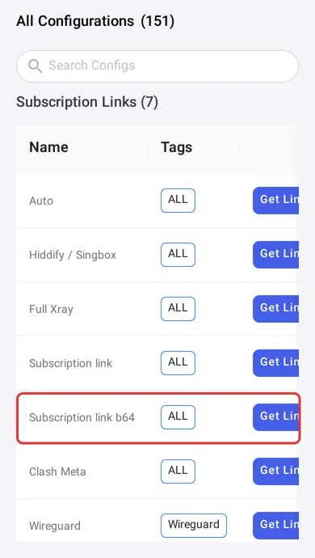

2. Open V2Box and tap **Configs** in the bottom menu.
3. Tap the **+** button.

    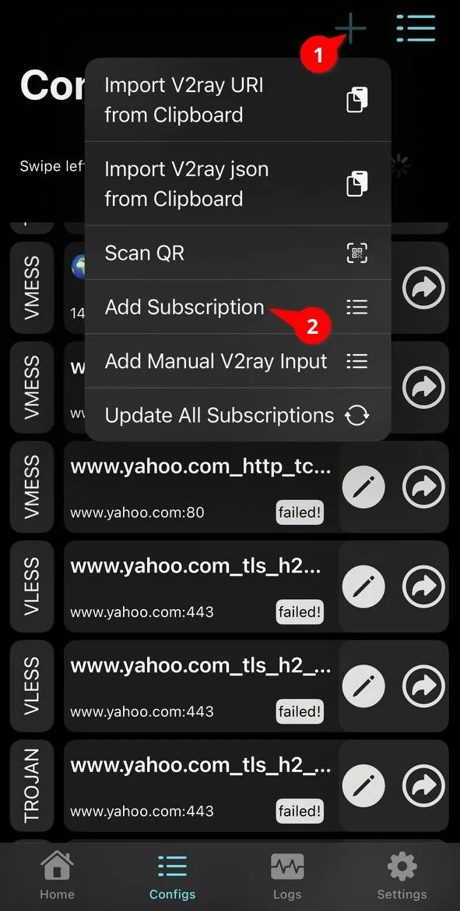

4. Tap **Add Subscription**.
5. Type any name, for example the name of your server, and paste the link into the **URL** field.

    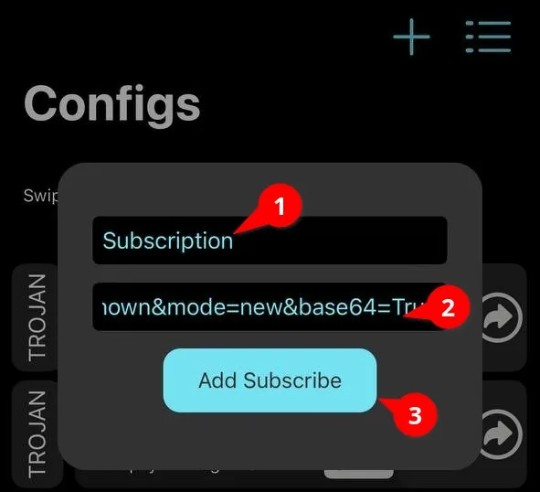

6. Tap **Add Subscribe**. Your configs appear in the list, and V2Box tests them by itself.

    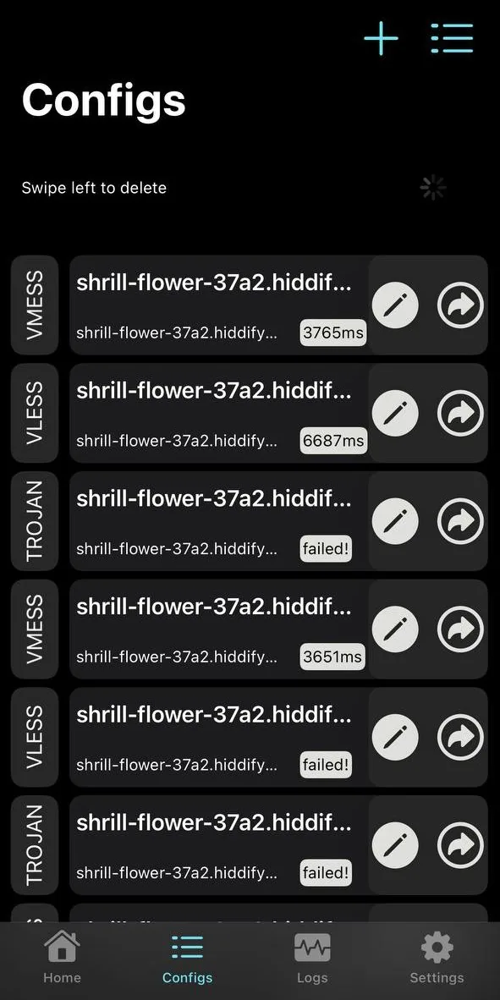

## Option 2: Scan the QR code

Use this if the user page is open on another screen, such as a computer.

1. In V2Box, open **Configs** and tap **+**.
2. Tap **Scan QR**.
3. Point your phone's camera at the QR code on the user page. The configs are added and tested, just as with option 1.

## Test the connections

In the **Configs** list, tap **Ping All**. The result appears next to each config. Lower numbers are better; a config with an error or a timeout does not work right now.

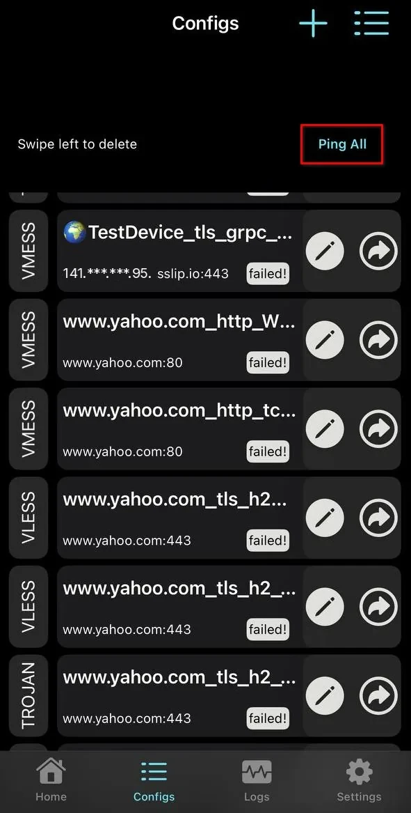

## Connect

1. In **Configs**, tap a config that tested well to select it.
2. Go to **Home** and slide the button at the bottom to the right. The first time, iOS asks you to allow a VPN configuration; tap **Allow**.

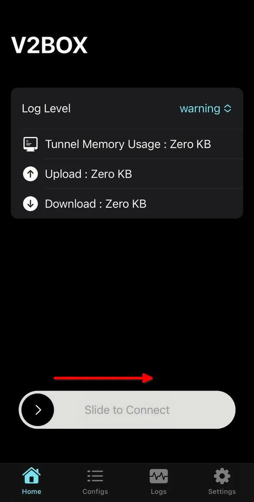

While you are connected, the Home screen shows your upload, download and memory use.

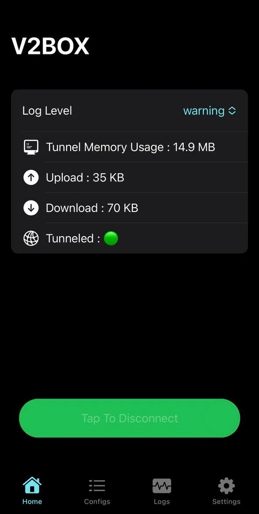

## Update your subscription

When the admin changes something on the server, update the subscription to get the new configs:

1. In **Configs**, tap **+**.
2. Tap **Update All Subscriptions**.

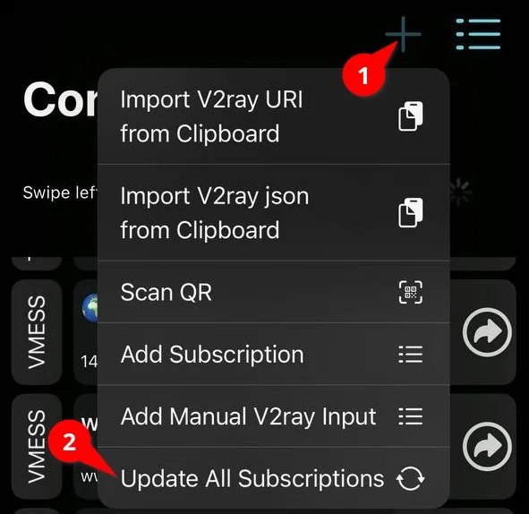

To let V2Box update by itself, tap the menu (three lines) at the top of the **Configs** screen and turn on **Auto Update**.

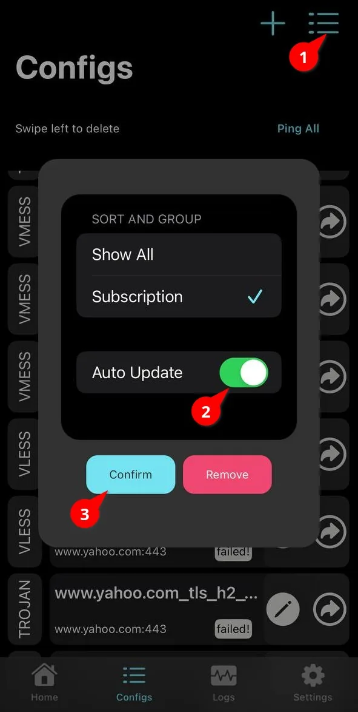

## Add a single config

You can also add one config instead of the whole subscription: copy the config link, then in **Configs** tap **+** and **Import V2ray URL from Clipboard**. This is not recommended, because a single config is not updated when the server changes.

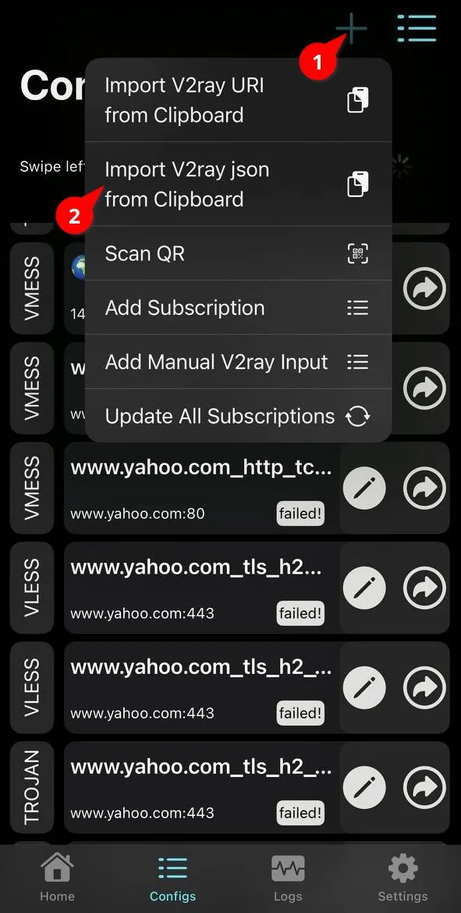

## If it doesn't connect

- Update the subscription and test again. Pick another config that shows a good result.
- Some configs, for example those using newer protocols, may not work in V2Box. Try the [Hiddify app](/app/How-to-install-Hiddify-app/).
- See [Troubleshooting connectivity issues](/manager/basic-concepts-and-troubleshooting/Troubleshooting-connectivity-issues-with-HiddifyManager-and-proxies/).

## Related articles

- [sing-box](/manager/client-software-on-ios/Tutorial-for-SingBox-app/)
- [Streisand](/manager/client-software-on-ios/Tutorial-for-Streisand/)
- [FoXray](/manager/client-software-on-ios/Tutorial-for-FoXray-app/)
- [Shadowrocket](/manager/client-software-on-ios/Tutorial-for-ShadowRocket-app/)

