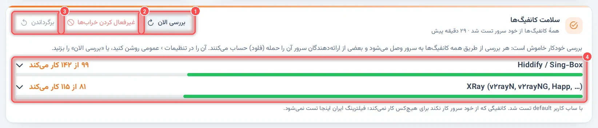
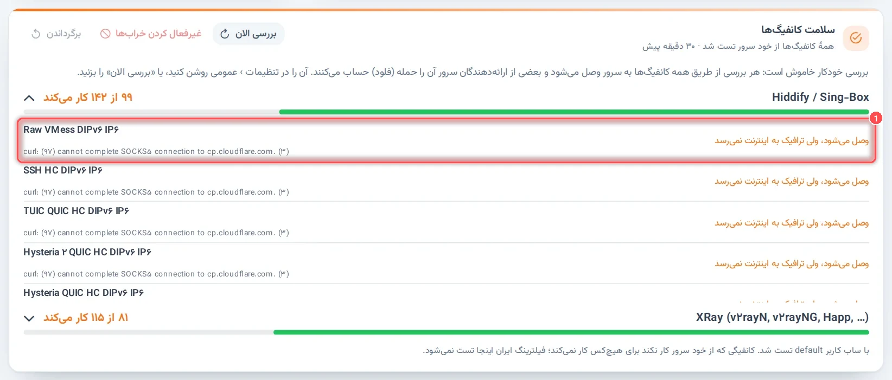
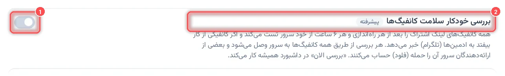

# بررسی خودکار سلامت کانفیگ‌ها در هیدیفای‌منیجر

!!! info "نوشته‌شده برای هیدیفای‌منیجر نسخهٔ ۱۴.۵"
    تصویرها و مراحل این صفحه از هیدیفای‌منیجر نسخهٔ ۱۴.۵ هستند.

لینک اشتراک هر کاربر کانفیگ‌های زیادی دارد: یکی برای هر پروتکل، ترنسپورت و دامنه. اگر یکی از آن‌ها خراب باشد (قالب اشتباه، هسته‌ای که آن را قبول نمی‌کند، inbound جاافتاده)، برای **هیچ‌کس** کار نمی‌کند و کاربران فقط می‌بینند که «وصل نمی‌شود».

**سلامت کانفیگ‌ها** این کانفیگ‌ها را برایتان پیدا می‌کند. پنل همهٔ کانفیگ‌های یک لینک اشتراک را **از خود سرور** تست می‌کند، همان‌طور که اپ‌ها آن را می‌گیرند، و نشان می‌دهد کدام‌ها کار می‌کنند.

!!! note "چه چیزی تست نمی‌شود"
    تست روی سرور شما انجام می‌شود، نه در ایران. کانفیگی که اینجا کار می‌کند ممکن است هنوز با فیلترینگ کشور کاربران مسدود شود. اما کانفیگی که اینجا کار نکند برای هیچ‌کس کار نمی‌کند، پس اول باید همین‌ها را درست کرد.

## کارت سلامت کانفیگ‌ها

این کارت در **داشبورد** است.

1. **بررسی الان**: همین حالا یک بررسی انجام می‌دهد. یکی دو دقیقه طول می‌کشد و در این مدت دکمه *در حال بررسی…* را نشان می‌دهد. این دکمه همیشه کار می‌کند، حتی وقتی بررسی خودکار خاموش است.
2. **غیرفعال کردن خراب‌ها**: کانفیگ‌هایی را که در **هر دو** نوع اپ کار نمی‌کنند، برای همهٔ کاربران خاموش می‌کند. تا وقتی بررسی چنین کانفیگی پیدا نکند این دکمه کم‌رنگ و غیرفعال است (کانفیگ‌هایی که دست‌کم در یک نوع اپ کار می‌کنند روشن می‌مانند). پیش از هر تغییری فهرست را می‌بینید و تأیید می‌کنید.
3. **برگرداندن**: کانفیگ‌هایی را که **غیرفعال کردن خراب‌ها** (یا ابزار تست کانفیگ) خاموش کرده دوباره روشن می‌کند.
4. نتیجه برای هر نوع اپ:
    - **Hiddify / Sing-Box**: لینک اشتراک همان‌طور که اپ هیدیفای آن را می‌گیرد.
    - **XRay (v2rayN، v2rayNG، Happ و…)**: لینک اشتراک همان‌طور که اپ‌های ایکس‌ری آن را می‌گیرند.

    مثلاً *۹۹ از ۱۴۲ کار می‌کند* یعنی ۴۳ کانفیگ کار نکرده‌اند.

تست با لینک اشتراک یکی از کاربران فعال انجام می‌شود (کارت نام او را می‌گوید) و بررسی می‌کند که ترافیک واقعاً از طریق هر کانفیگ به اینترنت برسد.

## دیدن کانفیگ‌هایی که کار نمی‌کنند

روی ردیفی که کانفیگ خراب دارد بزنید تا فهرستش باز شود.

برای هر کانفیگ نامش، دلیل به زبان ساده و پیام فنی را می‌بینید. دلیل‌ها:

| دلیل | معمولاً یعنی |
|---|---|
| وصل می‌شود، ولی ترافیک به اینترنت نمی‌رسد | کانفیگ به سرور می‌رسد ولی سرور نمی‌تواند ترافیک را به بیرون بفرستد: خروجی‌ای را که استفاده می‌کند بررسی کنید (مثلاً وارپ یا خروجی فقط IPv6) |
| به‌موقع جوابی نیامد | سرور، یا آن پورت یا پروتکل، جواب نداد |
| اتصال رد شد | چیزی روی آن پورت گوش نمی‌دهد: پروتکل یا inbound خاموش یا خراب است |
| سرور اتصال را بست | سرور اتصال را پذیرفت و بعد قطعش کرد: اغلب یک تنظیم اشتباه در آن پروتکل |
| دست‌دهی TLS ناموفق بود | مشکل گواهی یا TLS (SNI، ریالتی) روی آن دامنه |

در تصویر، کانفیگ‌های خرابی که دیده می‌شوند کانفیگ‌های IPv6 هستند (نامشان با **IP6** تمام می‌شود): روی این سرور آزمایشی، کانفیگ‌هایی که از IPv6 استفاده می‌کنند به اینترنت نمی‌رسند. در چنین حالتی IPv6 سرور را بررسی کنید یا کانفیگ‌های IPv6 را خاموش کنید.

اگر کل بررسی انجام نشود، کارت به جای نتیجه دلیلش را می‌گوید؛ مثلاً پنل نتوانسته لینک اشتراک خودش را باز کند چون **گواهی** دامنه معتبر نیست، **دامنه پیدا نشده** یا **به‌موقع جواب نداده**. هر پیام می‌گوید چه چیزی را بررسی کنید و **جزئیات فنی** خطای دقیق را نشان می‌دهد.

## روشن کردن بررسی خودکار

به طور پیش‌فرض فقط **بررسی الان** کار می‌کند. برای بررسی خودکار:

1. به **تنظیمات ← تنظیمات عمومی** بروید. این یک تنظیم پیشرفته است: اگر آن را نمی‌بینید، **نمایش تنظیمات پیشرفته** را بزنید.
2. **بررسی خودکار سلامت کانفیگ‌ها** (۱) را روشن کنید.

3. ذخیره کنید.

از این به بعد پنل بعد از هر بار راه‌اندازی و هر **۶ ساعت** یک بار بررسی می‌کند. کانفیگی که کار نکند کمی بعد دوباره تست می‌شود، تا یک قطعی لحظه‌ای گزارش نشود. وقتی کانفیگ‌ها در **دو بررسی پشت سر هم** کار نکنند، سوپرادمین‌ها از بات تلگرام پیام می‌گیرند (اگر بات تنظیم شده باشد) و داشبورد هم پیامی مثل *۱۲ از ۱۴۲ کانفیگ از روی سرور کار نمی‌کنند* نشان می‌دهد.

!!! warning "چرا به طور پیش‌فرض خاموش است"
    هر بررسی برای هر کانفیگ یک کلاینت اجرا می‌کند و از طریق آن به خود سرور وصل می‌شود: در یک لینک اشتراک بزرگ، یعنی صدها اتصال در چند دقیقه. **بعضی از ارائه‌دهندگان سرور این را حمله (فلود) حساب می‌کنند و ممکن است سرور را مسدود کنند.** بررسی خودکار را فقط وقتی روشن کنید که ارائه‌دهندهٔ سرورتان با این کار مشکلی ندارد؛ در غیر این صورت هر وقت لازم شد از **بررسی الان** استفاده کنید.

## چند نکته

- بعد از تغییر پروتکل‌ها، دامنه‌ها یا قالب‌های پروکسی، **بررسی الان** را بزنید تا مطمئن شوید همهٔ کانفیگ‌ها هنوز کار می‌کنند.
- برای تست هر لینک اشتراک دیگری (حتی از پنل دیگر) از روی سرور، از **ابزارها ← تست کانفیگ** استفاده کنید.

## مقاله‌های مرتبط

- [آشنایی کامل با پنل و تنظیمات آن](/fa/manager/configuration-and-advanced-settings/How-to-configure-Hiddify-panel-properly/)
- [همهٔ تنظیمات پنل، یکی‌یکی](/fa/manager/configuration-and-advanced-settings/Settings-reference/)
- [منوی هیدیفای‌منیجر در SSH](/fa/manager/configuration-and-advanced-settings/How-to-connect-and-troubleshoot-via-SSH/)
- [انتقال کاربران از پنل X-UI](/fa/manager/configuration-and-advanced-settings/how-to-import-xui-to-hiddifymanager/)

