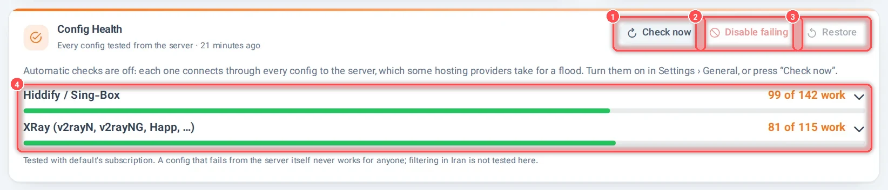
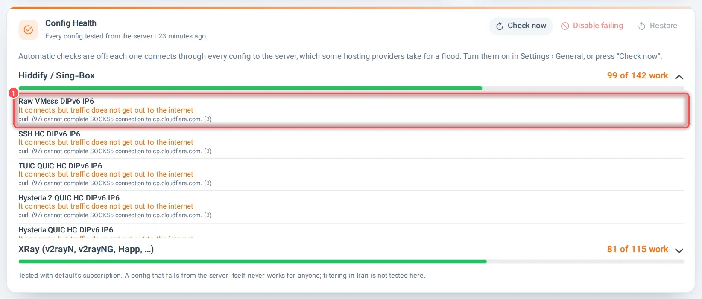
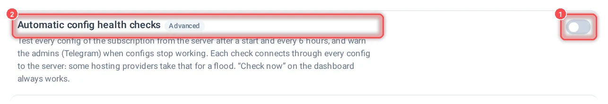

# Automatic config health checks on Hiddify Manager

!!! info "Written for Hiddify Manager v14.5"
    The pictures and steps on this page are from Hiddify Manager v14.5.

A user's subscription link has many configs: one for each protocol, transport and domain. If one of them is broken (a wrong template, a core that rejects it, a missing inbound), it does not work for **anyone**, and users only see "it does not connect".

**Config Health** finds these configs for you. The panel tests every config of a subscription **from the server itself**, the same way the apps get it, and shows which ones work.

!!! note "What it does not test"
    The test runs on your server, not in Iran. A config that works here can still be blocked by filtering in your users' country. But a config that fails here never works for anyone, so these are the ones to fix first.

## The Config Health card

The card is on the **Dashboard**.

1. **Check now**: runs a check right away. It takes a minute or two; meanwhile the button says *Checking…*. This button always works, even when the automatic checks are off.
2. **Disable failing**: turns off, for every user, the configs that fail in **both** kinds of apps. It is greyed out until a check finds such configs (configs that work in at least one kind of app stay on). You see the list and confirm before anything changes.
3. **Restore**: turns back on the configs that **Disable failing** (or the config tester) turned off.
4. The result for each kind of app:
    - **Hiddify / Sing-Box**: the subscription as the Hiddify app gets it.
    - **XRay (v2rayN, v2rayNG, Happ, …)**: the subscription as the Xray apps get it.

    For example, *99 of 142 work* means 43 configs failed.

The test uses the subscription of one active user (the card says whose) and checks that traffic really gets out to the internet through each config.

## See which configs fail

Click a line with failures to open its list.

For each config you see its name, the reason in plain words, and the technical message. The reasons:

| Reason | What it usually means |
|---|---|
| It connects, but traffic does not get out to the internet | The config reaches the server, but the server cannot send the traffic on: check the outbound it uses (for example WARP or an IPv6-only exit) |
| No answer in time | The server, or that port or protocol, did not answer |
| The connection was refused | Nothing listens on that port: the protocol or inbound is off or broken |
| The server closed the connection | The server accepted and then dropped it: often a wrong setting of that protocol |
| The TLS handshake failed | A certificate or TLS (SNI, Reality) problem on that domain |

In the picture, the failing configs shown are IPv6 configs (their names end with **IP6**): on this test server, configs that use IPv6 do not get out to the internet. In such a case, check the server's IPv6, or turn off the IPv6 configs.

If the whole check could not run, the card says why instead, for example: the panel could not open its own subscription because the **certificate** of the domain is not valid, the **domain could not be found**, or it **did not answer in time**. Each message says what to check; **Technical details** shows the exact error.

## Turn on the automatic checks

By default only **Check now** works. To check automatically:

1. Open **Settings → General Settings**. This is an advanced setting: click **Show advanced settings** if you do not see it.
2. Turn on **Automatic config health checks** (1).

3. Save.

Then the panel checks after every start of the panel and every **6 hours**. A config that fails is tested again after a short time, so a moment's hiccup is not reported. When configs fail in **two checks in a row**, the super admins get a message from the Telegram bot (if the bot is set up), and the Dashboard shows a notice such as *12 of 142 configs do not work from the server*.

!!! warning "Why it is off by default"
    Each check starts a client for every config and connects through it to your own server: on a big subscription that is hundreds of connections in a few minutes. **Some hosting providers take this for an attack (a flood) and can suspend the server.** Turn the automatic checks on only if your provider is fine with that; otherwise use **Check now** when you need it.

## Good to know

- After you change protocols, domains or the proxy templates, press **Check now** to see that every config still works.
- To test any subscription link (also one from another panel) from the server, use **Tools → Config Tester**.

## Related articles

- [Every part and setting of the panel](/manager/configuration-and-advanced-settings/How-to-configure-Hiddify-panel-properly/)
- [All panel settings, one by one](/manager/configuration-and-advanced-settings/Settings-reference/)
- [The Hiddify Manager menu over SSH](/manager/configuration-and-advanced-settings/How-to-connect-and-troubleshoot-via-SSH/)
- [Import users from X-UI](/manager/configuration-and-advanced-settings/how-to-import-xui-to-hiddifymanager/)

