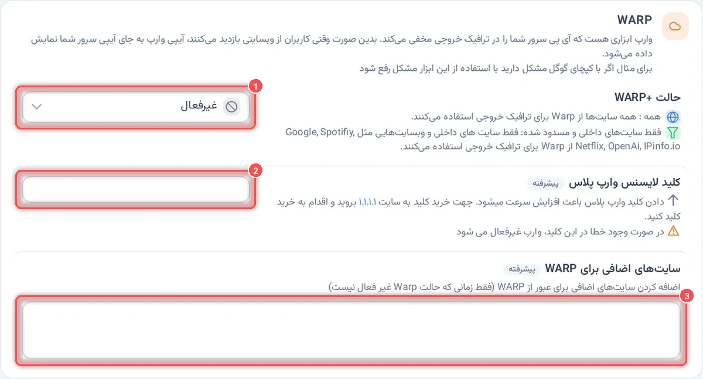
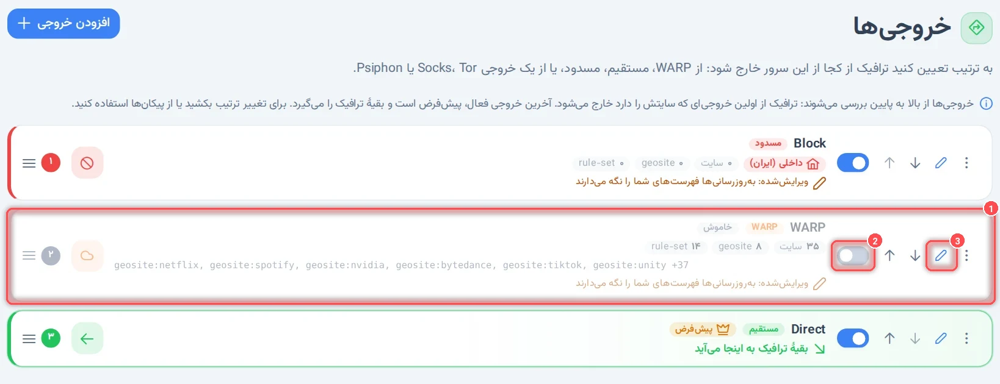
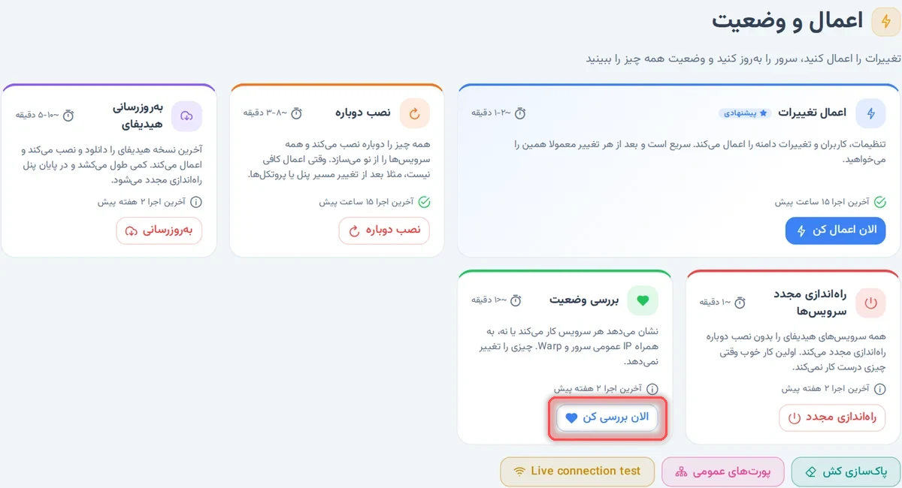
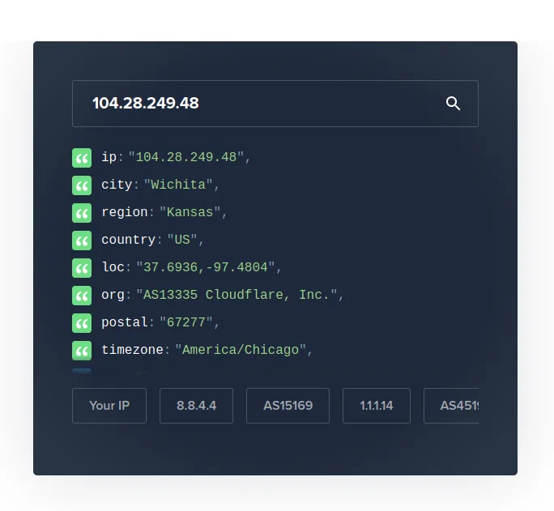
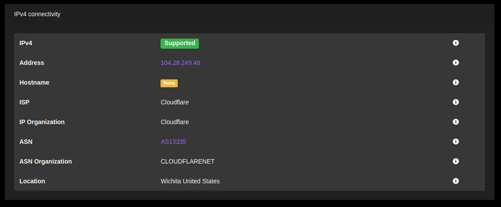

<div dir="rtl" markdown=1>
# آموزش فعال‌سازی وارپ در پنل هیدیفای‌منیجر

خیلی از وبسایت‌ها از جمله گوگل دسترسی کاربران از طریق VPN را محدود می‌کنند. به این دلیل که به طور همزمان چندین کانکشن مختلف از یک آی‌پی به سمت سرور گوگل می‌رود، این رفتار شبیه رفتاهای مخرب سایبری است و به همین دلیل ارتباط دچار مشکل می‌شود و گوگل به عنوان مثال خطای ۴۰۳ می‌دهد. سایر وبسایت‌ها هم اجازه برقراری ارتباط و استفاده از سرویس را نمی‌دهند. در اینجا یکی از روش‌های حل مشکل استفاده از سرویس WARP کلادفلر است.

## وارپ چیست؟
وارپ یک سرویس از کلادفلر است که ارتباط امن و رمزگذاری شده از طریق شبکه خود را فراهم می‌کند. پس از اینکه چک‌های امنیتی را روی کلاینت مورد نظر انجام داد و مطمئن شد که رفتار مخربی وجود ندارد، ارتباط را به سمت اینترنت برقرار می‌کند. به آن سیستم یک آی‌پی اختصاص می‌دهد و ارتباط از آن طریق صورت می‌گیرد. در واقع وارپ ابزاری هست که آی‌پی سرور شما را از سایت‌هایی که کاربرانتان بازدید می‌کنند مخفی می‌کند. چون آی‌پی سرور مخفی می‌شود، بنابراین دسترسی برقرار می‌شود.

سرویس رایگان وارپ محدودیت حجم ندارد. **وارپ پلاس** (با کلید پولی از برنامهٔ 1.1.1.1) اختیاری است و ترافیک را از شبکهٔ سریع‌تر کلادفلر عبور می‌دهد. هیدیفای‌منیجر از هر دو پشتیبانی می‌کند.

این آموزش برای هیدیفای‌منیجر نسخهٔ ۱۴.۵ است. از نسخهٔ ۱۴.۵ وارپ یکی از **خروجی‌های** پنل است: می‌توانید آن را از **تنظیمات** روشن کنید (روش ساده، در ادامه) یا در صفحهٔ **خروجی‌ها** دقیقاً تعیین کنید چه سایت‌هایی از آن عبور کنند.

## تنظیم وارپ در هیدیفای‌منیجر
در منوی کناری پنل روی **تنظیمات** کلیک کنید و کارت **WARP** را پیدا کنید. (می‌توانید در کادر جستجوی بالای صفحه «WARP» را هم بنویسید.)
</div>

<div align=center markdown=1>



</div>

<div dir="rtl" markdown=1>
۱. در **حالت +WARP** گزینه‌ای غیر از `غیرفعال` را انتخاب کنید.

۲. بار اول، پنل پنجرهٔ **شرایط Cloudflare WARP** را نشان می‌دهد: ترافیکی که از وارپ خارج می‌شود طبق شرایط استفاده و سیاست حریم خصوصی کلادفلر پردازش می‌شود. آن‌ها را بخوانید، تیک را بزنید و روی **می‌پذیرم** کلیک کنید. تا نپذیرید، وارپ اجرا نمی‌شود.

۳. تنظیمات را ذخیره کنید و بعد در صفحهٔ **اقدامات** (یا در بنری که نمایش داده می‌شود) روی **الان اعمال کن** بزنید تا وارپ شروع به کار کند.

برای استفاده از وارپ پلاس، کلید آن را در فیلد **کلید لایسنس وارپ پلاس** وارد کنید (این تنظیم پیشرفته است: کلید **نمایش تنظیمات پیشرفته** را بالای صفحه روشن کنید). کلید اصلی را می‌توانید از کلادفلر در برنامهٔ 1.1.1.1 بخرید. البته برای دریافت این کد ربات‌های مختلفی در تلگرام وجود دارند که این کد را به شما می‌دهند ولی هیچ کدام مورد تایید ما نیستند.

در فیلد **سایت‌های اضافی برای WARP** (آن هم پیشرفته) می‌توانید سایت‌های دیگری را که باید از وارپ عبور کنند اضافه کنید. از نسخهٔ ۱۴.۵ همین فهرست در صفحهٔ **خروجی‌ها** هم هست (پایین‌تر) که ویرایشش آنجا راحت‌تر است.

### حالت همه
همه ترافیک‌ها را از وارپ عبور می‌دهد حتی سایت‌هایی که مشکل ندارند نیز از وارپ عبور می‌کنند. در صفحهٔ **خروجی‌ها** با این حالت، وارپ خروجی **پیش‌فرض** (آخرین خروجی) می‌شود.

### حالت فقط سایت‌های داخلی و مسدود شده
فقط سایت‌های ایرانی و `Google, Spotify, Netflix, OpenAI, ipinfo.io` (و بقیهٔ سایت‌های فهرست وارپ) از وارپ استفاده می‌کنند. بقیهٔ ترافیک مستقیم خارج می‌شود.

* نکته: اگر در کلید وارپ پلاس خطایی وجود داشته باشد، وارپ غیرفعال می‌شود. بنابراین دقت کنید که کلید را به درستی استفاده کنید. کلید را به درستی انتخاب و کپی نمایید و در فیلد مورد نظر قرار دهید.

### صفحهٔ خروجی‌ها { #outbounds }
در منوی کناری روی **خروجی‌ها** کلیک کنید. هر ردیف یک راه خروج ترافیک از سرور است: **مسدود**، **WARP**، **مستقیم** (و هر خروجی Socks، Tor یا Psiphon که اضافه کنید). خروجی‌ها از بالا به پایین بررسی می‌شوند: هر سایت از اولین خروجی‌ای خارج می‌شود که آن سایت در فهرستش باشد، و آخرین خروجی فعال (**پیش‌فرض**) بقیهٔ ترافیک را می‌گیرد.
</div>

<div align=center markdown=1>


</div>

<div dir="rtl" markdown=1>
۱. ردیف **WARP**.

۲. کلید آن وارپ را روشن یا خاموش می‌کند (همان تنظیم **حالت +WARP**).

۳. مداد، بخش **چه چیزی از آن عبور کند** را باز می‌کند: سایت‌ها، فهرست‌های `geosite:` و rule-setهایی را که باید از وارپ خارج شوند اضافه یا حذف کنید.

برای عبور **همهٔ** ترافیک از وارپ، ردیف WARP را به پایین فهرست بکشید تا پیش‌فرض شود.

## چطور چک کنید که وارپ فعال است یا خیر
برای این کار در منوی کناری روی `اقدامات` کلیک کنید. در صفحه **اعمال و وضعیت**، در کارت **بررسی وضعیت** روی **الان بررسی کن** بزنید.

<div align=center markdown=1>




</div> 


بررسی وضعیت نشان می‌دهد هر سرویس کار می‌کند یا نه، به همراه IP عمومی سرور و وضعیت سرویس وارپ و آی‌پی اختصاص یافته جهت استفاده ترافیک وارپ. خروجی آن در فایل `status.log` در فهرست **لاگ‌ها** پایین همین صفحه هم ذخیره می‌شود.

> * بررسی وضعیت، حساب وارپ و آی‌پی، کشور و شبکه‌ای (`Cloudflare`) را که ترافیک وارپ از آن خارج می‌شود نشان می‌دهد. همین خروجی در فایل `warp.log` در فهرست **لاگ‌ها** هست.

> * وقتی خروجی WARP خاموش است، هیچ ترافیکی از وارپ عبور نمی‌کند، حتی اگر خود سرویس وارپ در حال اجرا باشد.

> * روی سرور، منوی هیدیفای‌منیجر هم همین بررسی را دارد: دستور `hiddify` را اجرا کنید و **advanced** و بعد **warp** (*Check Warp Status*) را انتخاب کنید.


همچنین می‌توانید از سایت [ipinfo](https://ipinfo.io/) استفاده کنید. اگر با وجود روشن بودن فیلترشکن، آی‌پی نمایش داده شده در این صفحه مربوط به کلادفلر باشد؛ در این صورت وارپ به درستی فعال شده است.

<div align=center markdown=1>



</div> 


همچنین می‌توانید از سایت [ip.gs](https://ip.gs/) استفاده نمایید و به همین ترتیب اگر آی‌پی کلادفلر نمایش داده شد، یعنی وارپ فعال شده است.

<div align=center markdown=1>



</div> 

## چطور سرویس وارپ را دوباره نصب کنید؟

**از داخل پنل:** در منوی کناری **اقدامات** را باز کنید و **نصب دوباره** را بزنید. این کار همهٔ سرویس‌های هیدیفای‌منیجر، از جمله وارپ، را دوباره نصب می‌کند. کاربران و تنظیمات پاک نمی‌شوند، ولی اتصال همهٔ کاربران چند دقیقه قطع می‌شود.

**از ترمینال (فقط وارپ):** اگر فقط می‌خواهید وارپ دوباره نصب شود، [با SSH به سرور وصل شوید](/fa/manager/installation-and-setup/How-to-connect-to-server-via-SSH/)، با `Ctrl+C` (یا **Cancel**) از منوی هیدیفای‌منیجر خارج شوید و این دستور را اجرا کنید:

<div dir=ltr markdown=1>
```
cd /opt/hiddify-manager/services/warp && bash install.sh
```
</div>

## چطور آی‌پی وارپ را تغییر دهید؟

پنل دکمه‌ای برای این کار ندارد و از ترمینال انجام می‌شود.

۱. [با SSH به سرور وصل شوید](/fa/manager/installation-and-setup/How-to-connect-to-server-via-SSH/) و با `Ctrl+C` (یا **Cancel**) از منوی هیدیفای‌منیجر خارج شوید.

۲. این دستور را اجرا کنید:

<div dir=ltr markdown=1>
```
cd /opt/hiddify-manager/services/warp && bash change_ip.sh
```
</div>

این دستور یک حساب وارپ تازه می‌سازد و در نتیجه وارپ آی‌پی تازه‌ای به سرور می‌دهد. آی‌پی جدید را با دکمهٔ **الان بررسی کن** در صفحهٔ **اقدامات**، به روشی که بالاتر گفته شد، ببینید.

## مقاله‌های مرتبط

- [پروکسی تلگرام](/fa/manager/configuration-and-advanced-settings/How-to-set-up-Telegram-proxy-on-Hiddify/)
- [بات تلگرام پنل](/fa/manager/configuration-and-advanced-settings/How-to-set-up-and-use-Telegram-bot-on-Hiddify-panel/)
- [استفاده از IPv6](/fa/manager/configuration-and-advanced-settings/IPv6-usage-guide/)
- [آشنایی کامل با پنل و تنظیمات آن](/fa/manager/configuration-and-advanced-settings/How-to-configure-Hiddify-panel-properly/)

</div>
