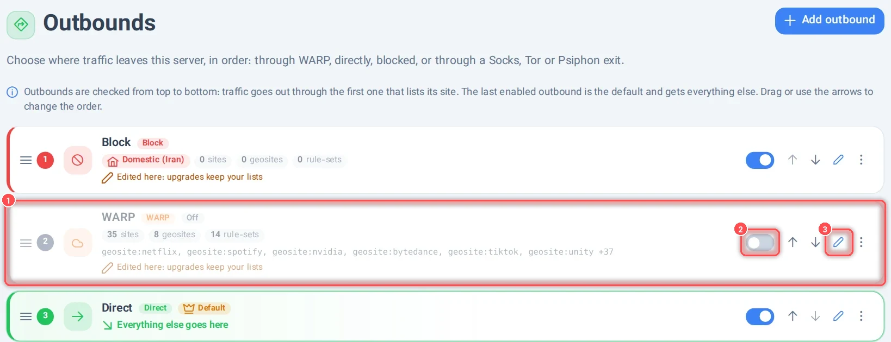
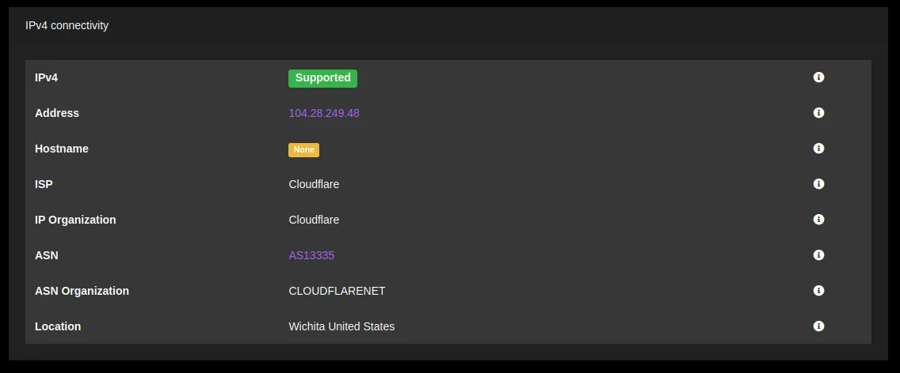

<div dir="ltr" markdown="1">

# How to activate WARP on the HiddifyManager panel
Many websites, including Google, restrict the access of users through VPN. Because several different connections go from the same IP to Google's server at the same time, this behavior is similar to cyber malicious behavior, and because of this, the connection is disrupted, and Google gives a 403 error, for example. Other websites do not allow communication and use of the service. Here is one way to solve the problem using Cloudflare's WARP service.

## What is WARP?
Warp is a Cloudflare service that provides secure and encrypted communication over its network. After performing security checks on the target client and making sure there is no malicious behavior, it opens the connection to the Internet. It assigns an IP to that system and communicates through it. In fact, Warp is a tool that hides your server IP from the sites that your users visit. Because the IP of the server is hidden, so access is established.

The free WARP service has no traffic limit. **WARP+** (with a paid key from the 1.1.1.1 app) is optional: it routes traffic through Cloudflare's faster network. HiddifyManager can use both.

This guide is for Hiddify Manager v14.5. Since v14.5, WARP is one of the panel's **Outbounds**: you can turn it on in **Settings** (the simple way, below) or choose exactly which sites go through it on the **Outbounds** page.


## Setting up WARP on HiddifyManager
Click **Settings** in the panel sidebar and find the **WARP** card. (You can also type "WARP" in the search box at the top of the page.)

<div align=center markdown=1>


</div>

1. Choose a **WARP+ Mode** other than `Disable`.
2. The first time, the panel shows **Cloudflare WARP terms**: traffic that leaves through WARP is handled by Cloudflare under their Terms of Service and Privacy Policy. Read them, tick the box and click **Accept**. Until you accept, WARP does not run.
3. Save the settings, then click **Apply now** on the **Actions** page (or in the banner that appears) so WARP starts.

To use WARP Plus, enter its key in the **Warp Plus Key** field (an advanced setting: turn on **Show Advanced Settings** at the top of the page); you can buy the original key from Cloudflare in the 1.1.1.1 app. There are also different bots in Telegram that give you this key, but none of them are approved by us.

In **Additional WARP Sites** (also advanced) you can add more sites that should pass through WARP. Since v14.5 the same list is on the **Outbounds** page (see below), which is the easier place to edit it.

### Mode "All"
It passes all traffic through the warp, even the sites that don't have problems pass through the warp. On the **Outbounds** page this makes WARP the **default** outbound (the last one).

### Mode "Only Domestic and Blocked Sites"
Only domestic sites and `Google, Spotify, Netflix, OpenAI, ipinfo.io` (and the other sites in WARP's lists) use Warp. Everything else leaves directly.

- Note: If there is an error in the Warp Plus key, the WARP will be disabled. So make sure to use the key correctly. Select and copy the key correctly and place it in the field.

### The Outbounds page { #outbounds }
Click **Outbounds** in the sidebar. Each row is a way out of the server: **Block**, **WARP**, **Direct** (and any Socks, Tor or Psiphon exit you add). They are checked from top to bottom: a site leaves through the first outbound whose lists contain it, and the last enabled outbound (**Default**) gets everything else.

<div align=center markdown=1>


</div>

1. The **WARP** row.
2. Its switch turns WARP on or off (the same as the **WARP+ Mode** setting).
3. The pencil opens **What goes through it**: add or remove sites, `geosite:` lists and rule-sets that should leave through WARP.

To send **all** traffic through WARP, drag the WARP row to the bottom so it becomes the default.

## How to check if warp is active or not?

Click **Actions** in the sidebar. On the **Apply & Status** page, click **Check now** in the **Check Status** card.

<div align=center markdown=1>


</div>

The status check shows whether each service is running, plus the server's public IP and the status of the warp connection with the IP allocated for the warp traffic. Its output is also kept in the `status.log` file in the **Logs** list at the bottom of the same page.

> * The status shows the WARP account and the IP, country and network (`Cloudflare`) that WARP traffic leaves from. The same output is in `warp.log` in the **Logs** list.

> * When the WARP outbound is off, no traffic goes through WARP, even if the WARP service itself is running.

> * On the server, the HiddifyManager menu has the same check: run `hiddify`, then **advanced** › **warp** (*Check Warp Status*).


You can also use the [ipinfo](https://ipinfo.io/) site. If the IP displayed on this page belongs to Cloudflare despite the filter breaker being turned on; In this case, the warp is activated correctly.

<div align=center markdown=1>


</div> 


You can also use the [ip.gs](https://ip.gs/) website, and if Cloudflare's IP is displayed, it means that Warp is activated.

<div align=center markdown=1>



</div> 

## How to reinstall WARP service?

**From the panel:** click **Actions** in the sidebar and click **Reinstall**. This reinstalls all HiddifyManager services, WARP included. It does not delete your users or settings, but all users are disconnected for a few minutes.

**From the terminal (only WARP):** if you only want to reinstall WARP, [connect to your server with SSH](/manager/installation-and-setup/How-to-connect-to-server-via-SSH/), leave the HiddifyManager menu with `Ctrl+C` (or **Cancel**), and run:

```
cd /opt/hiddify-manager/services/warp && bash install.sh
```

## How to change IP WARP?

The panel has no button for this; it is done in the terminal.

1. [Connect to your server with SSH](/manager/installation-and-setup/How-to-connect-to-server-via-SSH/) and leave the HiddifyManager menu with `Ctrl+C` (or **Cancel**).
2. Run:

    ```
    cd /opt/hiddify-manager/services/warp && bash change_ip.sh
    ```

It registers a new WARP account, so WARP gives the server a new IP. Check the new IP with **Check now** on the **Actions** page, as shown above.

## Related articles

- [Telegram proxy](/manager/configuration-and-advanced-settings/How-to-set-up-Telegram-proxy-on-Hiddify/)
- [The panel's Telegram bot](/manager/configuration-and-advanced-settings/How-to-set-up-and-use-Telegram-bot-on-Hiddify-panel/)
- [Using IPv6](/manager/configuration-and-advanced-settings/IPv6-usage-guide/)
- [Every part and setting of the panel](/manager/configuration-and-advanced-settings/How-to-configure-Hiddify-panel-properly/)

</div>
