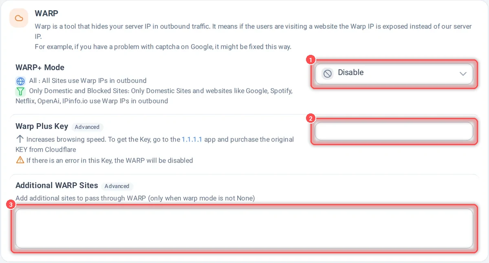
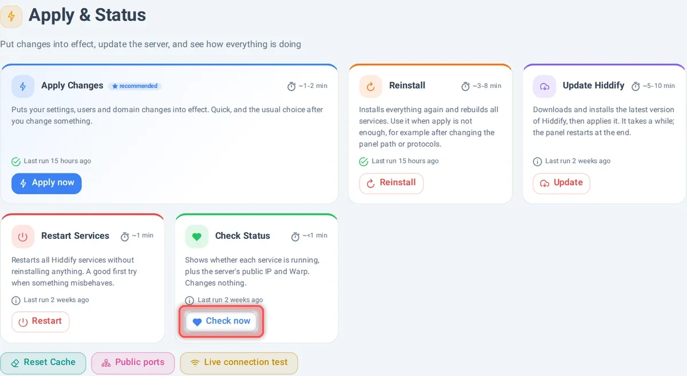

<div dir="ltr" markdown="1">

# How to activate WARP on the Hiddify panel
Many websites, including Google, restrict the access of users through VPN. Because several different connections go from the same IP to Google's server at the same time, this behavior is similar to cyber malicious behavior, and because of this, the connection is disrupted, and Google gives a 403 error, for example. Other websites do not allow communication and use of the service. Here is one way to solve the problem using Cloudflare's WARP service.

## What is WARP?
Warp is a Cloudflare service that provides secure and encrypted communication over its network. After performing security checks on the target client and making sure there is no malicious behavior, it opens the connection to the Internet. It assigns an IP to that system and communicates through it. In fact, Warp is a tool that hides your server IP from the sites that your users visit. Because the IP of the server is hidden, so access is established.

Warp has several levels of service, the free service of which has a traffic volume limit, and after crossing the limit, access is limited. It is better to use its special service called WARP Plus, which supports high volume. On Hiddify, it is possible to use this version of Warp, which will be explained later on how to activate it.


## Setting up WARP on Hiddify
Click **Settings** in the panel sidebar and find the **WARP** card. (You can also type "WARP" in the search box at the top of the page.)

<div align=center markdown=1>


</div>

Choose a **WARP+ Mode** other than `Disable`, then save. To use WARP Plus, enter its key in the **Warp Plus Key** field; you can buy the original key from Cloudflare in the 1.1.1.1 app. There are also different bots in Telegram that give you this key, but none of them are approved by us.

In **Additional WARP Sites** you can add more sites that should pass through WARP (only when the WARP mode is not disabled).

### Mode "All"
It passes all traffic through the warp, even the sites that don't have problems pass through the warp.

### Mode "Only Domestic and Blocked Sites"
Only domestic sites and `Google, Spotify, Netflix, OpenAI, ipinfo.io` use Warp.

- Note: If there is an error in the Warp Plus key, the WARP will be disabled. So make sure to use the key correctly. Select and copy the key correctly and place it in the field.

## How to check if warp is active or not?

To do this, click **Actions** in the sidebar. On the **Apply & Status** page, click **Check now** in the **Check Status** card.

<div align=center markdown=1>



</div>

The status check shows whether each service is running, plus the server's public IP and the status of the warp connection with the IP allocated for the warp traffic. Its output is also kept in the `status.log` file in the **Logs** list at the bottom of the same page.

> * Note that Warp is always active as a service. That is, here even if you have disabled it in the settings, it will be displayed again.

> * When you disable warp from the settings, traffic will not pass through the service even though it is enabled.

> * If you have entered the limited or unlimited Warp Plus code, the type of service will be displayed as `Limited` or `Unlimited` in the status.


You can also use the [ipinfo](https://ipinfo.io/) site. If the IP displayed on this page belongs to Cloudflare despite the filter breaker being turned on; In this case, the warp is activated correctly.

<div align=center markdown=1>


</div> 


You can also use the [ip.gs](https://ip.gs/) website, and if Cloudflare's IP is displayed, it means that Warp is activated.

<div align=center markdown=1>


</div> 

## How to reinstall WARP service?

- To do this, SSH to your server; Press `Ctrl+c` or click `Cancel` to exit Hiddify menu.

- Now run this command.

```

cd /opt/hiddify-manager/other/warp/wireguard && bash install.sh

```

## How to change IP WARP?

- To do this, SSH to your server; Press `Ctrl+c` or click `Cancel` to exit Hidify menu.

- Now run this command.

```

cd /opt/hiddify-manager/other/warp/wireguard && bash change_ip.sh

```

- After that, the assigned IP is changed by Warp. You can see the IP using the method given above.
