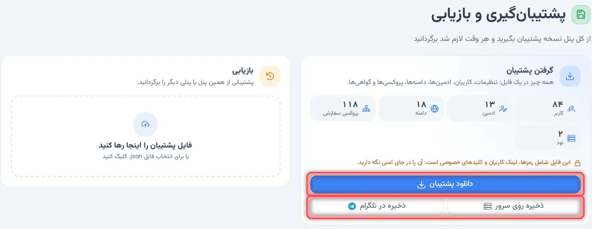
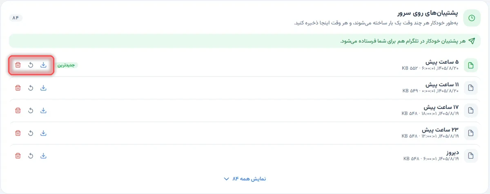
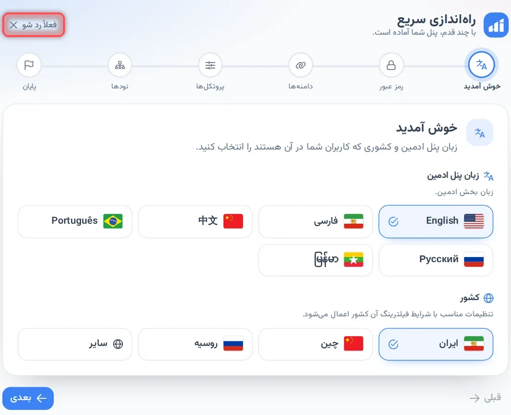
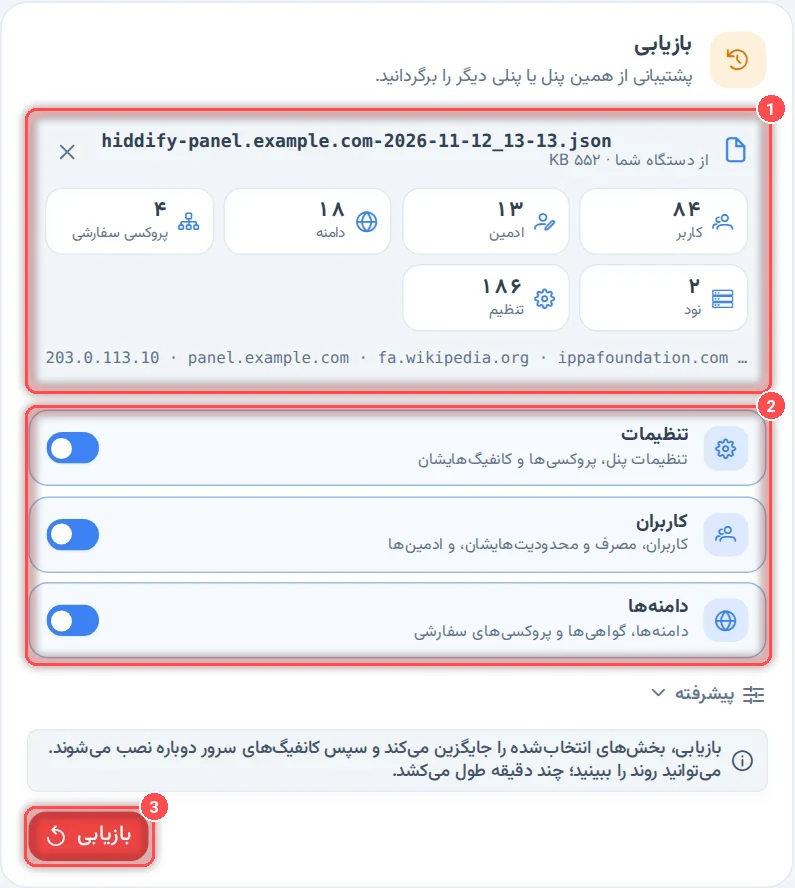

 
# آموزش پشتیبان‌گیری و بازیابی پنل در هیدیفای‌منیجر

خیلی وقت‌ها نیاز پیدا می‌کنید که از پنل بکاپ بگیرید و روی سرور دیگر آن را برگردانید. مثلا سرور شما فیلتر شده یا اینکه یک مشکلی پیش آمده که نمی‌توانید روی آن سرور ادامه دهید. در این صورت مراحل زیر را تا انتها ادامه دهید تا با انجام این کار آشنا شوید.

## پشتیبان‌گیری از پنل فعلی از طریق وب
در منوی کناری پنل ادمین، زیر **تنظیمات**، روی **پشتیبان‌گیری** کلیک کنید. در کارت **گرفتن پشتیبان** روی **دانلود پشتیبان** بزنید.

فایل پشتیبان یک فایل `json` است که همه چیز در آن هست: تنظیمات، کاربران، ادمین‌ها، دامنه‌ها، پروکسی‌ها و گواهی‌ها. محل ذخیره آن روی سیستم خود را مشخص کنید. این فایل شامل رمزها، لینک کاربران و کلیدهای خصوصی است؛ آن را در جای امنی نگه دارید.

همچنین می‌توانید با **ذخیره روی سرور** یک نسخه روی خود سرور نگه دارید، یا با **ذخیره در تلگرام** فایل را از بات تلگرام خود دریافت کنید.

## ارسال فایل پشتیبان به تلگرام
هر ۶ ساعت پنل به صورت خودکار برای شما بکاپ می‌گیرد و اگر [بات تلگرام](/fa/manager/configuration-and-advanced-settings/How-to-set-up-and-use-Telegram-bot-on-Hiddify-panel/) را فعال کرده باشید، هر پشتیبان خودکار روی بات هم برای شما ارسال می‌گردد.

## پشتیبان‌های روی سرور
پشتیبان‌های خودکار و پشتیبان‌هایی که با **ذخیره روی سرور** می‌گیرید، در کارت **پشتیبان‌های روی سرور** در همین صفحه نمایش داده می‌شوند. با دکمه‌های هر ردیف می‌توانید آن پشتیبان را دانلود، بازیابی یا حذف کنید. هنگام انجام آپدیت یا نصب مجدد پنل هم بکاپ گرفته می‌شود.

> نکته: اگر به هر دلیلی بات تلگرام در دسترس شما نبود و از طریق وب هم امکان بکاپ‌گیری نداشتید،  می‌توانید از مسیر زیر به بکاپ‌های قبلی سیستم برسید.

 
`/opt/hiddify-manager/hiddify-panel/backup`

و سپس فایل را خارج کنید. [اطلاعات بیشتر در اینجا](/fa/manager/basic-concepts-and-troubleshooting/How-to-transfer-files-between-a-server-and-a-computer/)

در نهایت شما فایل بکاپ را در یک جایی روی سیستم خود ذخیره کنید.

## بازیابی فایل پشتیبان
حالا روی سرور جدید پنل را نصب کنید. وقتی صفحه **راه‌اندازی سریع** باز شد، هیچ تنظیمی انجام ندهید و روی **فعلاً رد شو** بزنید.

در منوی کناری، زیر **تنظیمات**، روی **پشتیبان‌گیری** کلیک کنید.

در کارت **بازیابی**، فایل بکاپی که در مرحله قبل ذخیره کرده بودید را رها کنید یا روی کادر بزنید و آن را انتخاب کنید.
سپس بخش‌هایی که می‌خواهید بازیابی شوند را انتخاب کنید: **تنظیمات**، **کاربران** و **دامنه‌ها**. مثلا اگر می‌خواهید کل پنل را بازیابی کنید هر ۳ گزینه را انتخاب کنید، روی **بازیابی** بزنید و منتظر بمانید تا عملیات به انتها برسد. این کار چند دقیقه طول می‌کشد. اگر پشتیبان از پنل دیگری باشد، لینک ادمین تغییر می‌کند و لینک‌های جدید در پایان نمایش داده می‌شوند.

## انجام تنظیمات ساب‌دامین
تنظیمات ساب‌دامین خود را به آیپی جدید سرور تغییر دهید. یعنی هر جایی که دامنه‌های خود را تعریف کرده‌اید بروید و آیپی‌های جدید را وارد کنید.
مثلا در کلادفلر وارد تنظیمات DNS شوید و روی رکوردهای ثبت شده قبلی بروید و فقط آیپی را عوض کنید.

کار تمام است.پنل با لینک ادمین روی سرور جدید بالا می‌آید.
