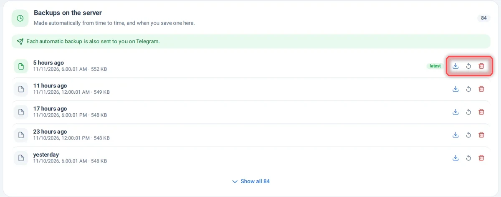
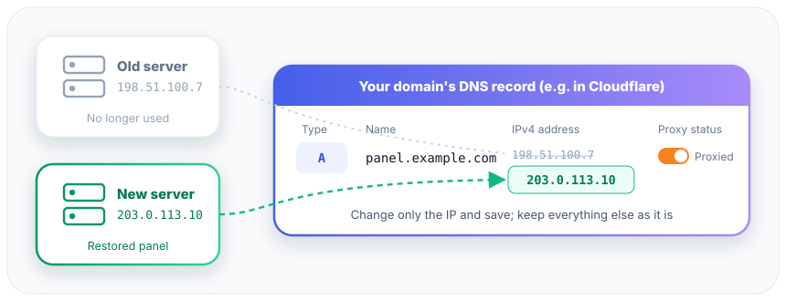

# How to backup and restore panel on HiddifyManager

Many times you need to backup the panel and restore it on another server. For example, your server is filtered or there is a problem that you cannot continue on that server. In this case, continue the following steps until the end to learn how to do this.

## Backup current panel via web

In the admin panel sidebar, under **Settings**, click **Backup**. In the **Make a Backup** card, click **Download Backup**.

The backup is one `.json` file with everything in it: settings, users, admins, domains, proxies and certificates. Choose where to save it on your computer. The file holds passwords, user links and private keys, so keep it somewhere safe.

You can also click **Save on the server** to keep a copy on the server, or **Save on the Telegram** to get the file from your Telegram bot.

## Sending the backup file to Telegram

The panel automatically makes a backup for you every 6 hours, and if you have activated the [Telegram bot](/manager/configuration-and-advanced-settings/How-to-set-up-and-use-Telegram-bot-on-Hiddify-panel/), each automatic backup is also sent to you in the bot.

## Backups on the server

Automatic backups, and the ones you save with **Save on the server**, are listed in the **Backups on the server** card of the same page. For each backup you can download it, restore it, or delete it with the buttons on its row. Backups are also made when updating or reinstalling the panel.

> Note: If for any reason the Telegram bot was not available to you and you were not able to backup via the web, you can access the previous backups of the system from the following path.

`/opt/hiddify-manager/hiddify-panel/backup`

and then transfer the file to your PC. [More info here](/manager/basic-concepts-and-troubleshooting/How-to-transfer-files-between-a-server-and-a-computer/)

Finally, keep the backup file somewhere safe on your computer.

## Restoring backup file
Now install the panel on the new server. When the **Quick setup** wizard opens, do not set anything up: click **Skip for now**.

In the sidebar, under **Settings**, click **Backup**.

In the **Restore** card, drop the backup file that you saved in the previous step, or click the box to choose it. Then choose which parts to restore: **Settings**, **Users** and **Domains**. For example, if you want to restore the entire panel, select all 3 options, click **Restore** and wait for the operation to finish. It takes a few minutes. If the backup comes from another panel, the admin link changes; the new links are shown when it finishes.

## Changing subdomain settings

After the restore, your domains and subdomains still point to the **old server's** IP. Where you manage your domain's DNS, change the records to the **new server's** IP. Only the IP changes; keep the record name and everything else as it is.

In **Cloudflare**:

1. Sign in to the [Cloudflare dashboard](https://dash.cloudflare.com/) and choose your domain.
2. In the sidebar, open **DNS**, then **Records**.
3. Next to each record that points to the old server, click **Edit**.
4. In **IPv4 address**, enter the new server's IP and click **Save**. If the new server has IPv6, change the **AAAA** records to its new IPv6 too.
5. Keep **Proxy status** (the orange cloud) as it was. CDN domains stay **Proxied** and direct domains stay **DNS only**.

Other DNS services work the same way: find the `A` (and `AAAA`) records and change only the IP.

!!! tip
    A DNS change usually takes a few minutes to reach everyone. If the panel does not open on the domain right away, wait a little.

The work is done. The panel comes up on the new server with your admin link. If the backup came from another panel, use the new links shown after the restore.

## Related articles

- [Update](/manager/configuration-and-advanced-settings/How-to-update-Hiddify-panel/)
- [Reset to default settings](/manager/configuration-and-advanced-settings/How-to-Reset-Hiddify-panel-to-default/)
- [SSH proxy](/manager/configuration-and-advanced-settings/SSH-proxy-setting-on-Hiddify-panel/)
- [Every part and setting of the panel](/manager/configuration-and-advanced-settings/How-to-configure-Hiddify-panel-properly/)

