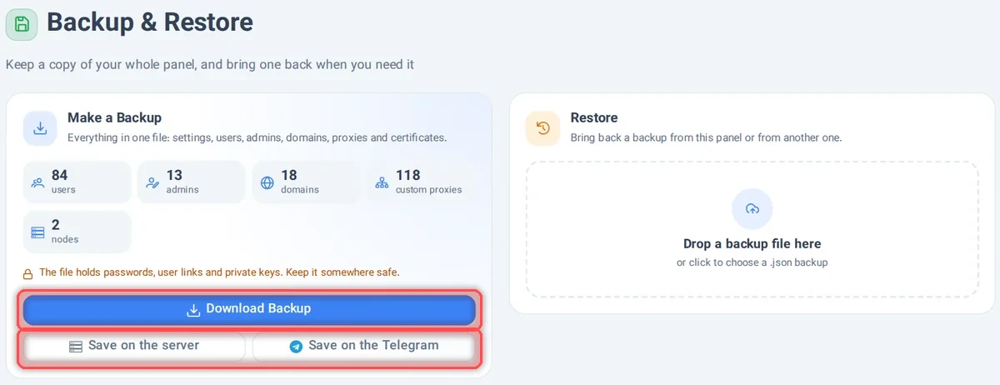
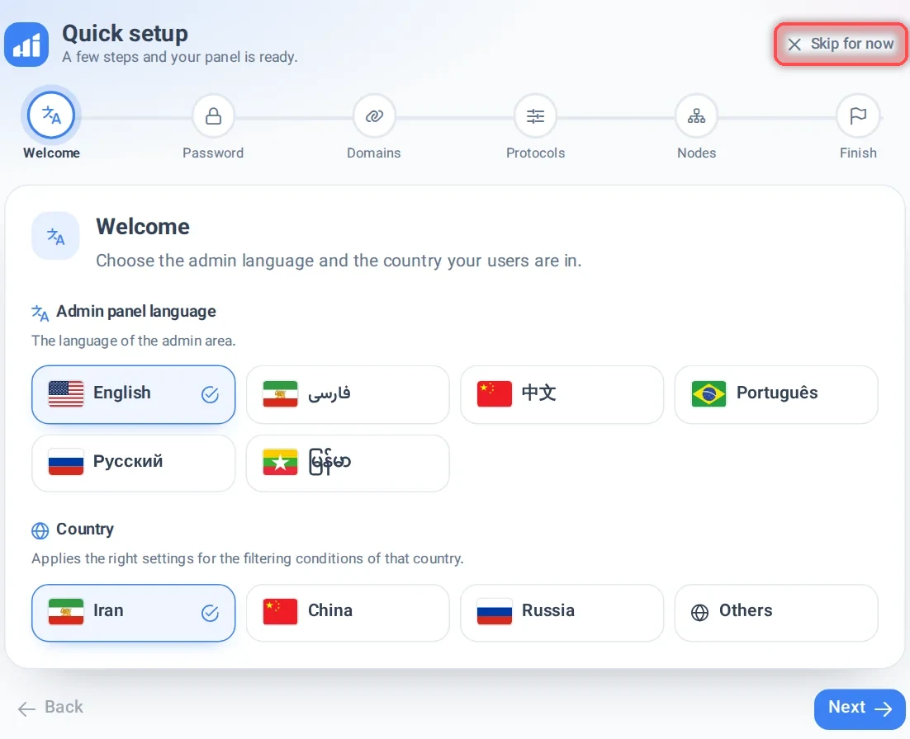
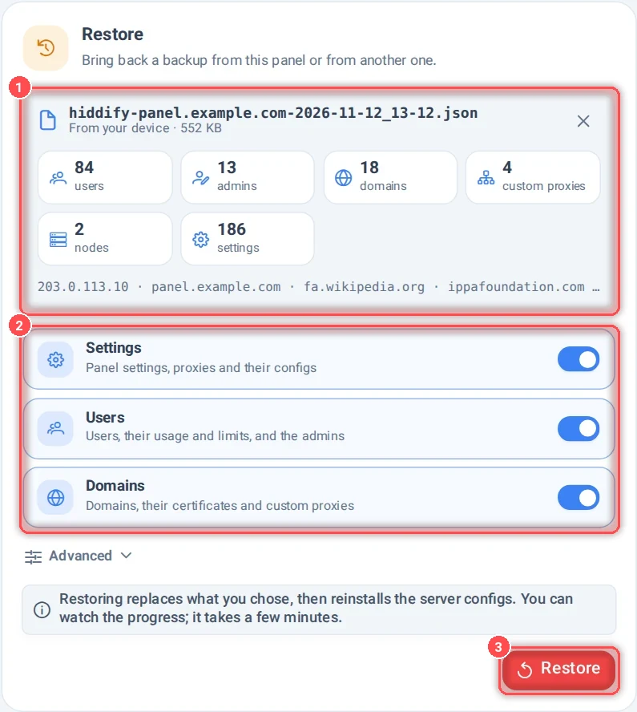

# How to backup and restore panel on HiddifyManager

Many times you need to backup the panel and restore it on another server. For example, your server is filtered or there is a problem that you cannot continue on that server. In this case, continue the following steps until the end to learn how to do this.

## Backup current panel via web

In the admin panel sidebar, under **Settings**, click **Backup**. In the **Make a Backup** card, click **Download Backup**.

The backup is one `.json` file with everything in it: settings, users, admins, domains, proxies and certificates. Choose where to save it on your computer. The file holds passwords, user links and private keys, so keep it somewhere safe.

You can also click **Save on the server** to keep a copy on the server, or **Save on the Telegram** to get the file from your Telegram bot.

## Sending the backup file to Telegram

The panel automatically makes a backup for you every 6 hours, and if you have activated the [Telegram bot](/manager/configuration-and-advanced-settings/How-to-set-up-and-use-Telegram-bot-on-Hiddify-panel), each automatic backup is also sent to you in the bot.

## Backups on the server

Automatic backups, and the ones you save with **Save on the server**, are listed in the **Backups on the server** card of the same page. For each backup you can download it, restore it, or delete it with the buttons on its row. Backups are also made when updating or reinstalling the panel.

> Note: If for any reason the Telegram bot was not available to you and you were not able to backup via the web, you can access the previous backups of the system from the following path.

`/opt/hiddify-manager/hiddify-panel/backup`

and then transfer the file to your PC. [More info here](/manager/basic-concepts-and-troubleshooting/How-to-transfer-files-between-a-server-and-a-computer)

## Restoring backup file
Now install the panel on the new server. When the **Quick setup** wizard opens, do not set anything up: click **Skip for now**.

In the sidebar, under **Settings**, click **Backup**.

In the **Restore** card, drop the backup file that you saved in the previous step, or click the box to choose it. Then choose which parts to restore: **Settings**, **Users** and **Domains**. For example, if you want to restore the entire panel, select all 3 options, click **Restore** and wait for the operation to finish. It takes a few minutes. If the backup comes from another panel, the admin link changes; the new links are shown when it finishes.

## Changing subdomain settings
Change your subdomain settings to the new server's IP. That is, go wherever you have defined your domains and enter the new IPs. For example, enter the DNS settings in Cloudflare and go to the previously registered records and just change the IP.

The work is done. The panel with the admin link will come up on the new server.
