<div dir="rtl" markdown=1>

# راهنمای جامع پیکربندی هیدیفای‌منیجر

</div>

<div dir="rtl" markdown=1>

این صفحه شما را در راه‌اندازی اولیه پنل ادمین هیدیفای‌منیجر همراهی می‌کند و همهٔ منوهای پنل را، به همان ترتیب منوی خود پنل، معرفی می‌کند. هر بخش می‌گوید آن صفحه به چه کاری می‌آید و چه چیزهایی در آن مهم‌تر است، و به آموزش کامل همان بخش لینک می‌دهد. بلافاصله بعد از نصب پنل، یا هر وقت خواستید بدانید یک منو یا تنظیم به چه دردی می‌خورد، این صفحه را بخوانید.

!!! info "نوشته‌شده برای هیدیفای‌منیجر نسخهٔ ۱۴.۵"
    نام منوها و تصویرهای این صفحه از هیدیفای‌منیجر نسخهٔ ۱۴.۵ هستند. همهٔ گزینه‌های صفحهٔ **تنظیمات**، با توضیح خود پنل، در [همهٔ تنظیمات هیدیفای‌منیجر](Settings-reference.md) آمده‌اند؛ آن صفحه برای هر نسخه از روی کد پنل ساخته می‌شود.

این پنل کار با پروکسی‌ها را ساده‌تر می‌کند، اما نمی‌تواند سرور مسدودشده یا دامنه خراب را درست کند. اگر این صفحه را تا آخر انجام دادید و کاربران باز هم وصل نشدند، [عیب‌یابی مشکلات اتصال](/fa/manager/basic-concepts-and-troubleshooting/Troubleshooting-connectivity-issues-with-HiddifyManager-and-proxies/) را بخوانید.

## پیش از شروع { #before-you-start }

به این موارد نیاز دارید:

1. **سروری با IP سالم.** IP سالم یعنی IPای که در کشور کاربران شما مسدود نیست. آن را با راهنمای [اطمینان از سالم بودن IP یا دامنه سرور](/fa/manager/basic-concepts-and-troubleshooting/How-to-make-sure-the-server%27s-IP-or-domain-is-clean/) بررسی کنید. اگر IP مسدود است، IP یا سرور جدید بگیرید.
2. **هیدیفای‌منیجر نصب‌شده**، طبق [راهنمای نصب](/fa/manager/installation-and-setup/guide/). در پایان نصب **لینک‌های ادمین** را دریافت می‌کنید. لینک ادمین شامل مسیر مخفی و شناسه ادمین شماست، پس مثل رمز عبور است. [فرمت صحیح لینک ادمین](/fa/manager/domain-worker-cdn-and-tunneling/The-correct-format-of-admin-link/) را ببینید.
3. **یک دامنه ثبت‌شده که در دسترس باشد.** دامنه نامی مثل `example.com` است که به سرور شما اشاره می‌کند. [انواع دامنه و نحوه ثبت آن‌ها](/fa/manager/domain-worker-cdn-and-tunneling/Domain-types-and-how-to-register-them/) را ببینید و سپس [سالم بودن دامنه را بررسی کنید](/fa/manager/basic-concepts-and-troubleshooting/How-to-make-sure-the-server%27s-IP-or-domain-is-clean/).

اگر واژه‌ای در این صفحه برایتان تازه است، [مفاهیم پایه](/fa/manager/basic-concepts-and-troubleshooting/Basic-Concepts/) را ببینید.

## اولین ورود به پنل ادمین { #open-the-admin-panel-for-the-first-time }

- اگر از لینک نصب سریع دیتاسنترهایی مثل Vultr یا OVH استفاده کرده‌اید، حدود ۱۰ دقیقه صبر کنید. سپس یک لینک یک‌بار مصرف می‌گیرید که صفحه ادمین را باز می‌کند.
- اگر از طریق SSH نصب کرده‌اید، لینک‌های ادمین در پایان نصب در ترمینال نمایش داده می‌شوند. یکی از لینک‌های **Secure** (با https و دامنه) را در مرورگر باز کنید. فقط وقتی هیچ لینک دامنه‌ای کار نکرد از لینک IP (بخش **Not Secure**) استفاده کنید.
- اگر لینک‌ها را گم کرده‌اید، با SSH به سرور وصل شوید و این دستور را اجرا کنید:

```bash
hiddify admin
```

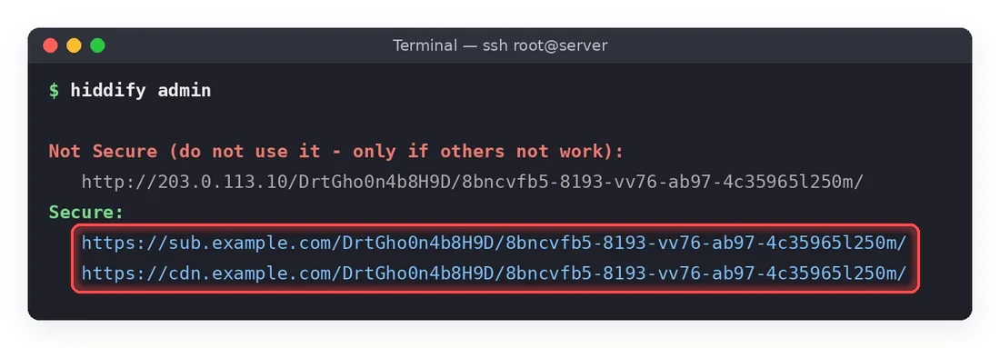

لینک ادمین شما این شکل را دارد: `https://<دامنه>/<مسیر مخفی ادمین>/<UUID ادمین>/`، مثلاً `https://sub.example.com/DrtGho0n4b8H9D/8bncvfb5-8193-vv76-ab97-4c35965l250m/`. وقتی آن را باز می‌کنید، پنل شما را وارد می‌کند و **Admin V2** (پنل ادمین جدید) را باز می‌کند و آدرس مرورگر به `https://sub.example.com/DrtGho0n4b8H9D/admin/v2/` تغییر می‌کند. این لینک را به کسی ندهید؛ مثل رمز عبور است. [فرمت صحیح لینک ادمین](/fa/manager/domain-worker-cdn-and-tunneling/The-correct-format-of-admin-link/) را ببینید.

اولین باری که صفحه ادمین را باز می‌کنید، ویزارد **راه‌اندازی سریع** شروع می‌شود.

## راه‌اندازی سریع { #quick-setup }

این ویزارد شش مرحله کوتاه دارد: **خوش آمدید ← رمز عبور ← دامنه‌ها ← پروتکل‌ها ← نودها ← پایان**. با **بعدی** و **قبلی** بین مرحله‌ها جابه‌جا شوید، یا با **فعلاً رد شو** از ویزارد خارج شوید. همه این موارد را بعداً هم می‌توانید در **تنظیمات** تغییر دهید.

1. **خوش آمدید:** **زبان پنل ادمین** و **کشور** کاربرانتان (ایران، چین، روسیه یا سایر) را انتخاب کنید. انتخاب کشور، تنظیمات مناسب با فیلترینگ آن کشور را اعمال می‌کند.
2. **رمز عبور:** برای بخش ادمین یک رمز عبور بگذارید (حداقل ۸ کاراکتر).
3. **دامنه‌ها:** دامنه خود را به IPهای سرور که در صفحه نشان داده می‌شود متصل کنید (رکورد `A` برای IPv4 و `AAAA` برای IPv6). سپس دامنه را وارد کنید و Enter بزنید. پنل نوع دامنه را خودش تشخیص می‌دهد؛ برای تغییر، روی نوع آن بزنید. حداقل یک دامنه مستقیم، CDN یا «فقط لینک اشتراک» لازم است.
4. **پروتکل‌ها:** پروتکل‌هایی را که می‌خواهید ارائه دهید انتخاب کنید. تا جای ممکن کمترین تعداد را انتخاب کنید.
5. **نودها** (اختیاری): سرورهای دیگر هیدیفای‌منیجر را متصل کنید تا از همین پنل مدیریت شوند. می‌توانید از این مرحله رد شوید.
6. **پایان:** انتخاب‌هایتان را بررسی کنید و روی **پایان** بزنید. پنل پیکربندی را اعمال می‌کند و سرویس‌ها را دوباره نصب می‌کند. این کار چند دقیقه طول می‌کشد و در این مدت لاگ و لینک‌های جدید ادمین نمایش داده می‌شود.

وقتی تمام شد، پنل آماده استفاده است. لینک‌های جدید ادمین را کپی کنید و جای امنی نگه دارید.

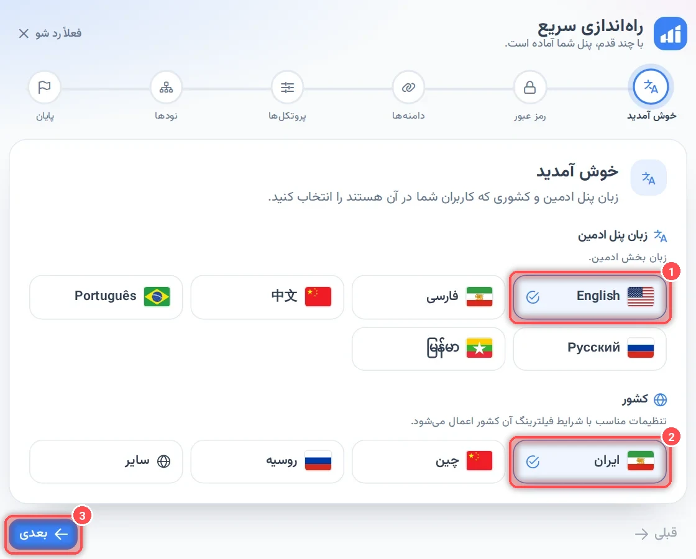

## منوی ادمین { #the-admin-menu }

نوار کناری (سمت راست) این گروه‌ها را دارد. بخش‌های این صفحه هم به همین ترتیب آمده‌اند.

- **مدیریت:** [داشبورد](#dashboard)، [کاربران](#users)، [ادمین‌ها](#admins)، [صندوق پیام](#inbox)، [نودها](#nodes) و [ابزارها](#tools) (Config Tester، اسکنر، رمزگشای متن، QR Code و ترمینال SSH).
- **تنظیمات:** [دامنه‌ها](#domains)، [پروتکل‌ها](#proxies-and-protocols)، [خروجی‌ها](#outbounds)، [تنظیمات](#settings)، [ویرایشگر پروکسی](#proxy-editor) (پروکسی‌ها، Base Configs، Templates و Template Variables)، [پشتیبان‌گیری](#backup)، [اقدامات](#apply-status) (صفحهٔ **اعمال و وضعیت**)، [بات تلگرام](#telegram-bot) و [API](#api).
- **راهنما** و **حمایت**.

حساب خودتان (رمز، passkey، زبان و پیش‌فرض‌های کاربرانتان) زیر آیکون آدمک بالای صفحه است: بخش [حساب من](#my-account) را ببینید.

!!! tip "نصب پنل به شکل اپ"
    اولین بار که پنل را باز می‌کنید، پیشنهاد می‌دهد خودش را مثل یک اپ روی گوشی یا کامپیوترتان نصب کند (**Install the panel as an app**). بعد از آن پنل در پنجرهٔ خودش و با یک لمس باز می‌شود. اگر نمی‌خواهید، **Do not show this again** را بزنید.

## داشبورد { #dashboard }

داشبورد ترافیک، کاربران و سلامت سرور را در یک نگاه نشان می‌دهد: کاربران آنلاین، مصرف امروز، این هفته و این ماه، و نمودار مصرف و کاربران در بازه ۷، ۳۰، ۹۰ یا ۱۸۰ روز. اگر چند سرور (نود) دارید، از فیلتر نودها یکی را انتخاب کنید. پایین‌تر، بخش سلامت کانفیگ‌ها همه کانفیگ‌ها را از روی سرور تست می‌کند و بخش سلامت نودها پردازنده، رم و شبکه هر نود را نشان می‌دهد. [بررسی خودکار سلامت کانفیگ‌ها](Automatic-config-health-checks-on-HiddifyManager.md) را ببینید.

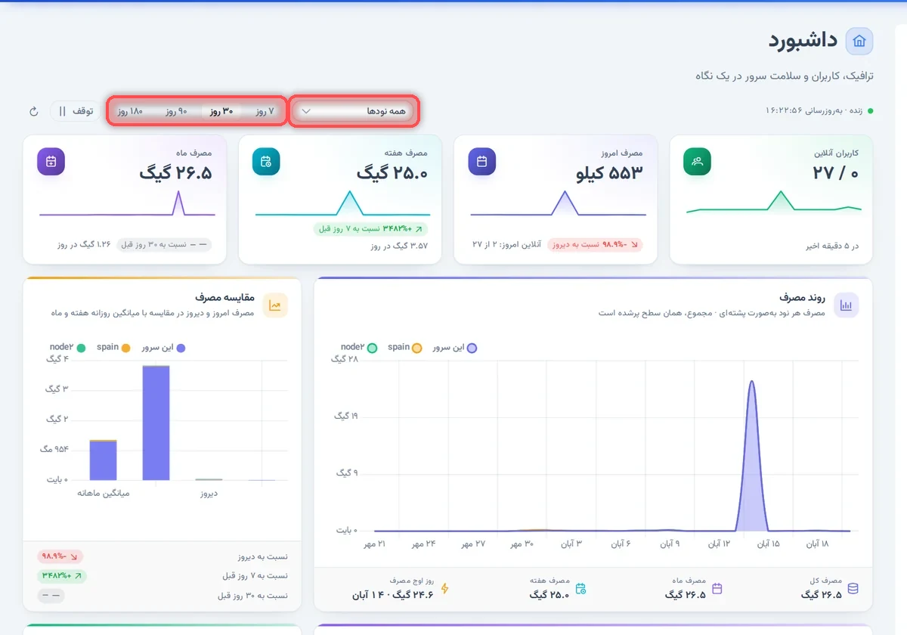

## کاربران { #users }

در این بخش برای هر کسی که از پروکسی‌های شما استفاده می‌کند یک حساب می‌سازید.

1. **کاربران** را باز کنید و روی **افزودن کاربر** بزنید.
2. در پنجره **کاربر جدید**، **نام** و اگر خواستید یک **یادداشت** (که فقط ادمین‌ها می‌بینند) وارد کنید.
3. در بخش **حجم**، **سقف حجم** را وارد کنید (یا یکی از گزینه‌های ۱۰، ۵۰، ۱۰۰ گیگ … را بزنید) و **دورهٔ بازنشانی** را انتخاب کنید: **بدون بازنشانی**، **ماهانه**، **هفتگی** یا **روزانه**.
4. در بخش **زمان**، **مدت بسته** را وارد کنید (یا ۱ هفته، ۱ ماه، ۳ ماه … را بزنید). روزها از اولین اتصال کاربر شروع می‌شوند.
5. روی **افزودن کاربر** بزنید. لینک و کد QR کاربر باز می‌شود تا برایش بفرستید.

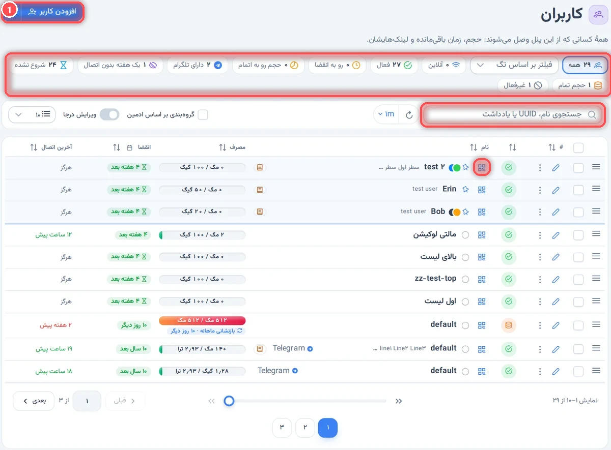

با زدن **افزودن کاربر** پنجرهٔ **کاربر جدید** باز می‌شود:

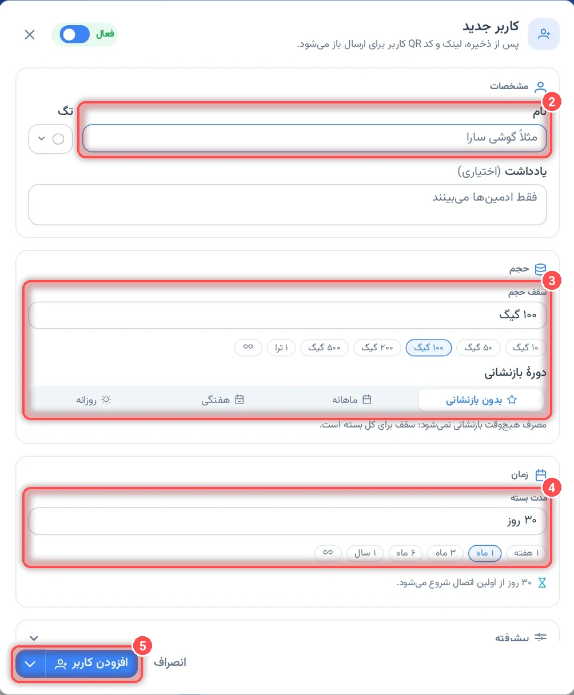

صفحه کاربران همه را با مصرف، تاریخ انقضا و آخرین اتصالشان نشان می‌دهد. برای پیدا کردن کاربران از کادر جستجو و فیلترها (آنلاین، فعال، رو به انقضا، …) استفاده کنید.

هر کاربر یک **صفحه کاربری** اختصاصی دارد. آن را با دکمه کد QR در ردیف کاربر باز کنید که لینک کاربر را نشان می‌دهد. در صفحه کاربری، کاربر ترافیک و زمان باقی‌مانده و یک دکمه بزرگ اتصال را می‌بیند. با زدن آن پنجره **VPN خود را پیکربندی کنید** باز می‌شود و کاربر اپ خود را انتخاب می‌کند یا لینک را کپی می‌کند. در منوی صفحه کاربری، بخش **همه تنظیمات** هم همه کانفیگ‌های کاربر را نشان می‌دهد.

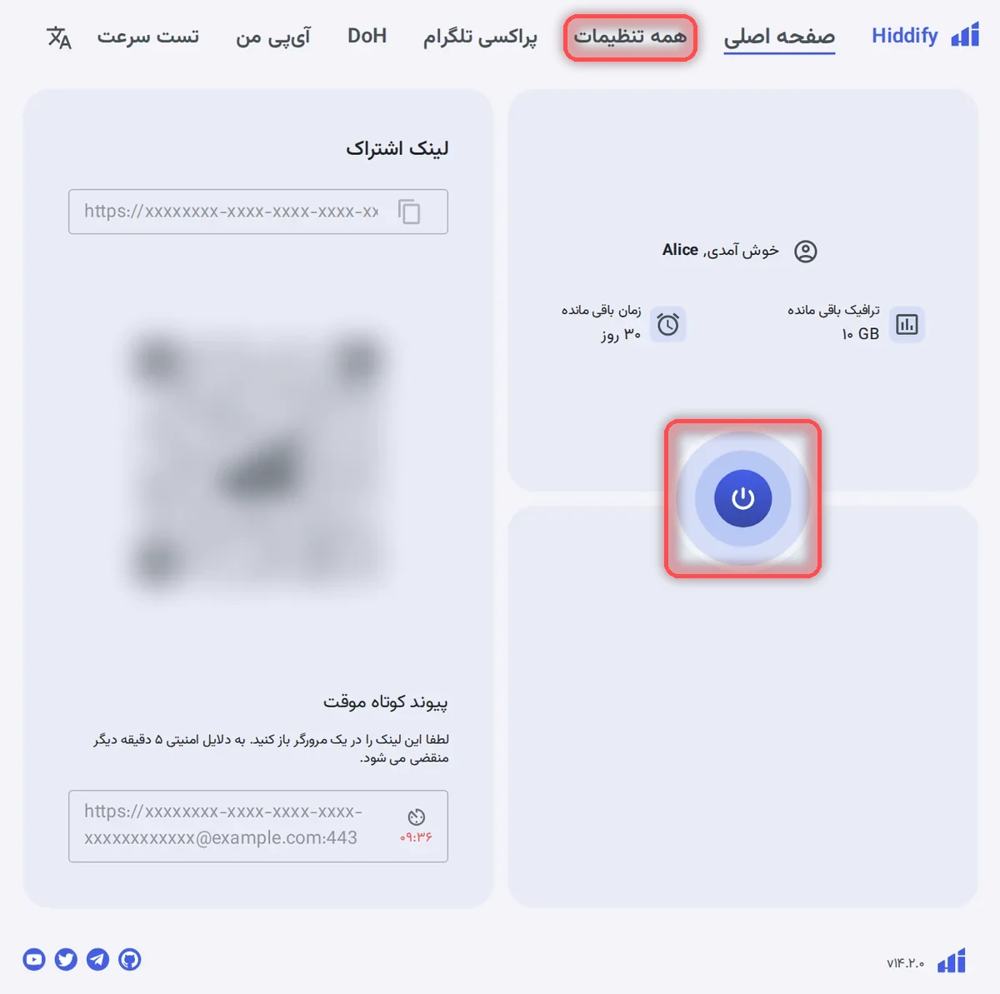

در بخش **همه تنظیمات** کاربر همهٔ کانفیگ‌ها و لینک‌های اشتراک را می‌بیند:

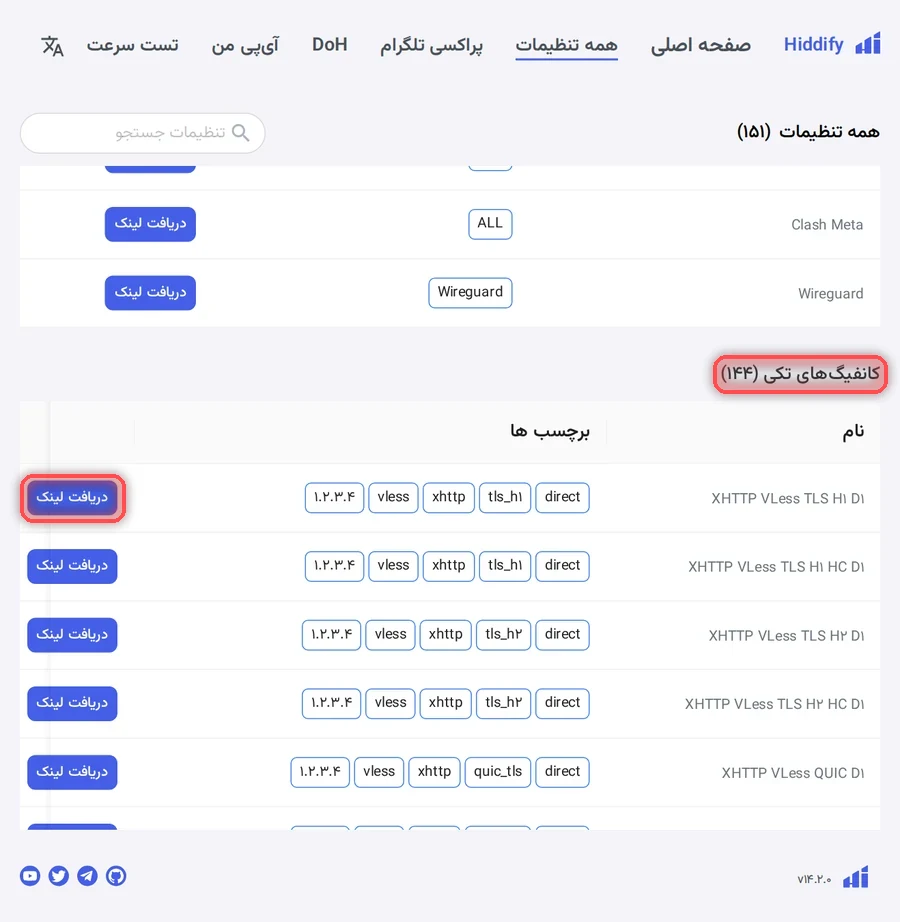

سه راه برای دادن دسترسی به کاربران دارید:

1. **لینک صفحه کاربری (پیشنهادی).** کاربر آن را باز می‌کند و همه چیز را آنجا پیدا می‌کند.
2. **لینک اشتراک (ساب‌لینک).** لینک اشتراک آدرسی است که اپ دوباره آن را می‌خواند تا جدیدترین کانفیگ‌ها را بگیرد. اگر تنظیمات را تغییر دهید، اپ کاربر خودش به‌روز می‌شود.
3. **لینک یک کانفیگ.** به‌روز نمی‌شود. اگر تنظیمات را تغییر دهید، باید لینک جدید برای کاربر بفرستید.

برای راهنمای اتصال اپ‌ها، آموزش‌های اپ‌ها در [صفحه آموزش‌های هیدیفای‌منیجر](/fa/manager/) را ببینید.

## ادمین‌ها { #admins }

در این بخش برای کسانی که در مدیریت پنل به شما کمک می‌کنند حساب می‌سازید. روی دکمه افزودن ادمین بزنید و فرم را پر کنید. ادمین‌ها به شکل درختی نشان داده می‌شوند: محدودیت‌های هر ادمین شامل کاربران خودش و همه زیرمجموعه‌هایش است.

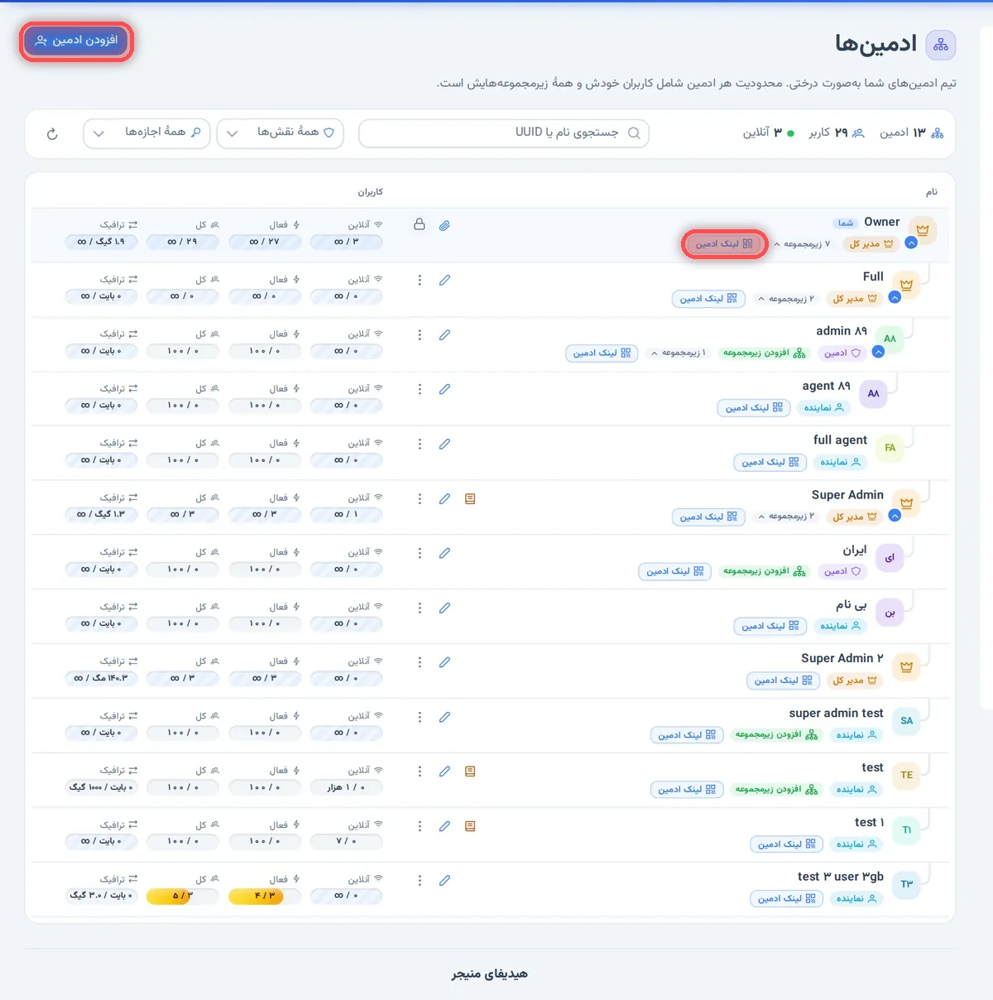

سه نوع ادمین وجود دارد:

- **مدیر کل (Super admin):** به کل پنل و همه تنظیمات دسترسی کامل دارد.
- **ادمین:** می‌تواند کاربران و بخشی از تنظیمات را مدیریت کند.
- **نماینده (Agent):** فقط می‌تواند کاربران را مدیریت کند.

برای هر ادمین می‌توانید:

- تعداد کاربران و کاربران فعال را محدود کنید؛
- اجازه ساختن ادمین زیرمجموعه را بدهید یا ندهید؛
- رمز عبورش را ریست کنید.

!!! note "توجه"
    لینک هر ادمین شامل شناسه مخفی اوست. اگر آن را تغییر دهید، آدرس پنل آن ادمین کاملاً عوض می‌شود. [فرمت صحیح لینک ادمین](/fa/manager/domain-worker-cdn-and-tunneling/The-correct-format-of-admin-link/) را ببینید.

هر ادمین در صفحهٔ **حساب من** خودش هم می‌تواند رمز و passkey بگذارد و برای کاربران خودش خروجی پیش‌فرض، کانفیگ‌های اضافه و صفحهٔ کاربر اختصاصی تعیین کند: بخش [حساب من](#my-account) را ببینید.

## صندوق پیام { #inbox }

**صندوق پیام** (Inbox) جای کسانی است که به بات تلگرام شما پیام می‌دهند، درخواست‌های تست رایگانشان، و پیام‌هایی که برای کاربرانتان می‌فرستید. این‌جا **بستهٔ تست رایگان** می‌سازید (لینکی که به هر کس بازش کند یک اکانت تست می‌دهد، خودکار یا بعد از تأیید شما)، به گفتگوها جواب می‌دهید، و با **Send Message** از طریق بات به همهٔ کاربران، یا فقط کاربران فعال یا منقضی‌شده، پیام می‌فرستید. این بخش به [بات تلگرام](#telegram-bot) نیاز دارد.

آموزش کامل: [صندوق پیام، بستهٔ تست رایگان و پیام به کاربران](Inbox-free-test-and-messages-on-HiddifyManager.md).

## نودها { #nodes }

**نودها** سرورهای هیدیفای‌منیجر دیگری هستند که به این پنل وصل شده‌اند. کاربران و ادمین‌ها خودکار با آن‌ها به اشتراک گذاشته می‌شوند، پس هر اکانت روی همهٔ سرورها کار می‌کند و مصرف همهٔ سرورها این‌جا جمع زده می‌شود. این صفحه وضعیت هر نود را نشان می‌دهد و می‌توانید نود اضافه کنید، پینگ بگیرید و مدیریتشان کنید. داشبورد هم می‌تواند هر نود را جدا نشان دهد.

آموزش کامل: [چندسروره با نودها](Multi-server-with-nodes-on-HiddifyManager.md).

## ابزارها { #tools }

منوی **ابزارها** چند ابزار کمکی دارد که از داخل پنل کار می‌کنند:

- **Config Tester:** همهٔ کانفیگ‌های یک سابسکریپشن را هر کدام در هستهٔ خودش اجرا می‌کند و بررسی می‌کند وصل می‌شوند یا نه.
- **اسکنر:** آی‌پی‌های کلادفلری را پیدا می‌کند که روی اینترنت شما کار می‌کنند (همراه با تست‌های **Fragment** و **REALITY SNI**) تا به کاربران همان اپراتور بدهید.
- **رمزگشای متن (Text Decoders):** لینک‌های اشتراک‌گذاری، سابسکریپشن، Base64 و URL را در خود مرورگر باز و ویرایش می‌کند.
- **QR Code:** از هر متنی QR می‌سازد، یا با دوربین یا از روی عکس QR را می‌خواند.
- **ترمینال SSH:** از داخل پنل روی هر سروری ترمینال و فایل‌هایش را باز می‌کند.

آموزش کامل: [ابزارهای پنل](How-to-use-the-panel-tools-in-HiddifyManager.md).

## دامنه‌ها { #domains }

برای افزودن یا ویرایش دامنه‌ها، **دامنه‌ها** را (در گروه **تنظیمات** منو) باز کنید. این فهرست هر دامنه را با حالت آن، وضعیت TLS و گواهی، پروکسی‌های سفارشی و «نمایش کانفیگ‌های» نشان می‌دهد. ترتیب مهم است: برای مرتب‌سازی دستگیره را بکشید. کانفیگ‌ها دامنه‌ها را به همین ترتیب می‌آورند و اولین دامنه برای لینک پنل استفاده می‌شود.

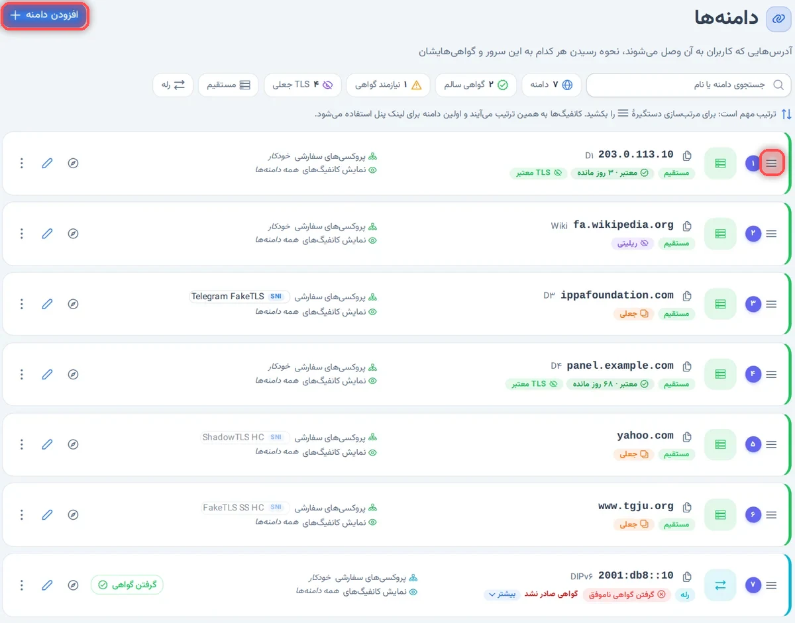

هر دامنه یک **حالت** دارد که می‌گوید کاربران چطور به سرور شما می‌رسند، و یک انتخاب **TLS** که می‌گوید از چه گواهی یا پوششی استفاده می‌کند.

برای افزودن دامنه روی **افزودن دامنه** بزنید. پنجره **افزودن دامنه** چهار مرحله دارد: **دامنه ← حالت ← نام ← گواهی**.

1. **دامنه:** دامنه یا زیردامنه، یا یک آدرس IPv4 / IPv6 را وارد کنید. در بخش **آن را به این سرور اشاره دهید** رکوردهای `A` (برای IPv4) و `AAAA` (برای IPv6) را که باید در DNS اضافه کنید می‌بینید. روی **بررسی** بزنید تا پنل DNS را بررسی کند و حالت مناسب را پیشنهاد دهد.
2. **حالت:** به دو پرسش **چطور تنظیم شده است؟** و **کدام TLS؟** جواب دهید (در ادامه).
3. **نام** و **گواهی:** مرحله‌های باقی‌مانده را کامل کنید.

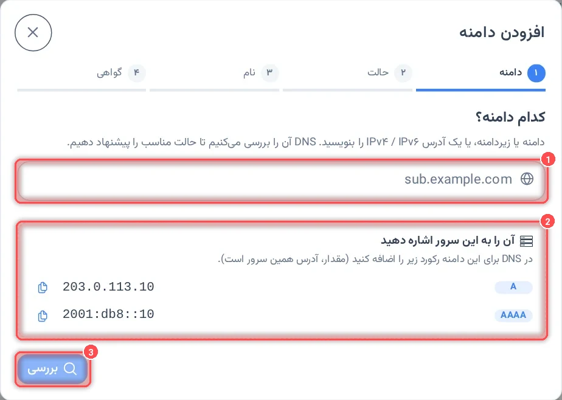

در قدم بعد حالت دامنه را انتخاب می‌کنید:

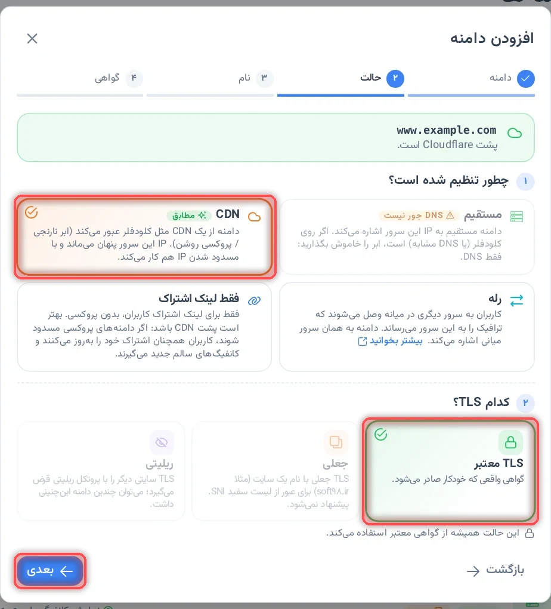

حالت‌ها (**چطور تنظیم شده است؟**):

- **مستقیم:** دامنه مستقیماً به IP سرور شما اشاره می‌کند. اگر دامنه روی کلادفلر است، ابر را خاموش بگذارید (فقط DNS).
- **CDN:** دامنه از یک CDN مثل کلادفلر عبور می‌کند (ابر نارنجی روشن). **CDN** شبکه‌ای از سرورهاست که بین کاربران و سرور شما قرار می‌گیرد، پس IP سرور شما پنهان می‌ماند.
- **رله:** کاربران به سرور دیگری در میانه وصل می‌شوند که ترافیک را به این سرور می‌رساند.
- **فقط لینک اشتراک:** فقط برای لینک اشتراک استفاده می‌شود و پروکسی ندارد.

TLS (**کدام TLS؟**): **TLS معتبر** (گواهی واقعی که خودکار صادر می‌شود)، **جعلی** (TLS جعلی با نام یک سایت دیگر؛ پیشنهاد نمی‌شود) و **ریالتی** (TLS سایتی دیگر را با پروتکل ریالتی قرض می‌گیرد). بعضی حالت‌ها همیشه از گواهی معتبر استفاده می‌کنند و پنجره این را به شما می‌گوید.

!!! info "تغییر در نسخه ۱۳"
    حالت‌های جداگانه قدیمی **Auto CDN IP**، **Fake** و **Reality** دیگر نوع دامنه نیستند. هنگام ارتقا، دامنه‌های Auto CDN IP به **CDN** تبدیل شدند و دامنه‌های Fake و Reality به دامنه **مستقیم** با حالت TLS **جعلی** یا **ریالتی**.

### دامنه مستقیم { #direct-domain }

روی **افزودن دامنه** بزنید، دامنه را وارد کنید و **مستقیم** را با **TLS معتبر** انتخاب کنید. تنظیمات دامنه مستقیم:

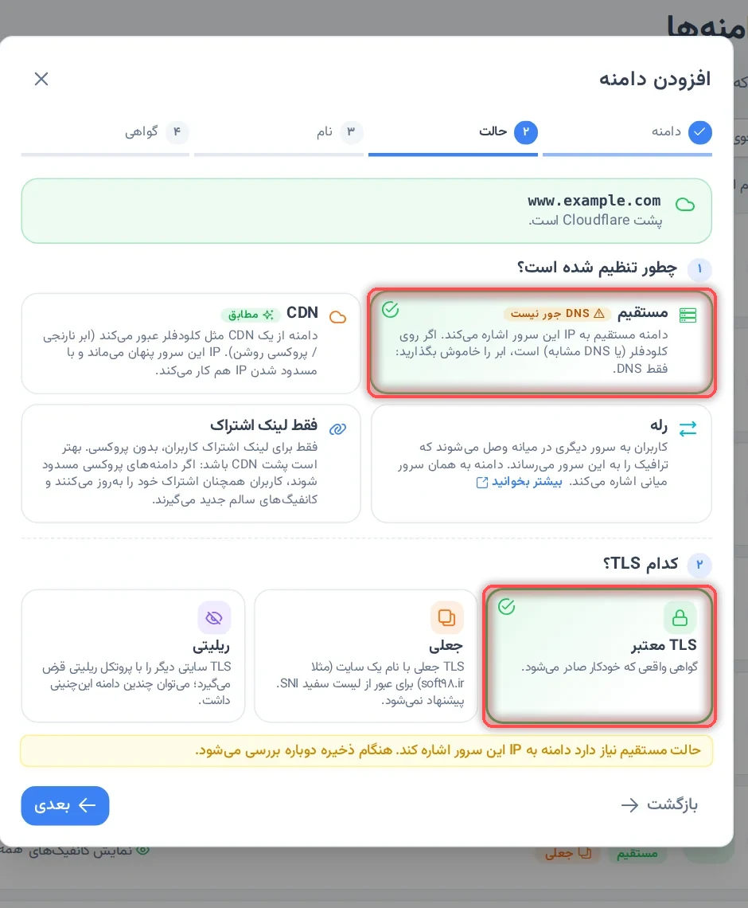

- **نام نمایشی:** به جای دامنه در اپ کاربران نشان داده می‌شود. اگر نمی‌خواهید دامنه در کانفیگ‌ها دیده شود، از آن استفاده کنید.
- **اجبار کانفیگ‌ها به استفاده از این IPها یا دامنه‌ها:** برای دامنه مستقیم خالی بگذارید. این فیلد بیشتر برای دامنه‌های CDN است.
- **نمایش کانفیگ‌های:** انتخاب کنید کاربرانی که صفحه کاربری را با این دامنه باز می‌کنند، کانفیگ‌های کدام دامنه‌ها را ببینند.

پیشنهاد: اگر یک دامنه با IP فیلترنشده و جدا از بقیه دارید، برای آن همه دامنه‌های دیگر (به جز خودش) را در «نمایش کانفیگ‌های» انتخاب کنید. چون از این IP برای فیلترشکن استفاده نمی‌شود و فقط یک سایت ساده است، احتمال مسدود شدنش کم است و کاربران همیشه می‌توانند پروفایل‌هایشان را به‌روز کنند.

### دامنه فقط لینک اشتراک { #subscription-only-domain }

این دامنه فقط لینک اشتراک را ارائه می‌دهد. چون ترافیک پروکسی از آن عبور نمی‌کند، احتمال مسدود شدنش کمتر است و کاربران همیشه می‌توانند کانفیگ‌هایشان را به‌روز کنند.

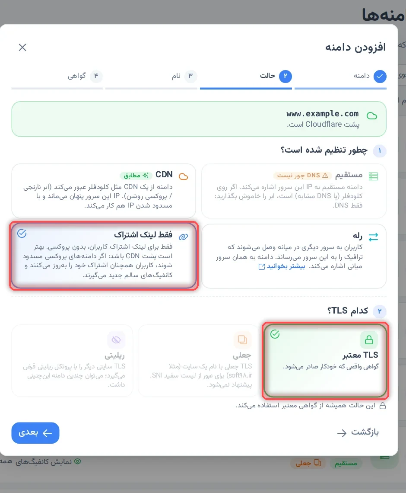

بعد از این‌که در «نمایش کانفیگ‌های» دامنه فقط لینک اشتراک را به دامنه‌های اتصال وصل کردید، صفحه کاربری را از طریق آن باز کنید. کانفیگ‌های این صفحه از دامنه‌های اتصال شما استفاده می‌کنند.

نکته: دامنه اشتراک پشت CDN بهتر کار می‌کند، چون وقتی دامنه‌های پروکسی مسدود شوند هم کاربران می‌توانند به‌روزرسانی کنند. می‌توانید از یک سایت PHP هم برای لینک اشتراک استفاده کنید: [استفاده از سایت PHP برای لینک اشتراک](/fa/manager/domain-worker-cdn-and-tunneling/How-to-use-a-PHP-site-for-sub-links/).

### دامنه CDN { #cdn-domain }

روی **افزودن دامنه** بزنید، دامنه را وارد کنید و **CDN** را انتخاب کنید. تنظیمات دامنه CDN:

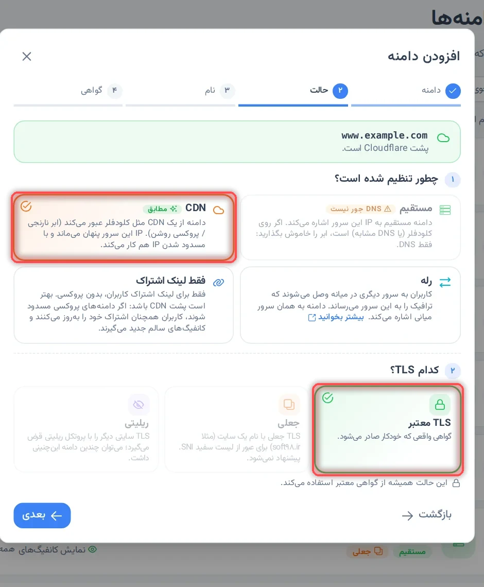

- **نام نمایشی:** به جای دامنه در اپ کاربران نشان داده می‌شود.
- **اجبار کانفیگ‌ها به استفاده از این IPها یا دامنه‌ها:** یک IP تمیز کلادفلر را اینجا بگذارید، یا بهتر، یک رکورد DNS معمولی (ابر خاموش) که به IP تمیز اشاره می‌کند. به این ترتیب وقتی IP تمیز جدید لازم داشتید، فقط همان رکورد DNS را عوض می‌کنید و تنظیمات پنل و کانفیگ‌ها ثابت می‌مانند. برای پیدا کردن IP تمیز، [راهنمای یافتن IP تمیز کلادفلر](/fa/manager/domain-worker-cdn-and-tunneling/Guide-for-finding-a-clean-Cloudflare-IP/) را ببینید. این فیلد جای حالت قدیمی Auto CDN IP را گرفته است: [راهنمای حالت Auto_CDN_IP](/fa/manager/domain-worker-cdn-and-tunneling/Guide-for-using-mode-Auto_CDN_IP-on-Hiddify/).
- **دامین فرانتینگ:** اختیاری. اپ کاربران به جای دامنه شما نام سایت دیگری (SNI) را نشان می‌دهد، پس فیلتر فقط آن سایت را می‌بیند. از سایت‌هایی روی همان CDN دامنه خود استفاده کنید. در نسخه‌های قدیمی این یک تنظیم سراسری بود؛ حالا برای هر دامنه CDN جداگانه تنظیم می‌شود. [راهنمای دامین فرانتینگ](/fa/manager/domain-worker-cdn-and-tunneling/Guide-for-domain-fronting/) را ببینید.
- **ECH:** برای این دامنه CDN از Encrypted Client Hello استفاده می‌کند. ابتدا **فعال‌سازی TLS ECH** را در **تنظیمات** روشن کنید.
- **نمایش کانفیگ‌های:** انتخاب کنید کاربران در صفحه کاربری این دامنه کانفیگ‌های کدام دامنه‌ها را ببینند.

اگر کاربران زیادی دارید و می‌خواهید به هر گروه دامنه جداگانه بدهید، [استفاده از چند دامنه CDN](/fa/manager/domain-worker-cdn-and-tunneling/How-to-use-multiCDN-domains-in-HiddifyManager/) را بخوانید.

### سایر حالت‌های دامنه { #other-domain-setups }

- **دامنه رله:** [افزودن دامنه رله](/fa/manager/domain-worker-cdn-and-tunneling/How-to-add-relay-domain-to-Hiddify-manager/) را ببینید.
- **حالت TLS جعلی:** [ساخت و استفاده از دامنه فیک](/fa/manager/domain-worker-cdn-and-tunneling/How-to-create-and-use-fake-domain/) را ببینید.
- **حالت TLS ریالتی:** [استفاده از ریالتی](/fa/manager/configuration-and-advanced-settings/How-to-use-Reality-on-Hiddify/) را ببینید.
- **ورکرهای کلادفلر:** [راه‌اندازی و استفاده از ورکرهای کلادفلر](/fa/manager/domain-worker-cdn-and-tunneling/How-to-set-up-and-use-Cloudflare-workers/) را ببینید.

## پروکسی‌ها و پروتکل‌ها { #proxies-and-protocols }

برای روشن یا خاموش کردن پروتکل‌ها، روش‌های انتقال و ترفندهای TLS برای کل پنل، **پروتکل‌ها** را باز کنید. روی هر کارت بزنید تا روشن یا خاموش شود و سپس ذخیره کنید. کارت‌ها در گروه‌های پروتکل‌ها، روش‌های انتقال، امنیت و ترفندها و سایر قرار دارند و هر گروه دکمه فعال‌سازی همه و غیرفعال‌سازی همه دارد. لینک **تنظیمات** هر کارت، تنظیمات آن را باز می‌کند. همین کلیدها در **تنظیمات ← تنظیمات پروکسی** هم هستند. **ویرایشگر پروکسی** به کاربران حرفه‌ای امکان می‌دهد هر قالب پروکسی داخلی را ویرایش کنند.

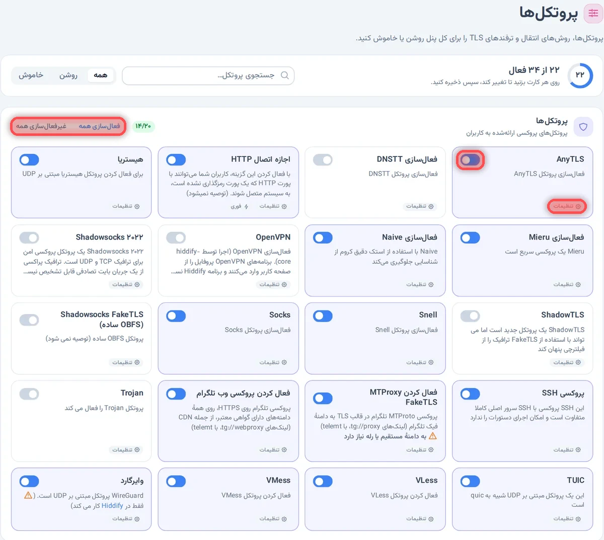

پایین‌تر در همین صفحه، روش‌های انتقال (ترنسپورت‌ها):

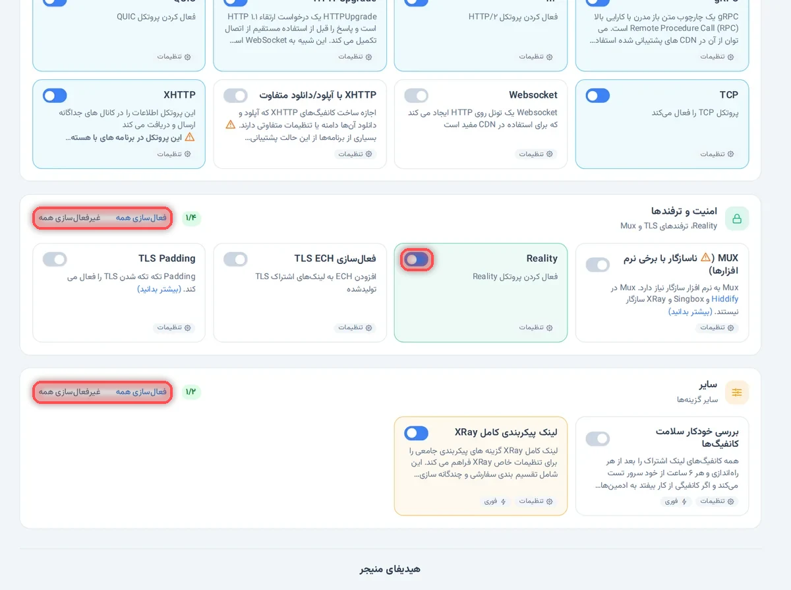

توجه: اتصال‌های HTTP ساده رمزگذاری ندارند، اما اتصال‌های TLS رمزگذاری دارند.

## خروجی‌ها { #outbounds }

**خروجی‌ها** (Outbounds) تعیین می‌کنند ترافیک کاربران از کجا از سرور شما خارج شود: مستقیم، از طریق وارپ، مسدود، یا از یک خروجی Socks، Tor یا Psiphon. خروجی‌ها از بالا به پایین بررسی می‌شوند: ترافیک از اولین خروجی‌ای بیرون می‌رود که سایتش در فهرست آن باشد، و آخرین خروجی فعال بقیهٔ ترافیک را می‌گیرد. هر ادمین هم می‌تواند در **حساب من** یک خروجی پیش‌فرض برای کاربران خودش انتخاب کند.

آموزش کامل: [خروجی‌ها](How-to-use-Outbounds-on-HiddifyManager.md). برای خود وارپ، [فعال‌سازی WARP](/fa/manager/configuration-and-advanced-settings/How-to-activate-WARP-on-the-Hiddify-panel/) را ببینید.

## تنظیمات { #settings }

**تنظیمات** را باز کنید. یک صفحهٔ بلند از کارت‌هاست و تنظیمات رایج اول نمایش داده می‌شوند. برای دیدن بقیه، کلید **نمایش تنظیمات پیشرفته** را در بالای صفحه روشن کنید یا در کادر جستجو بنویسید. تنظیماتی که برچسب **نصب دوباره** دارند فقط بعد از نصب دوباره اعمال می‌شوند ([اقدامات](#apply-status) را ببینید).

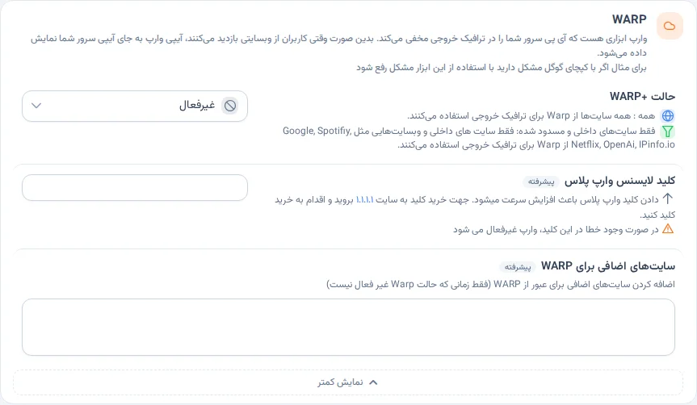

هر کارت برای چیست. روی نام کارت بزنید تا **همهٔ** تنظیمات آن را، با تصویر، در [همهٔ تنظیمات هیدیفای‌منیجر](Settings-reference.md) ببینید:

| کارت | برای چیست |
|---|---|
| [تنظیمات ادمین](Settings-reference.md#admin) | زبان پنل، پنل والد برای چند سرور، نام نود |
| [شخصی‌سازی صفحهٔ کاربر](Settings-reference.md#branding) | عنوان، لینک و متن پشتیبانی، زبان صفحهٔ کاربر |
| [تنظیمات عمومی](Settings-reference.md#general) | DNS، کشور، سایت فریب، فایروال، به‌روزرسانی خودکار، پشتیبان‌ها |
| [تنظیمات پروکسی](Settings-reference.md#proxies) | کدام ترنسپورت‌ها و پروتکل‌ها در کانفیگ‌ها باشند، مسدود کردن سایت‌های داخلی |
| [کانفیگ‌های تلگرام](Settings-reference.md#telegram) | پروکسی تلگرام (MTProxy / وب‌پروکسی) |
| [HTTP / TLS](Settings-reference.md#http) | پورت‌ها و گزینه‌های TLS کانفیگ‌ها |
| [MUX، ترفند TLS](Settings-reference.md#mux) | ترفندهای اتصال؛ [MUX](/fa/manager/basic-concepts-and-troubleshooting/How-MUX-works-and-its-usage/) و [ترفند TLS](/fa/manager/basic-concepts-and-troubleshooting/How-the-TLS-Trick-works-and-its-usage/) را ببینید |
| [پروکسی SSH، Mieru، TUIC، Hysteria، WireGuard، Shadowsocks، DNSTT](Settings-reference.md#ssh) | گزینه‌های همین پروتکل‌ها |
| [WARP](Settings-reference.md#warp) | [آموزش فعال‌سازی وارپ](/fa/manager/configuration-and-advanced-settings/How-to-activate-WARP-on-the-Hiddify-panel/) را ببینید |
| [ریالتی](Settings-reference.md#reality) | [آموزش استفاده از ریالتی](/fa/manager/configuration-and-advanced-settings/How-to-use-Reality-on-Hiddify/) را ببینید |
| [پیشرفته / خیلی پیشرفته](Settings-reference.md#advanced) | مسیرهای پروکسی، API کلادفلر، کانال به‌روزرسانی و گزینه‌های تخصصی |

## ویرایشگر پروکسی { #proxy-editor }

**ویرایشگر پروکسی** برای کاربران حرفه‌ای است که می‌خواهند نحوهٔ ساخته شدن کانفیگ‌ها را تغییر دهند:

- **پروکسی‌ها (Proxies):** همهٔ پروکسی‌های داخلی (پروتکل، ترنسپورت، لایهٔ TLS و هسته) با کلید و تنظیمات جداگانه.
- **Base Configs** و **Templates:** کانفیگ‌های سرور و کلاینت که پروکسی‌ها از روی آن‌ها ساخته می‌شوند.
- **Template Variables:** مقدارهایی که قالب‌ها از آن‌ها استفاده می‌کنند.

یک تغییر اشتباه این‌جا می‌تواند همهٔ کانفیگ‌ها را خراب کند؛ **Reset all to defaults** نسخه‌های داخلی را برمی‌گرداند. آموزش کامل: [ویرایشگر پروکسی](How-to-use-the-Proxy-Editor-in-HiddifyManager.md).

## پشتیبان‌گیری { #backup }

برای گرفتن پشتیبان از پنل یا بازیابی آن، **پشتیبان‌گیری** را در منو باز کنید. نام این صفحه **پشتیبان‌گیری و بازیابی** است.

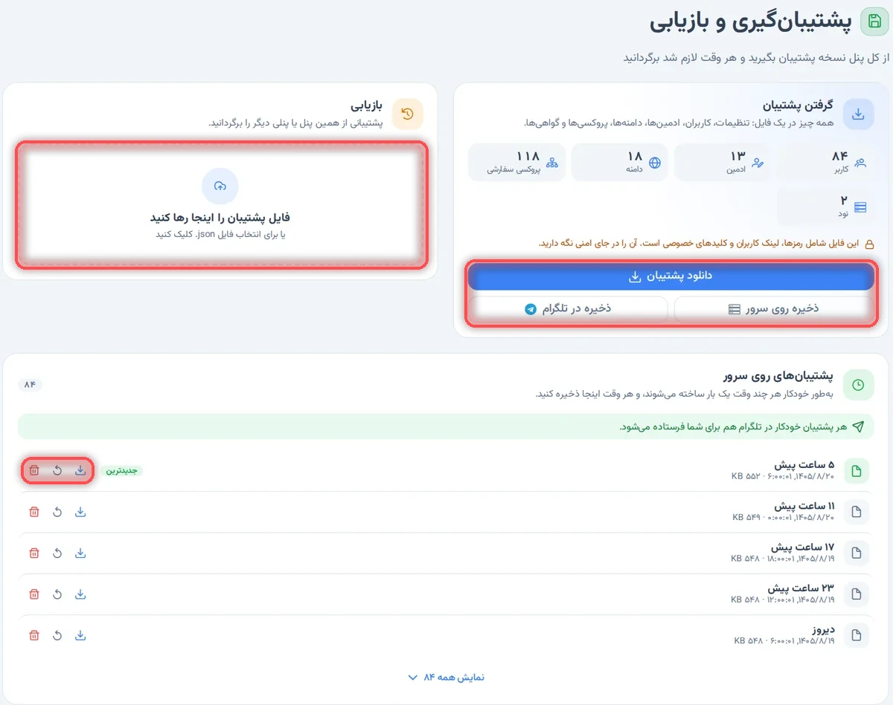

- در بخش **گرفتن پشتیبان**، **دانلود پشتیبان** همه چیز را در یک فایل `.json` ذخیره می‌کند: تنظیمات، کاربران، ادمین‌ها، دامنه‌ها، پروکسی‌ها و گواهی‌ها. فایل را جای امنی نگه دارید؛ شامل رمزها، لینک کاربران و کلیدهای خصوصی است. **ذخیره روی سرور** و **ذخیره در تلگرام** نسخه را روی سرور نگه می‌دارند یا در تلگرام برایتان می‌فرستند.
- پنل هر ۶ ساعت هم به‌طور خودکار روی سرور پشتیبان می‌گیرد. این پشتیبان‌ها در بخش **پشتیبان‌های روی سرور** فهرست می‌شوند و می‌توانید هر کدام را دانلود، بازیابی یا حذف کنید. اگر بات تلگرام شما وصل باشد، هر کدام در تلگرام هم برایتان فرستاده می‌شود.
- برای بازیابی، فایل `.json` پشتیبان را روی بخش **بازیابی** رها کنید (یا روی آن بزنید و فایل را انتخاب کنید). انتخاب می‌کنید کدام بخش‌ها برگردند: **تنظیمات**، **کاربران** و **دامنه‌ها**.

جزئیات: [پشتیبان‌گیری و بازیابی پنل](/fa/manager/configuration-and-advanced-settings/How-to-backup-and-restore-panel-on-Hiddify/).

## بات تلگرام { #telegram-bot }

گزینهٔ **بات تلگرام** در منو، بات پنل شما را در تلگرام باز می‌کند. با آن شما و کاربرانتان لینک‌ها، مصرف، هشدارها و پشتیبان‌ها را در تلگرام می‌گیرید، و [صندوق پیام](#inbox) هم از طریق آن کار می‌کند. برای راه‌اندازی و استفاده از بات، [این راهنما](/fa/manager/configuration-and-advanced-settings/How-to-set-up-and-use-Telegram-bot-on-Hiddify-panel/) را ببینید.

## اقدامات (اعمال و وضعیت) { #apply-status }

**اقدامات** را در منو باز کنید. در صفحه **اعمال و وضعیت** می‌توانید تغییرات را اعمال کنید، سرور را به‌روز کنید و وضعیت همه چیز را ببینید. هر کارت نشان می‌دهد اقدام چقدر طول می‌کشد و آخرین بار کی اجرا شده است. هر اقدام هنگام اجرا لاگ خود را نشان می‌دهد. می‌توانید از صفحه خارج شوید؛ اقدام روی سرور ادامه پیدا می‌کند. زیر کارت‌ها دکمه‌های **پاکسازی کش**، **پورت‌های عمومی** و **Live connection test** هم هستند.

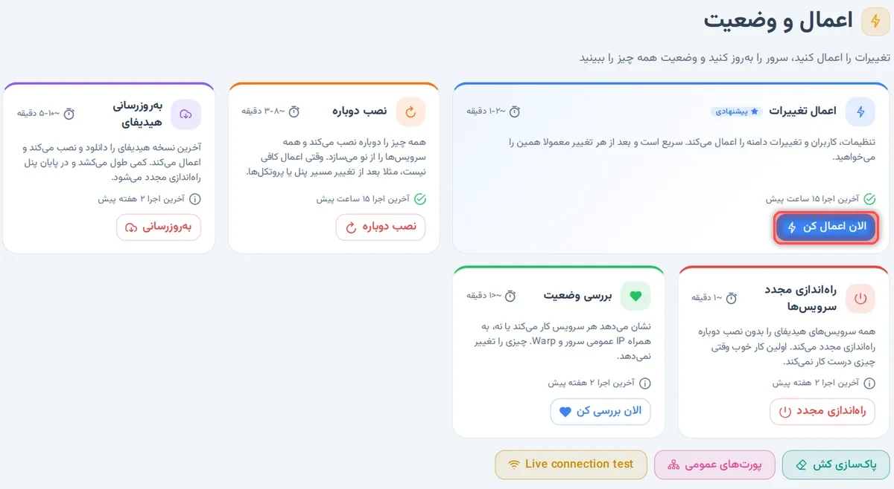

### بررسی وضعیت { #check-status }

روی **الان بررسی کن** بزنید. نشان می‌دهد هر سرویس کار می‌کند یا نه، به همراه IP عمومی سرور و وضعیت WARP. چیزی را تغییر نمی‌دهد.

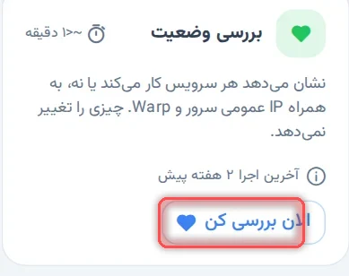

### لاگ‌ها { #logs }

بخش **لاگ‌ها** نشان می‌دهد هر اقدام چه کرد (مثلاً `hiddify_panel.log`، `status.log` و `warp.log`). برای خواندن هر لاگ روی آیکون چشم بزنید؛ آیکون‌های دیگر آن را دانلود می‌کنند یا به تلگرام می‌فرستند.

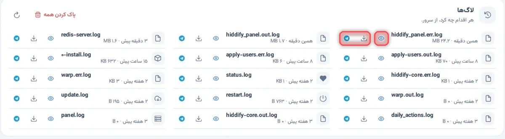

### اعمال تغییرات { #apply-changes }

روی **الان اعمال کن** بزنید. تنظیمات، کاربران و تغییرات دامنه را اعمال می‌کند. سریع است و معمولاً بعد از هر تغییر همین را می‌خواهید.

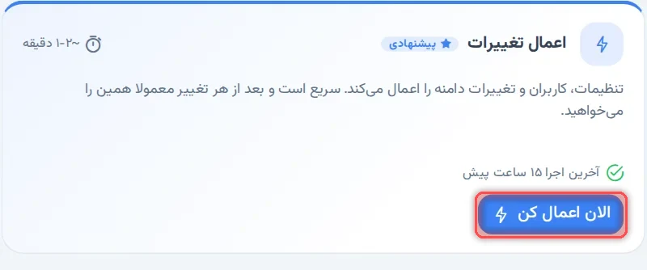

- وقتی تمام شد، صفحه لینک‌های ادمین روی دامنه‌های شما را نشان می‌دهد. ممکن است عوض شده باشند، پس قبل از خروج آن‌ها را کپی کنید.
- اگر بعد از یک تغییر پنل دیگر باز نشد، با SSH به سرور وصل شوید و این دستور را اجرا کنید تا لینک‌های فعلی ادمین را ببینید:

```bash
hiddify admin
```

- اگر مشکل حل نشد، [اتصال و عیب‌یابی از طریق SSH](/fa/manager/configuration-and-advanced-settings/How-to-connect-and-troubleshoot-via-SSH/) را ببینید.

### به‌روزرسانی هیدیفای { #update-hiddify }

روی **به‌روزرسانی** بزنید. آخرین نسخه را دانلود و نصب می‌کند و سپس اعمال می‌کند. کمی طول می‌کشد و در پایان پنل دوباره راه‌اندازی می‌شود. [به‌روزرسانی هیدیفای‌منیجر](/fa/manager/configuration-and-advanced-settings/How-to-update-Hiddify-panel/) را ببینید.

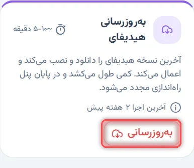

### نصب دوباره { #reinstall }

روی **نصب دوباره** بزنید. همه چیز را دوباره نصب می‌کند و همه سرویس‌ها را از نو می‌سازد. کاربران و لینک‌ها تغییری نمی‌کنند. وقتی **اعمال تغییرات** کافی نیست از آن استفاده کنید، مثلاً بعد از تغییر مسیر پنل، پروتکل‌ها یا تنظیمی که برچسب **نصب مجدد** دارد. ممکن است اتصال‌ها چند دقیقه قطع شوند.

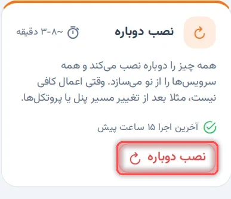

### راه‌اندازی مجدد سرویس‌ها { #restart-services }

روی **راه‌اندازی مجدد** بزنید. همه سرویس‌های هیدیفای‌منیجر را بدون نصب دوباره، از نو راه‌اندازی می‌کند. وقتی چیزی درست کار نمی‌کند، اولین کار خوبی است که می‌توانید امتحان کنید. اتصال‌ها لحظه‌ای قطع می‌شوند.

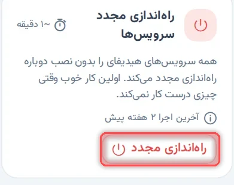

## API { #api }

گزینهٔ **API** مستندات API پنل را باز می‌کند تا کاربران و ادمین‌ها را از برنامه‌ها یا بات‌های خودتان مدیریت کنید. [استفاده از API هیدیفای‌منیجر](/fa/manager/contribution/How-to-use-API-in-HiddifyManager-project/) را ببینید.

## حساب من { #my-account }

روی آیکون آدمک بالای صفحه بزنید تا **حساب من** باز شود: لینک ادمین شما، محدودیت‌هایتان، زبان، رمز و **passkey** (ورود بدون رمز)، و برای کاربران خودتان (و کاربران ادمین‌های زیرمجموعه): **خروجی پیش‌فرض**، **کانفیگ‌های کاربرانم** که به سابسکریپشن همه‌شان اضافه می‌شود، و **صفحهٔ کاربرانم**، یعنی صفحهٔ کاربر اختصاصی. آموزش کامل: [حساب من و امنیت ادمین](My-account-and-admin-security-in-HiddifyManager.md).

## راهنما { #help }

همه آموزش‌ها و ویدیوها در [صفحه آموزش‌های هیدیفای‌منیجر](/fa/manager/) فهرست شده‌اند. همهٔ تنظیمات هم در [همهٔ تنظیمات هیدیفای‌منیجر](Settings-reference.md) توضیح داده شده‌اند.

## مقاله‌های مرتبط

- [همهٔ تنظیمات پنل، یکی‌یکی](/fa/manager/configuration-and-advanced-settings/Settings-reference/)
- [منوی هیدیفای‌منیجر در SSH](/fa/manager/configuration-and-advanced-settings/How-to-connect-and-troubleshoot-via-SSH/)
- [انتقال کاربران از پنل X-UI](/fa/manager/configuration-and-advanced-settings/how-to-import-xui-to-hiddifymanager/)
- [لینک ادمین و فرمت آن](/fa/manager/domain-worker-cdn-and-tunneling/The-correct-format-of-admin-link/)

</div>
