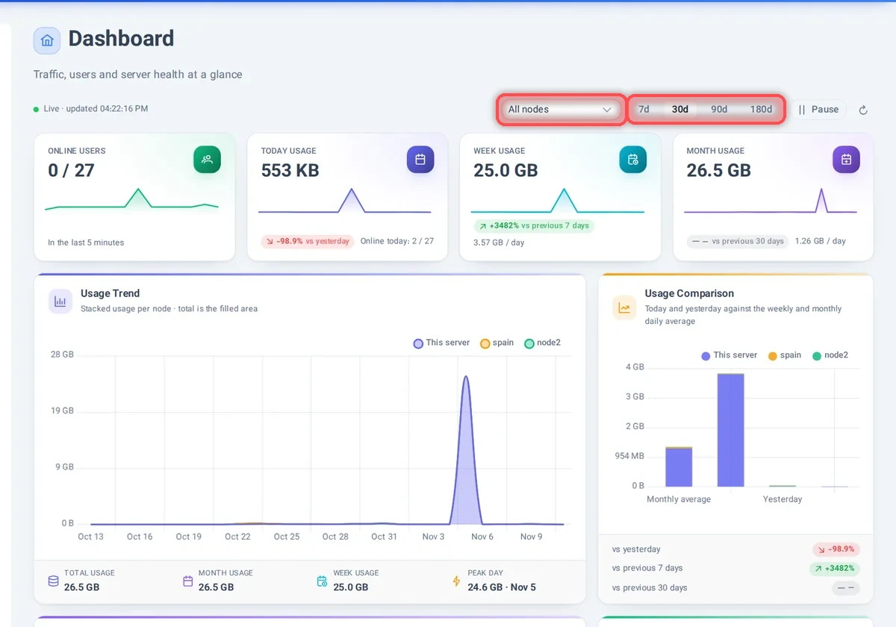
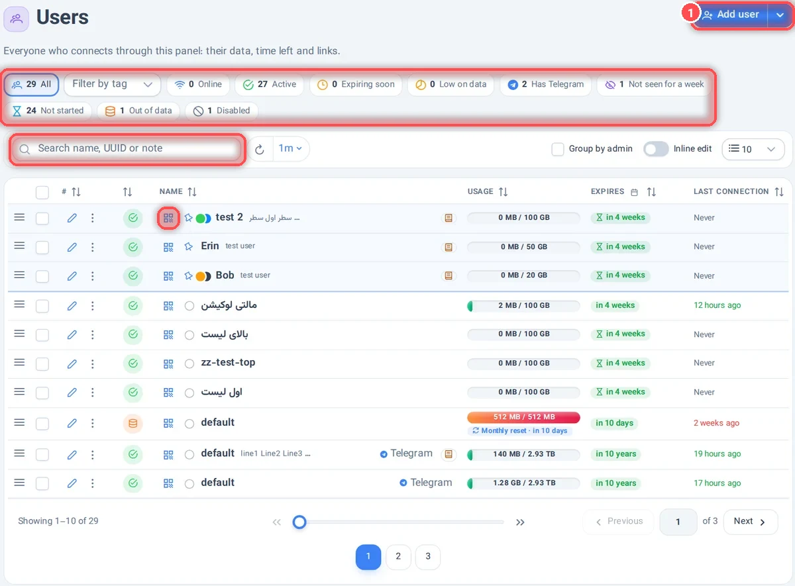
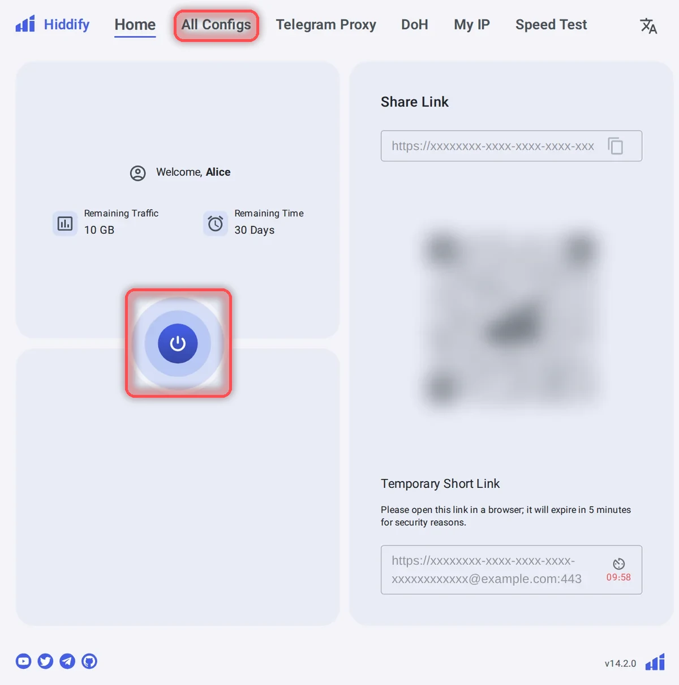
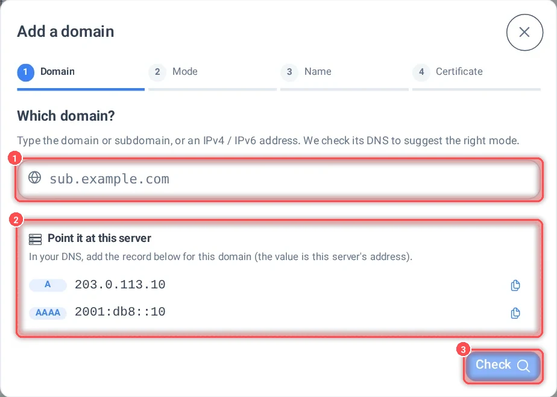
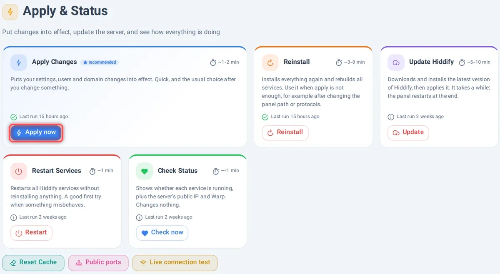
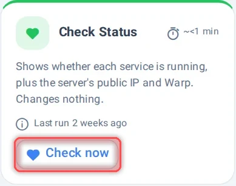
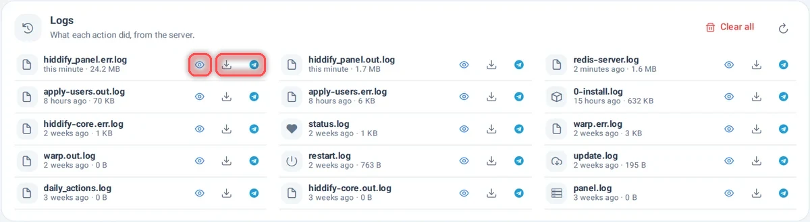
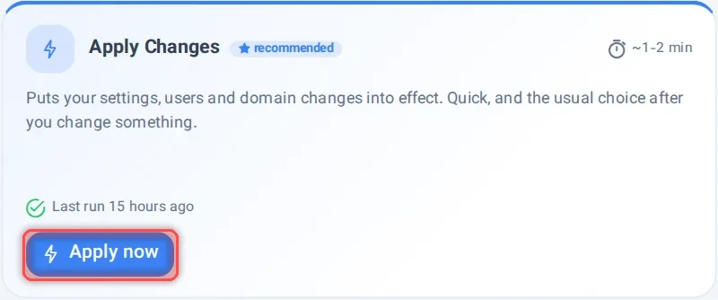
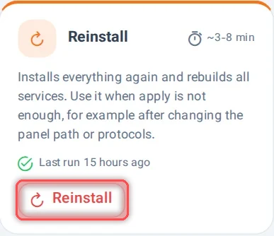
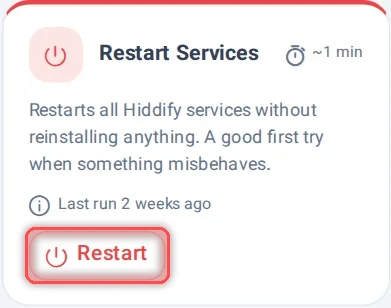

<div dir="ltr" markdown="1">

# How to configure HiddifyManager properly

This page walks you through the first setup of the HiddifyManager admin panel and gives a tour of every menu, in the order of the panel's own menu. Each part says what the page is for and what matters most on it, and links to the full guide of that part. Read it right after you install the panel, or whenever you want to know what a menu or setting is for.

!!! info "Written for HiddifyManager v14.5"
    The menu names and screenshots on this page are from HiddifyManager v14.5. Every option of the **Settings** page is listed, with the panel's own explanation, in [All HiddifyManager settings](Settings-reference.md), which is made from the panel's code for each release.

The panel makes running proxies easier, but it cannot fix a blocked server or a broken domain. If you finish this page and your users still cannot connect, read [Troubleshooting connectivity issues](/manager/basic-concepts-and-troubleshooting/Troubleshooting-connectivity-issues-with-HiddifyManager-and-proxies/).

## Before you start

You need:

1. **A server with a clean IP.** A clean IP is one that is not blocked in your users' country. Check it with [How to make sure the server's IP or domain is clean](/manager/basic-concepts-and-troubleshooting/How-to-make-sure-the-server%27s-IP-or-domain-is-clean/). If the IP is blocked, get a new IP or a new server.
2. **HiddifyManager installed**, as described in the [installation guide](/manager/installation-and-setup/guide/). At the end of the install you get your **admin links**. The admin link contains your secret path and your admin ID, so it works like a password. See [the correct format of the admin link](/manager/domain-worker-cdn-and-tunneling/The-correct-format-of-admin-link/).
3. **A registered domain that is reachable.** A domain is a name such as `example.com` that points to your server. See [domain types and how to register them](/manager/domain-worker-cdn-and-tunneling/Domain-types-and-how-to-register-them/), then [check that the domain is clean](/manager/basic-concepts-and-troubleshooting/How-to-make-sure-the-server%27s-IP-or-domain-is-clean/).

If a word on this page is new to you, see [Basic concepts](/manager/basic-concepts-and-troubleshooting/Basic-Concepts/).

## Open the admin panel for the first time

- If you used a one-click install link from a provider such as Vultr or OVH, wait about 10 minutes. You then get a one-time link that opens the admin page.
- If you installed over SSH, the admin links are printed in the terminal at the end of the install. Open one of the **Secure** (https, domain) links in your browser. Use the **Not Secure** IP link only if no domain link works.
- If you lost the links, connect to your server over SSH and run:

```bash
hiddify admin
```


Your admin link has the form `https://<domain>/<admin proxy path>/<admin UUID>/`, for example `https://sub.example.com/DrtGho0n4b8H9D/8bncvfb5-8193-vv76-ab97-4c35965l250m/`. When you open it, the panel signs you in and opens **Admin V2**, the new admin panel, and the address in your browser changes to `https://sub.example.com/DrtGho0n4b8H9D/admin/v2/`. Keep the link private: it works like a password. See [The correct format of the admin link](/manager/domain-worker-cdn-and-tunneling/The-correct-format-of-admin-link/).

The first time you open the admin page, the **Quick setup** wizard starts.

## Quick setup

The wizard has six short steps: **Welcome → Password → Domains → Protocols → Nodes → Finish**. Use **Next** and **Back** to move between them, or **Skip for now** to leave the wizard. You can change everything later in **Settings**.

1. **Welcome:** choose the **Admin panel language** and the **Country** your users are in (Iran, China, Russia or Others). The country applies settings that suit its filtering.
2. **Password:** set a password for the admin area (at least 8 characters).
3. **Domains:** point your domain to the server IPs shown on the page (an `A` record for IPv4, `AAAA` for IPv6). Then type your domain and press Enter. The panel detects the domain type by itself; tap the type to change it. You need at least one direct, CDN or subscription-only domain.
4. **Protocols:** pick the protocols you want to offer. Choose as few as you need.
5. **Nodes** (optional): connect other HiddifyManager servers to manage them from this panel. You can skip this.
6. **Finish:** review your choices and click **Finish**. The panel applies the configuration and reinstalls the services. This takes a few minutes. The log and your new admin links are shown while it runs.

When it finishes, the panel is ready to use. Copy the new admin links and keep them somewhere safe.


## The admin menu

The sidebar on the left has these groups. The sections below follow the same order.

- **Manager:** [Dashboard](#dashboard), [Users](#users), [Admins](#admins), [Inbox](#inbox), [Nodes](#nodes) and [Tools](#tools) (Config Tester, Scanner, Text Decoders, QR Code, SSH Terminal).
- **Settings:** [Domains](#domains), [Protocols](#proxies-and-protocols), [Outbounds](#outbounds), [Settings](#settings), [Proxy Editor](#proxy-editor) (Proxies, Base Configs, Templates, Template Variables), [Backup](#backup), [Actions](#apply-status) (the **Apply & Status** page), [Telegram Bot](#telegram-bot) and [API](#api).
- **Help** and **Donation**.

Your own account (password, passkeys, language and the defaults for your users) is under the person icon at the top: see [My account](#my-account).

!!! tip "Install the panel as an app"
    The first time you open the panel, it offers to install itself as an app on your phone or computer (**Install the panel as an app**). It then opens in its own window, one tap away. Tick **Do not show this again** if you don't want it.

## Dashboard

The Dashboard shows traffic, users and server health at a glance: online users, today's, this week's and this month's usage, and charts of usage and users over time (7, 30, 90 or 180 days). If you use several servers (nodes), pick one in the node filter. Further down, **Config Health** tests every config from the server, and **Node Health** shows CPU, RAM and network for each node. See [Automatic config health checks](Automatic-config-health-checks-on-HiddifyManager.md).



## Users

Here you create an account for each person who will use your proxies.

1. Open **Users** and click **Add user**.
2. In the **New user** window, enter a **Name** (and, if you like, a **Note** that only admins see).
3. Under **Data**, set the **Usage limit** (or pick 10 GB, 50 GB, 100 GB …) and the **Reset period**: **Without reset**, **Monthly**, **Weekly** or **Daily**.
4. Under **Time**, set the **Package length** (or pick 1 week, 1 month, 3 months …). The days start at the user's first connection.
5. Click **Add user**. The user's link and QR code open, ready to send.



Click **Add user** to open the **New user** window:


The Users page lists everyone with their usage, expiry date and last connection. Use the search box and the filters (Online, Active, Expiring soon, Low on data, …) to find users.

Each user has their own **user page**. Open it with the QR code button in the user's row, which shows the user's link. On the user page the user sees the remaining traffic and time and a big connect button. Tapping it opens **Configure Your VPN**, where the user picks an app or uses **Copy Link**. The menu of the user page also has **All Configs**, with every config of the user.



Under **All Configs** the user finds every config and subscription link:


You can give users access in three ways:

1. **The user page link (recommended).** The user opens it and finds everything there.
2. **The subscription link.** A subscription link is one address that the app re-reads to get the latest configs. If you change your settings, the user's app updates itself.
3. **A single config link.** It does not update. If you change your settings, you must send the user a new link.

For help connecting client apps, see the client tutorials on the [HiddifyManager tutorials page](/manager/).

## Admins

Here you create accounts for other people who help you manage the panel. Click **Add admin** and fill in the form. The admins are shown as a tree: each admin's limits cover their own users and everyone below them. Each admin has an **Admin link** button.


There are three admin types:

- **Super admin:** full access to the whole panel and all settings.
- **Admin:** can manage users and some settings.
- **Agent:** can only manage users.

For each admin you can:

- limit the number of users and active users;
- allow or forbid adding sub-admins;
- reset their password.

!!! note
    Each admin's link contains their secret ID. If you change it, that admin's panel address changes completely. See [the correct format of the admin link](/manager/domain-worker-cdn-and-tunneling/The-correct-format-of-admin-link/).

Each admin can also set a password and passkeys, a default outbound, extra configs and a custom user page for their own users on their **My account** page: see [My account](#my-account).

## Inbox { #inbox }

The **Inbox** gathers the people who write to your Telegram bot, their requests for a free test, and the messages you send to your users. Here you make **free test packages** (a link that gives whoever opens it a test account, given automatically or after you approve it), answer conversations, and use **Send Message** to write to all your users, or to the active or expired ones, through the bot. It needs the [Telegram bot](#telegram-bot).

Full guide: [Inbox, free test packages and messages to users](Inbox-free-test-and-messages-on-HiddifyManager.md).

## Nodes { #nodes }

**Nodes** are other HiddifyManager servers connected to this panel. Users and admins are shared with them automatically, so one account works on every server, and the usage of all servers is added up here. The page shows each node's state and lets you add, ping and manage them. The Dashboard can show each node on its own.

Full guide: [Multi-server with nodes](Multi-server-with-nodes-on-HiddifyManager.md).

## Tools { #tools }

The **Tools** menu has helpers that run from the panel:

- **Config Tester:** runs every config of a subscription in its own core and checks that it connects.
- **Scanner:** finds Cloudflare IPs that work on your internet (with **Fragment** and **REALITY SNI** tests too), to give to the users of your ISP.
- **Text Decoders:** decodes and edits share links, subscriptions, Base64 and URLs, in your browser.
- **QR Code:** makes a QR code from any text, or reads one with the camera or from an image.
- **SSH Terminal:** opens a terminal on any server, and its files, right from the panel.

Full guide: [The panel's tools](How-to-use-the-panel-tools-in-HiddifyManager.md).

## Domains

Open **Domains** (in the **Settings** group of the menu) to add or edit your domains. The list shows each domain with its mode, its TLS and certificate state, its custom proxies and **Show configs of**. The order matters: drag the handle to sort. Configs list domains in this order, and the first one is used for panel links.


Each domain has a **mode**, which says how users reach your server, and a **TLS** choice, which says which certificate or disguise it uses.

To add a domain, click **Add domain**. The **Add a domain** window has four steps: **Domain → Mode → Name → Certificate**.

1. **Domain:** type the domain or subdomain, or an IPv4 / IPv6 address. Under **Point it at this server** you see the `A` (IPv4) and `AAAA` (IPv6) records to add in your DNS. Click **Check**: the panel checks the DNS and suggests the right mode.
2. **Mode:** answer **How is it set up?** and **Which TLS?** (see below).
3. **Name** and **Certificate:** finish the remaining steps.



In the next step you choose the mode:


Modes (**How is it set up?**):

- **Direct:** the domain points straight to your server's IP. If the domain is on Cloudflare, keep the cloud off (DNS only).
- **CDN:** the domain goes through a CDN such as Cloudflare (orange cloud on). A **CDN** is a network of servers that sits between your users and your server, so your server's IP stays hidden.
- **Relay:** users connect to another server in between, which forwards the traffic to this one.
- **Subscription only:** used only for subscription links, with no proxies.

TLS (**Which TLS?**): **Valid TLS** (a real certificate, issued automatically), **Fake** (decoy TLS with a fake site's name; not recommended) and **Reality** (borrows another site's TLS with the Reality protocol). Some modes always use a valid certificate; the window tells you when.

!!! info "Changed in v13"
    The old separate types **Auto CDN IP**, **Fake** and **Reality** are no longer domain types. On upgrade, Auto CDN IP domains became **CDN** domains, and Fake and Reality domains became **Direct** domains with the **Fake** or **Reality** TLS mode.

### Direct domain

Click **Add domain**, type the domain, and choose **Direct** with **Valid TLS**. The settings of a direct domain:


- **Display name:** shown in the users' apps instead of the domain. Use it if you don't want the domain to appear in the configs.
- **Force configs to use these IPs / domains:** leave it empty for a direct domain. It is mainly for CDN domains.
- **Show configs of:** choose which domains' configs users see when they open their user page through this domain.

### Subscription-only domain

A subscription-only domain only serves subscription links. Because no proxy traffic goes through it, it is less likely to be blocked, so users can always update their configs.


After you link the subscription-only domain to your connection domains in **Show configs of**, open a user page through it. The configs on that page use your connection domains.

Tip: a subscription domain works best behind a CDN, so users can still update when your proxy domains are blocked. You can also use a PHP website for subscription links: see [How to use a PHP site for sub links](/manager/domain-worker-cdn-and-tunneling/How-to-use-a-PHP-site-for-sub-links/).

### CDN domain { #cdn-domain }

Click **Add domain**, type the domain, and choose **CDN**. The settings of a CDN domain:


- **Display name:** shown in the users' apps instead of the domain.
- **Force configs to use these IPs / domains:** put a clean Cloudflare IP here, or better, a normal DNS record (cloud off) that points to a clean IP. Then, when you need a new clean IP, you only update that DNS record and the panel and configs stay the same. To find clean IPs, see [Guide for finding a clean Cloudflare IP](/manager/domain-worker-cdn-and-tunneling/Guide-for-finding-a-clean-Cloudflare-IP/). This field replaces the old Auto CDN IP mode: see [Guide for using mode Auto_CDN_IP](/manager/domain-worker-cdn-and-tunneling/Guide-for-using-mode-Auto_CDN_IP-on-Hiddify/).
- **Domain fronting:** optional. Users' apps show another site's name (SNI) instead of your domain, so a filter only sees that other site. Use sites on the same CDN as your domain. In older versions this was a global setting; now it is set per CDN domain. See [Guide for domain fronting](/manager/domain-worker-cdn-and-tunneling/Guide-for-domain-fronting/).
- **ECH:** uses Encrypted Client Hello for this CDN domain. Turn on **Enable TLS ECH** in **Settings** first.
- **Show configs of:** choose which domains' configs users see on this domain's user page.

If you have many users and want to give each group its own domain, read [How to use multi-CDN domains](/manager/domain-worker-cdn-and-tunneling/How-to-use-multiCDN-domains-in-HiddifyManager/).

### Other domain setups

- **Relay domain:** see [How to add a relay domain](/manager/domain-worker-cdn-and-tunneling/How-to-add-relay-domain-to-Hiddify-manager/).
- **Fake TLS mode:** see [How to create and use a fake domain](/manager/domain-worker-cdn-and-tunneling/How-to-create-and-use-fake-domain/).
- **Reality TLS mode:** see [How to use Reality](/manager/configuration-and-advanced-settings/How-to-use-Reality-on-Hiddify/).
- **Cloudflare workers:** see [How to set up and use Cloudflare workers](/manager/domain-worker-cdn-and-tunneling/How-to-set-up-and-use-Cloudflare-workers/).

## Proxies and protocols

Open **Protocols** to turn protocols, transports and TLS tricks on or off for the whole panel. Tap a card to switch it, then save. The cards are grouped into **Protocols**, **Transports**, **Security & tricks** and **Other**, and each group has **Enable all** and **Disable all**. Each card's **Settings** link opens its settings. The same switches are also in **Settings → Proxies Settings**. The **Proxy Editor** lets advanced users edit each built-in proxy template.


Note: plain HTTP connections are not encrypted. TLS connections are encrypted.

## Outbounds { #outbounds }

**Outbounds** decide where your users' traffic leaves your server: directly, through WARP, blocked, or through a Socks, Tor or Psiphon exit. They are checked from top to bottom: traffic goes out through the first outbound that lists its site, and the last enabled one gets everything else. Each admin can also pick a default outbound for their own users in **My account**.

Full guide: [Outbounds](How-to-use-Outbounds-on-HiddifyManager.md). For WARP itself, see [How to activate WARP](/manager/configuration-and-advanced-settings/How-to-activate-WARP-on-the-Hiddify-panel/).

## Settings

Open **Settings**. It is one long page of cards; common settings are shown first. Turn on **Show Advanced Settings** at the top to see the rest, or type in the search box. Settings marked **Reinstall** take effect only after a reinstall (see [Actions](#apply-status)).


What each card is for. Click a card to see **every** setting in it, with a picture, in [All HiddifyManager settings](Settings-reference.md):

| Card | What it is for |
|---|---|
| [Admin Settings](Settings-reference.md#admin) | panel language, parent panel for multi-server, node name |
| [Customizing User Page](Settings-reference.md#branding) | title, support link and text, language of the user page |
| [General Settings](Settings-reference.md#general) | DNS, country, decoy site, firewall, auto update, backups |
| [Proxies Settings](Settings-reference.md#proxies) | which transports and protocols go into the configs, domestic-site blocking |
| [Telegram Configs](Settings-reference.md#telegram) | Telegram proxy (MTProxy / web proxy) |
| [HTTP / TLS](Settings-reference.md#http) | ports and TLS options of the configs |
| [MUX, TLS Trick](Settings-reference.md#mux) | connection tricks; see [MUX](/manager/basic-concepts-and-troubleshooting/How-MUX-works-and-its-usage/) and [TLS trick](/manager/basic-concepts-and-troubleshooting/How-the-TLS-Trick-works-and-its-usage/) |
| [SSH Proxy, Mieru, TUIC, Hysteria, WireGuard, Shadowsocks, DNSTT](Settings-reference.md#ssh) | options of those protocols |
| [WARP](Settings-reference.md#warp) | see [How to activate WARP](/manager/configuration-and-advanced-settings/How-to-activate-WARP-on-the-Hiddify-panel/) |
| [Reality](Settings-reference.md#reality) | see [How to use Reality](/manager/configuration-and-advanced-settings/How-to-use-Reality-on-Hiddify/) |
| [Advanced / Very Advanced](Settings-reference.md#advanced) | proxy paths, Cloudflare API, update channel and other expert options |

## Proxy Editor { #proxy-editor }

The **Proxy Editor** is for advanced users who want to change how the configs are built:

- **Proxies:** every built-in proxy (protocol, transport, TLS layer and core) with its own switch and settings.
- **Base Configs** and **Templates:** the server and client configs the proxies are made from.
- **Template Variables:** values that the templates use.

A wrong change here can break all configs; **Reset all to defaults** brings back the built-in ones. Full guide: [Proxy Editor](How-to-use-the-Proxy-Editor-in-HiddifyManager.md).

## Backup

Open **Backup** to make a backup of your panel or restore one. The page is called **Backup & Restore**.


- Under **Make a Backup**, **Download Backup** saves everything in one `.json` file: settings, users, admins, domains, proxies and certificates. Keep the file safe: it contains passwords, user links and private keys. **Save on the server** and **Save on the Telegram** keep the copy on the server or send it to you on Telegram.
- The panel also makes automatic backups on the server every 6 hours. They are listed under **Backups on the server**, where you can download, restore or delete each one. If your Telegram bot is connected, each one is also sent to you on Telegram.
- To restore, drop a `.json` backup file on **Restore** (or click it to choose one). You choose which parts to bring back: **Settings**, **Users** and **Domains**.

Details: [How to back up and restore](/manager/configuration-and-advanced-settings/How-to-backup-and-restore-panel-on-Hiddify/).

## Telegram bot { #telegram-bot }

**Telegram Bot** in the menu opens your panel's bot in Telegram. With it you and your users get their links, usage, alerts and backups in Telegram, and the [Inbox](#inbox) works through it. To set it up, see [How to set up and use the Telegram bot](/manager/configuration-and-advanced-settings/How-to-set-up-and-use-Telegram-bot-on-Hiddify-panel/).

## Actions (Apply & Status) { #apply-status }

Open **Actions** in the menu. The **Apply & Status** page lets you put changes into effect, update the server and see how everything is doing. Each card shows how long the action takes and when it last ran. Each action shows its log while it runs. You can leave the page; the action keeps running on the server. Below the cards are **Reset Cache**, **Public ports** and **Live connection test**.



### Check Status

Click **Check now**. It shows whether each service is running, plus the server's public IP and WARP. It changes nothing.



### Logs

The **Logs** section lists what each action did (for example `hiddify_panel.log`, `status.log`, `warp.log`). Click the eye icon to read a log; the other icons download it or send it to Telegram.



### Apply Changes

Click **Apply now**. It puts your settings, users and domain changes into effect. It is quick, and it is the usual choice after you change something.



- When it finishes, the page shows your admin links on your domains. They may have changed, so copy them before you leave.
- If the panel no longer opens after a change, connect to your server over SSH and run `hiddify admin` to see your current admin links:

```bash
hiddify admin
```

- If that does not help, see [How to connect and troubleshoot via SSH](/manager/configuration-and-advanced-settings/How-to-connect-and-troubleshoot-via-SSH/).

### Update Hiddify

Click **Update**. It downloads and installs the latest version, then applies it. It takes a while, and the panel restarts at the end. See [How to update HiddifyManager](/manager/configuration-and-advanced-settings/How-to-update-Hiddify-panel/).


### Reinstall

Click **Reinstall**. It installs everything again and rebuilds all services. Your users and links are not changed. Use it when **Apply changes** is not enough, for example after you change the panel path, protocols or a setting marked **Reinstall**. Connections may drop for a few minutes.



### Restart Services

Click **Restart**. It restarts all HiddifyManager services without reinstalling anything. It is a good first try when something misbehaves. Connections drop for a moment.



## API { #api }

**API** opens the documentation of the panel's REST API, to manage users and admins from your own programs or bots. See [How to use the API](/manager/contribution/How-to-use-API-in-HiddifyManager-project/).

## My account { #my-account }

Click the person icon at the top to open **My account**: your admin link, your limits, your language, password and **passkeys** (sign in without a password), and for your users (and your sub-admins' users): the **default outbound**, **configs for my users** that are added to their subscriptions, and **my users' page**, a custom user page. Full guide: [My account and admin security](My-account-and-admin-security-in-HiddifyManager.md).

## Help

All tutorials and videos are listed on the [HiddifyManager tutorials page](/manager/). Every setting is explained in [All HiddifyManager settings](Settings-reference.md).

## Related articles

- [All panel settings, one by one](/manager/configuration-and-advanced-settings/Settings-reference/)
- [The Hiddify Manager menu over SSH](/manager/configuration-and-advanced-settings/How-to-connect-and-troubleshoot-via-SSH/)
- [Import users from X-UI](/manager/configuration-and-advanced-settings/how-to-import-xui-to-hiddifymanager/)
- [The admin link and its format](/manager/domain-worker-cdn-and-tunneling/The-correct-format-of-admin-link/)

</div>
