<div dir="ltr" markdown="1">

# How to configure HiddifyManager properly

This page walks you through the first setup of the HiddifyManager admin panel and explains what each part of the panel does. Read it right after you install the panel, or whenever you want to know what a menu or setting is for.

!!! info "Updated for HiddifyManager v14"
    Since v13 the panel opens **Admin V2** by default, and in v14 the old (classic) admin pages redirect to it. The menu names and screenshots on this page are from the new panel (v14.2).

The panel makes running proxies easier, but it cannot fix a blocked server or a broken domain. If you finish this page and your users still cannot connect, read [Troubleshooting connectivity issues](/manager/basic-concepts-and-troubleshooting/Troubleshooting-connectivity-issues-with-HiddifyManager-and-proxies/).

There is also a [video walkthrough in Persian](https://www.youtube.com/watch?v=OfvKL9CaOQU). It was recorded for an older version.

## Before you start

You need:

1. **A server with a clean IP.** A clean IP is one that is not blocked in your users' country. Check it with [How to make sure the server's IP or domain is clean](/manager/basic-concepts-and-troubleshooting/How-to-make-sure-the-server%27s-IP-or-domain-is-clean/). If the IP is blocked, get a new IP or a new server.
2. **HiddifyManager installed**, as described in the [installation guide](/manager/installation-and-setup/guide/). At the end of the install you get your **admin links**. The admin link contains your secret path and your admin ID, so it works like a password. See [the correct format of the admin link](/manager/domain-worker-cdn-and-tunneling/The-correct-format-of-admin-link/).
3. **A registered domain that is reachable.** A domain is a name such as `example.com` that points to your server. See [domain types and how to register them](/manager/domain-worker-cdn-and-tunneling/Domain-types-and-how-to-register-them/), then [check that the domain is clean](/manager/basic-concepts-and-troubleshooting/How-to-make-sure-the-server%27s-IP-or-domain-is-clean/).

If a word on this page is new to you, see [Basic concepts](/manager/basic-concepts-and-troubleshooting/Basic-Concepts/).

## Open the admin panel for the first time

- If you used a one-click install link from a provider such as Vultr or OVH, wait about 10 minutes. You then get a one-time link that opens the admin page.
- If you installed over SSH, the admin links are printed in the terminal at the end of the install. Open one of the **Secure** (https, domain) links in your browser. Use the **Not Secure** IP link only if no domain link works.
- If you lost the links, connect to your server over SSH and run:

```bash
hiddify admin
```

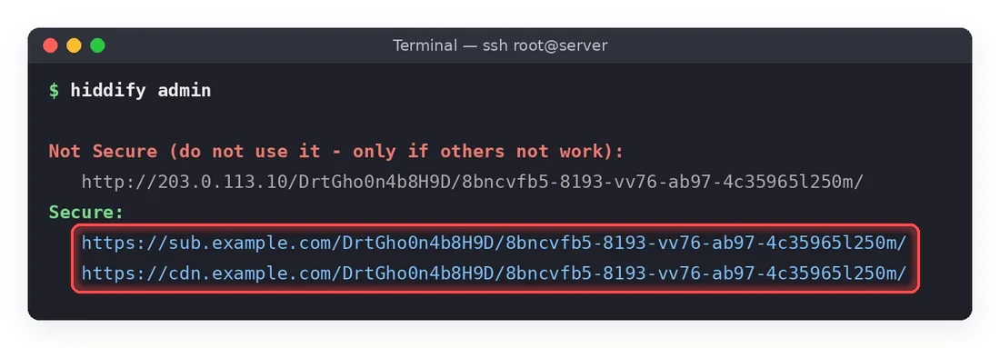

Your admin link has the form `https://<domain>/<admin proxy path>/<admin UUID>/`, for example `https://sub.example.com/DrtGho0n4b8H9D/8bncvfb5-8193-vv76-ab97-4c35965l250m/`. When you open it, the panel signs you in and opens **Admin V2**, the new admin panel, and the address in your browser changes to `https://sub.example.com/DrtGho0n4b8H9D/admin/v2/`. Keep the link private: it works like a password. See [The correct format of the admin link](/manager/domain-worker-cdn-and-tunneling/The-correct-format-of-admin-link/).

The first time you open the admin page, the **Quick setup** wizard starts.

## Quick setup

The wizard has six short steps: **Welcome → Password → Domains → Protocols → Nodes → Finish**. Use **Next** and **Back** to move between them, or **Skip for now** to leave the wizard. You can change everything later in **Settings**.

1. **Welcome:** choose the **Admin panel language** and the **Country** your users are in (Iran, China, Russia or Others). The country applies settings that suit its filtering.
2. **Password:** set a password for the admin area (at least 8 characters).
3. **Domains:** point your domain to the server IPs shown on the page (an `A` record for IPv4, `AAAA` for IPv6). Then type your domain and press Enter. The panel detects the domain type by itself; tap the type to change it. You need at least one direct, CDN or subscription-only domain.
4. **Protocols:** pick the protocols you want to offer. Choose as few as you need.
5. **Nodes** (optional): connect other HiddifyManager servers to manage them from this panel. You can skip this.
6. **Finish:** review your choices and click **Finish**. The panel applies the configuration and reinstalls the services. This takes a few minutes. The log and your new admin links are shown while it runs.

When it finishes, the panel is ready to use. Copy the new admin links and keep them somewhere safe.

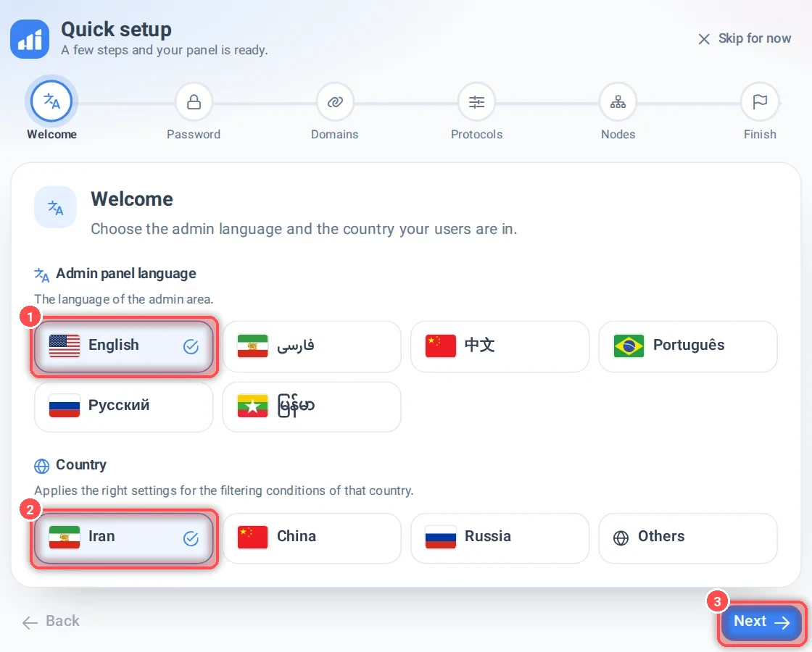

## The admin menu

The sidebar on the left has two groups:

- **Manager:** Dashboard, Users, Admins, Send Message, Inbox, Nodes and Tools (Config tester, Clean IP scanner, Text decoders, QR code, SSH terminal).
- **Settings:** Domains, Protocols, Outbounds, Settings, Proxy Editor (Custom proxies, Base configs, Templates, Template variables), Backup, Actions (the **Apply & Status** page), Telegram Bot and API.

## Dashboard

The Dashboard shows traffic, users and server health at a glance: online users, today's, this week's and this month's usage, and charts of usage and users over time (7, 30, 90 or 180 days). If you use several servers (nodes), pick one in the node filter. Further down, **Config Health** tests every config from the server, and **Node Health** shows CPU, RAM and network for each node.


## Users

Here you create an account for each person who will use your proxies.

1. Open **Users** and click **Add user**.
2. In the **New user** window, enter a **Name** (and, if you like, a **Note** that only admins see).
3. Under **Data**, set the **Usage limit** (or pick 10 GB, 50 GB, 100 GB …) and the **Reset period**: **Without reset**, **Monthly**, **Weekly** or **Daily**.
4. Under **Time**, set the **Package length** (or pick 1 week, 1 month, 3 months …). The days start at the user's first connection.
5. Click **Add user**. The user's link and QR code open, ready to send.


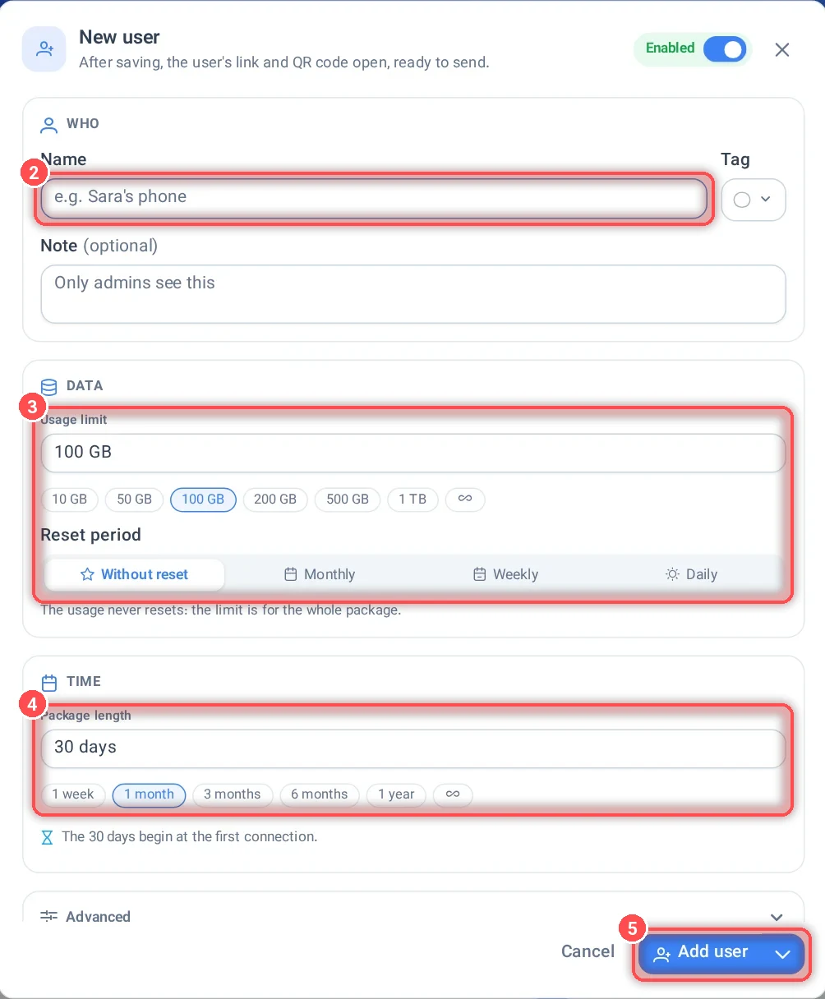

The Users page lists everyone with their usage, expiry date and last connection. Use the search box and the filters (Online, Active, Expiring soon, Low on data, …) to find users.

Each user has their own **user page**. Open it with the QR code button in the user's row, which shows the user's link. On the user page the user sees the remaining traffic and time and a big connect button. Tapping it opens **Configure Your VPN**, where the user picks an app or uses **Copy Link**. The menu of the user page also has **All Configs**, with every config of the user.


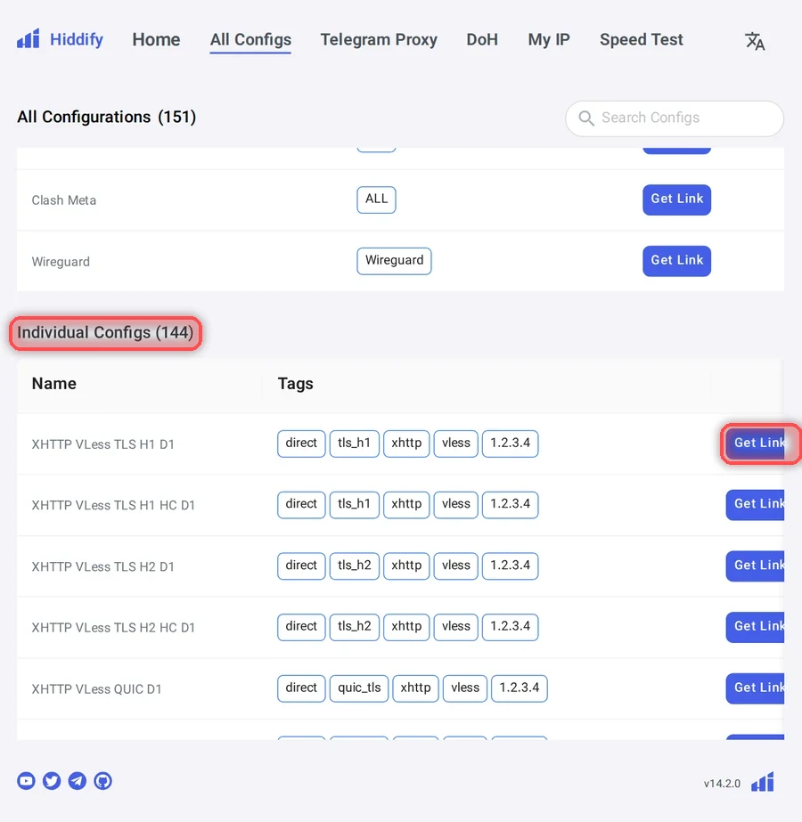

You can give users access in three ways:

1. **The user page link (recommended).** The user opens it and finds everything there.
2. **The subscription link.** A subscription link is one address that the app re-reads to get the latest configs. If you change your settings, the user's app updates itself.
3. **A single config link.** It does not update. If you change your settings, you must send the user a new link.

For help connecting client apps, see the [YouTube playlist](https://www.youtube.com/watch?v=Ml7XeYp70mM&list=PL2DSfh6Z6tTIalRDm3hY7G7ku9-yrCfBL) and the client tutorials on the [HiddifyManager tutorials page](/manager/).

## Admins

Here you create accounts for other people who help you manage the panel. Click **Add admin** and fill in the form. The admins are shown as a tree: each admin's limits cover their own users and everyone below them. Each admin has an **Admin link** button.

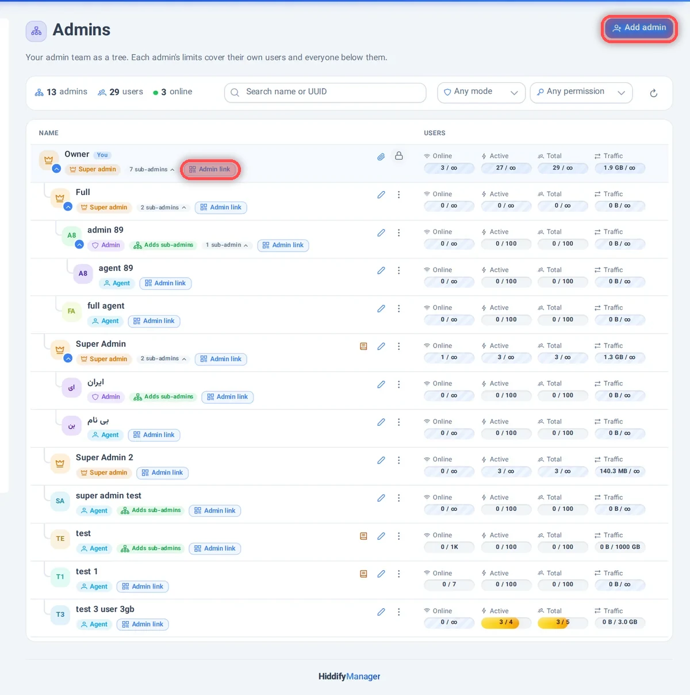

There are three admin types:

- **Super admin:** full access to the whole panel and all settings.
- **Admin:** can manage users and some settings.
- **Agent:** can only manage users.

For each admin you can:

- limit the number of users and active users;
- allow or forbid adding sub-admins;
- reset their password.

!!! note
    Each admin's link contains their secret ID. If you change it, that admin's panel address changes completely. See [the correct format of the admin link](/manager/domain-worker-cdn-and-tunneling/The-correct-format-of-admin-link/).

## Domains

Open **Domains** (in the **Settings** group of the menu) to add or edit your domains. The list shows each domain with its mode, its TLS and certificate state, its custom proxies and **Show configs of**. The order matters: drag the handle to sort. Configs list domains in this order, and the first one is used for panel links.

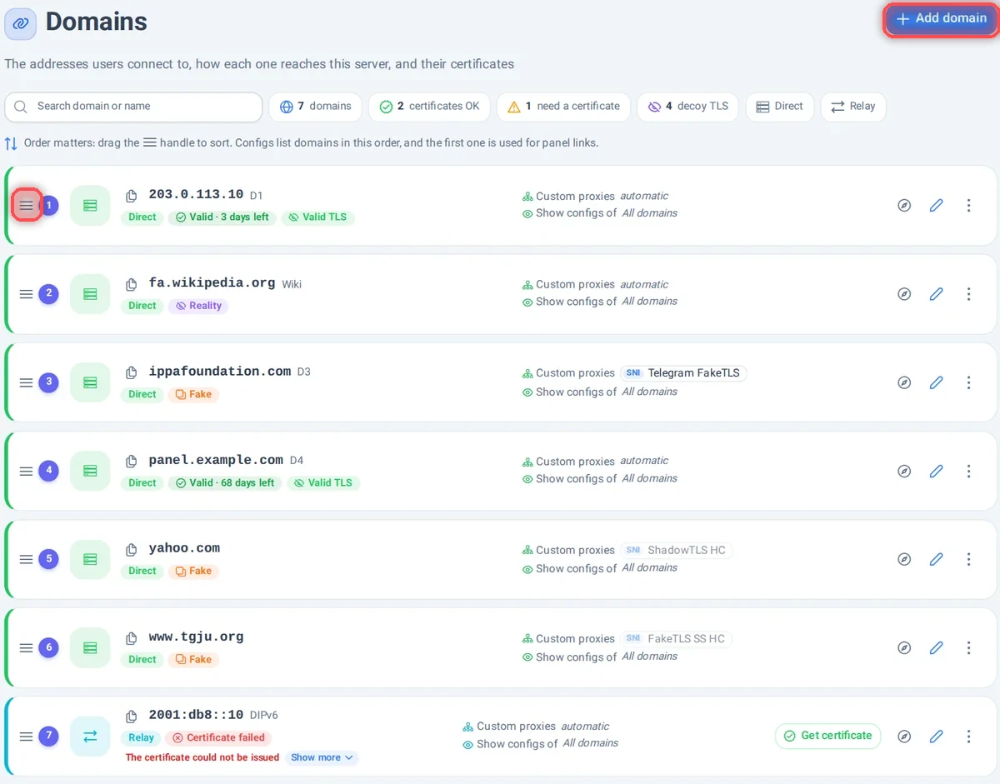

Each domain has a **mode**, which says how users reach your server, and a **TLS** choice, which says which certificate or disguise it uses.

To add a domain, click **Add domain**. The **Add a domain** window has four steps: **Domain → Mode → Name → Certificate**.

1. **Domain:** type the domain or subdomain, or an IPv4 / IPv6 address. Under **Point it at this server** you see the `A` (IPv4) and `AAAA` (IPv6) records to add in your DNS. Click **Check**: the panel checks the DNS and suggests the right mode.
2. **Mode:** answer **How is it set up?** and **Which TLS?** (see below).
3. **Name** and **Certificate:** finish the remaining steps.


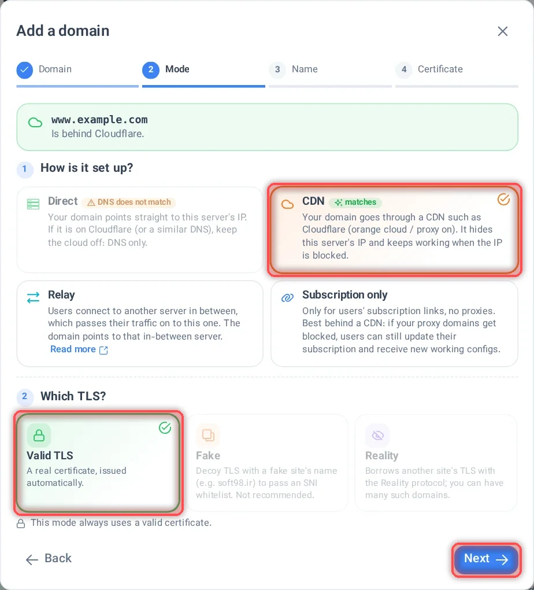

Modes (**How is it set up?**):

- **Direct:** the domain points straight to your server's IP. If the domain is on Cloudflare, keep the cloud off (DNS only).
- **CDN:** the domain goes through a CDN such as Cloudflare (orange cloud on). A **CDN** is a network of servers that sits between your users and your server, so your server's IP stays hidden.
- **Relay:** users connect to another server in between, which forwards the traffic to this one.
- **Subscription only:** used only for subscription links, with no proxies.

TLS (**Which TLS?**): **Valid TLS** (a real certificate, issued automatically), **Fake** (decoy TLS with a fake site's name; not recommended) and **Reality** (borrows another site's TLS with the Reality protocol). Some modes always use a valid certificate; the window tells you when.

!!! info "Changed in v13"
    The old separate types **Auto CDN IP**, **Fake** and **Reality** are no longer domain types. On upgrade, Auto CDN IP domains became **CDN** domains, and Fake and Reality domains became **Direct** domains with the **Fake** or **Reality** TLS mode.

### Direct domain

Click **Add domain**, type the domain, and choose **Direct** with **Valid TLS**. The settings of a direct domain:

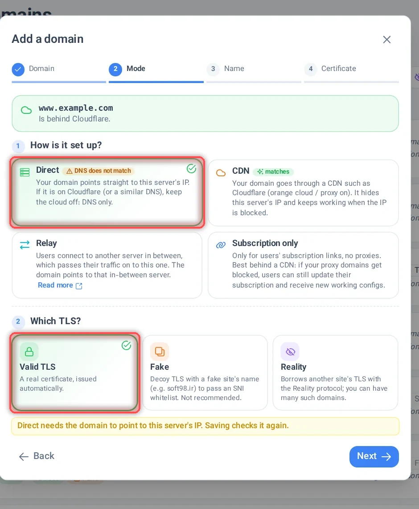

- **Display name:** shown in the users' apps instead of the domain. Use it if you don't want the domain to appear in the configs.
- **Force configs to use these IPs / domains:** leave it empty for a direct domain. It is mainly for CDN domains.
- **Show configs of:** choose which domains' configs users see when they open their user page through this domain.

### Subscription-only domain

A subscription-only domain only serves subscription links. Because no proxy traffic goes through it, it is less likely to be blocked, so users can always update their configs.

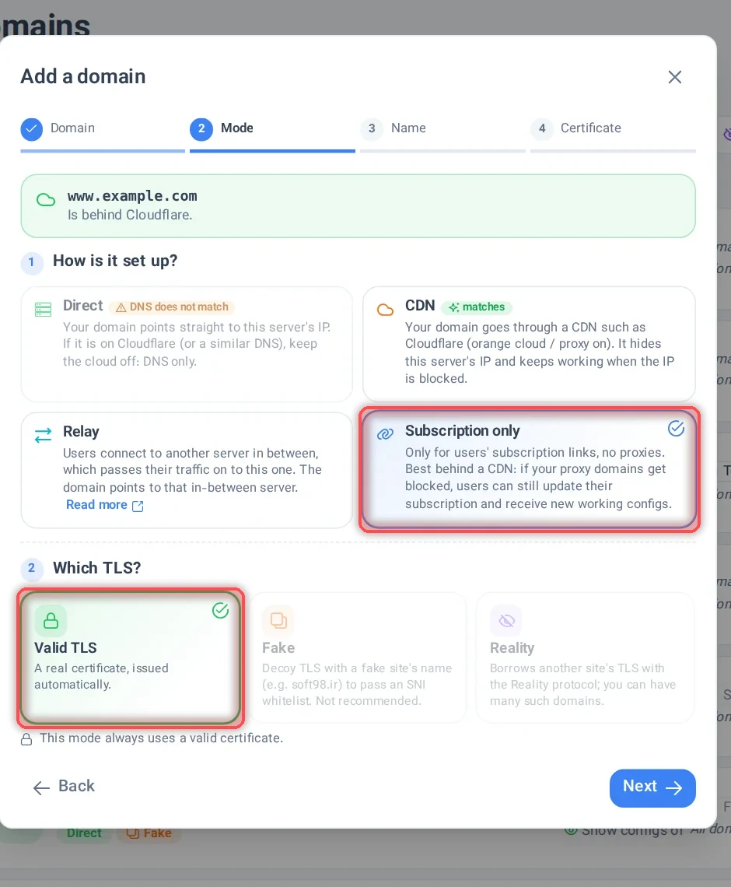

After you link the subscription-only domain to your connection domains in **Show configs of**, open a user page through it. The configs on that page use your connection domains.

Tip: a subscription domain works best behind a CDN, so users can still update when your proxy domains are blocked. You can also use a PHP website for subscription links: see [How to use a PHP site for sub links](/manager/domain-worker-cdn-and-tunneling/How-to-use-a-PHP-site-for-sub-links/).

### CDN domain { #cdn-domain }

Click **Add domain**, type the domain, and choose **CDN**. The settings of a CDN domain:

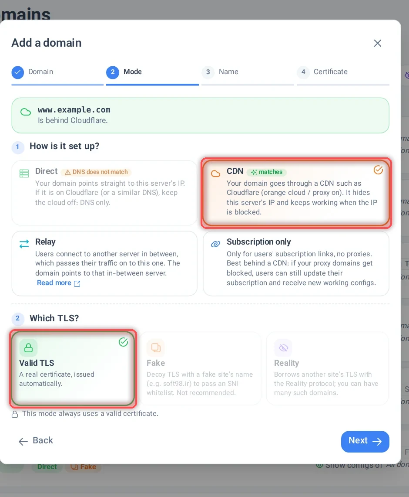

- **Display name:** shown in the users' apps instead of the domain.
- **Force configs to use these IPs / domains:** put a clean Cloudflare IP here, or better, a normal DNS record (cloud off) that points to a clean IP. Then, when you need a new clean IP, you only update that DNS record and the panel and configs stay the same. To find clean IPs, see [Guide for finding a clean Cloudflare IP](/manager/domain-worker-cdn-and-tunneling/Guide-for-finding-a-clean-Cloudflare-IP/). This field replaces the old Auto CDN IP mode: see [Guide for using mode Auto_CDN_IP](/manager/domain-worker-cdn-and-tunneling/Guide-for-using-mode-Auto_CDN_IP-on-Hiddify/).
- **Domain fronting:** optional. Users' apps show another site's name (SNI) instead of your domain, so a filter only sees that other site. Use sites on the same CDN as your domain. In older versions this was a global setting; now it is set per CDN domain. See [Guide for domain fronting](/manager/domain-worker-cdn-and-tunneling/Guide-for-domain-fronting/).
- **ECH:** uses Encrypted Client Hello for this CDN domain. Turn on **Enable TLS ECH** in **Settings** first.
- **Show configs of:** choose which domains' configs users see on this domain's user page.

If you have many users and want to give each group its own domain, read [How to use multi-CDN domains](/manager/domain-worker-cdn-and-tunneling/How-to-use-multiCDN-domains-in-HiddifyManager/).

### Other domain setups

- **Relay domain:** see [How to add a relay domain](/manager/domain-worker-cdn-and-tunneling/How-to-add-relay-domain-to-Hiddify-manager/).
- **Fake TLS mode:** see [How to create and use a fake domain](/manager/domain-worker-cdn-and-tunneling/How-to-create-and-use-fake-domain/).
- **Reality TLS mode:** see [How to use Reality](/manager/configuration-and-advanced-settings/How-to-use-Reality-on-Hiddify/).
- **Cloudflare workers:** see [How to set up and use Cloudflare workers](/manager/domain-worker-cdn-and-tunneling/How-to-set-up-and-use-Cloudflare-workers/).

## Proxies and protocols

Open **Protocols** to turn protocols, transports and TLS tricks on or off for the whole panel. Tap a card to switch it, then save. The cards are grouped into **Protocols**, **Transports**, **Security & tricks** and **Other**, and each group has **Enable all** and **Disable all**. Each card's **Settings** link opens its settings. The same switches are also in **Settings → Proxies Settings**. The **Proxy Editor** lets advanced users edit each built-in proxy template.

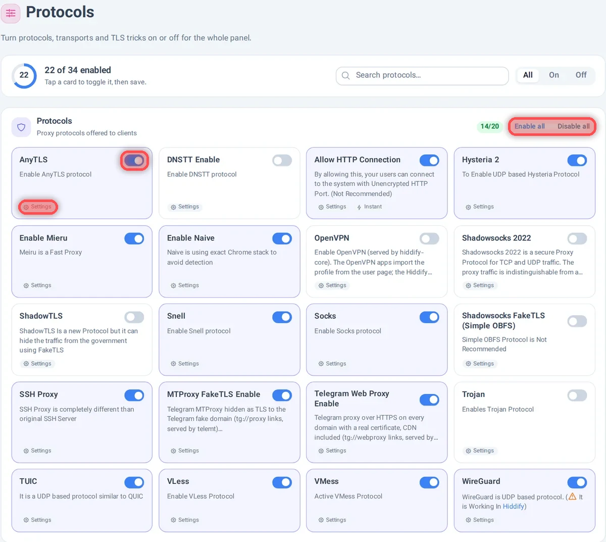

Note: plain HTTP connections are not encrypted. TLS connections are encrypted.

## Settings

Open **Settings**. It is one long page of cards (Admin Settings, Customizing User Page, General Settings, Proxies Settings, Telegram Configs, TLS Settings, Advanced Settings, Very Advanced Settings, WARP, Reality and more). Common settings are shown first. Turn on **Show Advanced Settings** at the top to see the settings marked **Advanced**, or use the search box. Settings marked **Reinstall** only take effect after a reinstall (see [Actions](#apply-status)). The cards are described below.

### Admin Settings

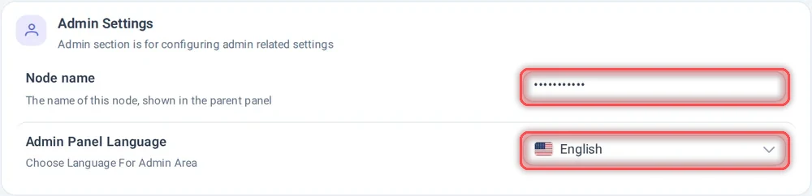

- **Admin Panel Language:** the language of the admin area (English, Persian, Chinese, Portuguese, Russian or Burmese).
- **Parent Panel (Multi Server):** connect this panel to a central (parent) panel. You then define users on the parent panel, and the usage of all servers is added up there.
- **Node name:** a name for this server when it is part of a multi-server setup.

### Customizing User Page

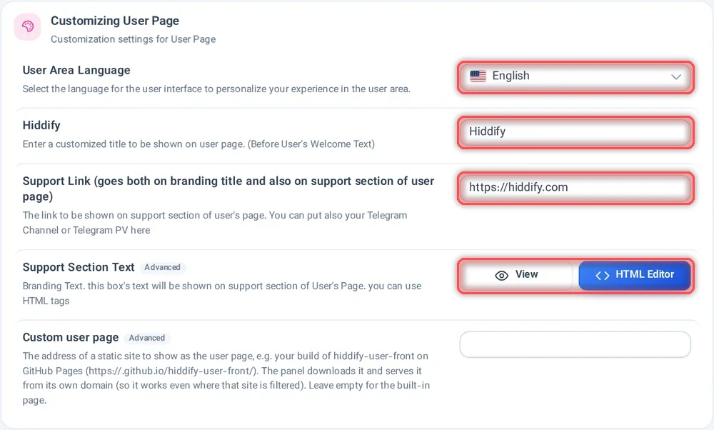

- **User Area Language:** the language of the user page.
- **User Page Title:** your brand name, shown at the top of the user page.
- **Support Link:** a link to your support channel.
- **Support Section Text:** a message shown in the support box of the user page.

Some of these are hidden until you click **Show 2 more advanced settings**.

### General Settings

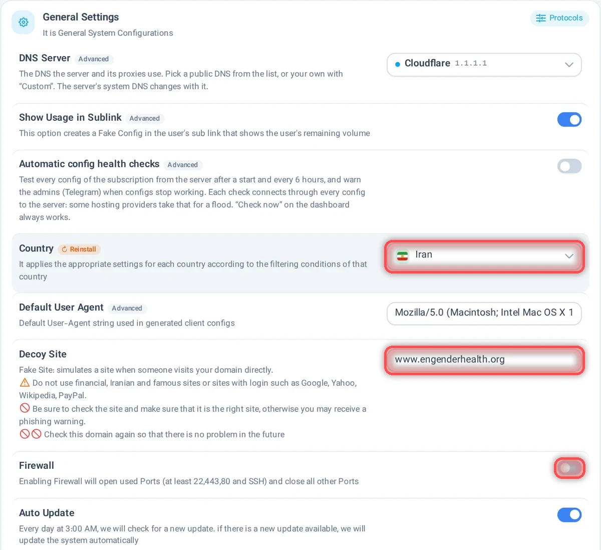

- **Country:** the country of your users. It selects settings that suit that country's filtering. Changing it needs a reinstall.
- **Auto Update:** lets the panel update itself.
- **Only IPv4:** turns off IPv6 on the server.
- **Speed Test:** lets users test their connection speed to your server.
- **Decoy Site:** a fake website. If someone (for example a filtering system) opens your domain directly, they see this site instead of your panel, which makes your server harder to identify. Do not use bank, payment, Iranian or very famous sites.
- **Firewall:** when on, only the ports HiddifyManager uses (at least 22, 443, 80 and SSH) stay open and all other ports are closed.
- **DNS Server**, **Show Usage in Sublink**, **Automatic config health checks**, **Default User Agent**, **Max Proxy IPs Per Version**, **Block BitTorrent**, **Config names** and **Keep Backups (days)** are also here (most are **Advanced**). **Keep Backups (days)** deletes automatic backups older than this number of days; `0` keeps all of them.

### Proxies Settings

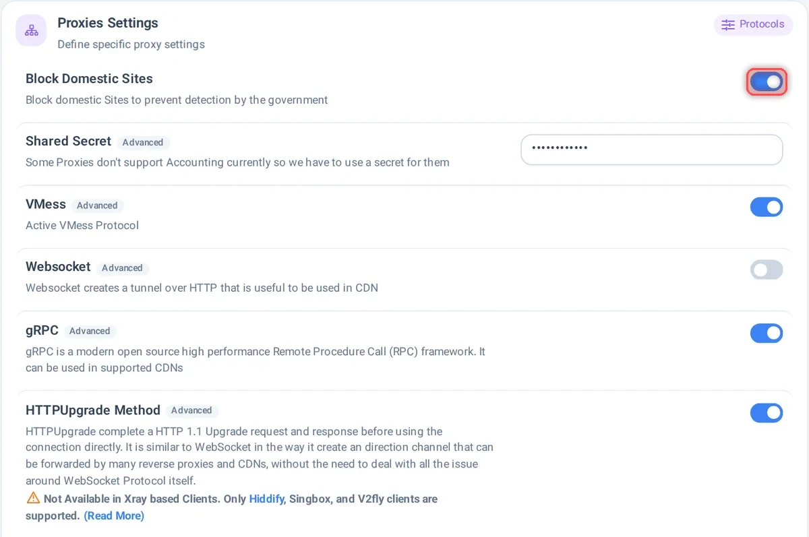

- **Block Domestic Sites:** blocks traffic from your server to Iranian sites and `.ir` domains. This makes it harder for the filtering system to identify your server. We recommend turning it on.
- **Shared Secret:** a password used by connections whose traffic is not counted per user.
- On/off switches for protocols and transports (the same as on the **Protocols** page), for example **VLess**, **Trojan**, **VMess**, **Reality**, **Websocket**, **gRPC**, **HTTPUpgrade**, **XHTTP**, **TCP**, **QUIC**, **Naive**, **AnyTLS**, **Snell** and **SOCKS**.

Tip: in the Hiddify app, routing rules can send traffic for Iranian sites directly, without the proxy. This saves your server's traffic.

!!! info "Removed settings"
    The old **V2Ray** switch is gone. The browser fingerprint setting (**uTLS**) is now under **Advanced Settings**.

### Domain fronting

The old global **Domain Fronting** settings group was removed. Domain fronting is now set on each CDN domain (see [CDN domain](#cdn-domain)). More information: [Guide for domain fronting](/manager/domain-worker-cdn-and-tunneling/Guide-for-domain-fronting/).

### Telegram Configs

A Telegram proxy works only inside the Telegram app and helps users bypass Telegram filtering.

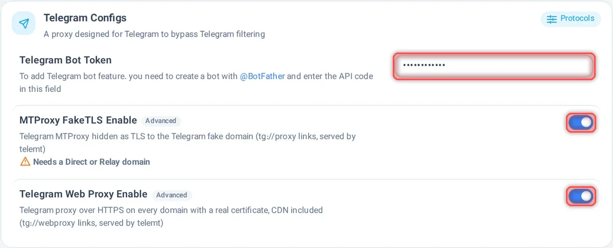

- **MTProxy FakeTLS Enable:** turns the Telegram proxy (`tg://proxy` links) on or off. It needs a **Direct** or **Relay** domain.
- **Telegram Web Proxy Enable:** turns on the Telegram proxy over HTTPS (`tg://webproxy` links). It works on every domain with a real certificate, CDN domains included.
- **Telegram Bot Token:** connects the panel to your Telegram bot. See [How to set up and use the Telegram bot](/manager/configuration-and-advanced-settings/How-to-set-up-and-use-Telegram-bot-on-Hiddify-panel/).

!!! info "Changed in v14"
    The Telegram proxy now always uses **telemt**. The old choice of Telegram proxy library (Python, Erlang and others) was removed.

### HTTP Configuration

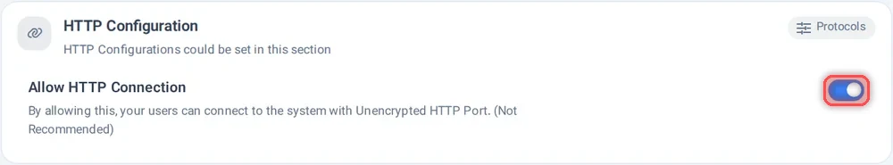

- **Allow HTTP Connection:** allows unencrypted HTTP connections. We don't recommend turning it on. The same switch is on the **Protocols** page.

The custom HTTP port list was removed in v14. Proxies are served on ports 80 and 443 whenever possible.

### TLS Settings

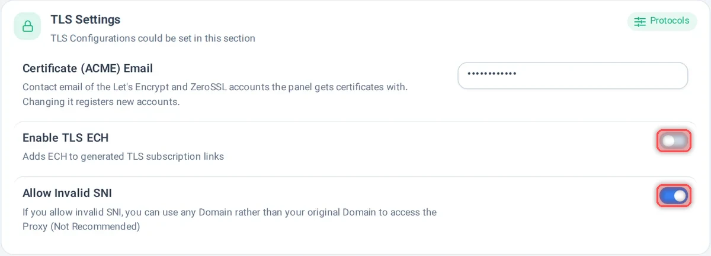

- **Certificate (ACME) Email:** the email used when the panel requests certificates.
- **Enable TLS ECH:** adds ECH (Encrypted Client Hello) to the generated TLS subscription links. You then enable it per CDN domain.
- **Allow Invalid SNI:** lets any domain, not only yours, be used to reach the proxy. Not recommended.

The custom TLS port list was removed in v14. Since v14 the panel issues and stores certificates itself.

The **TLS Trick** group (TLS fragment, mixed SNI case, padding) is explained in [How the TLS trick works](/manager/basic-concepts-and-troubleshooting/How-the-TLS-Trick-works-and-its-usage/).

### Shadowsocks

**Shadowsocks FakeTLS** is a simple disguise that wraps data in TLS-looking packets to fool the filter.

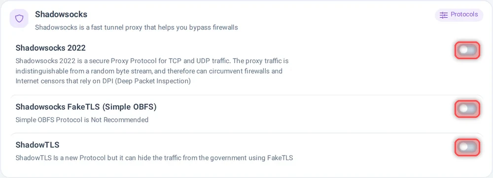

- **Shadowsocks 2022:** turns Shadowsocks 2022 on or off.
- **Shadowsocks FakeTLS (Simple OBFS):** we don't recommend it.
- **SS FakeTLS FakeDomain:** the fake domain used to disguise the packets.

The **Shadowsocks 2022** and **Shadowsocks FakeTLS (Simple OBFS)** switches are also on the **Protocols** page.

### ShadowTLS

ShadowTLS shows the firewall a real TLS handshake with a valid certificate from a site you choose. Its switch is on the **Protocols** page, and its fake domain is in the **Shadowsocks** group.

!!! warning
    The ShadowTLS service was removed from HiddifyManager in v13. Whether ShadowTLS configs still work is not confirmed, so don't rely on it.


### Advanced Settings

These settings are for experienced users.

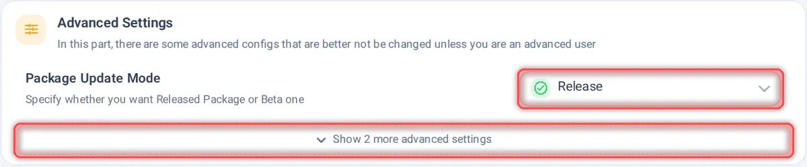

- **Package Update Mode:** choose **Release** (stable) or **Beta** updates.
- **Common Proxy Core:** which engine serves the shared proxies: `xray`, `hiddify_core` or `both`. It replaces the old **Core** setting.
- **uTLS:** which browser fingerprint the configs imitate (for example Chrome, Firefox, Safari, iOS or Android).

**Common Proxy Core** and **uTLS** are hidden until you click **Show 2 more advanced settings** (or turn on **Show Advanced Settings**).

The parent panel link and the Telegram bot token moved to **Admin Settings** and **Telegram Configs**.

### Very Advanced Settings

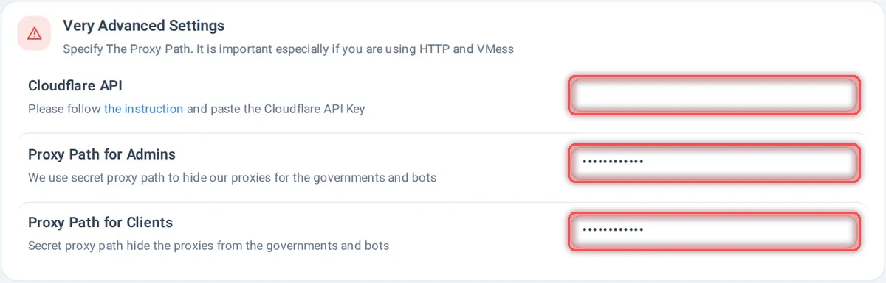

- **Proxy Path for Admins** and **Proxy Path for Clients:** the secret paths in your admin and user links. They hide your panel and connections from the filter. The panel sets them for you; change them only if you need to. If you change the admin path, your admin link changes.
- **Cloudflare API:** your Cloudflare API key (follow the instruction link next to it).

The per-protocol path settings were hidden in v13.

### WARP and Reality

- **WARP:** see [How to activate WARP](/manager/configuration-and-advanced-settings/How-to-activate-WARP-on-the-Hiddify-panel/).
- **Reality:** see [How to use Reality](/manager/configuration-and-advanced-settings/How-to-use-Reality-on-Hiddify/).

### SSH Proxy

The **SSH Proxy** card has **Multiplex SSH on TLS port** and the **SSH Proxy** switch, which is also on the **Protocols** page. See [SSH proxy setting](/manager/configuration-and-advanced-settings/SSH-proxy-setting-on-Hiddify-panel/).

## Backup

Open **Backup** to make a backup of your panel or restore one. The page is called **Backup & Restore**.

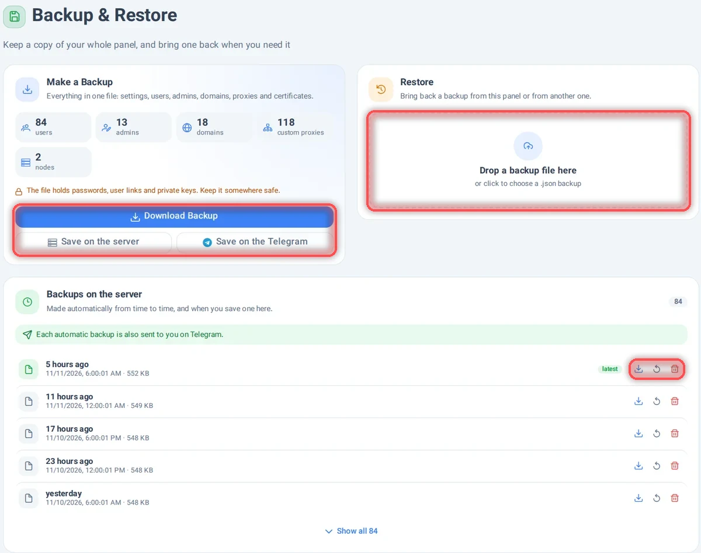

- Under **Make a Backup**, **Download Backup** saves everything in one `.json` file: settings, users, admins, domains, proxies and certificates. Keep the file safe: it contains passwords, user links and private keys. **Save on the server** and **Save on the Telegram** keep the copy on the server or send it to you on Telegram.
- The panel also makes automatic backups on the server every 6 hours. They are listed under **Backups on the server**, where you can download, restore or delete each one. If your Telegram bot is connected, each one is also sent to you on Telegram.
- To restore, drop a `.json` backup file on **Restore** (or click it to choose one). You choose which parts to bring back: **Settings**, **Users** and **Domains**.

Details: [How to back up and restore](/manager/configuration-and-advanced-settings/How-to-backup-and-restore-panel-on-Hiddify/).

## Telegram bot

To set up and use the panel's Telegram bot, see [How to set up and use the Telegram bot](/manager/configuration-and-advanced-settings/How-to-set-up-and-use-Telegram-bot-on-Hiddify-panel/).

## Actions (Apply & Status) { #apply-status }

Open **Actions** in the menu. The **Apply & Status** page lets you put changes into effect, update the server and see how everything is doing. Each card shows how long the action takes and when it last ran. Each action shows its log while it runs. You can leave the page; the action keeps running on the server. Below the cards are **Reset Cache**, **Public ports** and **Live connection test**.


### Check Status

Click **Check now**. It shows whether each service is running, plus the server's public IP and WARP. It changes nothing.


### Logs

The **Logs** section lists what each action did (for example `hiddify_panel.log`, `status.log`, `warp.log`). Click the eye icon to read a log; the other icons download it or send it to Telegram.


### Apply Changes

Click **Apply now**. It puts your settings, users and domain changes into effect. It is quick, and it is the usual choice after you change something.


- When it finishes, the page shows your admin links on your domains. They may have changed, so copy them before you leave.
- If the panel no longer opens after a change, connect to your server over SSH and run `hiddify admin` to see your current admin links:

```bash
hiddify admin
```

- If that does not help, see [How to connect and troubleshoot via SSH](/manager/configuration-and-advanced-settings/How-to-connect-and-troubleshoot-via-SSH/).

### Update Hiddify

Click **Update**. It downloads and installs the latest version, then applies it. It takes a while, and the panel restarts at the end. See [How to update HiddifyManager](/manager/configuration-and-advanced-settings/How-to-update-Hiddify-panel/).

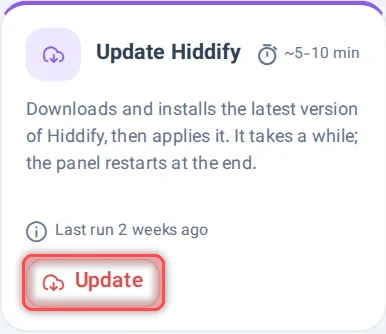

### Reinstall

Click **Reinstall**. It installs everything again and rebuilds all services. Your users and links are not changed. Use it when **Apply changes** is not enough, for example after you change the panel path, protocols or a setting marked **Reinstall**. Connections may drop for a few minutes.


### Restart Services

Click **Restart**. It restarts all HiddifyManager services without reinstalling anything. It is a good first try when something misbehaves. Connections drop for a moment.


## Help

All tutorials and videos are listed on the [HiddifyManager tutorials page](/manager/).

</div>
