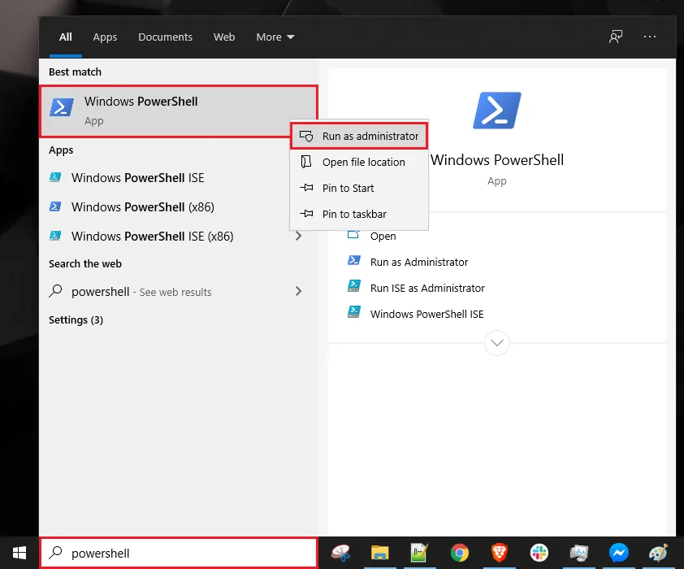
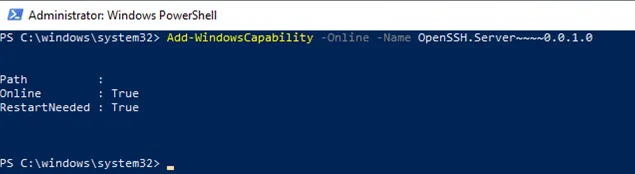
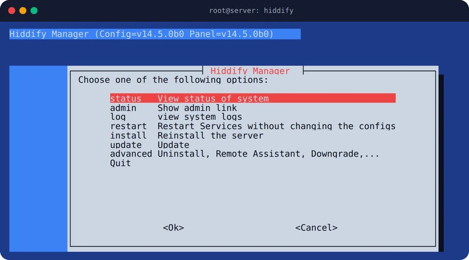
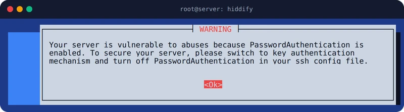
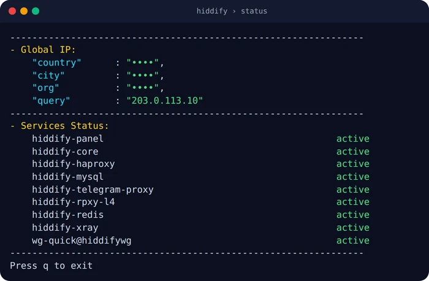
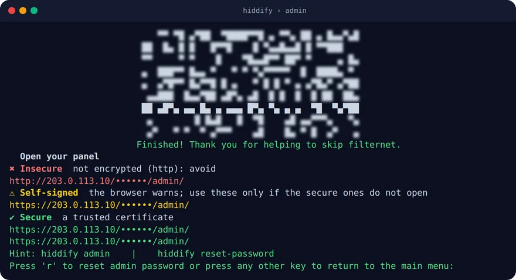
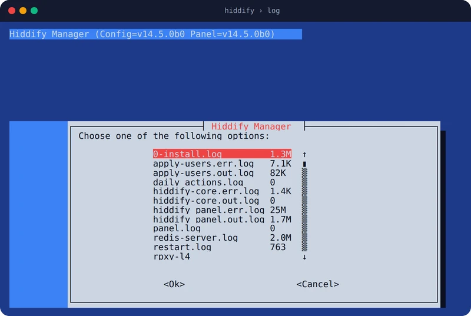
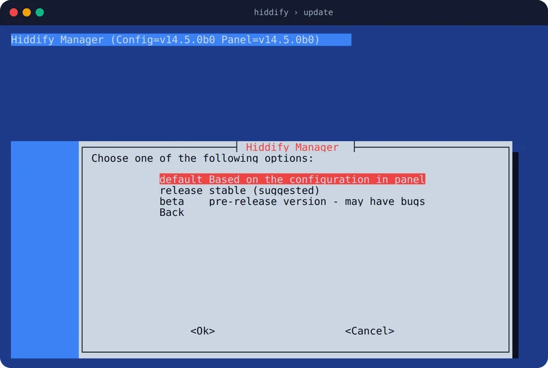
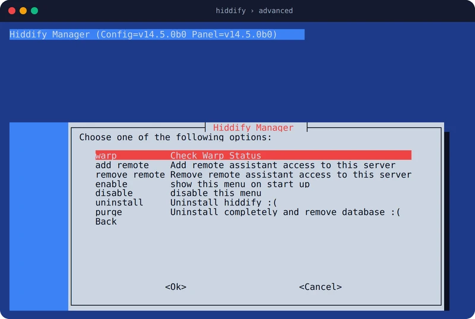

<div dir="rtl" markdown=1>

# اتصال به سرور با SSH و کار با منوی هیدیفای‌منیجر

<details markdown="1"> <summary><b>پیش‌نیاز: نصب SSH در ویندوز</b> (کلیک کنید)</summary>

ویندوز ۱۰ و ۱۱ معمولاً SSH را از قبل دارند. اگر دستور `ssh` در PowerShell کار نکرد، آن را این‌طور نصب کنید:

1. منوی Start را باز کنید و **PowerShell** را جستجو کنید.
2. روی **PowerShell** راست‌کلیک کنید و **Run as Administrator** را بزنید.

    

3. این دستور را در PowerShell اجرا کنید:

    ```powershell
    Add-WindowsCapability -Online -Name OpenSSH.Client
    ```

4. پس از پایان، باید چیزی شبیه این ببینید:

    

حالا SSH روی ویندوز شما نصب است.
</details>


این صفحه به شما نشان می‌دهد وقتی پنل وب باز نمی‌شود یا لینک ادمین را گم کرده‌اید، چطور هیدیفای‌منیجر را از خط فرمان سرور مدیریت کنید. همچنین هر گزینه از منوی هیدیفای‌منیجر را توضیح می‌دهد.

**SSH** راهی امن برای باز کردن یک ترمینال متنی روی سرور از کامپیوتر یا گوشی خودتان است. هر چیزی که تایپ کنید روی سرور اجرا می‌شود.

## پیش‌نیازها

- آدرس IP سرور.
- نام کاربری سرور (معمولاً `root`) و رمز عبور یا کلید SSH. این‌ها را ارائه‌دهنده سرور به شما می‌دهد.
- یک برنامه SSH روی دستگاه شما:
    - اندروید: `Termius`
    - ویندوز: `PowerShell` (یا `PuTTY`)
    - مک: `Terminal`
    - لینوکس: `Terminal`

برای آموزش کامل، [نحوه اتصال به سرور از طریق SSH](/fa/manager/installation-and-setup/How-to-connect-to-server-via-SSH/) را ببینید.

## اتصال به سرور

1. برنامه SSH خود را باز کنید.
2. این دستور را روی دستگاه خود اجرا کنید. به جای `user` نام کاربری و به جای `<IP_Address>` آدرس IP سرور را بگذارید:

    ```bash
    ssh user@<IP_Address>
    ```

    مثلاً اگر نام کاربری شما `root` و IP سرور `1.1.1.1` است:

    ```bash
    ssh root@1.1.1.1
    ```

3. اگر پرسیده شد که به سرور اعتماد دارید، `yes` را بنویسید و سپس رمز عبور را وارد کنید. (رمز هنگام تایپ نشان داده نمی‌شود. این طبیعی است.)

اگر اتصال درست باشد، خط فرمان سرور را می‌بینید و ممکن است منوی هیدیفای‌منیجر خودش باز شود.


## باز کردن منوی هیدیفای‌منیجر

این دستور را روی سرور اجرا کنید تا منوی هیدیفای‌منیجر باز شود:

<div dir="ltr" markdown=1>

```bash
hiddify
```

</div>

منو این شکلی است (هیدیفای‌منیجر ۱۴.۵):



با کلیدهای جهت‌نما جابه‌جا شوید و برای انتخاب هر گزینه Enter را بزنید. بخش‌های زیر هر گزینه را توضیح می‌دهند.

!!! warning "اگر اول یک هشدار دیدید"
    اگر ورود با رمز عبور روی سرور روشن باشد، منو قبل از باز شدن این هشدار را نشان می‌دهد. **Ok** را بزنید تا منو باز شود، و برای امنیت سرور [ورود با رمز عبور را خاموش کنید](/fa/manager/basic-concepts-and-troubleshooting/Disable-SSH-Password-Authentication/).

    


!!! tip "دستورها به جای منو"
    بیشتر گزینه‌های منو به شکل دستور مستقیم هم در دسترس‌اند، مثلاً `hiddify status`، `hiddify admin`، `hiddify restart`، `hiddify apply` و `hiddify upgrade release`. برای دیدن همه آن‌ها `hiddify --help` را اجرا کنید.

## Cancel یا Quit
گزینه **Quit** را انتخاب کنید (یا **Cancel** / کلید `Esc` را بزنید) تا از منو خارج شوید و به ترمینال عادی سرور برگردید.

برای باز کردن دوباره منو، این دستور را روی سرور اجرا کنید:

<div dir="ltr" markdown=1>

```bash
hiddify
```

</div>

## Status
نشان می‌دهد هر کدام از سرویس‌های هیدیفای‌منیجر در حال اجرا هست یا نه. اگر همه چیز درست باشد، نتیجه این شکلی است:



برای بازگشت به منوی اصلی کلید `q` را بزنید.

**کاربرد اصلی:** بررسی سریع اینکه همه سرویس‌ها کار می‌کنند.

## Admin
لینک‌های پنل ادمین را نشان می‌دهد. لینک‌ها در سه گروه نمایش داده می‌شوند: **Secure** (با گواهی معتبر روی دامنهٔ شما؛ همین‌ها را باز کنید)، **Self-signed** (مرورگر هشدار می‌دهد؛ فقط اگر لینک‌های Secure باز نشدند) و **Insecure** (بدون رمزنگاری، http؛ از آن استفاده نکنید). QR code لینک هم بالای آن‌ها هست.



در همین صفحه می‌توانید کلید `r` را بزنید تا رمز ادمین مالک (owner) ریست شود. با زدن هر کلید دیگری به منوی اصلی برمی‌گردید.

همین لینک‌ها را این دستور هم نشان می‌دهد:

<div dir="ltr" markdown=1>

```bash
hiddify admin
```

</div>

**کاربرد اصلی:** پنل را نصب کرده‌اید ولی فراموش کرده‌اید لینک ادمین را کپی کنید.

## Log
لاگ‌های سیستم را نشان می‌دهد. پس از انتخاب آن، فایل لاگ مورد نظر را انتخاب کنید.



مثلاً `0-install.log` را انتخاب کنید تا ببینید هنگام نصب چه اتفاقی افتاده است. در انتهای آن، وضعیت سیستم و لینک‌های ادمین نمایش داده می‌شوند.


برای بستن لاگ کلید `q` را بزنید. فایل‌های لاگ روی سرور در مسیر `/opt/hiddify-manager/data/log/` ذخیره می‌شوند.

**کاربرد اصلی:** یکی از سرویس‌ها درست کار نمی‌کند و می‌خواهید علتش را ببینید.

## Restart
همه سرویس‌های هیدیفای‌منیجر را بدون تغییر در تنظیمات دوباره راه‌اندازی می‌کند.


برای بازگشت به منوی اصلی هر کلیدی را بزنید.

**کاربرد اصلی:** یکی از سرویس‌ها متوقف شده و می‌خواهید همه سرویس‌ها را یک‌جا راه‌اندازی مجدد کنید.

## اعمال تنظیمات (Apply configs)
منو دیگر گزینه «Apply Configs» ندارد. برای اعمال تنظیماتی که در پنل ذخیره کرده‌اید، این دستور را روی سرور اجرا کنید:

<div dir="ltr" markdown=1>

```bash
hiddify apply
```

</div>


**کاربرد اصلی:** تغییراتی را در پنل ذخیره کرده‌اید ولی قبل از اعمال آن‌ها دسترسی وب را از دست داده‌اید.

## Install
در منو با عنوان **Reinstall the server**. هیدیفای‌منیجر را روی سرور دوباره نصب می‌کند. اطلاعات پنل شما (کاربران، تنظیمات، دامنه‌ها) حفظ می‌شود.

**کاربرد اصلی:** یکی از مراحل نصب درست اجرا نشده و پنل باز نمی‌شود.

## Update
هیدیفای‌منیجر را به آخرین نسخه به‌روز می‌کند. این گزینه‌ها را دارد:



- **default**: به کانالی که در تنظیمات پنل انتخاب شده به‌روز می‌کند.
- **release**: به آخرین نسخه پایدار به‌روز می‌کند (پیشنهادی).
- **beta**: به آخرین نسخه آزمایشی به‌روز می‌کند. ممکن است باگ داشته باشد.

با دستور هم می‌توانید به‌روزرسانی کنید، مثلاً:

<div dir="ltr" markdown=1>

```bash
hiddify upgrade release
```

</div>


**کاربرد اصلی:** به‌روزرسانی از طریق پنل وب ناموفق بوده و دسترسی را از دست داده‌اید.

## Advanced
این زیرمنو چند گزینه دارد.



### warp
وضعیت سرویس WARP را نشان می‌دهد.

### add_remote
از طریق [ربات هیدیفای](https://t.me/hiddifybot) به تیم پشتیبانی هیدیفای دسترسی SSH به سرور شما می‌دهد. فقط وقتی از آن استفاده کنید که تیم پشتیبانی از شما بخواهد.

### remove_remote
دسترسی SSH که به [ربات هیدیفای](https://t.me/hiddifybot) داده‌اید را برمی‌دارد.

### enable
باعث می‌شود منوی هیدیفای‌منیجر هر بار که با SSH وارد سرور می‌شوید خودکار باز شود. اگر قبلاً آن را خاموش کرده‌اید از این گزینه استفاده کنید.

### disable
جلوی باز شدن خودکار منوی هیدیفای‌منیجر هنگام ورود را می‌گیرد. همچنان می‌توانید منو را با `hiddify` باز کنید.

### uninstall
سرویس‌های هیدیفای‌منیجر را از سرور حذف می‌کند. همه چیزهایی که نصب شده‌اند را پاک نمی‌کند. اگر می‌خواهید سرور دقیقاً مثل قبل از نصب شود، آن را از پنل ارائه‌دهنده سرور Rebuild کنید.

### purge
هیدیفای‌منیجر را **همراه با دیتابیس** به‌طور کامل حذف می‌کند. همه کاربران و تنظیمات پاک می‌شوند، پس ابتدا [پشتیبان بگیرید](/fa/manager/configuration-and-advanced-settings/How-to-backup-and-restore-panel-on-Hiddify/).

> اگر این روش به هر دلیلی کار نکرد، می‌توانید سرور را از پنل ارائه‌دهنده سرور **Rebuild** کنید. با این کار همه اطلاعات سرور پاک می‌شود.

## مقاله‌های مرتبط

- [آشنایی کامل با پنل و تنظیمات آن](/fa/manager/configuration-and-advanced-settings/How-to-configure-Hiddify-panel-properly/)
- [همهٔ تنظیمات پنل، یکی‌یکی](/fa/manager/configuration-and-advanced-settings/Settings-reference/)
- [انتقال کاربران از پنل X-UI](/fa/manager/configuration-and-advanced-settings/how-to-import-xui-to-hiddifymanager/)
- [لینک ادمین و فرمت آن](/fa/manager/domain-worker-cdn-and-tunneling/The-correct-format-of-admin-link/)

</div>
