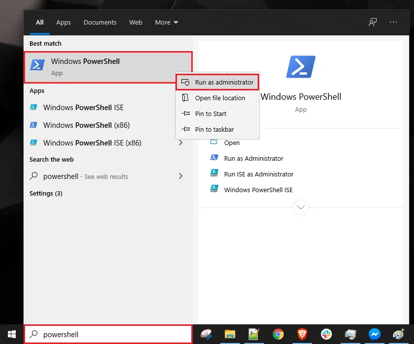
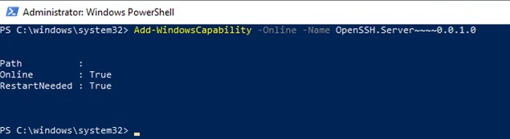
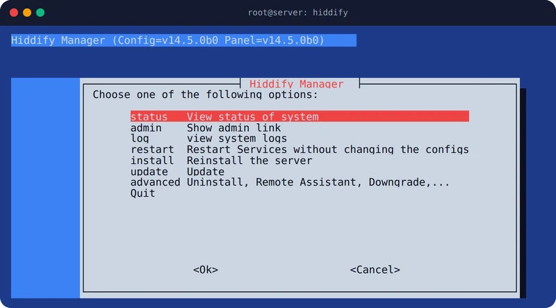
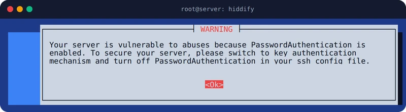
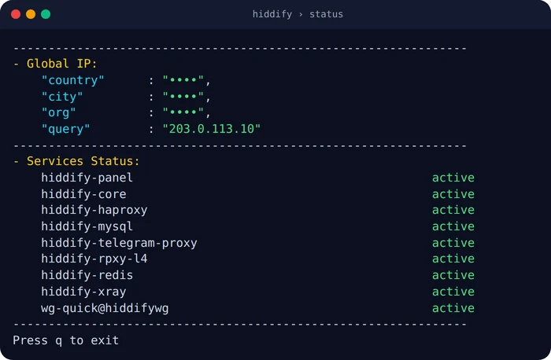
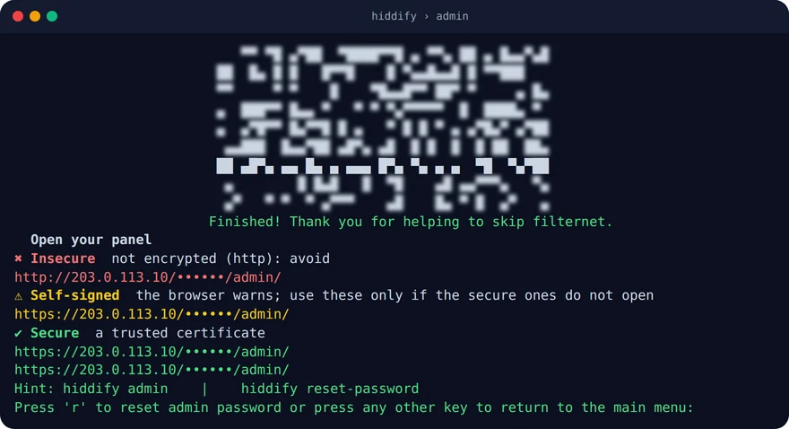
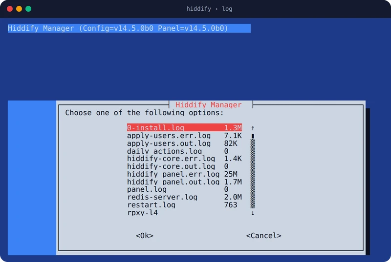
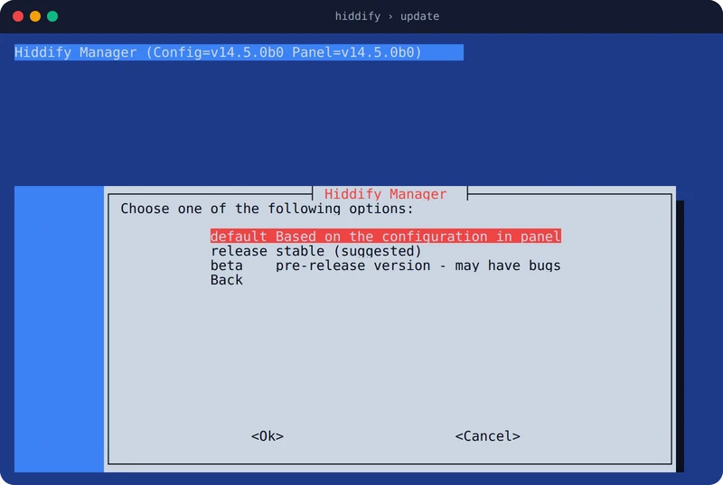
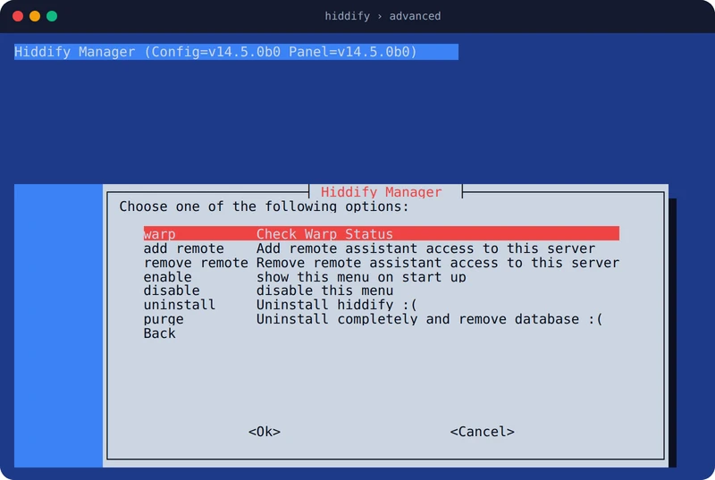

<div dir="ltr" markdown="1">

# Connect over SSH and use the Hiddify Manager menu

<details markdown="1"><summary><b>Prerequisite: Installing SSH on Windows</b> (click)</summary>

Windows 10 and 11 usually already include the SSH client. If the `ssh` command does not work in PowerShell, install it like this:

1. Open the Start menu and search for **PowerShell**.
2. Right-click **PowerShell** and choose **Run as Administrator**.

    

3. Run this command in PowerShell:

    ```powershell
    Add-WindowsCapability -Online -Name OpenSSH.Client
    ```

4. When it finishes, you should see something like this:

    

The SSH client is now installed.

</details>


This page shows you how to manage Hiddify Manager from your server's command line when the web panel does not open, or when you have lost your admin link. It also explains each option of the HiddifyManager menu.

**SSH** is a secure way to open a text terminal on your server from your own computer or phone. Everything you type runs on the server.

## Prerequisites

- Your server's IP address.
- The server's username (usually `root`) and password or SSH key. Your server provider gives you these.
- An SSH app on your device:
    - Android: `Termius`
    - Windows: `PowerShell` (or `PuTTY`)
    - macOS: `Terminal`
    - Linux: `Terminal`

For a full guide, see [How to connect to the server via SSH](/manager/installation-and-setup/How-to-connect-to-server-via-SSH/).

## Connect to the server

1. Open your SSH app.
2. Run this command on your device. Replace `user` with your username and `<IP_Address>` with your server's IP:

    ```bash
    ssh user@<IP_Address>
    ```

    For example, if your username is `root` and your server's IP is `1.1.1.1`:

    ```bash
    ssh root@1.1.1.1
    ```

3. Type `yes` if you are asked to trust the server, then enter your password. (The password is not shown while you type. This is normal.)

If the connection works, you see the server's command prompt, and the HiddifyManager menu may open by itself.


## Open the HiddifyManager menu

Run this command on your server to open the HiddifyManager menu:

```bash
hiddify
```

The menu looks like this (Hiddify Manager 14.5):



Use the arrow keys to move, and press Enter to choose an item. The sections below explain each item.

!!! warning "If you see a warning first"
    If password sign-in is on for the server, the menu shows this warning before it opens. Press **Ok** to open the menu, and to keep the server safe [turn off password sign-in](/manager/basic-concepts-and-troubleshooting/Disable-SSH-Password-Authentication/).

    


!!! tip "Commands instead of the menu"
    Most menu items are also available as direct commands, for example `hiddify status`, `hiddify admin`, `hiddify restart`, `hiddify apply` and `hiddify upgrade release`. Run `hiddify --help` to see them all.

## Cancel or Quit
Choose **Quit** (or press **Cancel** / `Esc`) to leave the menu and go back to the normal server terminal.

To open the menu again, run this command on your server:

```bash
hiddify
```

## Status
Shows whether each HiddifyManager service is running. If everything is fine, the result looks like this:



Press `q` to return to the main menu.

**When to use it:** to check quickly whether all services are running.

## Admin
Shows your admin panel links. The links are shown in three groups: **Secure** (a trusted certificate on your domain; open these), **Self-signed** (the browser warns; use only if the Secure ones do not open) and **Insecure** (not encrypted, http; avoid). A QR code of the link is shown above them.



On this screen you can also press `r` to reset the owner admin password. Press any other key to return to the main menu.

The same links are printed by this command:

```bash
hiddify admin
```

**When to use it:** you installed the panel but forgot to copy the admin link.

## Log
Shows the system logs. After you choose it, pick the log file you want to read.



For example, choose `0-install.log` (the install log) to see what happened during installation. At its end, it shows the system status and the admin links.


Press `q` to close the log. The log files are stored on the server in `/opt/hiddify-manager/data/log/`.

**When to use it:** one of the services is not working and you need to see why.

## Restart
Restarts all HiddifyManager services without changing any settings.


Press any key to return to the main menu.

**When to use it:** a service has stopped and you want to restart all services at once.

## Apply configs
The menu no longer has an "Apply Configs" item. To apply the settings you saved in the panel, run this command on your server:

```bash
hiddify apply
```


**When to use it:** you saved changes in the panel but lost web access before you could apply them.

## Install
In the menu it is called **Reinstall the server**. It reinstalls Hiddify Manager on the server. Your panel data (users, settings, domains) is kept.

**When to use it:** an install step failed and the panel does not open.

## Update
Updates Hiddify Manager to the latest version. It offers these options:



- **default**: updates to the channel chosen in the panel settings.
- **release**: updates to the latest stable version (recommended).
- **beta**: updates to the latest pre-release version. It may have bugs.

You can also update with a command, for example:

```bash
hiddify upgrade release
```

While it runs, the terminal shows something like this:


**When to use it:** an update from the web panel failed and you lost access.

## Advanced
This submenu has several options.



### warp
Shows the status of the WARP service.

### add_remote
Gives the Hiddify support team SSH access to your server, through the [Hiddify bot](https://t.me/hiddifybot). Use it only when the support team asks you to.

### remove_remote
Removes the SSH access you gave to the [Hiddify bot](https://t.me/hiddifybot).

### enable
Shows the HiddifyManager menu automatically every time you log in to the server over SSH. Use it if you turned this off before.

### disable
Stops the HiddifyManager menu from opening automatically when you log in. You can still open it with `hiddify`.

### uninstall
Removes Hiddify Manager services from the server. It does not remove everything that was installed. If you want the server exactly as it was before the installation, rebuild it from your provider's control panel.

### purge
Removes Hiddify Manager **and its database** completely. All users and settings are deleted, so [take a backup](/manager/configuration-and-advanced-settings/How-to-backup-and-restore-panel-on-Hiddify/) first.

> If this does not work for any reason, you can **Rebuild** the server from your provider's control panel. This deletes all data on the server.

## Related articles

- [Every part and setting of the panel](/manager/configuration-and-advanced-settings/How-to-configure-Hiddify-panel-properly/)
- [All panel settings, one by one](/manager/configuration-and-advanced-settings/Settings-reference/)
- [Import users from X-UI](/manager/configuration-and-advanced-settings/how-to-import-xui-to-hiddifymanager/)
- [The admin link and its format](/manager/domain-worker-cdn-and-tunneling/The-correct-format-of-admin-link/)

</div>
