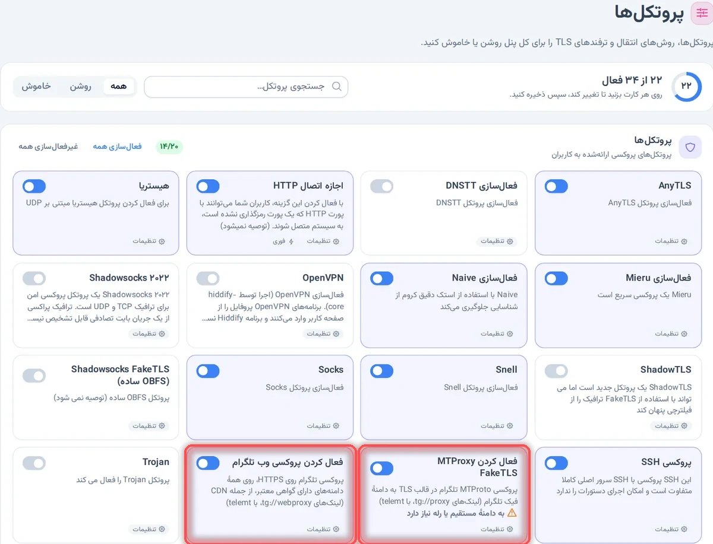
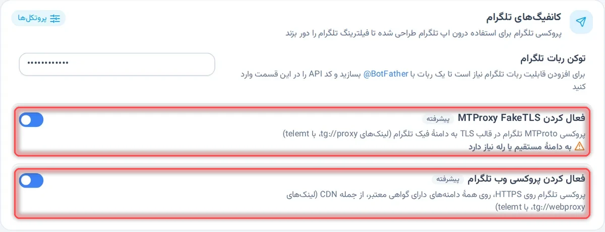

# آموزش راه‌اندازی پروکسی تلگرام در هیدیفای‌منیجر
یکی از قابلیت‌های خوب پنل هیدیفای، ارائه پروکسی تلگرام است. دو نوع پروکسی تلگرام وجود دارد که در ادامه توضیح داده می‌شوند.

* **MTProxy FakeTLS**: پروکسی MTProto تلگرام در قالب TLS (لینک‌های `tg://proxy`). به دامنه مستقیم یا رله نیاز دارد.
* **پروکسی وب تلگرام**: پروکسی تلگرام روی HTTPS، روی همه دامنه‌های دارای گواهی معتبر، از جمله CDN (لینک‌های `tg://webproxy`).

## فعال‌سازی پروکسی تلگرام
* برای این کار در منوی کناری پنل روی **پروتکل‌ها** کلیک کنید و گزینه **فعال کردن MTProxy FakeTLS** و/یا **فعال کردن پروکسی وب تلگرام** را روشن کنید و سپس ذخیره کنید.

* همین کلیدها در کارت **کانفیگ‌های تلگرام** در صفحه **تنظیمات** هم وجود دارند.

* در صورت نمایش پیغام مربوط به `اعمال تغییرات` ، حتما دکمه را فشار دهید تا تغییرات در سرور اعمال گردند. این کار را از منوی **اقدامات** هم می‌توانید انجام دهید: در کارت **اعمال تغییرات** روی **الان اعمال کن** بزنید.

* حال اگر صفحه کاربر را باز نمایید، مشاهده خواهید کرد که کانفیگ‌های پروکسی تلگرام نیز نمایش داده خواهند شد (در منوی صفحه کاربر، بخش **پروکسی تلگرام** را باز کنید).

## فعال‌سازی تبلیغات
برای این کار ربات [MTProxybot](https://t.me/MTProxybot) را جستجو نمایید.

* حالا پروکسی‌ای که ساخته شده را وارد بات کنید. ممکن است مقداری زمان بگیرد تا به صورت کامل فعال شود.

* سپس در تنظیمات پنل در فیلد `تگ تبلیغاتی تلگرام` آدرس مورد نظر خود برای تبلیغ را وارد نمایید. مثلا می‌توانید آدرس اکانت پشتیبانی خود را بدهید.

* کار تمام است.
