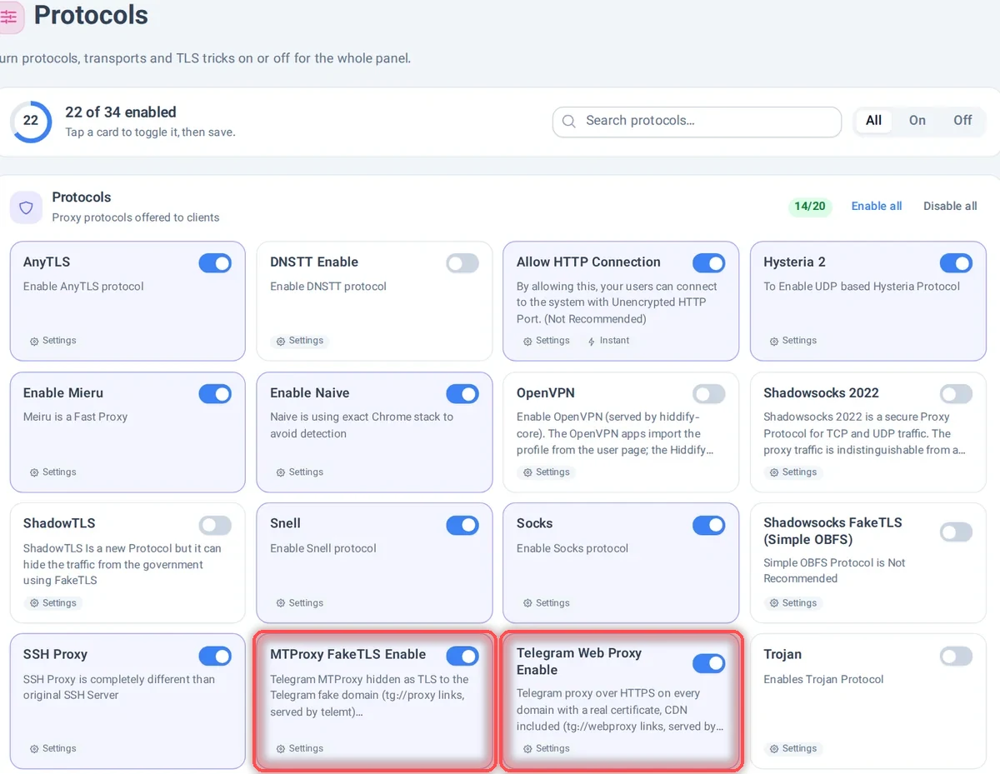
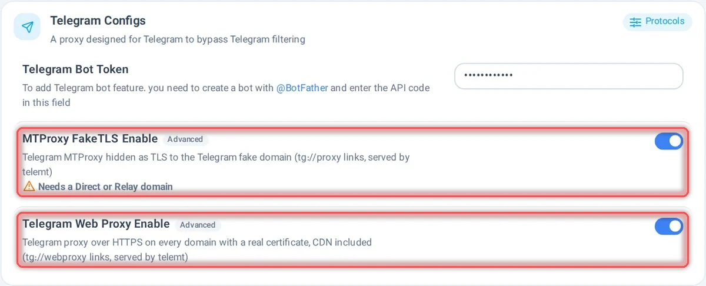
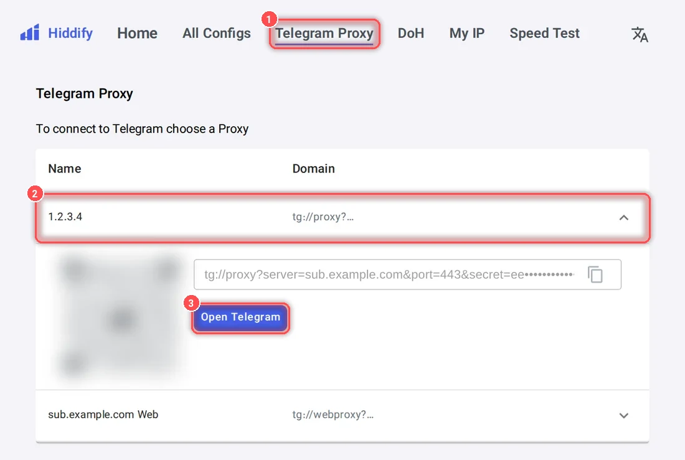

# How to set up Telegram proxy on HiddifyManager
One of the good features of the HiddifyManager panel is providing a Telegram proxy. There are two kinds, explained below.

- **MTProxy FakeTLS**: a Telegram MTProxy hidden as TLS (`tg://proxy` links). It needs a Direct or Relay domain.
- **Telegram Web Proxy**: a Telegram proxy over HTTPS on every domain with a real certificate, CDN included (`tg://webproxy` links).

## Telegram proxy activation

- To do this, click **Protocols** in the panel sidebar and turn on **MTProxy FakeTLS Enable** and/or **Telegram Web Proxy Enable**, then save.

- The same switches are also in the **Telegram Configs** card of the **Settings** page.

- If the message about applying changes is displayed, be sure to press the button so that the changes are applied to the server. You can also do it from **Actions** in the sidebar: click **Apply now** in the **Apply Changes** card.

- Now your users can find the proxies on their user page: in the menu at the top they open **Telegram Proxy**. The page lists one proxy per server address and, when **Telegram Web Proxy** is on, a **Web** proxy for each domain. Tapping a row shows its QR code, the link with a copy button, and **Open Telegram**, which adds the proxy to Telegram in one tap.

## Advertising activation

- For this, search for [MTProxybot](https://t.me/MTProxybot).

- Now enter the created proxy into the bot. It may take some time to fully activate.

- Then, in the panel settings, enter the address you want to advertise in the Telegram advertising tag field. For example, you can give your support account address.

- The work is done.