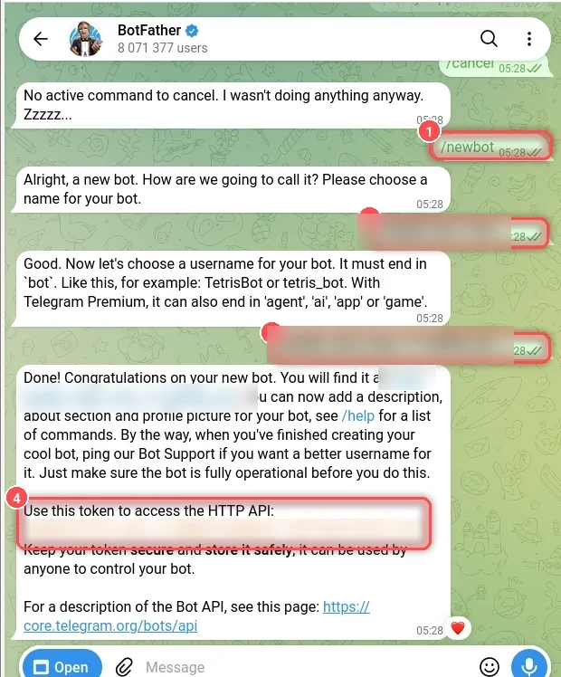
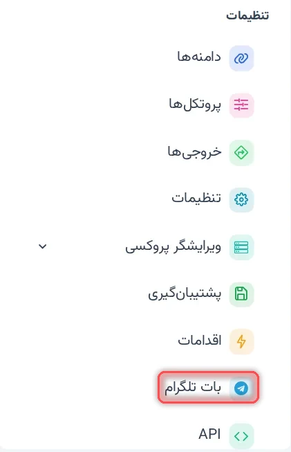
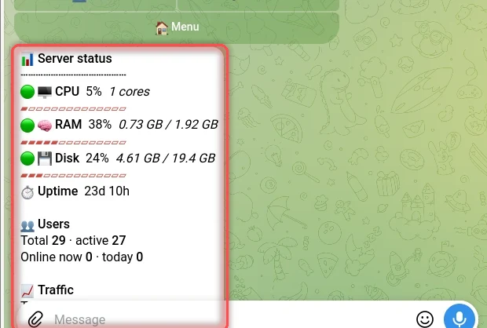
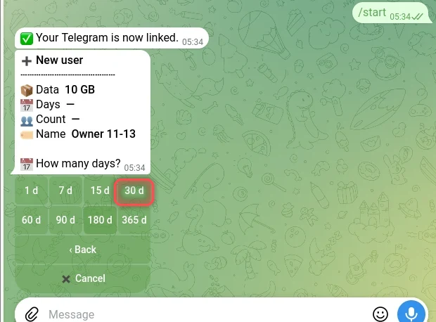
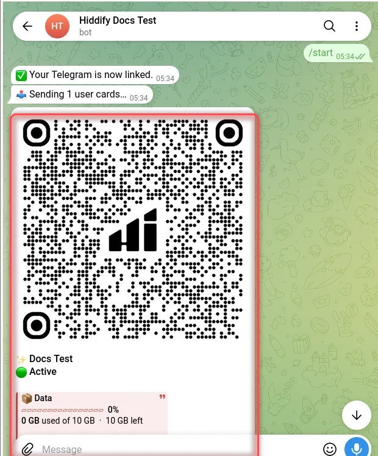
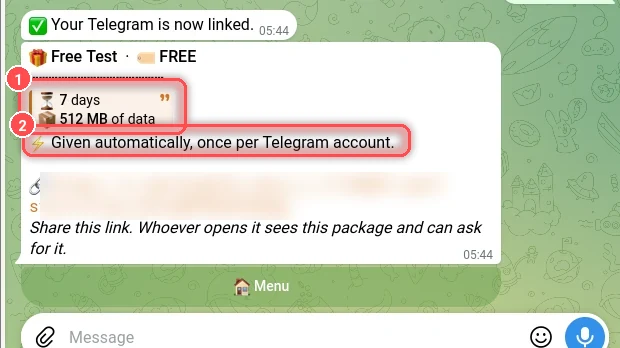
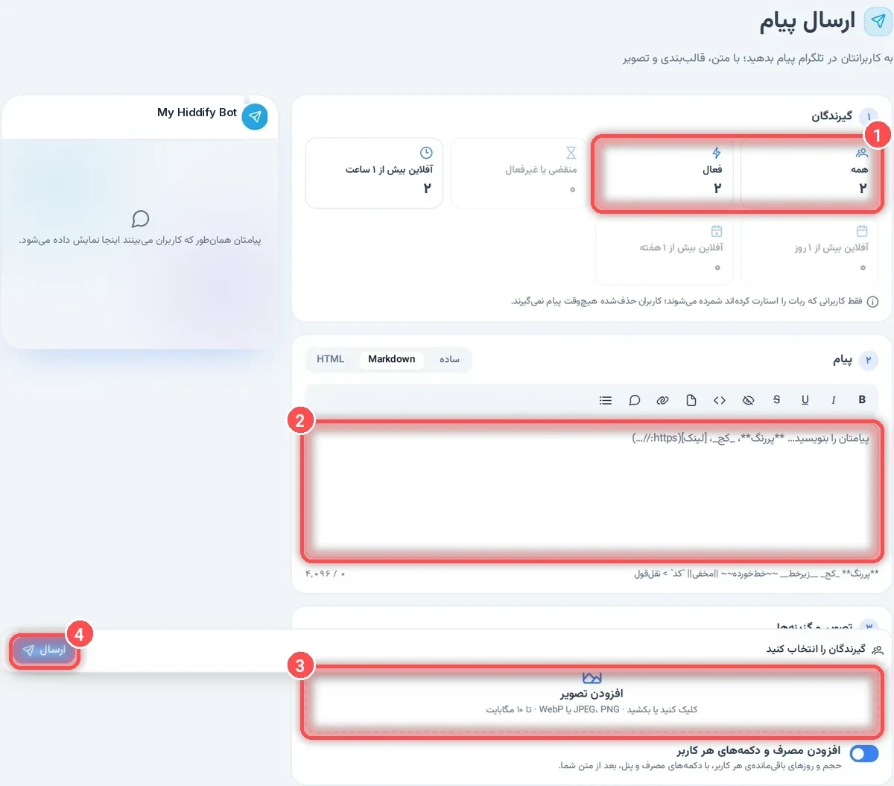

# نحوه تنظیم و استفاده از بات تلگرام در هیدیفای‌منیجر

این صفحه به شما نشان می‌دهد چطور پنل هیدیفای‌منیجر را به بات تلگرام خودتان وصل کنید. با این بات می‌توانید از داخل تلگرام کاربران را بسازید و مدیریت کنید، وضعیت سرور را ببینید و پشتیبان‌های خودکار پنل را دریافت کنید. کاربران شما هم می‌توانند تلگرام خود را وصل کنند تا وقتی بسته‌شان رو به اتمام است باخبر شوند.

**پیش‌نیازها**

- دسترسی ادمین به پنل هیدیفای‌منیجر.
- یک حساب تلگرام.

## مرحله ۱: ساخت بات تلگرام

1. تلگرام را باز کنید و `@BotFather` را جستجو کنید. این بات رسمی تلگرام برای ساختن بات است.

    

2. روی **Start** بزنید.

    

3. دستور `/newbot` را بفرستید (یا از منو انتخاب کنید).

    

4. یک نام برای بات بفرستید. سپس یک نام کاربری منحصربه‌فرد برای آن بفرستید.

    

    - نام کاربری باید به `bot` ختم شود (مثلاً `my_vpn_bot`).
    - استفاده از `_` در نام کاربری مجاز است.

5. حالا BotFather یک **توکن** برای شما می‌فرستد: یک کد طولانی مثل `123456789:AA...`. آن را کپی کنید. توکن را به کسی ندهید: هر کس توکن را داشته باشد می‌تواند بات شما را کنترل کند.

    

## مرحله ۲: وارد کردن توکن در پنل

1. پنل ادمین را باز کنید.
2. در منوی کناری، زیر **تنظیمات**، روی **تنظیمات** کلیک کنید.
3. فیلد **توکن ربات تلگرام** را در بخش **کانفیگ‌های تلگرام** پیدا کنید. (می‌توانید در کادر جستجوی بالای صفحه «تلگرام» را هم بنویسید.)
4. توکنی که کپی کرده‌اید را در آن بچسبانید.
5. روی **ذخیره** کلیک کنید.

    

اگر درست انجام شده باشد، پنل پیام «ربات تلگرام متصل شد: ‎@نام_کاربری_بات» را نشان می‌دهد و گزینه **بات تلگرام** در منوی کناری زیر **تنظیمات** ظاهر می‌شود.

اگر پیام «اتصال ربات تلگرام ناموفق بود» را دیدید، بررسی کنید که کل توکن را بدون فاصله اضافه چسبانده باشید و سرور شما به تلگرام دسترسی داشته باشد.

## مرحله ۳: وصل کردن حساب ادمین به بات

1. در منوی کناری پنل روی **بات تلگرام** کلیک کنید. تلگرام باز می‌شود و بات شما را نشان می‌دهد.
2. روی **Start** بزنید.

به دلایل امنیتی، بات فقط وقتی شما را ادمین می‌شناسد که آن را از همین لینک باز کنید. هر ادمین می‌تواند حساب تلگرام خودش را به همین روش وصل کند. از مسیر **حساب من** ← **اتصال تلگرام** هم می‌توانید این کار را انجام دهید.

## استفاده از بات

پس از استارت، بات منوی ادمین را با این دکمه‌ها نشان می‌دهد:

- **👥 کاربران**: فهرست کاربران شما. می‌توانید آن‌ها را فیلتر کنید (مثلاً کاربرانی که بسته‌شان رو به اتمام است) یا نامی را بنویسید تا جستجو شود. با باز کردن هر کاربر می‌توانید بسته‌اش را تمدید کنید، روز یا حجم اضافه کنید، مصرفش را ریست کنید، او را فعال، غیرفعال یا حذف کنید و لینک‌ها و کد QR او را ببینید.
- **➕ کاربر جدید**: ساختن یک یا چند کاربر.
- **📊 وضعیت سرور**: پردازنده، رم، دیسک، مدت روشن بودن، ترافیک و کاربران آنلاین.
- **🩺 بررسی وضعیت**: آی‌پی عمومی سرور با کشور و شرکت ارائه‌دهنده آن، و اینکه هر سرویس (Xray، sing-box، HAProxy و بقیه) روشن است یا نه. برای ادمین‌های نماینده نمایش داده نمی‌شود.
- **🎁 تست رایگان**: لینکی که به دیگران می‌دهید تا یک حساب تست رایگان درخواست کنند ([تست رایگان](#_10) را پایین‌تر ببینید).
- **💾 بکاپ**: گرفتن فوری فایل پشتیبان از کل پنل (فقط برای سوپرادمین‌ها).
- **🖥 باز کردن پنل**: باز کردن پنل ادمین داخل خود تلگرام. با حساب تلگرام وصل‌شده وارد می‌شوید و به لینک ادمین نیازی نیست.

هر وقت خواستید `/menu` را بفرستید تا منوی ادمین دوباره نمایش داده شود.

### ساختن کاربر از طریق بات

1. روی **➕ کاربر جدید** بزنید.
2. حجم بسته را انتخاب کنید.

    

3. مدت بسته (تعداد روز) را انتخاب کنید.

    

4. تعداد کاربرانی که با این مشخصات ساخته شوند را انتخاب کنید.

    

5. اختیاری: روی **✏️ نام** بزنید و یک نام برای کاربر بفرستید.
6. روی **✅ ساختن** بزنید.

    

بات برای هر کاربر جدید یک کارت با لینک‌های او می‌فرستد. می‌توانید این کارت را برای کاربر فوروارد کنید.

کاربر جدید در صفحه **کاربران** پنل هم دیده می‌شود.

روی دکمه **🔄 به‌روزرسانی** در کارت هر کاربر بزنید تا آخرین وضعیت حجم مصرفی و روزهای باقی‌مانده او را ببینید. با دکمه **⚙️ مدیریت** هم لینک‌ها و QR کاربر را می‌گیرید، روز یا حجم اضافه می‌کنید، بسته را تمدید می‌کنید، مصرف را صفر می‌کنید یا کاربر را غیرفعال یا حذف می‌کنید.

### جستجوی کاربر
در **👥 کاربران** روی **🔍 جستجو** بزنید و نام، UUID، توضیح یا شناسه تلگرام کاربر را بفرستید. با **✖️ پاک کردن** به فهرست کامل برمی‌گردید.

### بررسی وضعیت
**🩺 بررسی وضعیت** نشان می‌دهد آی‌پی عمومی سرور شما کجاست (کشور، شهر و شرکت ارائه‌دهنده) و کنار هر سرویسی که روشن است ✅ می‌گذارد. ❌ یعنی آن سرویس از کار افتاده است: در پنل **اقدامات** را باز کنید و ری‌استارت کنید، یا [آموزش اتصال و عیب‌یابی با SSH](/fa/manager/configuration-and-advanced-settings/How-to-connect-and-troubleshoot-via-SSH/) را ببینید.

### یادآوری‌های روزانه
بات هر روز یک بار همه کاربران را بررسی می‌کند:

- به کاربری که **۳ روز یا کمتر** تا پایان بسته‌اش مانده، یا **۸۵ درصد یا بیشتر** از حجمش را مصرف کرده، در بات یادآوری می‌فرستد (اگر تلگرامش را وصل کرده باشد).
- برای شما یک پیام خلاصه از کاربرانی که بسته‌شان رو به اتمام است (تا ۱۵ نام) می‌فرستد، با دکمه‌ای که فهرست **رو به اتمام** را باز می‌کند.

### تست رایگان
با **🎁 تست رایگان** می‌توانید اجازه دهید دیگران خودشان از بات یک حساب تست بگیرند. بسته (حجم و روز) و حالت آن را در پنل تنظیم کنید: در منوی کناری، زیر **مدیریت**، **صندوق پیام** → **تست رایگان** را باز کنید.

- **خودکار**: حساب فوراً داده می‌شود، برای هر حساب تلگرام فقط یک بار.
- **دستی**: هر درخواست با دکمه‌های **✅ تأیید** و **✖️ رد** در بات به شما می‌رسد.

در بات روی **🎁 تست رایگان** بزنید تا لینک اشتراک‌گذاری را بگیرید. هر کس آن را باز کند بسته را می‌بیند و می‌تواند درخواستش را بدهد.

### پیام‌های کاربران
کاربر می‌تواند در بات پیام بنویسد. پیام به شکل «*نام* نوشت:» با دکمه **↩️ پاسخ** به شما می‌رسد؛ پاسخ خود را بنویسید تا برای کاربر فرستاده شود. همین گفتگوها در **صندوق پیام** پنل هم هست.

### پشتیبان‌های خودکار

وقتی حساب ادمین شما به بات وصل باشد، هر پشتیبان خودکار پنل در تلگرام هم برای شما فرستاده می‌شود. پشتیبان‌ها را در پنل مدیریت کنید: در منوی کناری، زیر **تنظیمات**، روی **پشتیبان‌گیری** کلیک کنید. [آموزش پشتیبان‌گیری و بازیابی پنل](/fa/manager/configuration-and-advanced-settings/How-to-backup-and-restore-panel-on-Hiddify/) را ببینید.

## کاربران و بات

کاربران شما هم می‌توانند تلگرام خود را به بات وصل کنند. برای این کار، کاربر بات شما را باز می‌کند و **Start** را می‌زند، سپس لینک اشتراک یا UUID خود را می‌فرستد، یا در صفحه حساب خود دکمه تلگرام را می‌زند. پس از آن:

- می‌تواند حجم و روزهای باقی‌مانده و لینک‌هایش را در بات ببیند.
- بات وقتی بسته او رو به اتمام است به او هشدار می‌دهد.
- شما می‌توانید از پنل برایش پیام بفرستید: در منوی کناری، زیر **مدیریت**، روی **ارسال پیام** کلیک کنید. **گیرندگان** را انتخاب کنید (مثلاً **همه** یا **فعال**)، پیام را بنویسید، در صورت نیاز تصویر اضافه کنید و روی **ارسال** بزنید. فقط کاربرانی که بات را استارت کرده‌اند پیام را دریافت می‌کنند.

## مقاله‌های مرتبط

- [پروکسی تلگرام](/fa/manager/configuration-and-advanced-settings/How-to-set-up-Telegram-proxy-on-Hiddify/)
- [فعال‌سازی وارپ](/fa/manager/configuration-and-advanced-settings/How-to-activate-WARP-on-the-Hiddify-panel/)
- [استفاده از IPv6](/fa/manager/configuration-and-advanced-settings/IPv6-usage-guide/)
- [آشنایی کامل با پنل و تنظیمات آن](/fa/manager/configuration-and-advanced-settings/How-to-configure-Hiddify-panel-properly/)

