

# How to set up and use Telegram bot on HiddifyManager
This page shows you how to connect your Hiddify Manager panel to your own Telegram bot. With the bot you can create and manage users from Telegram, check the server status, and receive the panel's automatic backups. Your users can also link their Telegram to get notices when their package is about to end.

**Prerequisites**

- Admin access to your Hiddify Manager panel.
- A Telegram account.

## Step 1: Create a Telegram bot
1. Open Telegram and search for `@BotFather`. This is Telegram's official bot for creating bots.

    

2. Tap **Start**.

    

3. Send `/newbot` (or choose it from the menu).

    

4. Send a name for your bot. Then send a unique username for it.

    

    - The username must end with `bot` (for example `my_vpn_bot`).
    - You can use `_` in the username.

5. BotFather now sends you a **token**: a long code like `123456789:AA...`. Copy it. Keep it secret: anyone with the token can control your bot.

    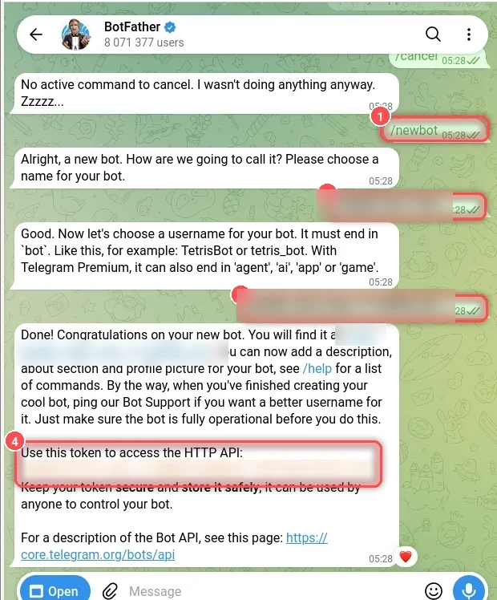

## Step 2: Add the token to the panel
1. Open your admin panel.
2. In the sidebar, under **Settings**, click **Settings**.
3. Find the **Telegram Bot Token** field in the **Telegram Configs** section. (You can also type "Telegram" in the search box at the top of the page.)
4. Paste the token you copied.
5. Click **Save**.

    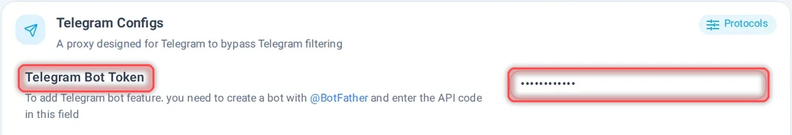

If it worked, the panel shows "Telegram bot connected: @your_bot_username", and a **Telegram Bot** item appears in the sidebar under **Settings**.

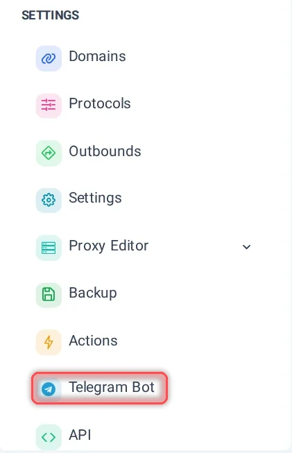

If you see "Telegram bot could not connect", check that you pasted the whole token with no extra spaces, and that your server can reach Telegram.

## Step 3: Link your admin account to the bot
1. In the panel sidebar, click **Telegram Bot**. Telegram opens your bot.
2. Tap **Start**.

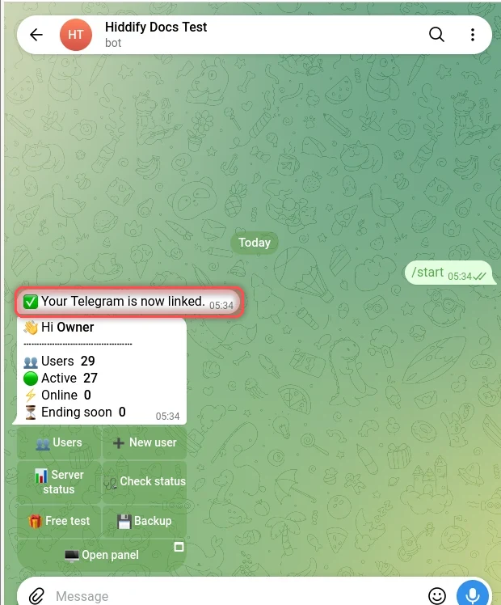

For security, the bot only recognises you as an admin when you open it from this link. Each admin can link their own Telegram account in the same way. You can also link it from **My account** → **Connect Telegram**.

## Using the bot
After you start it, the bot shows your admin menu with these buttons:

- **👥 Users**: list your users. You can filter them (for example, users whose package is ending soon) or type a name to search. Open a user to renew their package, add days or data, reset their usage, enable, disable or delete them, and see their links and QR code.
- **➕ New user**: create one or more users.
- **📊 Server status**: CPU, RAM, disk, uptime, traffic and online users.
- **🩺 Check status**: the server's public IP with its country and provider, and whether each service (Xray, sing-box, HAProxy and the others) is running. Not shown to agent admins.
- **🎁 Free test**: the link you share so people can ask for a free test account (see [Free test](#free-test) below).
- **💾 Backup**: get a backup file of the whole panel right now (super admins only).
- **🖥 Open panel**: open your admin panel inside Telegram. You are signed in with your linked Telegram account, without the admin link.

Send `/menu` at any time to bring the admin menu back.

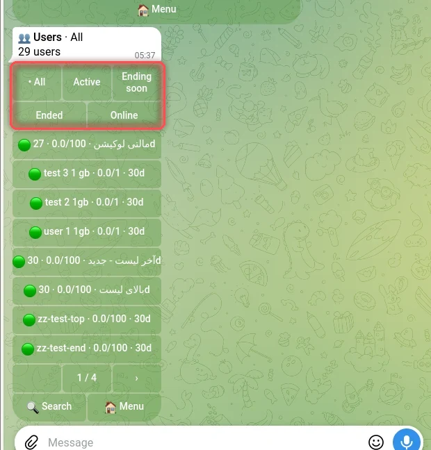
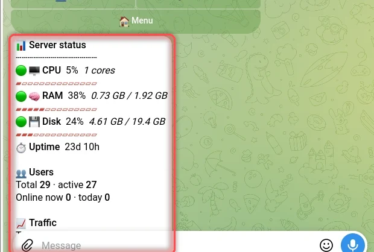

### Create a user from the bot
1. Tap **➕ New user**.
2. Choose how much data the package has.

    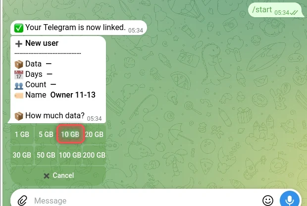
    

3. Choose how many days the package lasts.

    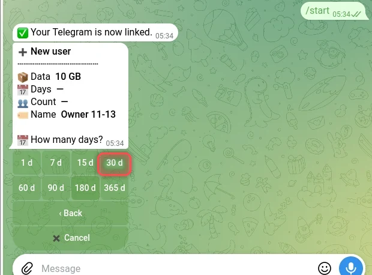

4. Choose how many users to create with these limits.

    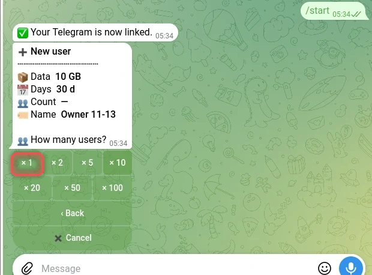

5. Optional: tap **✏️ Name** and send a name for the user.
6. Tap **✅ Create**.

    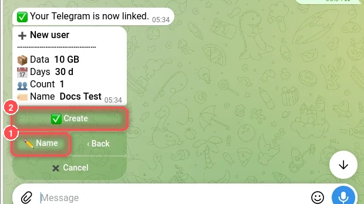

The bot sends you one card per new user, with the user's links. You can forward the card to the user.

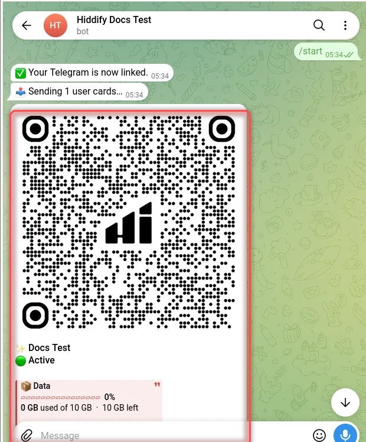

The new user also appears in the panel's **Users** page.

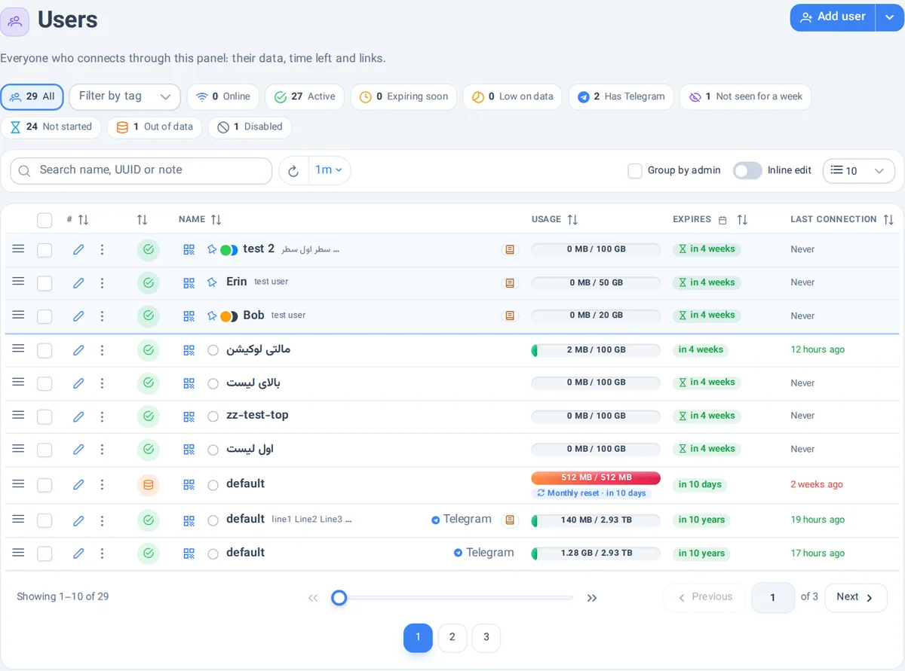

Tap **🔄 Refresh** on a user's card to see their latest data usage and remaining days. Tap **⚙️ Manage** to get the user's links and QR code, add days or data, renew the package, reset usage, or disable or delete the user.

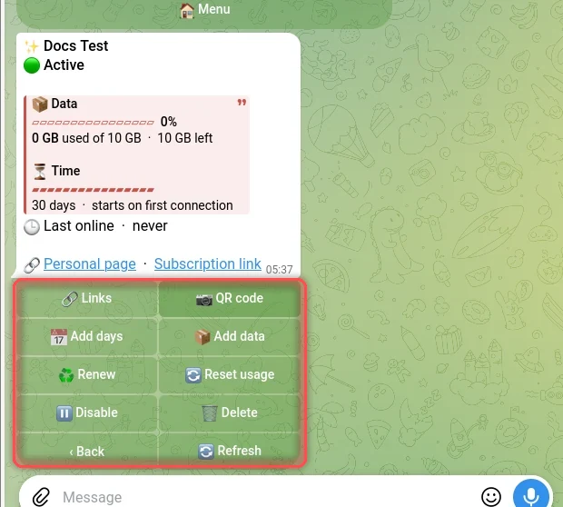

### Search for a user
In **👥 Users**, tap **🔍 Search** and send a name, UUID, comment or Telegram ID. Tap **✖️ Clear** to go back to the full list.

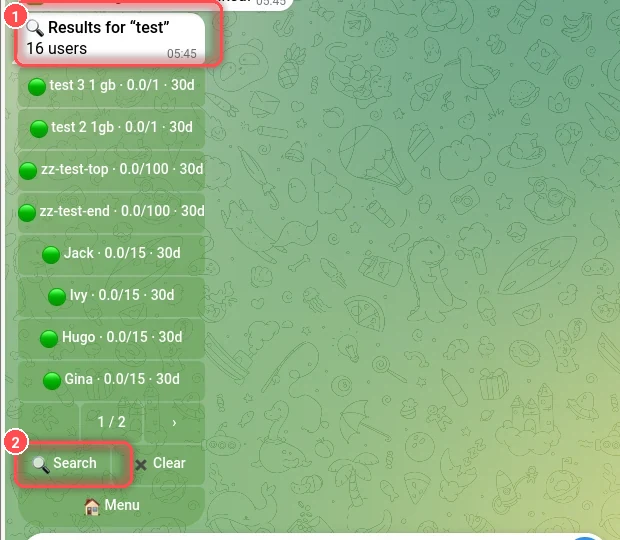

### Check status
**🩺 Check status** shows where your server's public IP is located (country, city, provider) and a ✅ for every service that is running. A ❌ means that service is down: open **Actions** in the panel and restart, or see [How to connect and troubleshoot via SSH](/manager/configuration-and-advanced-settings/How-to-connect-and-troubleshoot-via-SSH/).

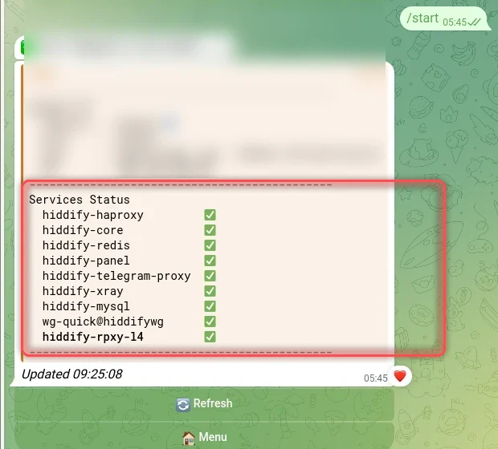

### Daily notices
Once a day the bot checks every user:

- A user whose package ends in **3 days or less**, or who has used **85% or more** of their data, gets a reminder in the bot (if they linked their Telegram).
- You get one summary message listing your users that are ending soon (up to 15 names), with a button that opens the **Ending soon** list.

### Free test
With **🎁 Free test** you can let people get a test account from the bot by themselves. Set the package (data and days) and the mode in the panel: in the sidebar, under **Manager**, open **Inbox** → **Free test**.

- **Automatic**: the account is given right away, once per Telegram account.
- **Manual**: each request comes to you in the bot with **✅ Approve** and **✖️ Decline**.

Tap **🎁 Free test** in the bot to get the link to share. Whoever opens it sees the package and can ask for it.

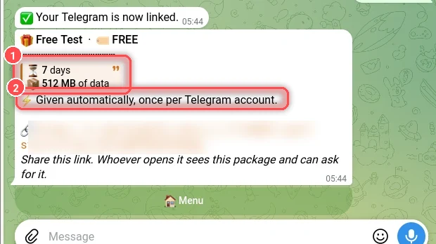

### Messages from users
A user can type a message in the bot. It comes to you as "*name* wrote:" with a **↩️ Reply** button; type your answer and it goes back to the user. The same conversations are in the panel's **Inbox**.

### Automatic backups
When your admin account is linked to the bot, each automatic backup of the panel is also sent to you in Telegram. You can manage backups in the panel: in the sidebar, under **Settings**, click **Backup**. See [How to backup and restore the panel](/manager/configuration-and-advanced-settings/How-to-backup-and-restore-panel-on-Hiddify/).

## Users and the bot
Your users can link their own Telegram to the bot. To do this, a user opens your bot and taps **Start**, then sends their subscription link or UUID, or taps the Telegram button on their account page. After that:

- They can see their remaining data and days, and their links, in the bot.
- The bot warns them when their package is about to end.
- You can send them messages from the panel: in the sidebar, under **Manager**, click **Send Message**. Choose who gets it (for example **Everyone** or **Active**), write the message, optionally add an image, and click **Send**. Only users who have started your bot receive messages.

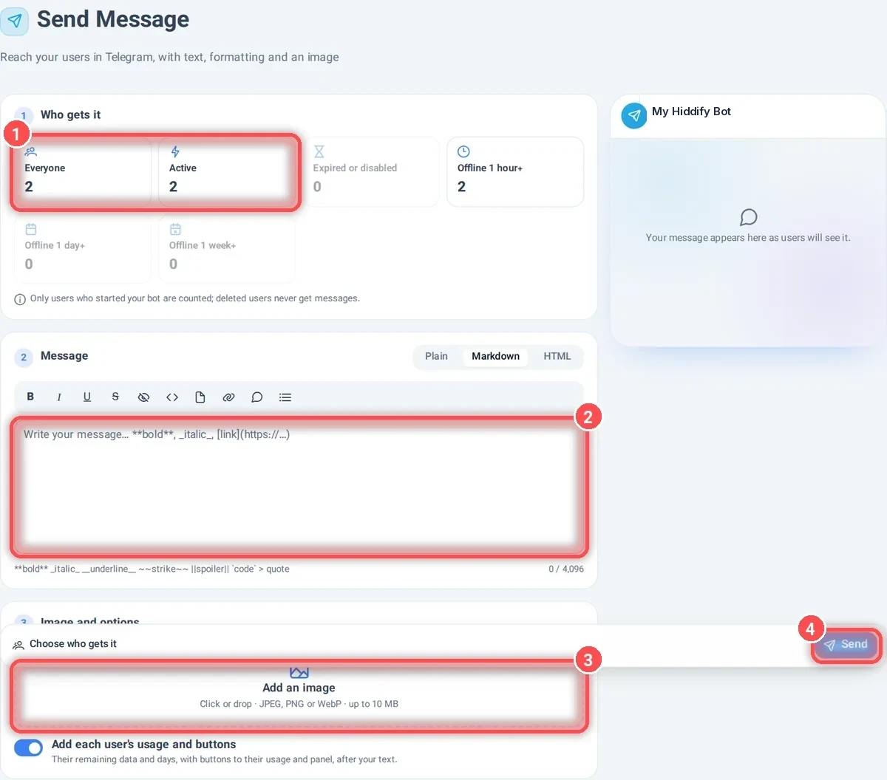

## Related articles

- [Telegram proxy](/manager/configuration-and-advanced-settings/How-to-set-up-Telegram-proxy-on-Hiddify/)
- [Turn on WARP](/manager/configuration-and-advanced-settings/How-to-activate-WARP-on-the-Hiddify-panel/)
- [Using IPv6](/manager/configuration-and-advanced-settings/IPv6-usage-guide/)
- [Every part and setting of the panel](/manager/configuration-and-advanced-settings/How-to-configure-Hiddify-panel-properly/)

