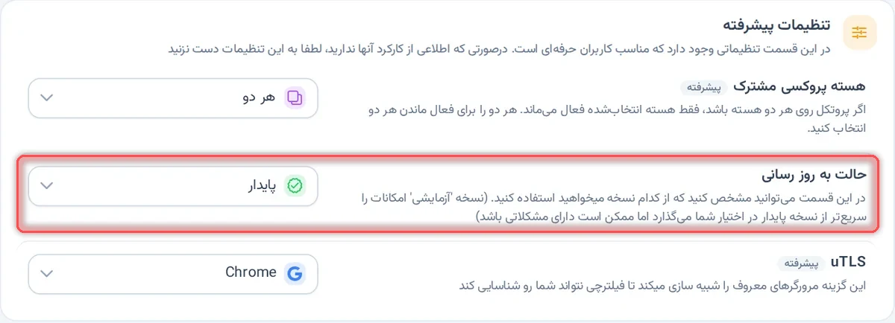

# آموزش به‌روزرسانی پنل هیدیفای
برای آپدیت پنل ۲ راه وجود داره.

## آپدیت از طریق پنل ادمین
در منوی کناری پنل، زیر **تنظیمات**، روی **اقدامات** کلیک کنید. در صفحه **اعمال و وضعیت**، در کارت **به‌روزرسانی هیدیفای** روی `به‌روزرسانی` کلیک کنید.

این کار ممکن است بین ۵ تا ۱۰ دقیقه زمان بگیرد. آخرین نسخه هیدیفای دانلود، نصب و اعمال می‌شود و در پایان پنل دوباره راه‌اندازی می‌شود.

### تغییر حالت آپدیت
در صورت نیاز به تغییر حالت آپدیت، از منوی کناری به **تنظیمات** بروید و در کارت **تنظیمات پیشرفته** گزینه **حالت به روز رسانی** را پیدا کنید. از بین نسخه‌های `پایدار` ، `در حال توسعه` و `نسخه آزمایشی` یکی را انتخاب نمایید و سپس اقدام به `به‌روزرسانی` نمایید.

به عنوان مثال `حالت به روز رسانی` را روی حالت `نسخه آزمایشی` قرار داده و تنظیمات را ذخیره کنید.

سپس از منوی `اقدامات`، در کارت **به‌روزرسانی هیدیفای** روی `به‌روزرسانی` بزنید. بعد از حدود ۵ دقیقه به‌روزرسانی به نسخه مورد نظر شما انجام می‌شود.

### تنظیمات آپدیت خودکار در پنل
پنل به صورت روزانه خود را با آخرین نسخه موجود در گیتهاب پروژه بروزرسانی می‌کند. تنظیم آن گزینه **به‌روز رسانی خودکار** در کارت **تنظیمات عمومی** در صفحه **تنظیمات** است.

وقتی گزینه **به‌روز رسانی خودکار** روشن باشد، هر روز راس ساعت ۳ صبح سیستم برای به‌روز رسانی جدید چک می‌شود و در صورت وجود، پنل به صورت خودکار آپدیت می‌شود.

## آپدیت از طریق SSH
 [به سرور SSH بزنید](/fa/manager/installation-and-setup/How-to-connect-to-server-via-SSH/) و در منوی هیدیفای آپدیت را انتخاب کنید. ۳ حالت وجود داره.

* گزینه دیفالت بر اساس `default` پنل آپدیت می‌کند. 
* گزینه `release` آپدیت بر اساس نسخه پایدار است. 
* گزینه `develop` آپدیت نسخه در حال توسعه است.
