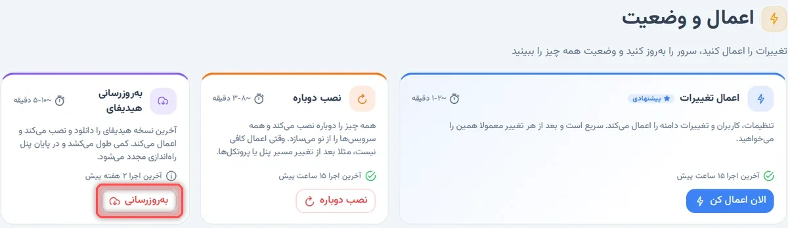
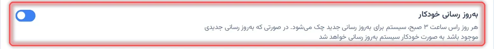
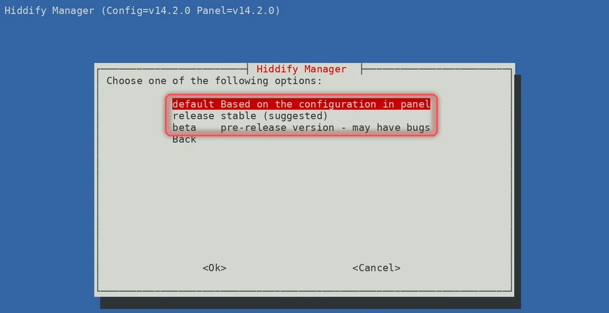

# آموزش به‌روزرسانی پنل هیدیفای‌منیجر
برای آپدیت پنل ۲ راه وجود داره.

## آپدیت از طریق پنل ادمین
در منوی کناری پنل، زیر **تنظیمات**، روی **اقدامات** کلیک کنید. در صفحه **اعمال و وضعیت**، در کارت **به‌روزرسانی هیدیفای** روی `به‌روزرسانی` کلیک کنید.

این کار ممکن است بین ۵ تا ۱۰ دقیقه زمان بگیرد. آخرین نسخه هیدیفای‌منیجر دانلود، نصب و اعمال می‌شود و در پایان پنل دوباره راه‌اندازی می‌شود.

### تغییر حالت آپدیت
در صورت نیاز به تغییر حالت آپدیت، از منوی کناری به **تنظیمات** بروید و در کارت **تنظیمات پیشرفته** گزینه **حالت به‌روزرسانی** را پیدا کنید. از بین نسخه‌های `پایدار`، `در حال توسعه` و `نسخه آزمایشی` یکی را انتخاب نمایید و سپس اقدام به `به‌روزرسانی` نمایید.

به عنوان مثال `حالت به روز رسانی` را روی حالت `نسخه آزمایشی` قرار داده و تنظیمات را ذخیره کنید.

سپس از منوی `اقدامات`، در کارت **به‌روزرسانی هیدیفای** روی `به‌روزرسانی` بزنید. بعد از حدود ۵ دقیقه به‌روزرسانی به نسخه مورد نظر شما انجام می‌شود.

### تنظیمات آپدیت خودکار در پنل
پنل به صورت روزانه خود را با آخرین نسخه موجود در گیتهاب پروژه به‌روزرسانی می‌کند. تنظیم آن گزینه **به‌روزرسانی خودکار** در کارت **تنظیمات عمومی** در صفحه **تنظیمات** است.

وقتی گزینه **به‌روزرسانی خودکار** روشن باشد، هر روز راس ساعت ۳ صبح سیستم برای به‌روزرسانی جدید چک می‌شود و در صورت وجود، پنل به صورت خودکار آپدیت می‌شود.

## آپدیت از طریق SSH
 [به سرور SSH بزنید](/fa/manager/installation-and-setup/How-to-connect-to-server-via-SSH/) و دستور `hiddify` را اجرا کنید تا منوی هیدیفای‌منیجر باز شود. گزینهٔ `update` را انتخاب کنید و بعد یکی از این ۳ حالت را:

* `default`: بر اساس کانالی که در پنل تنظیم شده آپدیت می‌کند (**حالت به‌روزرسانی** در تنظیمات > تنظیمات پیشرفته).
* `release`: به آخرین نسخهٔ پایدار آپدیت می‌کند. این گزینه پیشنهادی است.
* `beta`: به آخرین نسخهٔ پیش‌انتشار آپدیت می‌کند و ممکن است باگ داشته باشد.

## مقاله‌های مرتبط

- [پشتیبان‌گیری و بازیابی](/fa/manager/configuration-and-advanced-settings/How-to-backup-and-restore-panel-on-Hiddify/)
- [برگرداندن تنظیمات به حالت اولیه](/fa/manager/configuration-and-advanced-settings/How-to-Reset-Hiddify-panel-to-default/)
- [پروکسی SSH](/fa/manager/configuration-and-advanced-settings/SSH-proxy-setting-on-Hiddify-panel/)
- [آشنایی کامل با پنل و تنظیمات آن](/fa/manager/configuration-and-advanced-settings/How-to-configure-Hiddify-panel-properly/)

