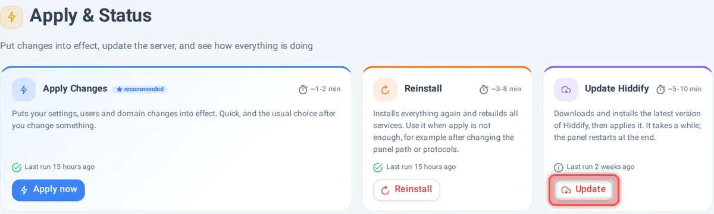
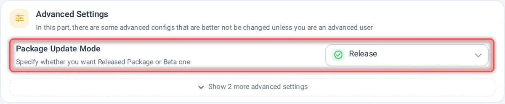
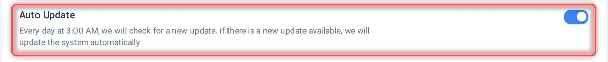

# How to update HiddifyManager
There are 2 ways to update the panel.

## Update through admin panel
In the panel sidebar, under **Settings**, click **Actions**. On the **Apply & Status** page, click **Update** in the **Update Hiddify** card.

  

This may take between 5 and 10 minutes. Hiddify downloads and installs the latest version, then applies it; the panel restarts at the end.

## Change the update mode

If you need to change the update mode, go to **Settings** in the sidebar and find **Package Update Mode** in the **Advanced Settings** card. Choose one of the `Release`, `Beta` and `Develop` versions and then update.

For example, set the update mode to `Beta` and save the settings.

Then open **Actions** in the sidebar and click **Update** in the **Update Hiddify** card. After about 5 minutes, the panel will be updated to the version you want.

## Automatic update settings in the panel

The panel updates itself daily with the latest released version on the project's GitHub. Its setting is **Auto Update** in the **General Settings** card of the **Settings** page.

  

When **Auto Update** is on, the panel checks for a new update every day at 3:00 AM and, if there is one, updates itself automatically.

## Update via SSH

Connect via [SSH to the server](/manager/installation-and-setup/How-to-connect-to-server-via-SSH/) and select Update in the Hiddify menu. There are 3 modes.

* The `default` option updates the panel based on default.
* The update `release` option is based on the stable version.
* The `develop` option is to update the version under development.
