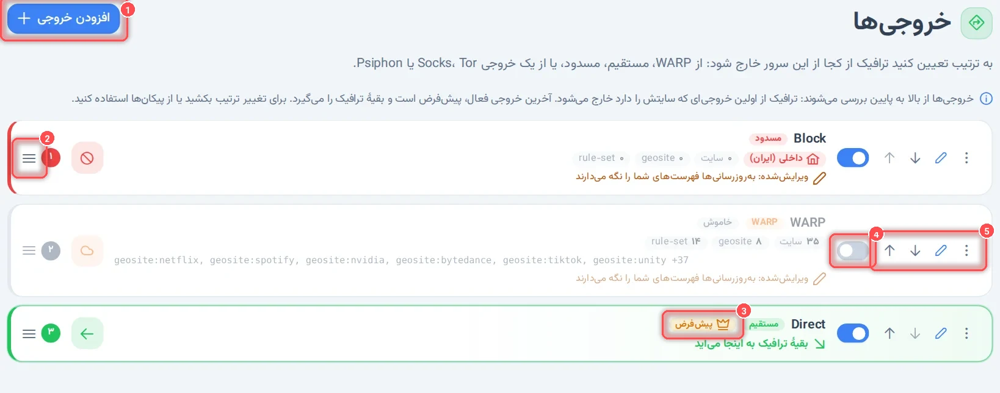
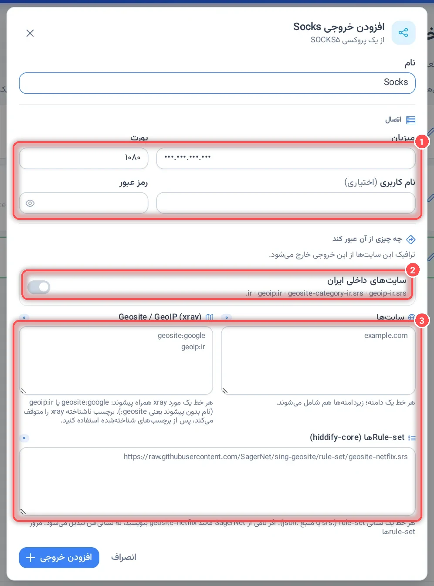
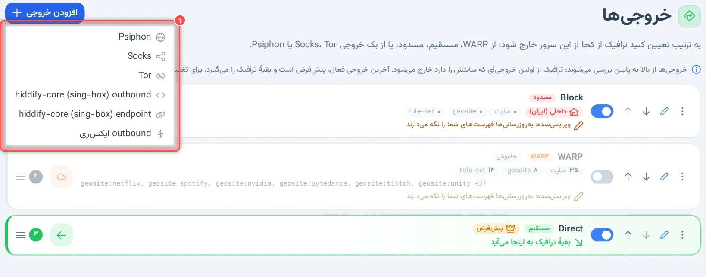
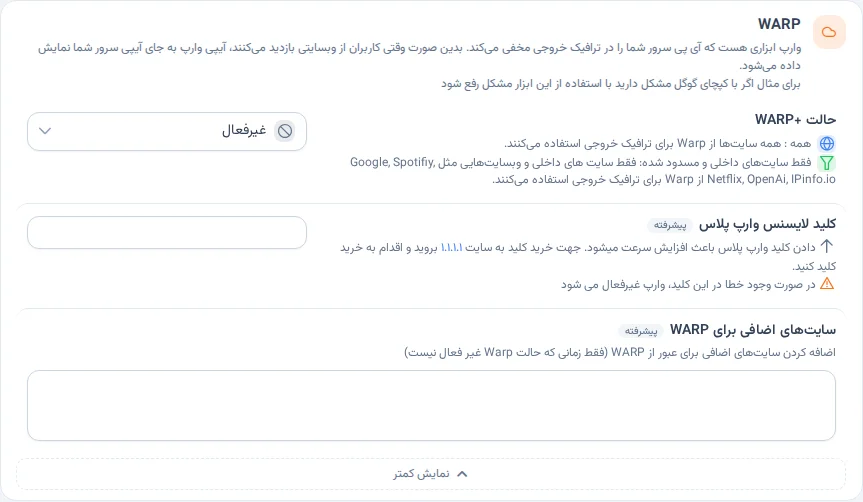
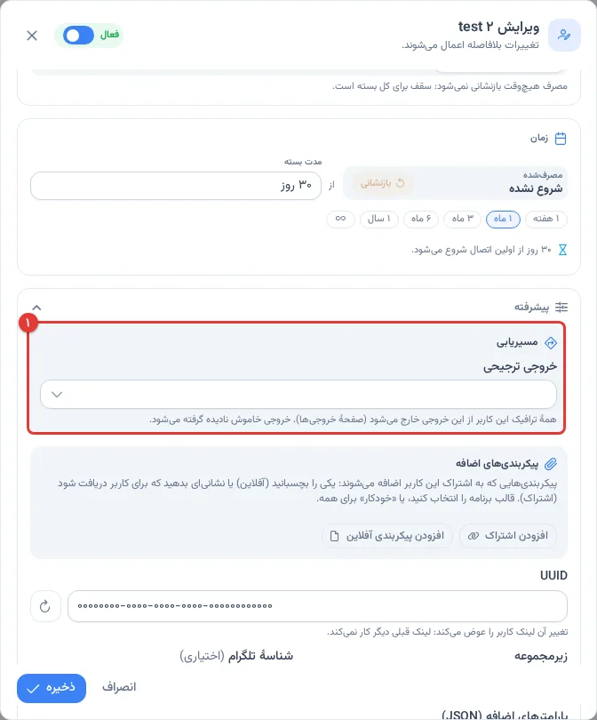
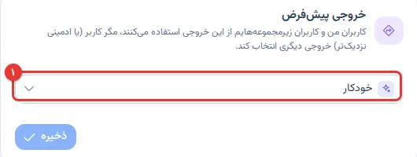

# آموزش خروجی‌ها (Outbounds) در هیدیفای‌منیجر

!!! info "نوشته‌شده برای هیدیفای‌منیجر نسخهٔ ۱۴.۵"
    تصویرها و مراحل این صفحه از هیدیفای‌منیجر نسخهٔ ۱۴.۵ هستند.

وقتی کاربری از طریق سرور شما سایتی را باز می‌کند، ترافیک باید از سرور به سمت آن سایت خارج شود. صفحهٔ **خروجی‌ها** تعیین می‌کند ترافیک **از کجا خارج شود**:

- **مستقیم (Direct)**: مستقیم از سرور شما، با آی‌پی خود سرور.
- **وارپ (WARP)**: از طریق Cloudflare WARP؛ سایت‌ها به جای آی‌پی سرور شما یک آی‌پی کلادفلر می‌بینند. مثلاً برای سایت‌هایی که کپچا نشان می‌دهند یا آی‌پی دیتاسنترها را مسدود می‌کنند مفید است.
- **مسدود (Block)**: ترافیک دور ریخته می‌شود. برای سایت‌های داخلی مفید است، چون اتصال سرور شما به آن‌ها می‌تواند سرور را برای سیستم فیلترینگ لو بدهد.
- **Socks**: از طریق یک سرور پروکسی دیگر (SOCKS5)، مثلاً سروری در کشوری دیگر.
- **Tor** و **Psiphon**: از طریق شبکهٔ Tor یا Psiphon.
- **JSON دلخواه شما**: یک outbound یا endpoint هستهٔ هیدیفای (sing-box)، مثلاً وایرگارد، یا یک outbound ایکس‌ری.

## ترتیب خروجی‌ها چطور کار می‌کند

خروجی‌ها **از بالا به پایین** بررسی می‌شوند. ترافیک از **اولین خروجی‌ای که سایتش را در فهرست دارد** خارج می‌شود. **آخرین خروجی روشن**، خروجی **پیش‌فرض** است (۳): هر چیزی که در فهرست هیچ خروجی بالاتری نباشد به آن می‌رود.

ترتیب در تصویر:

1. **مسدود** با سایت‌های داخلی ایران: سایت‌های ایرانی مسدود می‌شوند.
2. **WARP** با فهرستی از سایت‌ها (Netflix، Spotify، Google و…): این‌ها از وارپ خارج می‌شوند. اینجا وارپ **خاموش** است و نادیده گرفته می‌شود.
3. **مستقیم**، پیش‌فرض: بقیهٔ ترافیک مستقیم خارج می‌شود.

برای تغییر ترتیب، دستگیره (۲) را بکشید یا از فلش‌های بالا و پایین (۵) استفاده کنید. برای پیش‌فرض کردن یک خروجی، منوی **⋮** آن را باز کنید و **پیش‌فرض کردن (انتقال به انتها)** را بزنید. کلید (۴) خروجی را روشن یا خاموش می‌کند؛ خروجی خاموش نادیده گرفته می‌شود. مداد (۵) فهرست‌های آن را ویرایش می‌کند.

!!! tip "خروجی بدون سایت"
    خروجی‌ای که بالای پیش‌فرض است ولی هیچ سایت، geosite یا rule-setی ندارد با **بدون استفاده** مشخص می‌شود: هیچ ترافیکی از آن عبور نمی‌کند. چند سایت به آن اضافه کنید، یا آن را به انتها ببرید تا پیش‌فرض شود.

## چه چیزی از یک خروجی عبور کند

وقتی خروجی‌ای را اضافه یا ویرایش می‌کنید، بخش **چه چیزی از آن عبور کند** چهار فهرست دارد:

- **سایت‌های داخلی ایران** (۲): یک کلید برای همهٔ سایت‌های ایرانی (`.ir`، `geoip:ir` و rule-setهای ایران). کشور آن از تنظیم **کشور** پنل می‌آید.
- **سایت‌ها** (۳): هر خط یک دامنه، مثلاً `example.com`. زیردامنه‌ها هم شامل می‌شوند.
- **Geosite / GeoIP (xray)**: هر خط یک مورد ایکس‌ری با پیشوندش، مثلاً `geosite:google` یا `geoip:ir`. برچسبی که ایکس‌ری نشناسد ایکس‌ری را متوقف می‌کند، پس فقط برچسب‌های شناخته‌شده بنویسید.
- **Rule-setها (hiddify-core)**: هر خط آدرس یک rule-set (فایل `.srs` یا منبع `.json`). اگر نامی از SagerNet مثل `geosite-netflix` بنویسید، خودش به آدرس کامل تبدیل می‌شود. **مرور rule-setها** فهرست آن‌ها را نشان می‌دهد.

خروجی پیش‌فرض به فهرست نیازی ندارد، چون بقیهٔ ترافیک خودبه‌خود به آن می‌رسد. اگر آن را بالاتر ببرید، فهرست‌هایش دوباره به کار می‌آیند.

## افزودن خروجی

1. **افزودن خروجی** را بزنید و نوع آن را انتخاب کنید.

    

2. یک **نام** به آن بدهید.
3. برای **Socks**، **میزبان** و **پورت** سرور SOCKS5 را وارد کنید، و اگر لازم دارد **نام کاربری** و **رمز عبور** را (۱ در تصویر Socks بالا).
4. تعیین کنید چه چیزی از آن عبور کند (فهرست‌های بالا).
5. **افزودن خروجی** را بزنید. خروجی تازه درست بالای خروجی پیش‌فرض قرار می‌گیرد.
6. تغییرات را اعمال کنید (صفحهٔ **اقدامات ← اعمال تغییرات**) تا اجرا شود.

نکته‌های هر نوع:

- **WARP**، **مستقیم** و **مسدود** همیشه هستند: می‌توانید روشن و خاموششان کنید، جایشان را عوض کنید و فهرست‌هایشان را ویرایش کنید، ولی حذفشان نمی‌شود کرد.
- **Psiphon** و **Tor** داخل هستهٔ هیدیفای روی سرور اجرا می‌شوند و از هر کدام فقط یکی می‌شود داشت. برای Tor، برنامهٔ `tor` باید روی سرور نصب باشد (مثلاً `apt install tor`)؛ اگر نباشد صفحه هشدار می‌دهد.
- **Socks** و نوع‌های JSON را می‌شود چند بار اضافه کرد.
- **hiddify-core (sing-box) outbound / endpoint** و **outbound ایکس‌ری**: یک outbound (یا endpoint) را به صورت JSON بچسبانید. **درج یک نمونه** یک نمونه می‌گذارد. پنل پیش از ذخیره آن را با هسته بررسی می‌کند و یک برچسب (tag) مخصوص به آن می‌دهد؛ هستهٔ دیگر از طریق یک پل Socks محلی به آن می‌رسد.

## وارپ

خروجی WARP با فهرستی از سایت‌هایی می‌آید که معمولاً به آن نیاز دارند (سرویس‌های فیلم و موسیقی، هوش مصنوعی و بعضی سرویس‌های گوگل). اگر فهرست را تغییر دهید، ردیف آن این را نشان می‌دهد: **ویرایش‌شده: به‌روزرسانی‌ها فهرست‌های شما را نگه می‌دارند**. **بازگشت به پیش‌فرض** در منوی **⋮** فهرست‌های پیش‌فرض را برمی‌گرداند، که بعد با هر به‌روزرسانی تازه می‌شوند.

وارپ فقط بعد از **پذیرفتن شرایط Cloudflare** کار می‌کند: وقتی روشنش می‌کنید، پنل از شما می‌خواهد شرایط استفاده و سیاست حریم خصوصی Cloudflare را بخوانید و بپذیرید. تا آن موقع ترافیک از وارپ عبور نمی‌کند. بعد از پذیرفتن، تغییرات را اعمال کنید.

تنظیمات وارپ در **تنظیمات ← WARP** هنوز کار می‌کنند و با این صفحه هماهنگ‌اند:

- **حالت +WARP** روی *همه* = وارپ روشن و پیش‌فرض است (همهٔ ترافیک از وارپ عبور می‌کند).
- *فقط سایت‌های داخلی و مسدود شده* = وارپ با سایت‌های خودش روشن است و **مستقیم** پیش‌فرض است.
- *غیرفعال* = وارپ خاموش است.
- سایت‌هایی که در **سایت‌های اضافی برای WARP** بنویسید به خروجی WARP اضافه می‌شوند.

دربارهٔ وارپ بیشتر بخوانید: [آموزش فعال‌سازی وارپ](How-to-activate-WARP-on-the-Hiddify-panel.md).

## خروجی جدا برای بعضی کاربران یا ادمین‌ها

- **برای یک کاربر**: در پنجرهٔ کاربر، **خروجی ترجیحی** همهٔ ترافیک آن کاربر را از یک خروجی عبور می‌دهد. **خودکار (طبق قوانین خروجی‌ها)** از ترتیب همین صفحه پیروی می‌کند.
- **برای یک ادمین و کاربرانش**: در پنجرهٔ ادمین، **خروجی پیش‌فرض** تعیین می‌کند کاربران آن ادمین (و کاربران زیرادمین‌هایش) از کجا خارج شوند، مگر اینکه کاربری خروجی دیگری انتخاب کرده باشد.
- **برای خودتان**: در **حساب من**، **خروجی پیش‌فرض** همین کار را برای کاربران خودتان می‌کند.

در پنجرهٔ کاربر، **خروجی ترجیحی** زیر **پیشرفته** است (۱):

در **حساب من**، **خروجی پیش‌فرض** (۱):

ادمین فقط با دسترسی **تغییر خروجی ترجیحی** می‌تواند این‌ها را عوض کند، و فقط با دسترسی **مدیریت خروجی‌ها** می‌تواند این صفحه را ویرایش کند.

## چند نکته

- بعد از تغییر خروجی‌ها، تغییرات را اعمال کنید (صفحهٔ **اقدامات ← اعمال تغییرات**).
- در حالت چندسروره، خروجی‌ها روی پنل مرکزی تنظیم و به نودها کپی می‌شوند. ببینید: [چندسروره کردن با نودها](Multi-server-with-nodes-on-HiddifyManager.md).
- مسدود کردن سایت‌های داخلی همان کلید **بلاک کردن سایت‌های ایرانی** در **تنظیمات ← تنظیمات پروکسی** هم هست: این کلید سایت‌های داخلی را بین **مسدود** و **WARP** جابه‌جا می‌کند.

## مقاله‌های مرتبط

- [چندسروره با نودها](/fa/manager/configuration-and-advanced-settings/Multi-server-with-nodes-on-HiddifyManager/)
- [آشنایی کامل با پنل و تنظیمات آن](/fa/manager/configuration-and-advanced-settings/How-to-configure-Hiddify-panel-properly/)
- [همهٔ تنظیمات پنل، یکی‌یکی](/fa/manager/configuration-and-advanced-settings/Settings-reference/)
- [منوی هیدیفای‌منیجر در SSH](/fa/manager/configuration-and-advanced-settings/How-to-connect-and-troubleshoot-via-SSH/)

