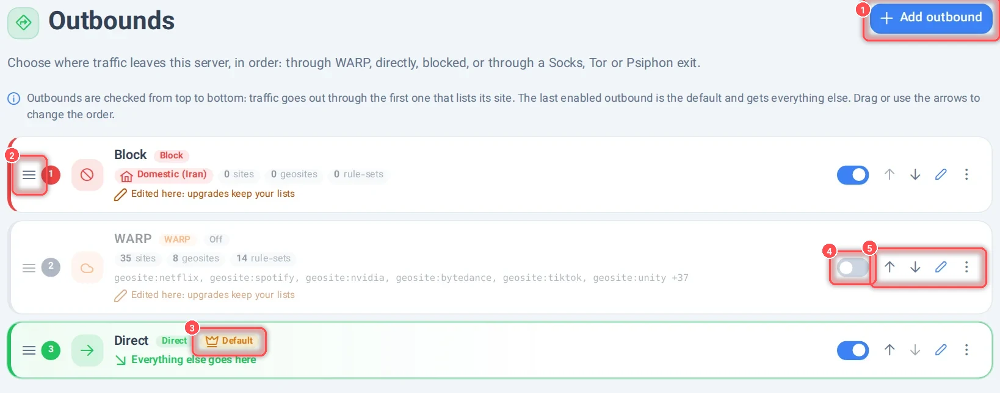
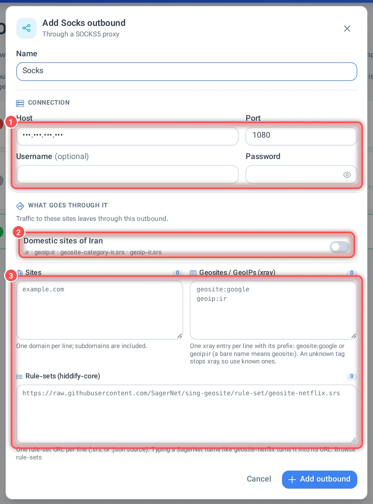
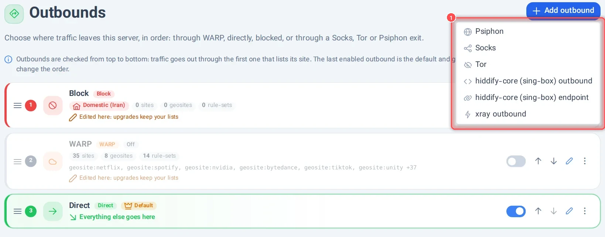
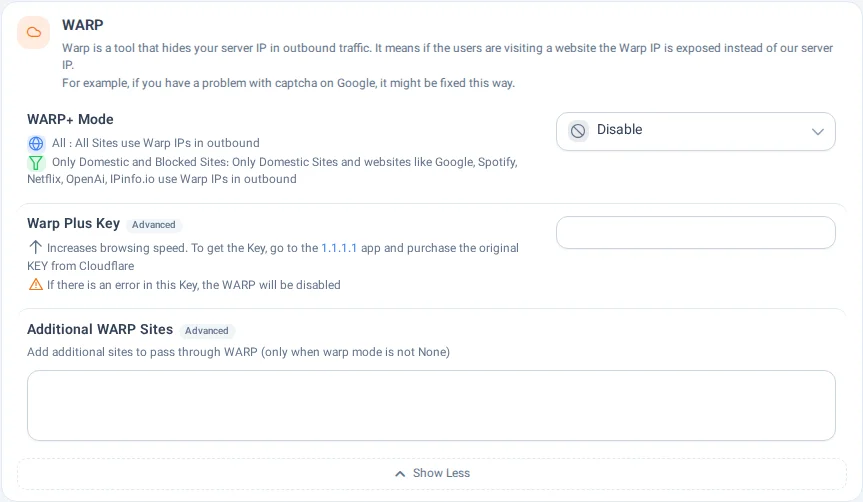
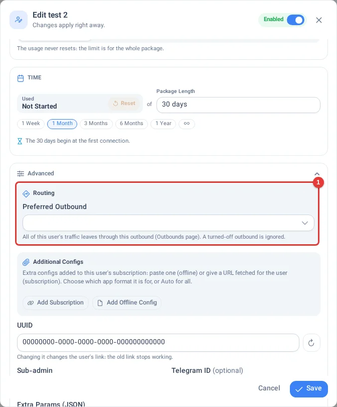
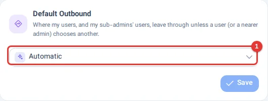

# How to use Outbounds on Hiddify Manager

!!! info "Written for Hiddify Manager v14.5"
    The pictures and steps on this page are from Hiddify Manager v14.5.

When a user opens a website through your server, the traffic has to leave the server toward that site. The **Outbounds** page decides **how it leaves**:

- **Direct**: straight from your server, with your server's IP.
- **WARP**: through Cloudflare WARP, so sites see a Cloudflare IP instead of your server's IP. Useful, for example, for sites that show captchas or block data-center IPs.
- **Block**: dropped. Useful for domestic sites: connections from your server to them can reveal it to the filtering system.
- **Socks**: through another proxy server (SOCKS5), for example a server in another country.
- **Tor** and **Psiphon**: through the Tor network or Psiphon.
- **Your own JSON**: a hiddify-core (sing-box) outbound or endpoint (for example WireGuard), or an Xray outbound.

## How the order works

Outbounds are checked **from top to bottom**. Traffic leaves through the **first outbound that lists its site**. The **last enabled** outbound is the **default** (3): everything that no outbound above lists goes there.

In the picture, the order is:

1. **Block** with the domestic sites of Iran: Iranian sites are blocked.
2. **WARP** with a list of sites (Netflix, Spotify, Google…): those go through WARP. Here WARP is **off**, so it is skipped.
3. **Direct**, the default: everything else leaves directly.

To change the order, drag the handle (2) or use the up and down arrows (5). To make an outbound the default, open its **⋮** menu and choose **Make default (move to the end)**. The switch (4) turns an outbound on or off; a turned-off outbound is skipped. The pencil (5) edits its lists.

!!! tip "An outbound with no sites"
    An outbound above the default with no sites, geosites or rule-sets is marked **Not used**: nothing goes through it. Add some sites, or move it to the end to make it the default.

## What goes through an outbound

When you add or edit an outbound, the **What goes through it** part has four lists:

- **Domestic sites of Iran** (2): one switch for all Iranian sites (`.ir`, `geoip:ir` and Iran's rule-sets). The region follows the **Country** setting of the panel.
- **Sites** (3): one domain per line, for example `example.com`. Subdomains are included.
- **Geosites / GeoIPs (xray)**: one Xray entry per line with its prefix, for example `geosite:google` or `geoip:ir`. A tag Xray does not know stops Xray, so use only known ones.
- **Rule-sets (hiddify-core)**: one rule-set URL per line (`.srs` or a `.json` source). If you type a SagerNet name such as `geosite-netflix`, it turns into its URL. **Browse rule-sets** shows the list.

The default outbound needs no lists: it already gets everything else. Its lists are used again if you move it up.

## Add an outbound

1. Click **Add outbound** and choose a type.

    

2. Give it a **Name**.
3. For **Socks**, fill in **Host** and **Port** of the SOCKS5 server, and **Username** and **Password** if it needs them (1 in the Socks picture above).
4. Choose what goes through it (the lists above).
5. Click **Add outbound**. The new outbound is put just above the default.
6. Apply the changes (**Actions → Apply now**) to put it into effect.

Notes on each type:

- **WARP**, **Direct** and **Block** are built in: you can turn them on or off, reorder them and edit their lists, but not delete them.
- **Psiphon** and **Tor** run inside hiddify-core on your server; there can be one of each. For Tor, the `tor` program must be installed on the server (for example `apt install tor`); the page warns you when it is missing.
- **Socks** and the JSON types can be added more than once.
- **hiddify-core (sing-box) outbound / endpoint** and **xray outbound**: paste one outbound (or endpoint) object as JSON. **Insert an example** fills in a sample. The panel checks it with the core before saving, and gives it its own tag; the other core reaches it through a local Socks bridge.

## WARP

The WARP outbound comes with lists of sites that usually need it (streaming, AI and some Google services). When you change them, the row shows **Edited here: upgrades keep your lists**. **Reset to defaults** in the **⋮** menu brings back the built-in lists, which upgrades then keep up to date.

WARP only runs after you **accept Cloudflare's terms**: when you turn it on, the panel asks you to read Cloudflare's Terms of Service and Privacy Policy and accept them. Until then, traffic is not sent through WARP. Then apply the changes.

The WARP settings under **Settings → WARP** still work and follow this page:

- **WARP+ Mode** *All* = WARP is on and is the default (everything goes through WARP).
- *Only domestic and blocked sites* (custom) = WARP is on, with its own sites, and **Direct** is the default.
- *Disable* = WARP is off.
- Sites you add in **Additional WARP Sites** are added to the WARP outbound.

More about WARP: [how to activate WARP](How-to-activate-WARP-on-the-Hiddify-panel.md).

## A different outbound for some users or admins

- **For one user**: in the user's window, **Preferred outbound** sends all of that user's traffic through one outbound. **Automatic** follows the order on this page.
- **For an admin and their users**: in the admin's window, **Default outbound** sets where that admin's users (and their sub-admins' users) leave through, unless a user chooses another.
- **For yourself**: on **My account**, **Default outbound** does the same for your own users.

In the user window, **Preferred outbound** is under **Advanced** (1):

On **My account**, **Default outbound** (1):

An admin can change these only with the **Change preferred outbound** permission, and can edit this page only with **Manage outbounds**.

## Good to know

- After you change outbounds, apply the changes (**Actions → Apply now**).
- On a multi-server setup, the outbounds are set on the main panel and copied to the nodes. See [multi-server with nodes](Multi-server-with-nodes-on-HiddifyManager.md).
- Blocking domestic sites is also the **Block Domestic Sites** switch in **Settings → Proxies Settings**: it moves the domestic sites between **Block** and **WARP**.

## Related articles

- [Multi-server with nodes](/manager/configuration-and-advanced-settings/Multi-server-with-nodes-on-HiddifyManager/)
- [Every part and setting of the panel](/manager/configuration-and-advanced-settings/How-to-configure-Hiddify-panel-properly/)
- [All panel settings, one by one](/manager/configuration-and-advanced-settings/Settings-reference/)
- [The Hiddify Manager menu over SSH](/manager/configuration-and-advanced-settings/How-to-connect-and-troubleshoot-via-SSH/)

