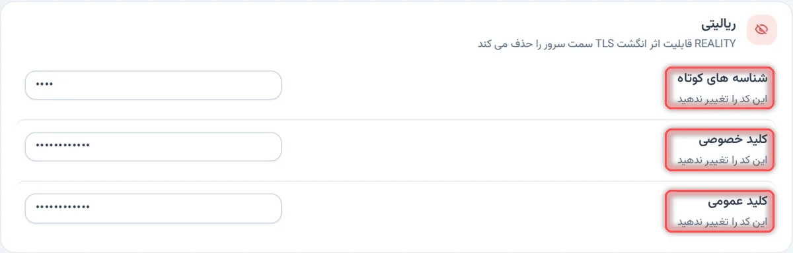
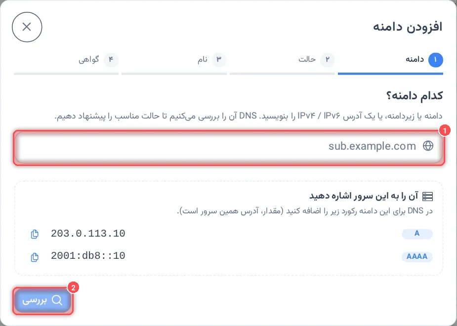
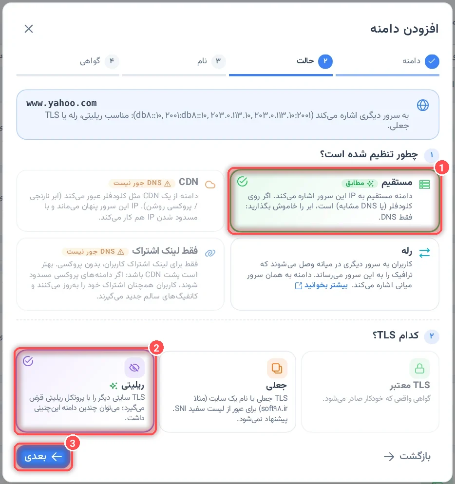
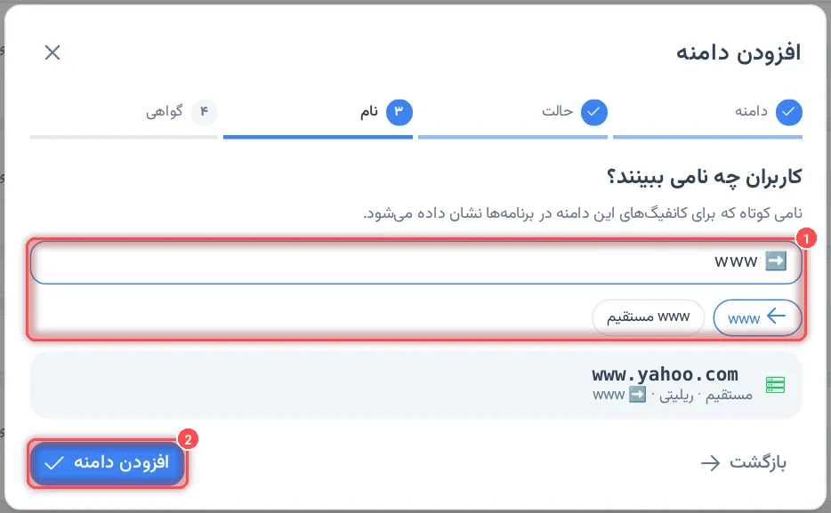
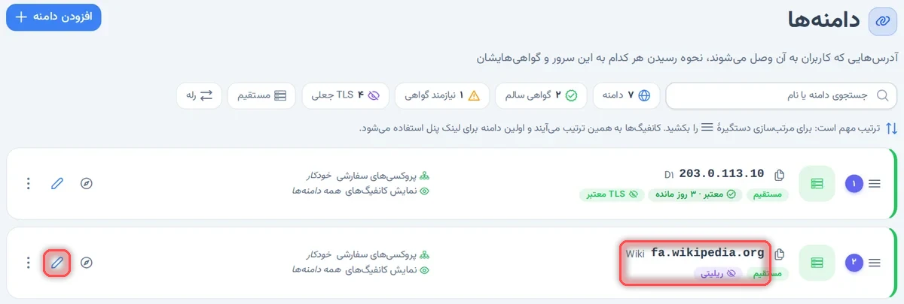
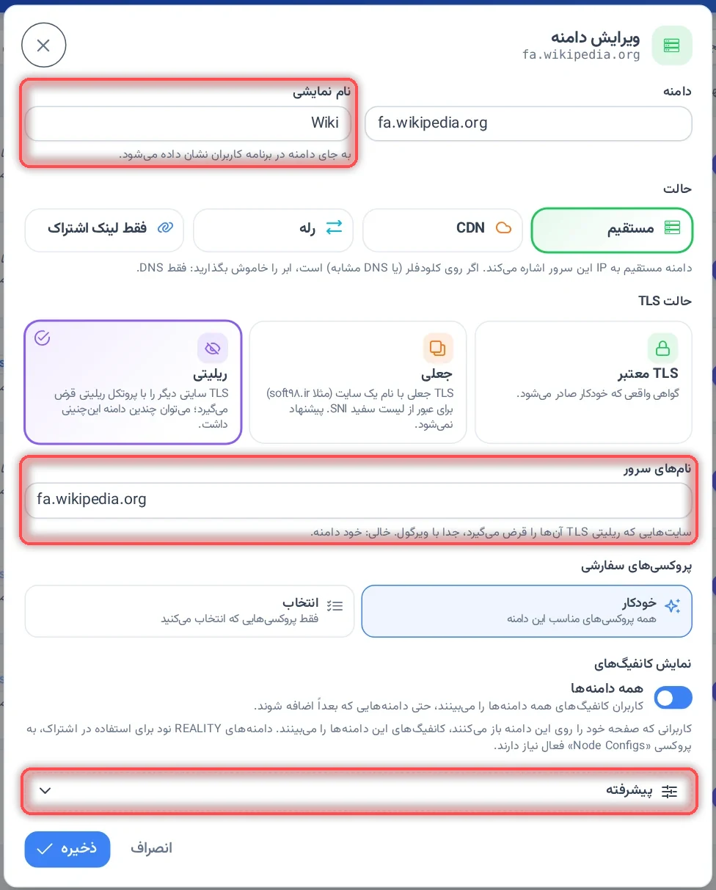
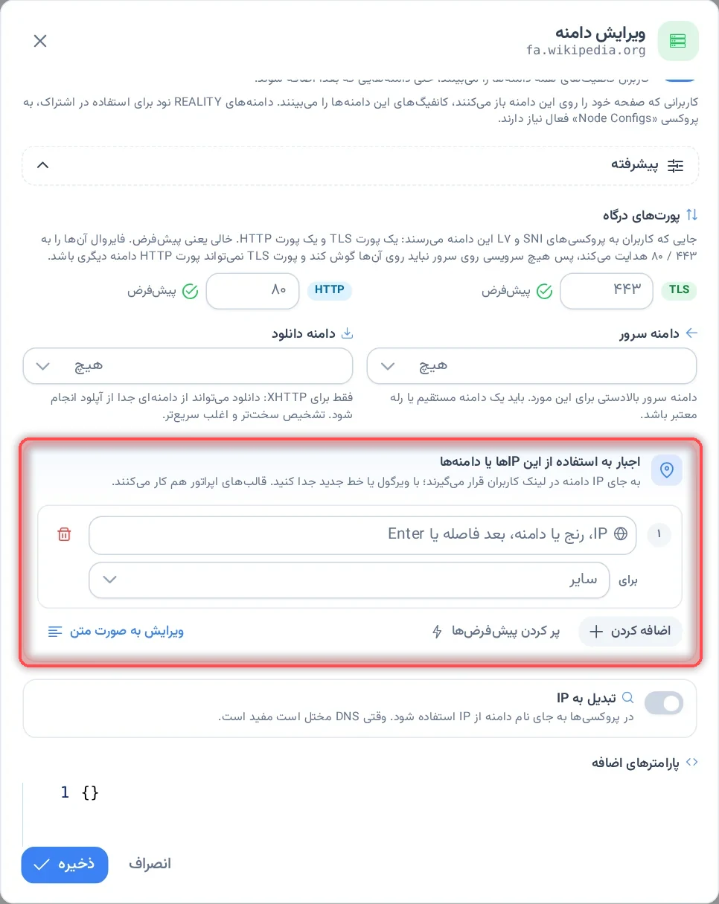
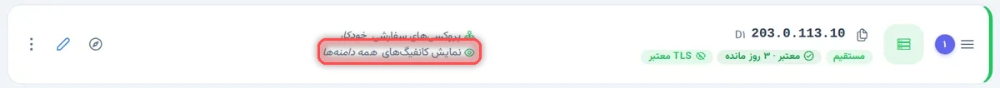

  
# آموزش استفاده از ریالتی در هیدیفای‌منیجر

این صفحه به شما نشان می‌دهد چطور در پنل هیدیفای‌منیجر یک دامنه ریالتی اضافه کنید تا کاربران شما کانفیگ‌های ریالتی بگیرند. این آموزش برای ادمین‌هایی است که هیدیفای‌منیجر را نصب کرده‌اند و پنل آن‌ها کار می‌کند.

**ریالتی** یک لایه امنیتی در Xray است. سرور شما هویت TLS (یعنی «اثر انگشت» اتصال رمزنگاری‌شده) یک سایت واقعی دیگر، مثلا `www.yahoo.com`، را قرض می‌گیرد. در نتیجه ترافیک شما از نگاه فیلترینگ شبیه بازدید معمولی از همان سایت است. برای ریالتی به دامنه یا گواهی (certificate) خودتان نیاز ندارید. هیدیفای‌منیجر بیشتر کارها را در پس‌زمینه انجام می‌دهد.

!!! warning "تغییرات هیدیفای‌منیجر نسخه ۱۳ و ۱۴"
    - ریالتی دیگر یک نوع دامنه جداگانه نیست. حالا دامنه را با حالت **مستقیم** (Direct) و حالت TLS **ریالتی** (Reality) اضافه می‌کنید.
    - تنظیمات کلی قدیمی «نام‌های سرور ریالتی» و «دامنه بازگشتی ریالتی» حذف شده‌اند. حالا این موارد را برای هر دامنه جداگانه، در فیلد **نام‌های سرور** همان دامنه، تنظیم می‌کنید.
    - ریالتی حالا با روش‌های انتقال دیگر (TCP، HTTP، gRPC و XHTTP) و علاوه بر VLESS با Trojan هم کار می‌کند.

!!! note "نکته مهم"
    ریالتی از CDN پشتیبانی نمی‌کند. (**CDN** شبکه‌ای از سرورها مثل Cloudflare است که بین کاربران و سرور شما قرار می‌گیرد.) ریالتی فقط در حالت **مستقیم** یا **رله** کار می‌کند، پس سرور شما باید IP تمیز داشته باشد، یعنی IP آن در کشور کاربران شما مسدود نباشد. برای بررسی سرور، [این راهنما](/fa/manager/basic-concepts-and-troubleshooting/How-to-make-sure-the-server%27s-IP-or-domain-is-clean/) را ببینید.

## پیش‌نیازها
- بتوانید با حساب مالک پنل (سوپر ادمین) وارد پنل شوید.
- IP سرور شما تمیز باشد.
- یک یا چند سایت مناسب برای ریالتی انتخاب کرده باشید. سایت مناسب از TLS 1.3 و HTTP/2 پشتیبانی می‌کند، در کشور شما مسدود نیست و بهتر است در همان دیتاسنتر سرور شما باشد. [اسکنر ریالتی هیدیفای](/fa/manager/configuration-and-advanced-settings/How-to-use-Hiddify-Reality-Scanner/) می‌تواند در پیدا کردن چنین سایتی کمکتان کند.

## تنظیمات کلی ریالتی
در منوی کناری پنل، زیر **تنظیمات**، روی **تنظیمات** بزنید و کارت **ریالتی** را پیدا کنید. می‌توانید `Reality` یا «ریالتی» را در کادر جستجوی تنظیمات هم بنویسید. این فیلدها را می‌بینید:

  

- **شناسه‌های کوتاه** (Short IDs): برای رمزنگاری استفاده می‌شود.
- **کلید خصوصی** (Private Key): برای رمزنگاری اتصال استفاده می‌شود.
- **کلید عمومی** (Public Key): به اپ‌های کاربران داده می‌شود تا بتوانند با سرور شما ارتباط بگیرند.

پنل این مقادیر را خودش می‌سازد. زیر هر فیلد نوشته شده **این کد را تغییر ندهید**: آن‌ها را تغییر ندهید. اگر تغییرشان دهید، همه کانفیگ‌های ریالتی فعلی کاربران از کار می‌افتند.

## افزودن دامنه ریالتی
1. در منوی کناری پنل، زیر **تنظیمات**، روی **دامنه‌ها** بزنید.
2. روی **افزودن دامنه** بزنید.
3. در مرحله **دامنه** (**کدام دامنه؟**)، آدرس سایتی را که انتخاب کرده‌اید بنویسید، مثلا `www.yahoo.com`، و روی **بررسی** بزنید. پنل DNS دامنه را بررسی می‌کند. اگر نوشت که دامنه «به سرور دیگری اشاره می‌کند (…): مناسب ریالتی، رله یا TLS جعلی»، می‌توانید ادامه دهید. اگر نوشت «آن سایت برای ریالتی مناسب نیست (TLS 1.3 و HTTP/2 لازم است)»، برگردید و سایت دیگری انتخاب کنید. لازم نیست رکورد DNSی را که زیر **آن را به این سرور اشاره دهید** آمده تنظیم کنید، چون دامنه ریالتی سایت شخص دیگری است.

    

4. در مرحله **حالت**، زیر **چطور تنظیم شده است؟**، گزینه **مستقیم** را انتخاب کنید.
5. زیر **کدام TLS؟**، گزینه **ریالتی** را انتخاب کنید و روی **بعدی** بزنید.

    

6. در مرحله **نام** (**کاربران چه نامی ببینند؟**)، یک نام کوتاه بنویسید که کاربران در اپ خود ببینند، یا یکی از پیشنهادها را انتخاب کنید. از حروف و اعداد ساده استفاده کنید. سپس روی **افزودن دامنه** بزنید. دامنه ریالتی به گواهی نیاز ندارد.

    

7. برای دیدن بقیه فیلدهای دامنه (توضیحشان پایین‌تر آمده است)، در فهرست **دامنه‌ها** روی آیکون مداد (ویرایش) دامنه جدید بزنید. فقط اگر لازم بود آن‌ها را تغییر دهید و بعد روی **ذخیره** بزنید.
8. تغییرات را اعمال کنید: وقتی پنل پیام «ذخیره شد. برای اعمال تغییرات، کانفیگ‌ها را اعمال کنید.» را نشان داد، روی دکمه اعمال بزنید. همچنین می‌توانید در منوی کناری (زیر **تنظیمات**) روی **اقدامات** بزنید و در کارت **اعمال تغییرات** روی **الان اعمال کن** بزنید.

اگر مراحل درست انجام شده باشد، دامنه جدید با برچسب‌های **مستقیم** و **ریالتی** در فهرست **دامنه‌ها** دیده می‌شود و کاربران بعد از به‌روزرسانی لینک اشتراک (سابسکریپشن)، کانفیگ‌های ریالتی جدید را می‌گیرند.

### فیلدهای دامنه ریالتی
فیلدهای هر دامنه با آیکون مداد (ویرایش) در فهرست **دامنه‌ها** باز می‌شوند.

#### نام‌های سرور
سایت‌هایی که ریالتی هویت TLS آن‌ها را قرض می‌گیرد. چند نام را با کاما از هم جدا کنید، مثلا `www.yahoo.com,blog.yahoo.com`. اگر این فیلد را خالی بگذارید، پنل از خود دامنه استفاده می‌کند.

نام‌هایی بگذارید که مال همان سایت و همان سرورِ دامنه باشند. مثلا اگر دامنه شما `www.yahoo.com` است، `blog.yahoo.com` نام سرور مناسبی است، ولی `www.google.com` مناسب نیست.

برای پخش کردن ترافیک روی چند نام از یک سایت، [آموزش استفاده از چند زیردامنه یک سایت در ریالتی](/fa/manager/configuration-and-advanced-settings/How-to-use-subdomains-of-a-website-in-Reality/) را بخوانید.

#### نام نمایشی
نامی اختیاری که کاربران به جای دامنه در اپ خود می‌بینند.

#### اجبار به استفاده از این IPها یا دامنه‌ها
این فیلد در بخش **پیشرفته** پایین پنجره است. اگر می‌خواهید کانفیگ‌ها به جای IP اصلی سرور از IP دیگری استفاده کنند، آن IP را اینجا بنویسید. چند IP را با کاما یا در خط‌های جدا بنویسید. این فیلد بیشتر برای **سرورهای رله** است. (سرور رله سروری میانی است که ترافیک کاربران را به سرور اصلی شما می‌رساند.) اگر ریالتی را از طریق سرور رله استفاده می‌کنید، IP سرور رله را اینجا وارد کنید. برای آشنایی بیشتر با رله، [آموزش افزودن دامنه رله](/fa/manager/domain-worker-cdn-and-tunneling/How-to-add-relay-domain-to-Hiddify-manager/) را ببینید.

وقتی ذخیره می‌کنید، پنل فیلدهای شما را بررسی می‌کند و ممکن است پیام‌هایی نشان دهد. پیام‌های قرمز خطا هستند و باید قبل از ادامه آن‌ها را برطرف کنید. پیام‌های زرد فقط هشدارند. بهتر است تنظیمات را طوری تغییر دهید که این هشدارها از بین بروند، ولی می‌توانید آن‌ها را نادیده بگیرید و ادامه دهید.

## روشن یا خاموش کردن ریالتی
ریالتی با یک کلید کلی در پنل کنترل می‌شود:

1. در منوی کناری، زیر **تنظیمات**، روی **پروتکل‌ها** بزنید.
2. در بخش **امنیت و ترفندها**، کلید **ریالتی** را روشن یا خاموش کنید. (همین کلید در کارت **تنظیمات پروکسی** صفحه **تنظیمات** هم هست.)
3. روی **ذخیره** بزنید و بعد تغییرات را اعمال کنید.

!!! tip "اگر ریالتی روی شبکه شما کار نکرد"
    ریالتی ممکن است روی شبکه‌های مختلف رفتار متفاوتی داشته باشد. اگر کار نکرد، اول مطمئن شوید IP سرور شما تمیز است. بعد سایت دیگری را به عنوان دامنه و نام‌های سرور امتحان کنید.

## چرا کاربران کانفیگ‌های ریالتی را نمی‌بینند؟

کاربران کانفیگ‌های دامنه‌ای را می‌بینند که صفحه کاربری خود را روی آن باز می‌کنند. به طور پیش‌فرض هر دامنه کانفیگ‌های **همه دامنه‌ها** را نشان می‌دهد؛ این را در فهرست **دامنه‌ها** جلوی **نمایش کانفیگ‌های** می‌بینید. اگر فیلد **نمایش کانفیگ‌های** دامنه‌ای را که لینک اشتراک کاربران روی آن است محدود کرده‌اید، باید دامنه ریالتی را هم به آن اضافه کنید.

مثلا فرض کنید دامنه اشتراک شما `t1.hiddify.com` و دامنه ریالتی شما `www.yahoo.com` است:

1. در منوی کناری، زیر **تنظیمات**، روی **دامنه‌ها** بزنید و آیکون مداد (ویرایش) دامنه `t1.hiddify.com` را بزنید.
2. در فیلد **نمایش کانفیگ‌های**، دامنه `www.yahoo.com` (یا همه دامنه‌ها) را انتخاب کنید.
3. روی **ذخیره** بزنید و تغییرات را اعمال کنید.

حالا لینک اشتراک روی `t1.hiddify.com` را باز کنید. باید کانفیگ‌های ریالتی را در آن ببینید.

## مقاله‌های مرتبط

- [اسکنر ریالتی هیدیفای](/fa/manager/configuration-and-advanced-settings/How-to-use-Hiddify-Reality-Scanner/)
- [چند زیردامنهٔ یک سایت در ریالتی](/fa/manager/configuration-and-advanced-settings/How-to-use-subdomains-of-a-website-in-Reality/)
- [آشنایی کامل با پنل و تنظیمات آن](/fa/manager/configuration-and-advanced-settings/How-to-configure-Hiddify-panel-properly/)
- [همهٔ تنظیمات پنل، یکی‌یکی](/fa/manager/configuration-and-advanced-settings/Settings-reference/)

