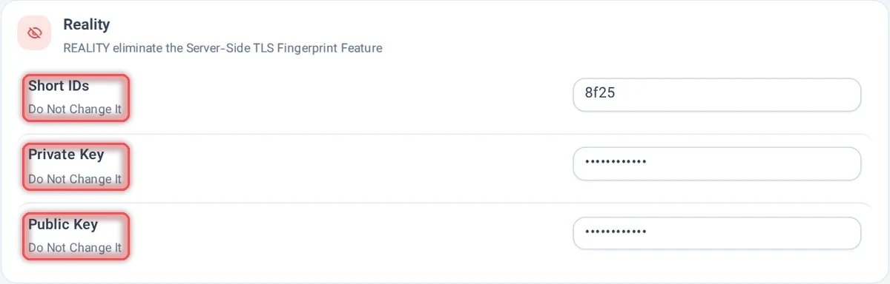
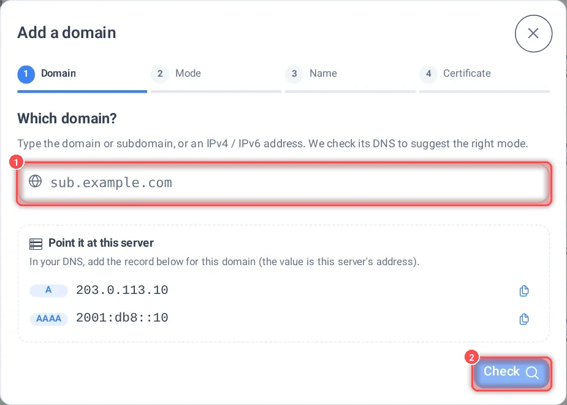
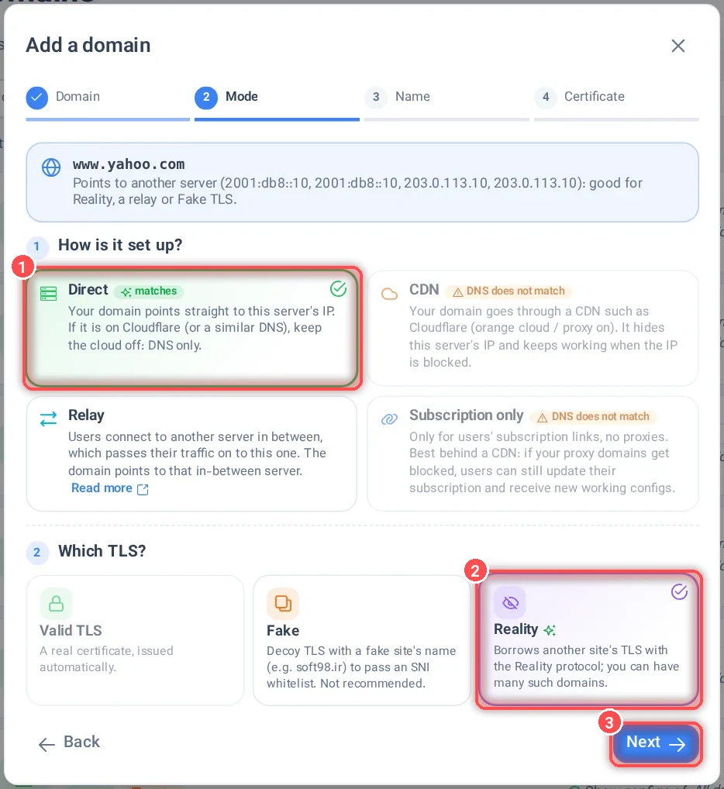
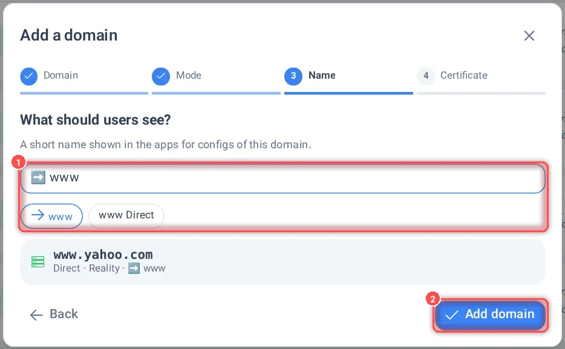
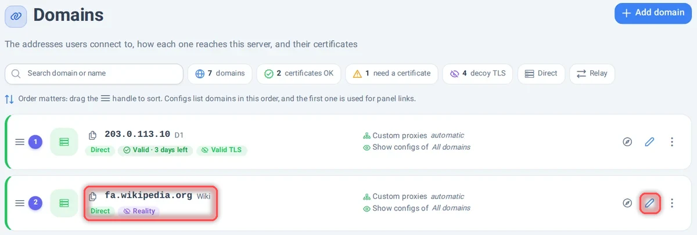
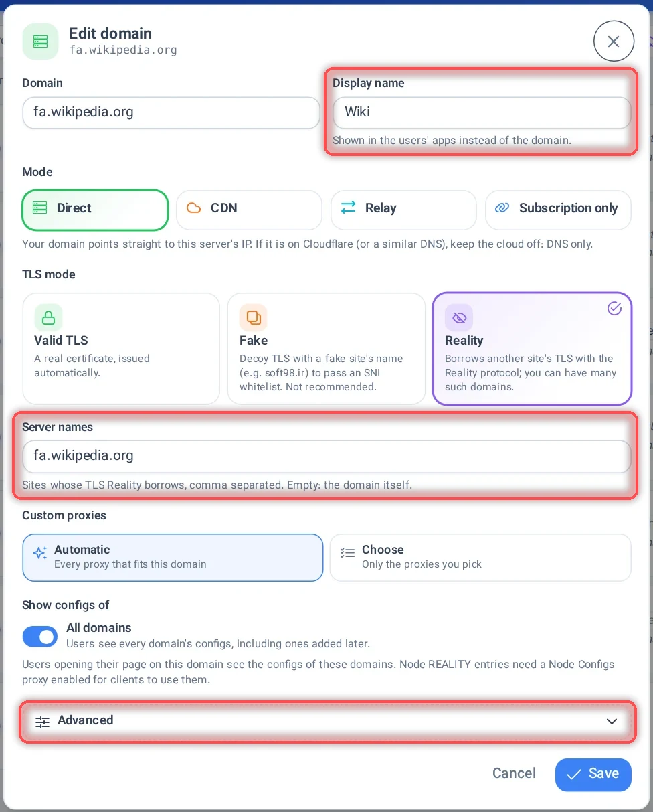
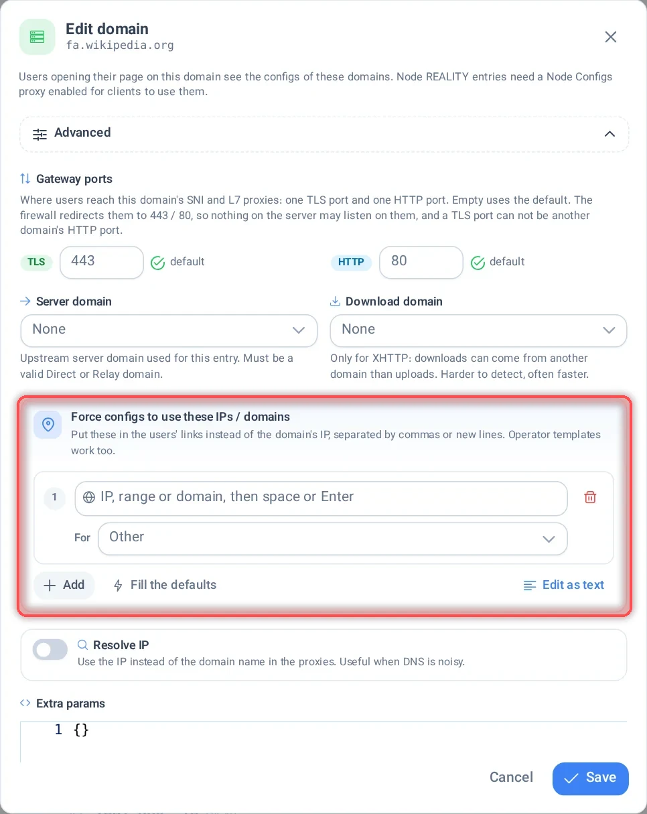
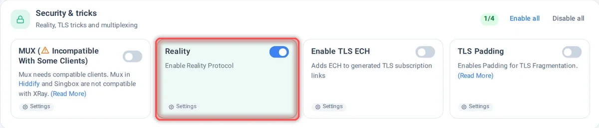
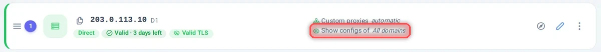

# How to use Reality on HiddifyManager
This page shows you how to add a Reality domain in the Hiddify Manager panel, so your users get Reality configs. It is for panel admins who already have a working Hiddify Manager.

**Reality** is a security layer from Xray. Your server borrows the TLS identity (the "fingerprint" of the encrypted connection) of another real website, for example `www.yahoo.com`. To a filter, the traffic looks like a normal visit to that website. You don't need your own domain or certificate for Reality. HiddifyManager does most of the work behind the scenes.

!!! warning "What changed in Hiddify Manager v13 and v14"
    - Reality is no longer a separate domain type. You now add a domain with the mode **Direct** and the TLS mode **Reality**.
    - The old panel-wide "Reality Server Names" and "Reality Fallback Domain" settings were removed. You now set them per domain, in the domain's **Server names** field.
    - Reality now also works with other transports (TCP, HTTP, gRPC and XHTTP), and with Trojan as well as VLESS.

!!! note "Important"
    Reality can't go through a CDN (a network of servers, such as Cloudflare, that sits between your users and your server). It only works in **Direct** or **Relay** mode, so your server needs a clean IP (an IP that is not blocked in your users' country). To check your server, see [How to make sure the server's IP or domain is clean](/manager/basic-concepts-and-troubleshooting/How-to-make-sure-the-server%27s-IP-or-domain-is-clean/).

## Before you start
- You can log in to your panel as the owner (super admin).
- Your server's IP is clean.
- You have chosen one or more Reality-friendly websites. A good one supports TLS 1.3 and HTTP/2, is not blocked in your country, and ideally is hosted in the same data center as your server. The [Hiddify Reality Scanner](/manager/configuration-and-advanced-settings/How-to-use-Hiddify-Reality-Scanner/) can help you find one.

## Panel-wide Reality settings
In the panel's sidebar, under **Settings**, click **Settings** and find the **Reality** card. You can also type `Reality` in the settings search box. You will see these fields:

  

- **Short IDs**: used for encryption.
- **Private Key**: used to encrypt the connection.
- **Public Key**: given to the client apps so they can talk to your server.

The panel creates these values for you. Each field says **Do Not Change It**: don't change them. If you change them, all your users' existing Reality configs stop working.

## Add a Reality domain
1. In the panel's sidebar, under **Settings**, click **Domains**.
2. Click **Add domain**.
3. In the **Domain** step (**Which domain?**), type the address of the website you chose, for example `www.yahoo.com`, and click **Check**. The panel checks the domain's DNS. If it says the site "Points to another server (…): good for Reality, a relay or Fake TLS", you can go on. If it says the site is "not Reality friendly (needs TLS 1.3 and HTTP/2)", go back and choose another website. You don't need to set the DNS record shown under **Point it at this server**: a Reality domain is someone else's website.

    

4. In the **Mode** step, under **How is it set up?**, choose **Direct**.
5. Under **Which TLS?**, choose **Reality**, then click **Next**.

    

6. In the **Name** step (**What should users see?**), type a short name that users will see in their apps, or tap one of the suggestions. Use plain letters and numbers. Then click **Add domain**. A Reality domain needs no certificate.

    

7. To see the domain's other fields (see below), click the pencil (edit) icon of the new domain in the **Domains** list. Change them only if you need to, then click **Save**.
8. Apply the changes: when the panel shows "Saved. Apply the configs to put the changes into effect.", click the button to apply. You can also click **Actions** in the sidebar (under **Settings**) and, in the **Apply Changes** card, click **Apply now**.

If the steps worked, the new domain appears in the **Domains** list with the badges **Direct** and **Reality**, and your users see new Reality configs after they update their subscription.

### Fields of a Reality domain
Open a domain's fields with the pencil (edit) icon in the **Domains** list.

#### Server names
The websites whose TLS identity Reality borrows. Separate several names with commas, for example `www.yahoo.com,blog.yahoo.com`. If you leave this field empty, the panel uses the domain itself.

Use names that belong to the same website and server as the domain. For example, if your domain is `www.yahoo.com`, `blog.yahoo.com` is a good server name, but `www.google.com` is not.

To spread your traffic over many names of one website, see [How to use subdomains of a website in Reality](/manager/configuration-and-advanced-settings/How-to-use-subdomains-of-a-website-in-Reality/).

#### Display name
An optional name that users see in their apps instead of the domain.

#### Force configs to use these IPs / domains
This field is in the **Advanced** section at the bottom of the window. Put an IP here if you want the configs to use it instead of your server's main IP. Separate several IPs with commas or new lines. This is mainly for **relay servers** (a server in between that passes your users' traffic on to your main server). If you use Reality through a relay server, put the relay server's IP here. For more about relays, see [How to add a relay domain](/manager/domain-worker-cdn-and-tunneling/How-to-add-relay-domain-to-Hiddify-manager/).

  

When you save, the panel checks your fields and may show messages. Red messages are errors: fix them before you go on. Yellow messages are only warnings. It is best to change your settings until they go away, but you can ignore them and continue.

## Turn Reality on or off
Reality is controlled by a panel-wide switch:

1. In the sidebar, under **Settings**, click **Protocols**.
2. In the **Security & tricks** section, turn **Reality** on or off. (The same switch is also in the **Proxies Settings** card of the **Settings** page.)
3. Click **Save**, then apply the changes.

!!! tip "If Reality doesn't work on your network"
    Reality can behave differently on different networks. If it doesn't work, first make sure your server's IP is clean. Then try another website as the domain and as the server names.

## Why don't my users see the Reality configs?
Users see the configs of the domain they open their user page on. By default, each domain shows the configs of **All domains**: you can see this under **Show configs of** in the **Domains** list. If you limited the **Show configs of** field of the domain that your users' subscription link uses, you must add the Reality domain to it.

  

For example, say your subscription domain is `t1.hiddify.com` and your Reality domain is `www.yahoo.com`:

1. In the sidebar, under **Settings**, click **Domains**, and click the pencil (edit) icon of `t1.hiddify.com`.
2. In the **Show configs of** field, select `www.yahoo.com` (or all domains).
3. Click **Save** and apply the changes.

Now open the subscription link on `t1.hiddify.com`. You should see the Reality configs in it.

## Related articles

- [Hiddify Reality Scanner](/manager/configuration-and-advanced-settings/How-to-use-Hiddify-Reality-Scanner/)
- [Several subdomains of a site in Reality](/manager/configuration-and-advanced-settings/How-to-use-subdomains-of-a-website-in-Reality/)
- [Every part and setting of the panel](/manager/configuration-and-advanced-settings/How-to-configure-Hiddify-panel-properly/)
- [All panel settings, one by one](/manager/configuration-and-advanced-settings/Settings-reference/)

