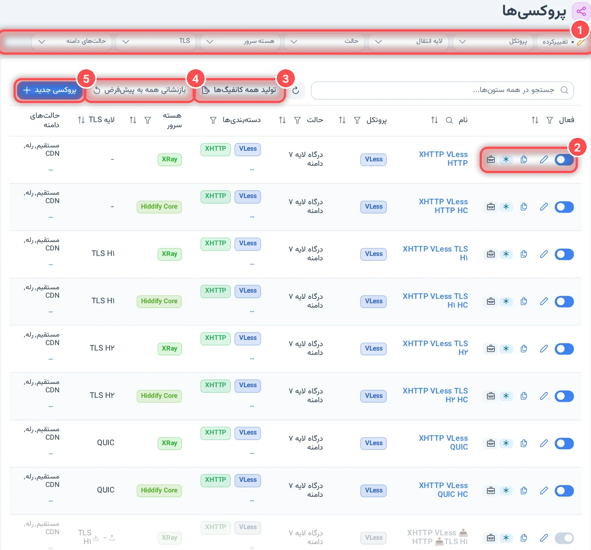
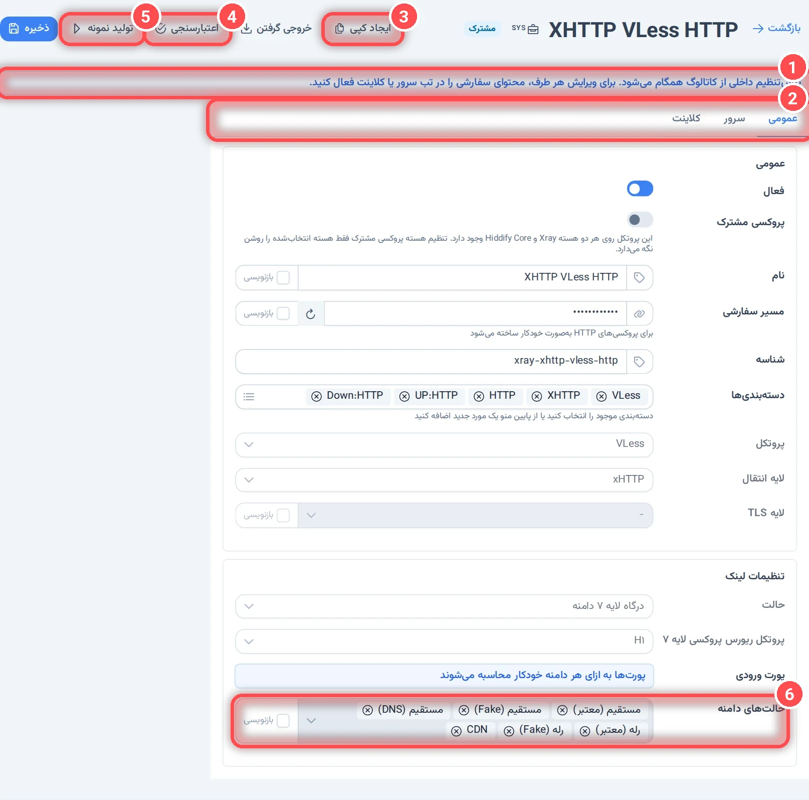
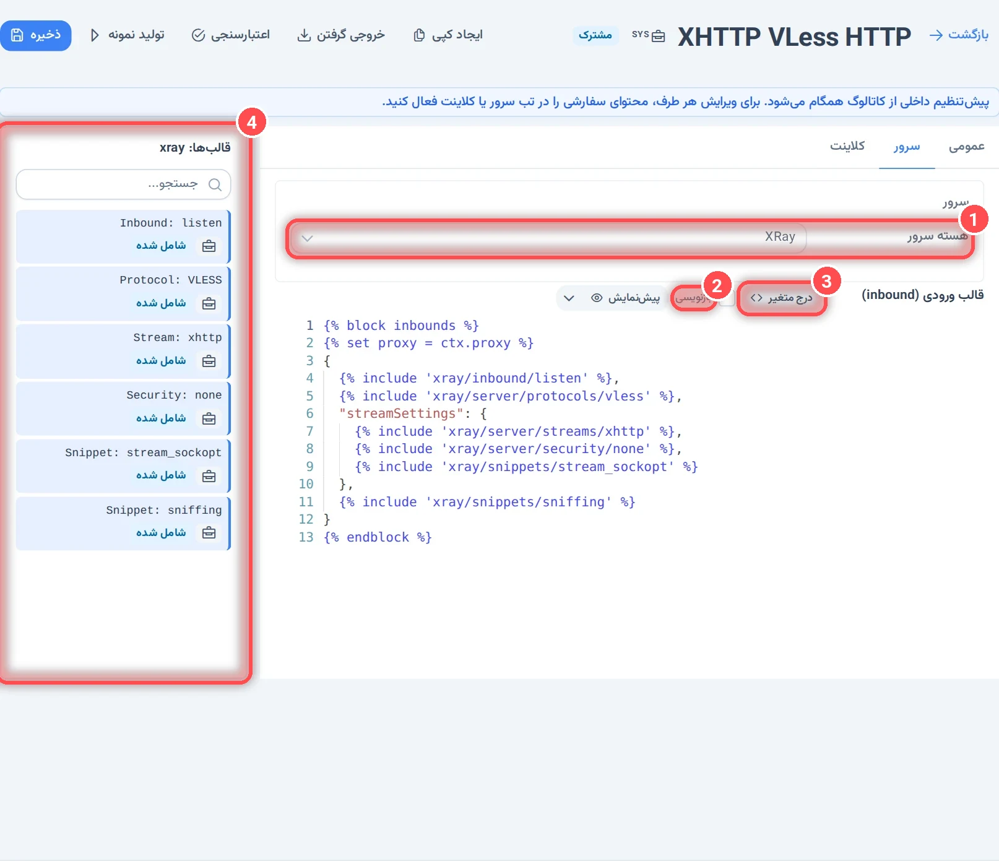
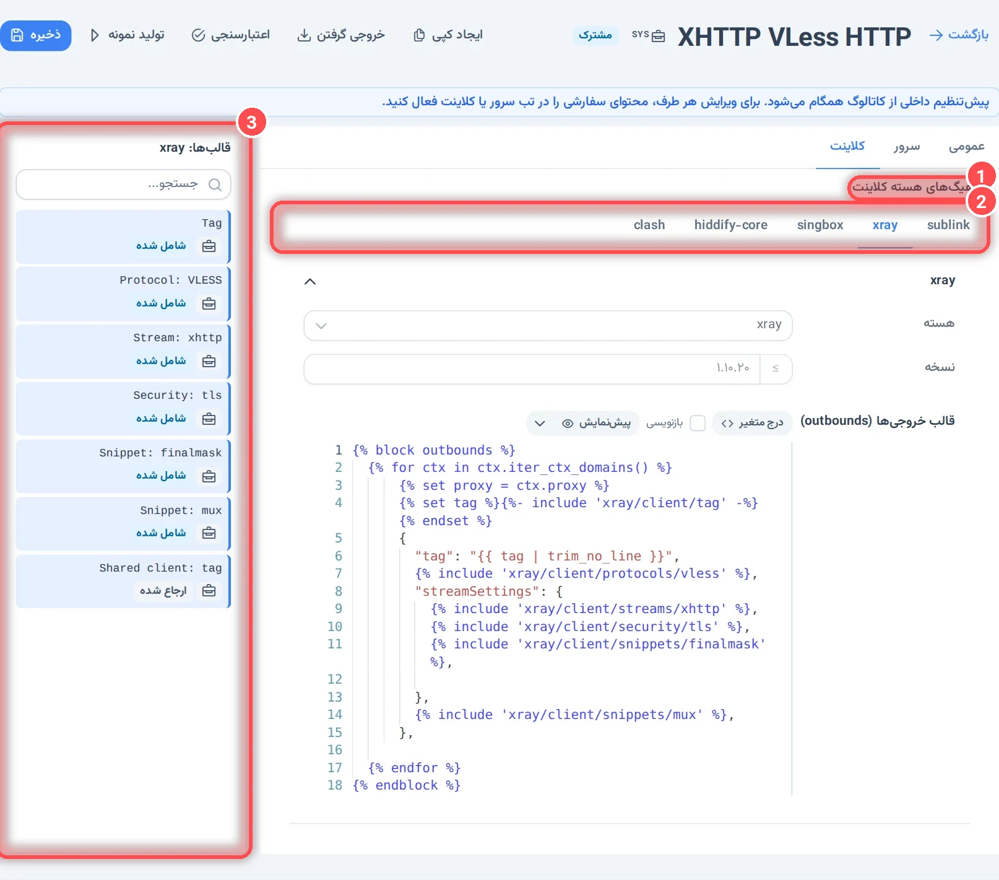
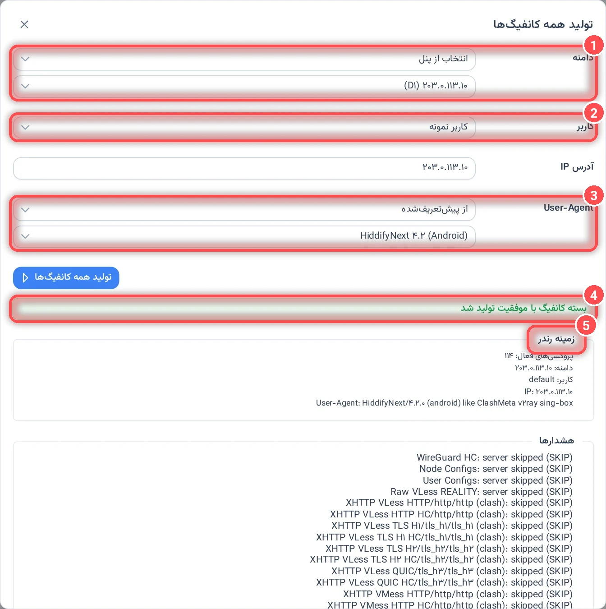
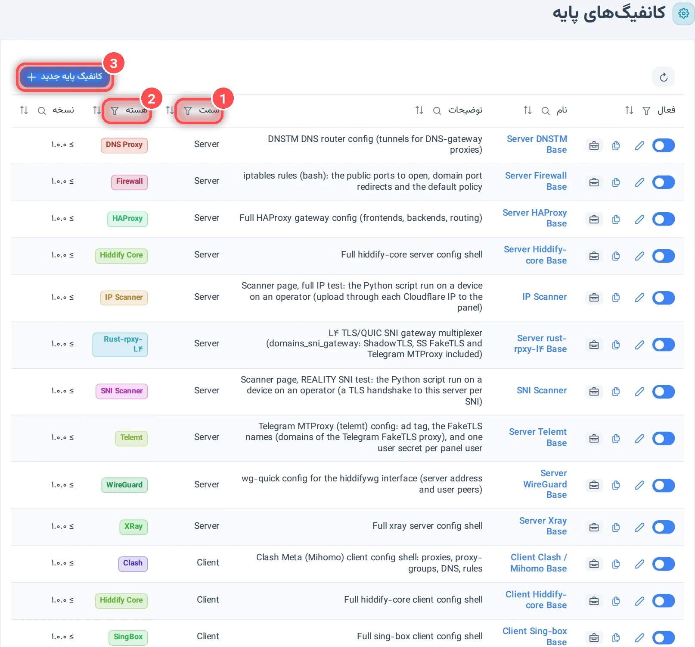
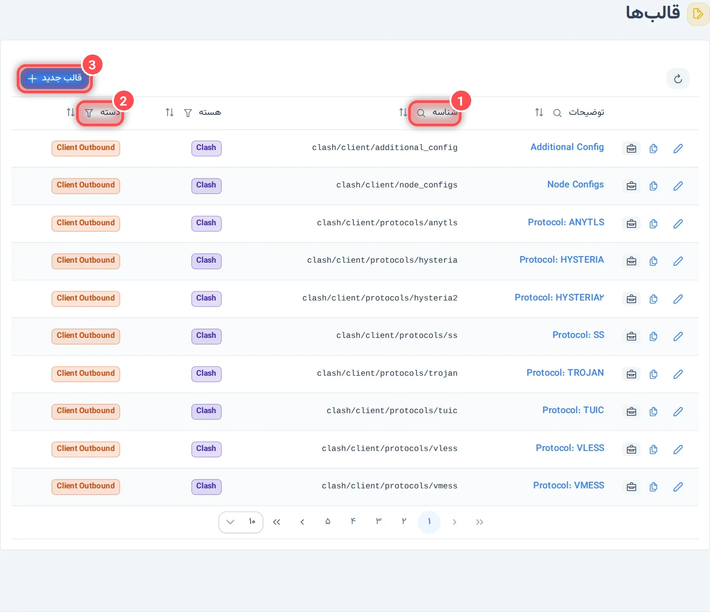
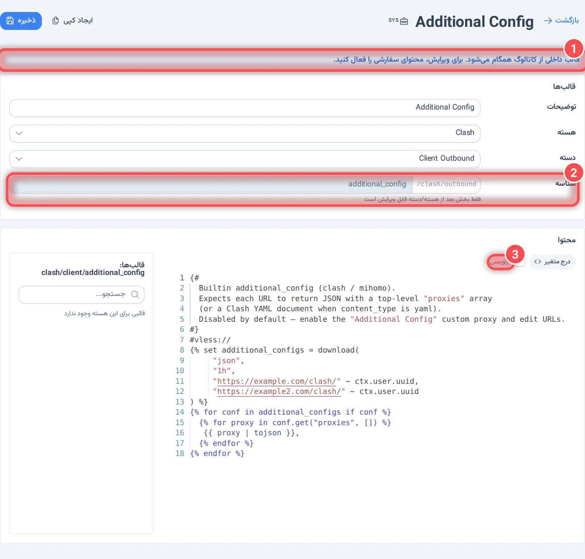
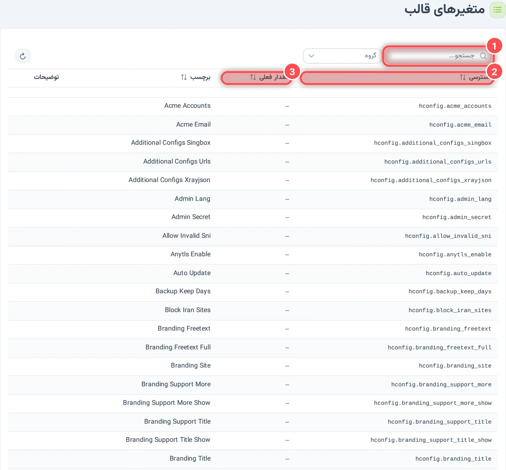

# آموزش ویرایشگر پروکسی در هیدیفای‌منیجر

!!! info "نوشته‌شده برای هیدیفای‌منیجر نسخهٔ ۱۴.۵"
    نام منوها و گزینه‌های این صفحه مربوط به نسخهٔ ۱۴.۵ است. بعضی از آن‌ها در نسخه‌های قدیمی‌تر وجود ندارند.

**ویرایشگر پروکسی** جایی است که هیدیفای‌منیجر «دستور ساخت» همهٔ کانفیگ‌هایش را نگه می‌دارد: هم چیزی که روی سرور اجرا می‌شود و هم چیزی که در لینک اشتراک کاربران قرار می‌گیرد. بیشتر ادمین‌ها هیچ‌وقت لازم نیست آن را تغییر دهند؛ پروکسی‌های داخلی تست شده‌اند و با هر نسخهٔ جدید به‌روز می‌شوند. از این بخش وقتی استفاده کنید که کاری می‌خواهید که با تنظیمات معمولی ممکن نیست؛ مثلاً یک پروکسی روی پورت خاص، یک خروجی اضافه، یا تغییر کانفیگ‌های یک اپ خاص.

در منو، **تنظیمات › ویرایشگر پروکسی** را باز کنید. چهار صفحه دارد:

| صفحه | چه چیزی در آن است |
|---|---|
| **پروکسی‌ها** | همهٔ پروکسی‌هایی که پنل می‌سازد (پروتکل + لایه انتقال + TLS)، با بخش سرور و بخش کلاینت هرکدام. |
| **کانفیگ‌های پایه** | «پوستهٔ» کامل کانفیگ هر هسته؛ فایلی که تکه‌های پروکسی‌ها داخل آن قرار می‌گیرند. |
| **قالب‌ها** | تکه‌های قابل استفادهٔ دوباره (یک پروتکل، یک لایه انتقال، یک لایهٔ امنیتی و …) که پروکسی‌ها و کانفیگ‌های پایه از آن‌ها استفاده می‌کنند. |
| **متغیرهای قالب** | همهٔ مقدارهایی که داخل قالب‌ها می‌شود استفاده کرد، همراه با مقدار فعلی‌شان. |

!!! warning "پیش از هر تغییری"
    - موردهایی که علامت **SYS** دارند داخلی هستند. از کاتالوگ پنل پیروی می‌کنند و با هر نسخه به‌روز می‌شوند. به جای تغییر یک مورد داخلی، بهتر است با **ایجاد کپی** یک نسخهٔ جدا بسازید و آن را ویرایش کنید.
    - اول از پنل پشتیبان بگیرید (صفحهٔ **پشتیبان‌گیری**).
    - بعد از ذخیره، پنل از شما می‌خواهد کانفیگ‌ها را **اعمال** کنید. تغییرهای سمت سرور فقط بعد از اعمال (صفحهٔ **اعمال و وضعیت**) اثر می‌کنند.

## پروکسی‌ها

1. **فیلترها:** فقط بعضی پروکسی‌ها را نشان می‌دهد؛ بر اساس پروتکل، لایه انتقال، حالت، هستهٔ سرور، TLS یا حالت دامنه. گزینهٔ **تغییرکرده** پروکسی‌های داخلی‌ای را نشان می‌دهد که تغییرشان داده‌اید.
2. **ردیف هر پروکسی:** کلید آن را روشن یا خاموش می‌کند؛ مداد آن را باز می‌کند؛ آیکون کپی یک نسخهٔ جدید از آن می‌سازد؛ پروکسی‌هایی که خودتان ساخته‌اید آیکون حذف هم دارند. ستاره یعنی **مشترک**: این پروتکل هم در Xray و هم در هستهٔ هیدیفای (Hiddify Core) هست و تنظیم **هسته پروکسی مشترک** تعیین می‌کند کدام هسته آن را اجرا کند. آیکون **SYS** یعنی پروکسی داخلی است (اگر تغییرش داده باشید، پررنگ می‌شود).
3. **تولید همه کانفیگ‌ها:** همهٔ کانفیگ‌های سرور و کلاینت را برای یک دامنه و یک کاربر می‌سازد و نشان می‌دهد، بدون اینکه چیزی ذخیره یا اعمال شود ([توضیح بیشتر](#generate-all-configs)).
4. **بازنشانی همه به پیش‌فرض:** همهٔ تغییرهایی را که در پروکسی‌های داخلی داده‌اید پاک می‌کند و نسخهٔ کاتالوگ را برمی‌گرداند. به پروکسی‌هایی که خودتان ساخته‌اید دست نمی‌زند.
5. **پروکسی جدید:** یک پروکسی خالی برای خودتان می‌سازد.

یک پروکسی فقط وقتی روشن می‌شود که پروتکلش در **تنظیمات** روشن باشد. اگر آنجا خاموش باشد، پنل پیشنهاد می‌دهد همین‌جا روشنش کند.

### صفحهٔ یک پروکسی

روی مداد یک پروکسی بزنید. این صفحه سه تب دارد: **عمومی**، **سرور** و **کلاینت**.

1. پروکسی داخلی این پیام را نشان می‌دهد: از کاتالوگ پیروی می‌کند. برای ویرایش بخش سرور یا کلاینت آن، در همان تب گزینهٔ **بازنویسی** را فعال کنید.
2. سه تب صفحه.
3. **ایجاد کپی:** یک نسخهٔ قابل ویرایش از پروکسی می‌سازد. امن‌ترین راه برای تغییر یک پروکسی داخلی همین است.
4. **اعتبارسنجی:** قالب‌های پروکسی را از نظر خطا بررسی می‌کند.
5. **تولید نمونه:** کانفیگ‌هایی را که این پروکسی برای یک دامنه و یک کاربر می‌سازد نشان می‌دهد.
6. **حالت‌های دامنه:** نوع دامنه‌هایی که این پروکسی برایشان ساخته می‌شود (مستقیم، رله، CDN، ریالتی و …). دامنه‌ای که در این فهرست نباشد، کانفیگی از این پروکسی نمی‌گیرد.

بقیهٔ فیلدهای تب **عمومی**:

- **فعال** و **پروکسی مشترک**.
- **نام:** برچسب لینک‌های این پروکسی در اپ کاربران. **مسیر سفارشی** مسیر پروکسی‌های بر پایهٔ HTTP است؛ خودکار ساخته می‌شود و با دکمهٔ فلش گرد یک مسیر جدید ساخته می‌شود.
- **شناسه** و **دسته‌بندی‌ها:** یک شناسه و چند برچسب که فیلترها و قالب‌ها از آن‌ها استفاده می‌کنند.
- **پروتکل**، **لایه انتقال** و **لایه TLS:** اینکه پروکسی دقیقاً چیست.
- **تنظیمات لینک:** **حالت** (ترافیک از چه راهی به هسته می‌رسد: از درگاه دامنه، روی پورت‌های جدا، با IP و …)، پروتکل پروکسی معکوس و **پورت ورودی** (خالی یعنی خودکار، برای هر دامنه).

در پروکسی داخلی، فیلدهایی که کنارشان گزینهٔ **بازنویسی** هست، تا وقتی تیک آن را نزنید مقدار کاتالوگ را نگه می‌دارند.

### تب سرور

1. **هسته سرور:** برنامه‌ای که این پروکسی را روی سرور اجرا می‌کند (Xray یا هستهٔ هیدیفای).
2. **بازنویسی:** تیک آن را بزنید تا بتوانید قالب سرور یک پروکسی داخلی را ویرایش کنید.
3. **درج متغیر:** یک [متغیر قالب](#template-variables) را در جای مکان‌نما می‌گذارد. **پیش‌نمایش** نتیجه را برای یک دامنه و یک کاربر نشان می‌دهد.
4. پنل **قالب‌ها** تکه‌هایی را که این قالب از آن‌ها استفاده می‌کند فهرست می‌کند. روی هرکدام بزنید تا محتوایش را ببینید.

قالب‌ها JSON همراه با تگ‌های [Jinja](https://jinja.palletsprojects.com/) هستند: `{{ proxy.port }}` یک مقدار را قرار می‌دهد، <code>{&#37; include 'xray/server/streams/xhttp' &#37;}</code> یک قالب دیگر را اضافه می‌کند و `` بخشی را تکرار می‌کند.

### تب کلاینت

1. **کانفیگ‌های هسته کلاینت:** چیزی که این پروکسی به لینک اشتراک هر نوع اپ اضافه می‌کند.
2. برای هر فرمت یک تب: **sublink** (لینک‌های اشتراک‌گذاری)، **xray**، **singbox**، **hiddify-core** و **clash**. اگر فرمتی اینجا کانفیگ نداشته باشد، اپ‌هایی که آن فرمت را می‌خوانند کانفیگی از این پروکسی نمی‌گیرند.
3. پنل **قالب‌ها**ی فرمت انتخاب‌شده.

هر فرمت می‌تواند یک **نسخه** داشته باشد (کمترین نسخهٔ هستهٔ اپ که این کانفیگ را می‌گیرد) و قالب خروجی خودش را.

### تولید همه کانفیگ‌ها { #generate-all-configs }

این امن‌ترین راه برای دیدن نتیجهٔ تغییرهایتان است. هیچ چیزی ذخیره یا اعمال نمی‌شود.

1. **دامنه:** یکی از دامنه‌های پنل، دامنه‌ای که خودتان بنویسید، یا همهٔ دامنه‌ها.
2. **کاربر:** یک کاربر نمونه یا یکی از کاربرانتان.
3. **User-Agent:** اپی که کانفیگ برایش ساخته شود (مثلاً اپ هیدیفای روی اندروید). پنل برای هر اپ فرمت متفاوتی می‌سازد.
4. نتیجه: موفق، یا هشدارها و خطاها. روی یک خطا بزنید تا خط قالبی که باعث آن شده را ببینید.
5. **زمینه رندر:** اینکه کانفیگ‌ها با چه مقدارهایی ساخته شدند. زیر آن همهٔ کانفیگ‌های سرور و کلاینت و بخش **هشدارها** هست. هشدار `skipped (SKIP)` عادی است: یعنی آن پروکسی به این دامنه یا این اپ مربوط نمی‌شود.

## کانفیگ‌های پایه

کانفیگ پایه کل فایل کانفیگ یک هسته است، با جایی که پروکسی‌ها داخل آن قرار می‌گیرند.

1. **سمت:** کانفیگ‌های **Server** روی سرور شما اجرا می‌شوند؛ کانفیگ‌های **Client** پوستهٔ لینک اشتراک کاربران هستند.
2. **هسته:** در سمت سرور: Xray، هستهٔ هیدیفای، HAProxy، درگاه لایه ۴ (rust-rpxy-l4)، مسیریاب DNS، وایرگارد، پروکسی MTProxy تلگرام (Telemt)، قانون‌های فایروال و اسکریپت‌های صفحهٔ **اسکنر**. در سمت کلاینت: Xray، سینگ‌باکس، هستهٔ هیدیفای، لینک‌های اشتراک‌گذاری (sublink) و Clash/Mihomo.
3. **کانفیگ پایه جدید:** یک کانفیگ پایهٔ دلخواه می‌سازد.

در کانفیگ پایهٔ داخلی فقط نام و کلید روشن/خاموش قابل تغییر است. برای ویرایش محتوایش، در صفحهٔ آن تیک **بازنویسی** را بزنید یا با **ایجاد کپی** یک نسخهٔ جدا بسازید. **نسخه** تعیین می‌کند کانفیگ پایه از کدام نسخهٔ هسته به بعد استفاده شود.

## قالب‌ها

قالب‌ها تکه‌های کوچکی هستند که پروکسی‌ها و کانفیگ‌های پایه از آن‌ها ساخته می‌شوند.

1. **شناسه:** نامی که قالب با آن اضافه می‌شود؛ مثلاً `xray/client/protocols/vless` یعنی هسته، سمت، دسته و نام.
2. **دسته:** نوع تکه (پروتکل، لایه انتقال، لایهٔ امنیتی، خروجی و …).
3. **قالب جدید:** یک تکهٔ دلخواه می‌سازد.

تغییر یک قالب، همهٔ پروکسی‌هایی را که از آن استفاده می‌کنند تغییر می‌دهد. این هم خوب است (یک بار اصلاح می‌کنید) و هم دلیلی برای احتیاط: بعد از تغییر، با **تولید همه کانفیگ‌ها** نتیجه را بررسی کنید.

1. قالب داخلی از کاتالوگ پیروی می‌کند.
2. **شناسه:** فقط بخش بعد از هسته و دسته قابل تغییر است.
3. **بازنویسی:** تیک آن را بزنید تا محتوای قالب داخلی را ویرایش کنید. اگر می‌خواهید نسخهٔ اصلی بماند، به جای آن از **ایجاد کپی** (کپی به‌عنوان سفارشی) استفاده کنید.

!!! example "نمونه: قالب Additional Config"
    پروکسی داخلی **Additional Config** و قالب‌هایش کانفیگ‌های یک لینک اشتراک دیگر را به اشتراک کاربران شما اضافه می‌کنند. به‌صورت پیش‌فرض خاموش است. پروکسی را روشن کنید، در بخش کلاینت آن تیک **بازنویسی** را بزنید و آدرس لینک اشتراک خودتان را به جای `example.com` بنویسید. تابع `download("json", "1h", …)` آن را دریافت می‌کند (و یک ساعت نگه می‌دارد).

## متغیرهای قالب { #template-variables }

این صفحه همهٔ مقدارهایی را که یک قالب می‌تواند استفاده کند فهرست می‌کند.

1. **جستجو** و **گروه:** پیدا کردن متغیر با نام یا با گروه (تنظیمات پنل، پروکسی، دامنه، کاربر و …).
2. **دسترسی:** شکلی که متغیر در قالب نوشته می‌شود؛ مثلاً `hconfig.block_iran_sites` همان تنظیم **بلاک کردن سایت‌های ایرانی** است.
3. **مقدار فعلی:** مقدار آن در همین پنل.

یک قالب می‌تواند `SKIP` را خروجی بدهد (یا `skip()` را صدا بزند) تا وقتی شرطی برقرار نیست، آن پروکسی ساخته نشود؛ مثلاً وقتی کاربر در پارامترهای اضافه‌اش آدرسی ندارد.

## نکته‌ها

- بعد از هر تغییر از **تست کانفیگ** (منوی **ابزارها › تست کانفیگ**) استفاده کنید: از طریق همهٔ کانفیگ‌های یک لینک اشتراک وصل می‌شود و نشان می‌دهد کدام‌ها کار می‌کنند. [آموزش ابزارهای پنل](How-to-use-the-panel-tools-in-HiddifyManager.md#config-tester) را ببینید.
- اگر چیزی خراب شد، **بازنشانی همه به پیش‌فرض** در صفحهٔ پروکسی‌ها، یا **بازگردانی به پیش‌فرض کاتالوگ** در صفحهٔ یک پروکسی، تغییرهایتان را برمی‌گرداند.
- نمونه‌های بیشتر (لینک اشتراک جدا برای یک کاربر، خروجی وارپ برای یک کاربر، خروج کل سرور از یک پروکسی SOCKS) در [help_customize_proxies](https://github.com/hiddify/Hiddify-Manager/blob/main/docs/help_customize_proxies.md) آمده است.

## مقاله‌های مرتبط

- [ابزارهای پنل (تست کانفیگ، اسکنر، SSH و …)](/fa/manager/configuration-and-advanced-settings/How-to-use-the-panel-tools-in-HiddifyManager/)
- [حساب من و امنیت ادمین](/fa/manager/configuration-and-advanced-settings/My-account-and-admin-security-in-HiddifyManager/)
- [آشنایی کامل با پنل و تنظیمات آن](/fa/manager/configuration-and-advanced-settings/How-to-configure-Hiddify-panel-properly/)
- [همهٔ تنظیمات پنل، یکی‌یکی](/fa/manager/configuration-and-advanced-settings/Settings-reference/)

