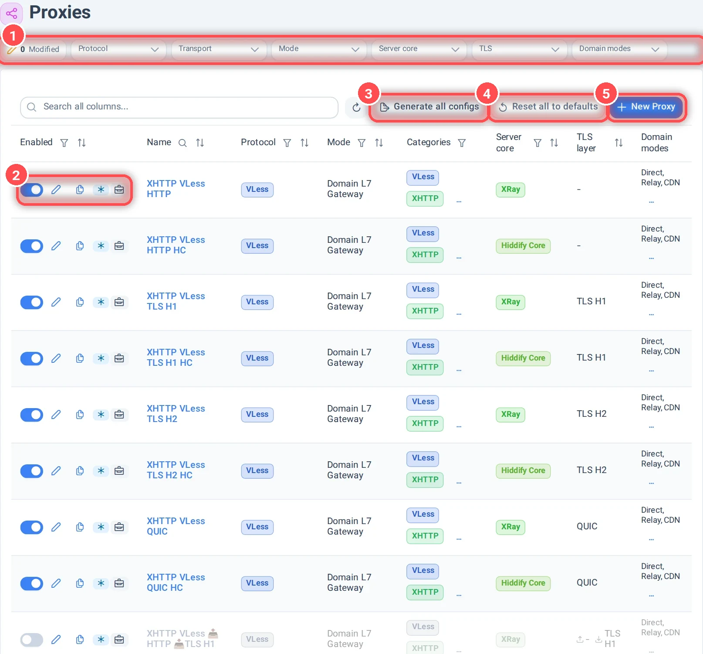
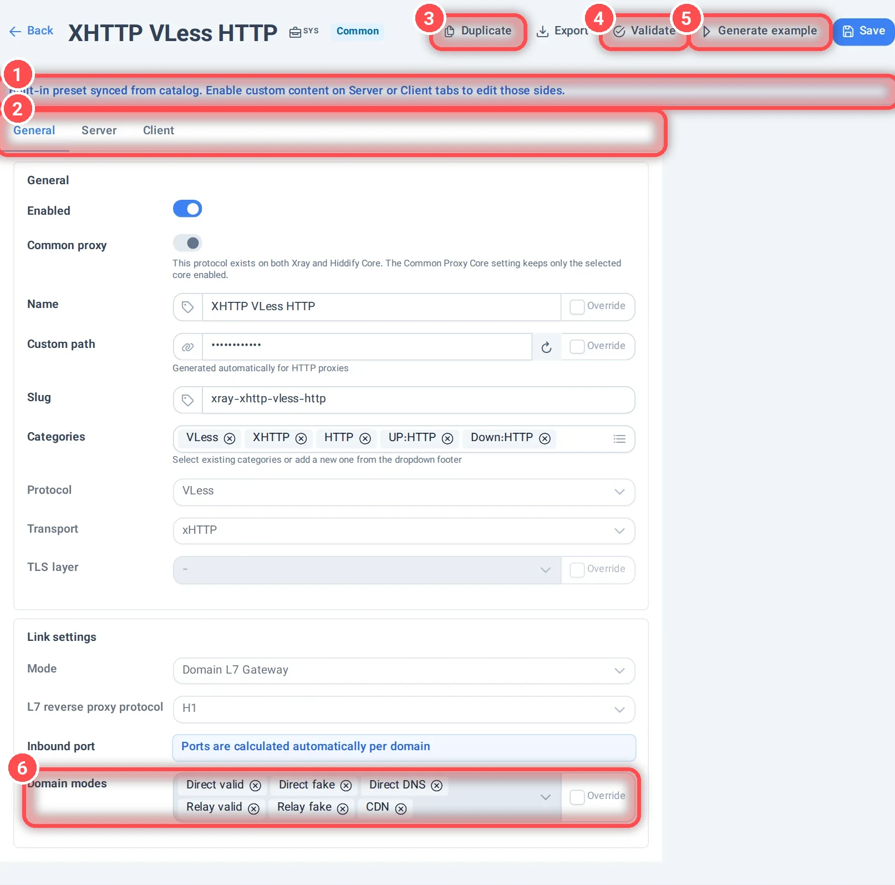
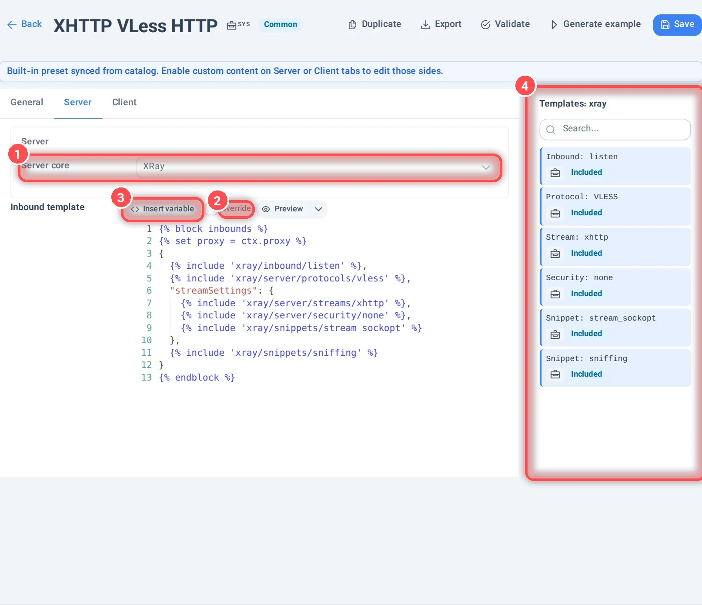
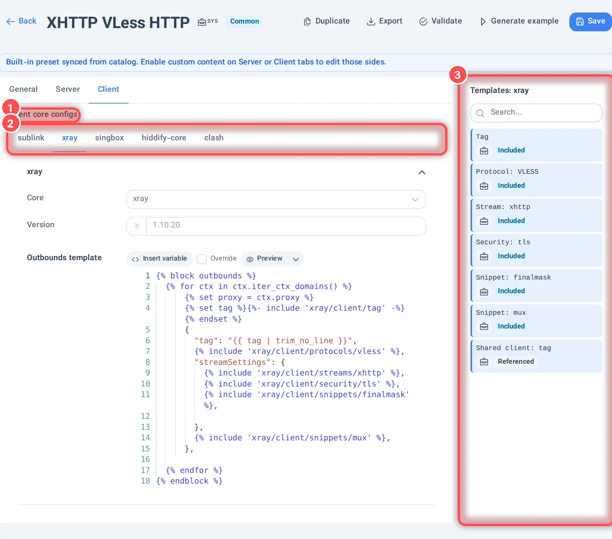
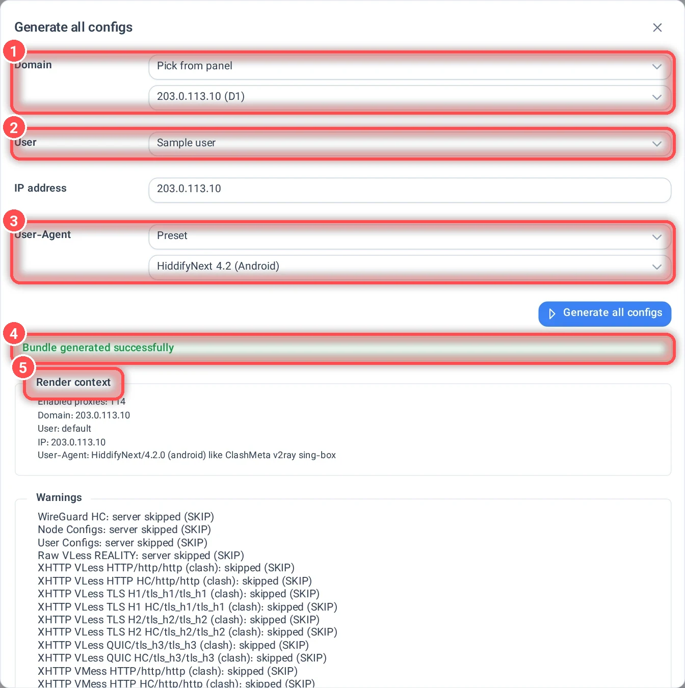
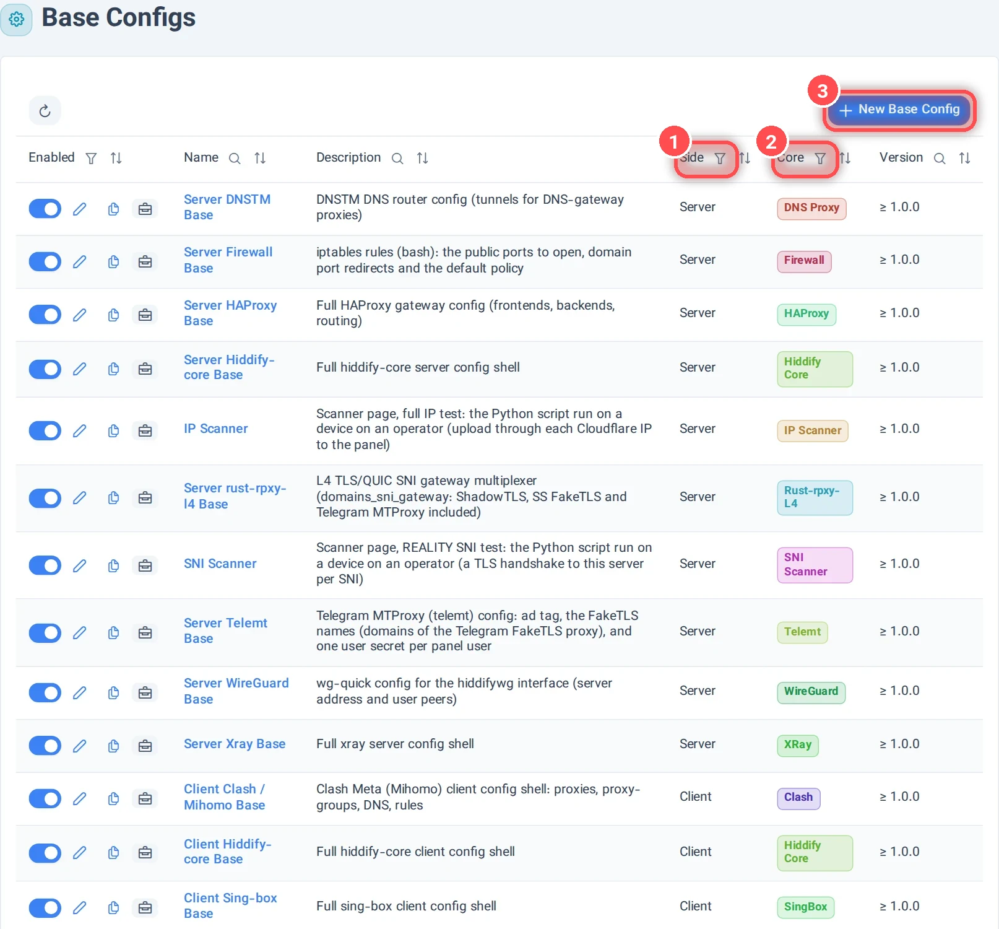
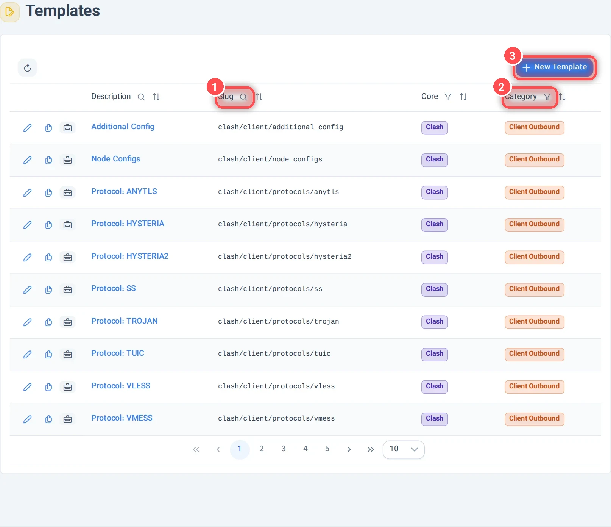
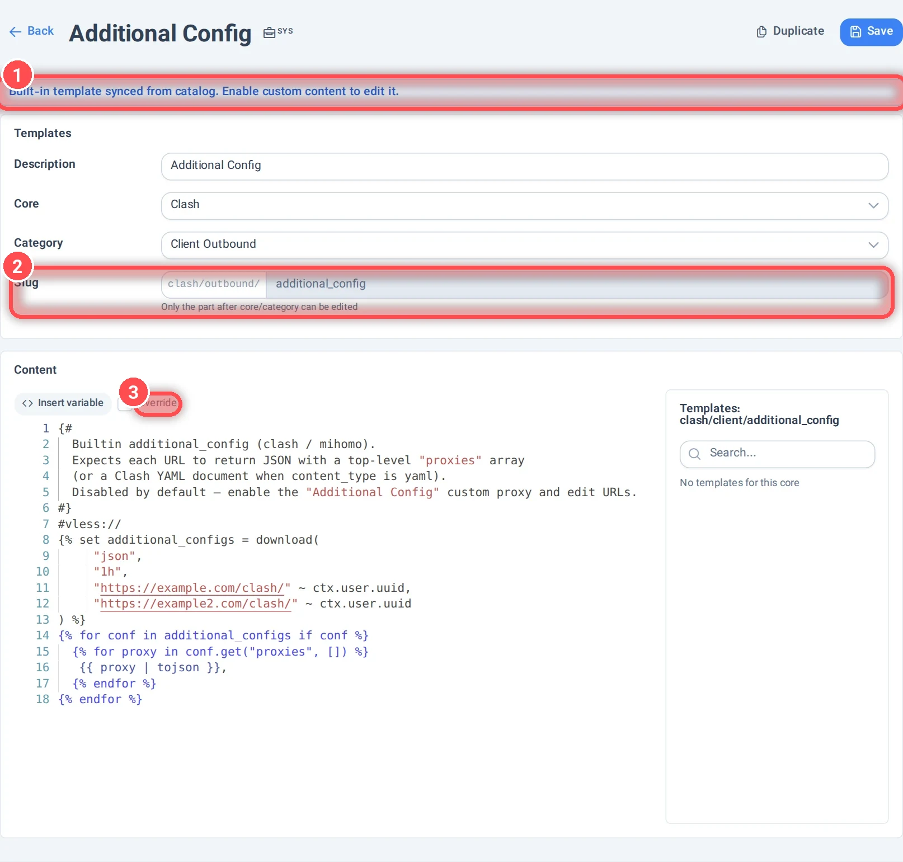
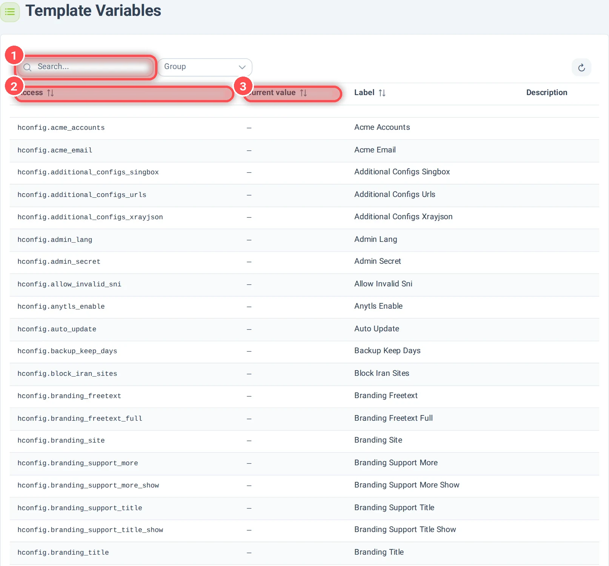

# How to use the Proxy Editor in Hiddify Manager

!!! info "Written for Hiddify Manager v14.5"
    The menus and names on this page are those of version 14.5. In older versions some of them do not exist.

The **Proxy Editor** is where Hiddify Manager keeps the recipe of every config it builds: what runs on the server, and what goes into your users' subscriptions. Most people never need to change it: the built-in proxies are tested and updated with each release. Use it when you want something the normal settings can't do, for example a proxy on a special port, an extra outbound, or a change to the configs of one app.

Open **Settings › Proxy Editor** in the menu. It has four pages:

| Page | What it holds |
|---|---|
| **Proxies** | Every proxy (protocol + transport + TLS) the panel can build, with its server part and its client part. |
| **Base Configs** | The full config "shell" of each core: the file a proxy's pieces are put into. |
| **Templates** | Reusable pieces (a protocol, a transport, a security layer…) that proxies and base configs include. |
| **Template Variables** | Every value you can use inside a template, with its current value. |

!!! warning "Before you change anything"
    - The items marked **SYS** are built in. They follow the catalog of the panel and are updated with each release. Prefer **Duplicate** and edit the copy, instead of changing a built-in item.
    - Make a backup first (**Backup** page).
    - After you save, the panel asks you to **Apply** the configs. Server changes take effect only after Apply (**Actions › Apply now**).

## Proxies

1. **Filters:** show only some proxies, by protocol, transport, mode, server core, TLS or domain mode. **Modified** shows the built-in proxies you have changed.
2. **The row of a proxy:** the switch turns it on or off; the pencil opens it; the copy icon duplicates it; custom proxies also have a delete icon. A star means **Common**: this protocol exists on both Xray and Hiddify Core, and the **Common Proxy Core** setting decides which core serves it. The **SYS** icon marks a built-in proxy (it is highlighted when you changed it).
3. **Generate all configs:** builds every server and client config for one domain and one user, without saving or applying anything (see [below](#generate-all-configs)).
4. **Reset all to defaults:** drops every change you made to the built-in proxies and brings back the catalog version. Proxies you created yourself are not touched.
5. **New Proxy:** makes an empty proxy of your own.

A proxy can only be turned on when its protocol is on in **Settings**. If it is off there, the panel offers to turn it on for you.

### The proxy page

Click the pencil of a proxy. The page has three tabs: **General**, **Server** and **Client**.

1. A built-in proxy shows this note: it follows the catalog. To edit its server or client side, turn on **Override** on that tab.
2. The three tabs.
3. **Duplicate:** an editable copy of the proxy. This is the safest way to change a built-in proxy.
4. **Validate:** checks the templates of the proxy for mistakes.
5. **Generate example:** shows the configs this proxy makes for one domain and one user.
6. **Domain modes:** the kinds of domain this proxy is built for (Direct, Relay, CDN, REALITY…). A domain that is not in this list gets no config of this proxy.

The other fields of **General**:

- **Enabled** and **Common proxy**.
- **Name:** the label of its links in the users' apps. **Custom path** is the path of HTTP-based proxies; it is made automatically and the round arrow makes a new one.
- **Slug** and **Categories:** an ID and tags, used by the filters and by templates.
- **Protocol**, **Transport** and **TLS layer:** what the proxy is.
- **Link settings:** the **Mode** (how traffic reaches the core: through a domain gateway, on its own ports, by IP…), the reverse proxy protocol and the **Inbound port** (empty means automatic, per domain).

On a built-in proxy, fields with an **Override** box keep the catalog value until you tick the box.

### Server tab

1. **Server core:** the program that serves this proxy on the server (Xray or Hiddify Core).
2. **Override:** tick it to edit the server template of a built-in proxy.
3. **Insert variable:** adds a [template variable](#template-variables) at the cursor. **Preview** shows the result for one domain and user.
4. The **Templates** panel lists the pieces this template includes. Click one to see it.

Templates are JSON with [Jinja](https://jinja.palletsprojects.com/) tags: `{{ proxy.port }}` puts in a value, <code>{&#37; include 'xray/server/streams/xhttp' &#37;}</code> puts in another template, `` repeats a part.

### Client tab

1. **Client core configs:** what this proxy adds to the subscription of each app format.
2. One tab per format: **sublink** (share links), **xray**, **singbox**, **hiddify-core** and **clash**. A format with no config here gives no config of this proxy to the apps that read that format.
3. The **Templates** panel of the selected format.

Each format can have a **Version** (the lowest app core version that gets it) and its outbound template.

### Generate all configs { #generate-all-configs }

This is the safe way to see what your changes do. Nothing is saved or applied.

1. **Domain:** one of the panel's domains, a domain you type, or all domains.
2. **User:** a sample user or one of your users.
3. **User-Agent:** the app to build for (for example the Hiddify app on Android). The panel builds a different format for each app.
4. The result: success, or warnings and errors. Click an error to see the template line that caused it.
5. **Render context:** what it was built with. Below it, every server and client config, and the **Warnings**. A `skipped (SKIP)` warning is normal: that proxy does not apply to this domain or app.

## Base Configs

A base config is the whole config file of one core, with a place where the proxies are put in.

1. **Side:** **Server** configs run on your server; **Client** configs are the shell of a subscription.
2. **Core:** server ones are Xray, Hiddify Core, HAProxy, the L4 gateway (rust-rpxy-l4), the DNS router, WireGuard, the Telegram MTProxy (Telemt), the firewall rules, and the scripts of the **Scanner** page. Client ones are Xray, sing-box, Hiddify Core, share links (sublink) and Clash/Mihomo.
3. **New Base Config:** makes your own.

For a built-in base config only the name and the switch can change. To edit its content, tick **Override** on its page, or **Duplicate** it. **Version** decides from which core version a base config is used.

## Templates

Templates are the small pieces the proxies and base configs are made of.

1. **Slug:** the name a template is included by, for example `xray/client/protocols/vless`: core, side, category, name.
2. **Category:** what kind of piece it is (protocol, stream, security, outbound…).
3. **New Template:** makes your own piece.

A change to a template changes every proxy that includes it. That is useful (fix it once), and also the reason to be careful: check with **Generate all configs** afterwards.

1. A built-in template follows the catalog.
2. **Slug:** only the part after core/category can be changed.
3. **Override:** tick it to edit the content of a built-in template. To keep the original, use **Duplicate** (clone as custom) instead.

!!! example "Example: the Additional Config template"
    The built-in **Additional Config** proxy and its templates add the configs of another subscription to your users' subscriptions. It is off by default. Turn the proxy on, tick **Override** on its client side and put your subscription address in place of `example.com`. The `download("json", "1h", …)` function fetches it (and keeps it for an hour).

## Template Variables { #template-variables }

This page lists every value a template can use.

1. **Search** and **Group:** find a variable by name or by group (panel settings, the proxy, the domain, the user…).
2. **Access:** how to write it in a template, for example `hconfig.block_iran_sites` is the **Block Domestic Sites** setting.
3. **Current value:** its value on this panel.

A template can also output `SKIP` (or call `skip()`) to leave a proxy out when a condition is not met, for example when a user has no address in their extra parameters.

## Good to know

- Use the **Config Tester** (**Tools › Config Tester**) after a change: it connects through every config of a subscription and shows which ones work. See [Panel tools](How-to-use-the-panel-tools-in-HiddifyManager.md#config-tester).
- **Reset all to defaults** on the Proxies page, or **Reset to catalog default** on one proxy, undoes your changes when something goes wrong.
- More examples (a subscription for one user, one user through WARP, the whole server through a SOCKS proxy) are in [help_customize_proxies](https://github.com/hiddify/Hiddify-Manager/blob/main/docs/help_customize_proxies.md) (Persian).

## Related articles

- [Panel tools (Config Tester, Scanner, SSH…)](/manager/configuration-and-advanced-settings/How-to-use-the-panel-tools-in-HiddifyManager/)
- [My account and admin security](/manager/configuration-and-advanced-settings/My-account-and-admin-security-in-HiddifyManager/)
- [Every part and setting of the panel](/manager/configuration-and-advanced-settings/How-to-configure-Hiddify-panel-properly/)
- [All panel settings, one by one](/manager/configuration-and-advanced-settings/Settings-reference/)

