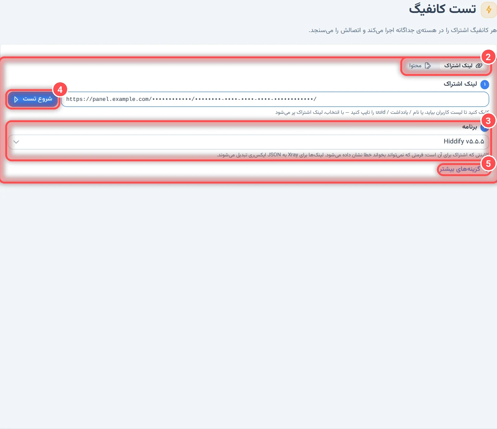
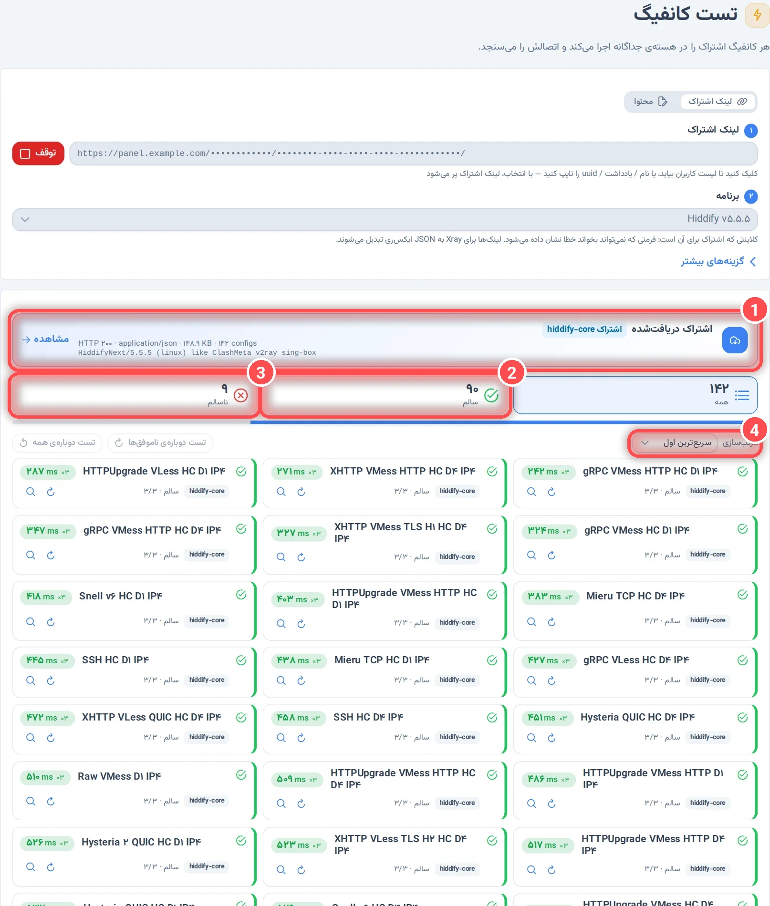
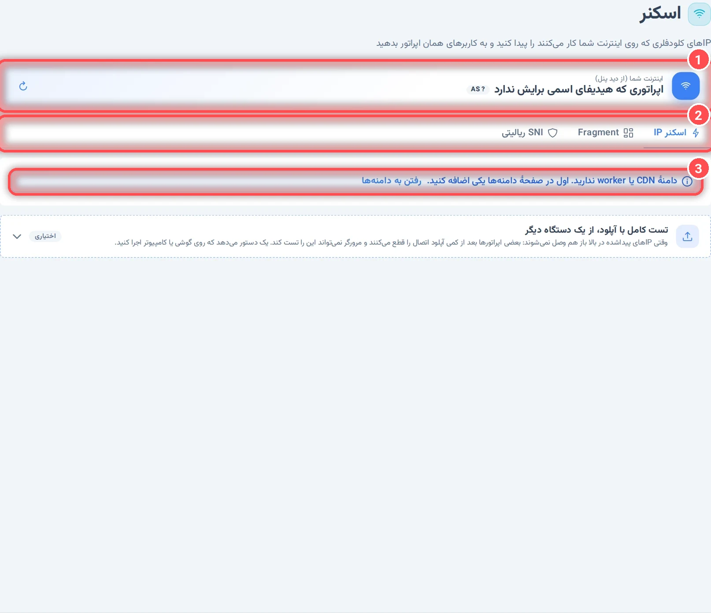
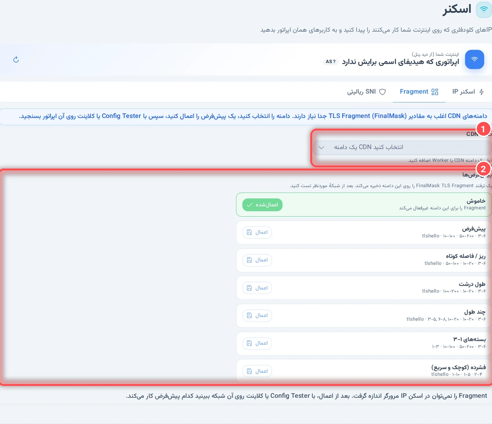
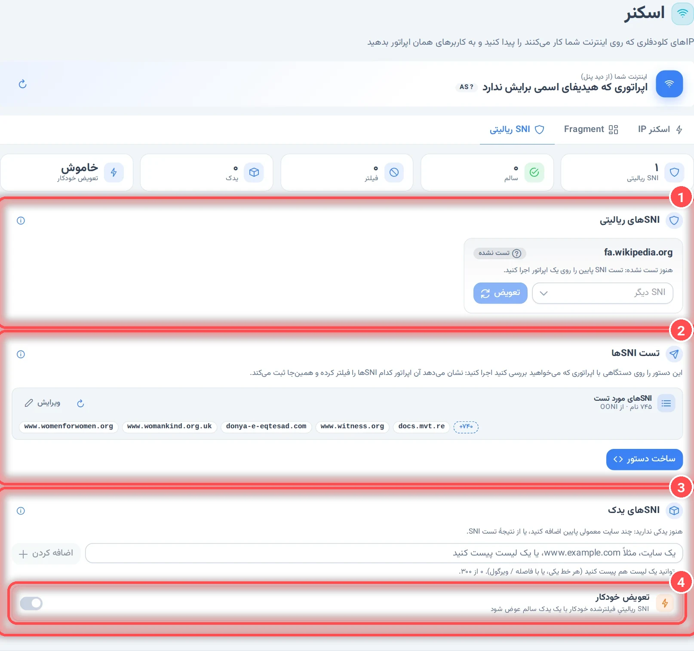
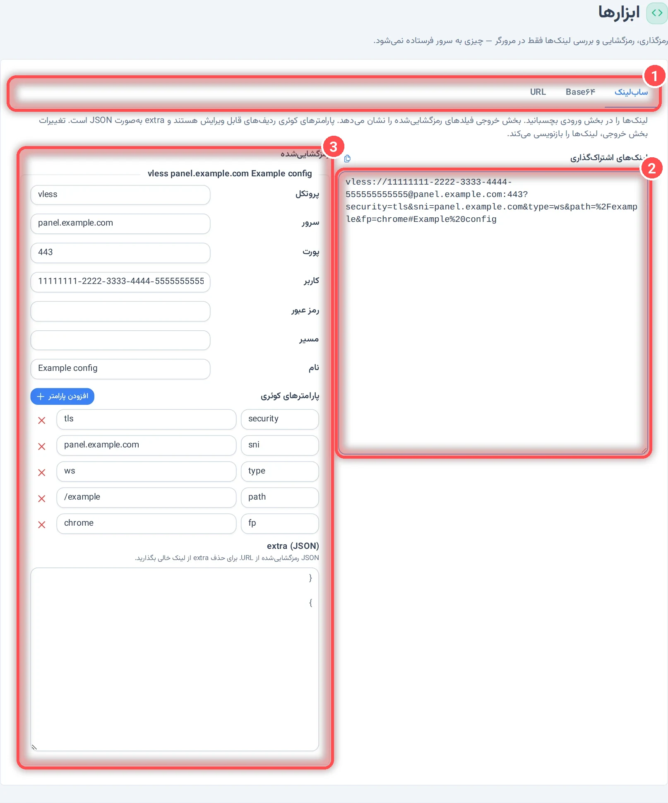
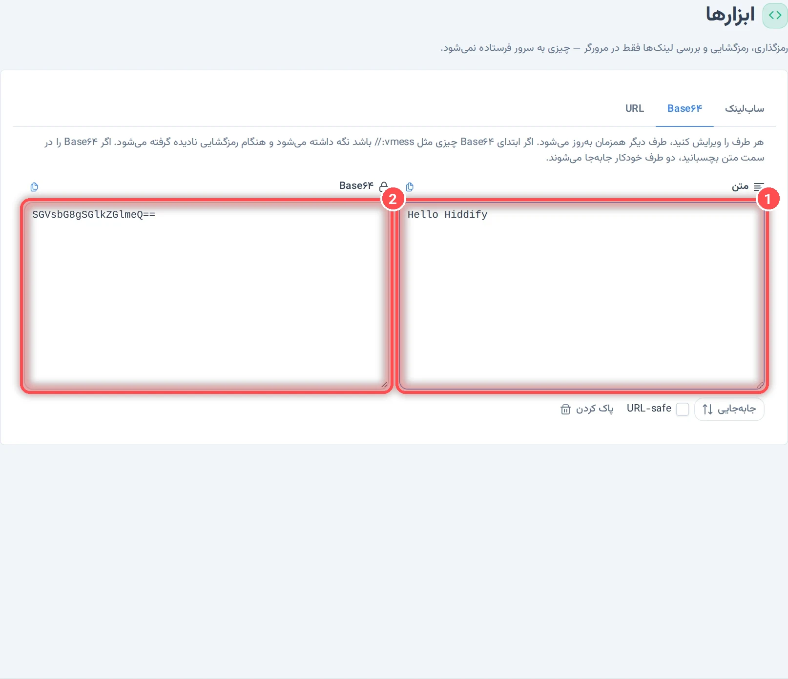
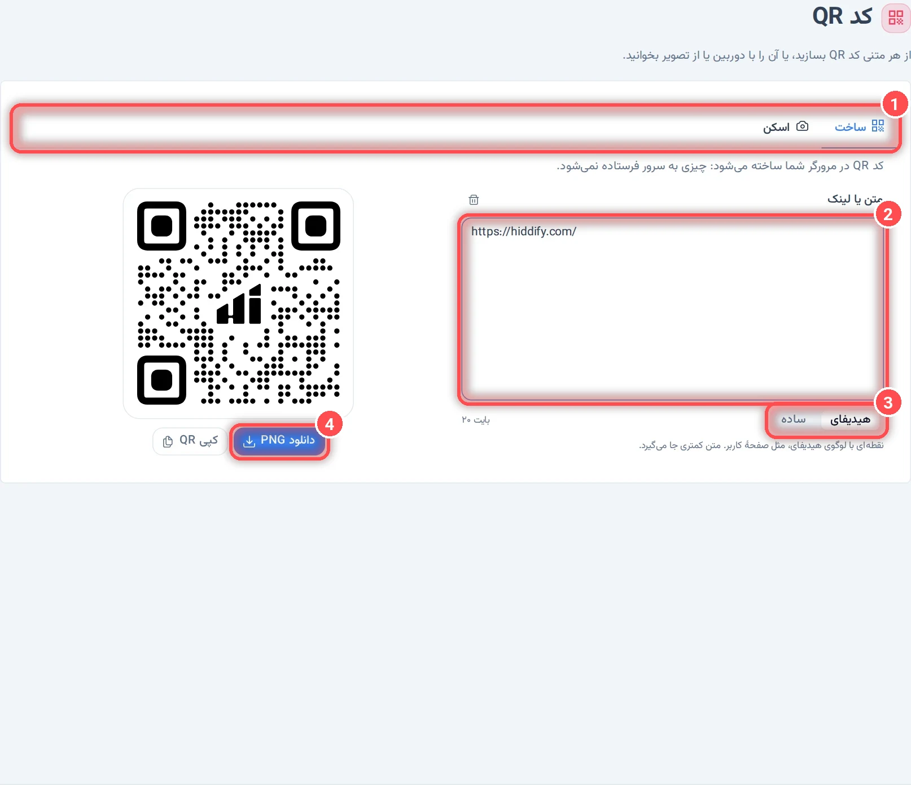
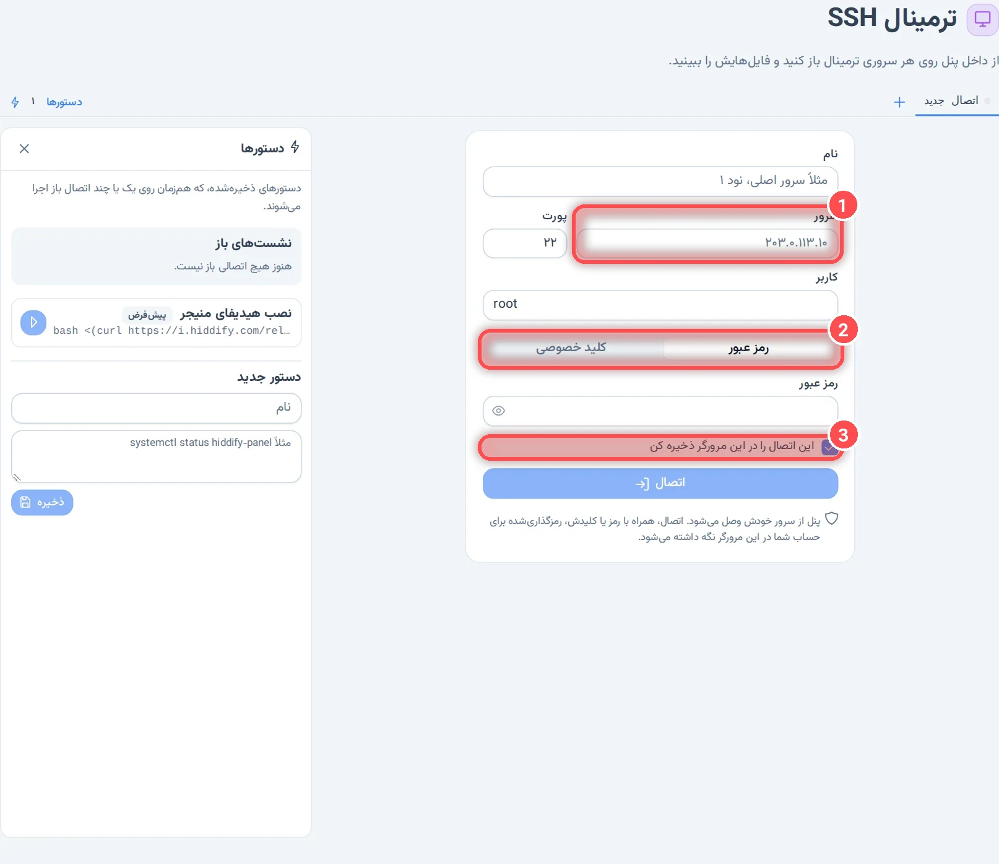

# آموزش ابزارهای پنل هیدیفای‌منیجر

!!! info "نوشته‌شده برای هیدیفای‌منیجر نسخهٔ ۱۴.۵"
    نام منوها و گزینه‌های این صفحه مربوط به نسخهٔ ۱۴.۵ است. بعضی از این ابزارها در نسخه‌های قدیمی‌تر وجود ندارند.

منوی **ابزارها** در پنل پنج ابزار کمکی برای کارهای روزمره دارد:

| ابزار | چه کاری می‌کند |
|---|---|
| [تست کانفیگ](#config-tester) | از روی سرور، با تک‌تک کانفیگ‌های یک لینک اشتراک وصل می‌شود و نشان می‌دهد کدام‌ها کار می‌کنند. |
| [اسکنر](#scanner) | آی‌پی‌های کلادفلر را که روی اینترنت کاربرانتان کار می‌کنند پیدا می‌کند، مقدار Fragment را تنظیم می‌کند و SNIهای ریالتی را بررسی می‌کند. |
| [رمزگشای متن](#text-decoders) | لینک‌های اشتراک‌گذاری، متن Base64 و متن URL-encoded را باز می‌کند تا بتوانید بخوانید و ویرایششان کنید. |
| [کد QR](#qr-code) | از هر متنی کد QR می‌سازد، یا یک کد QR را می‌خواند. |
| [ترمینال SSH](#ssh-terminal) | ترمینال و مدیریت فایل هر سروری، داخل خود پنل. |

## تست کانفیگ { #config-tester }

تست کانفیگ هر کانفیگِ یک لینک اشتراک را در هستهٔ جداگانهٔ خودش اجرا می‌کند و بررسی می‌کند که وصل می‌شود یا نه. بعد از تغییر دامنه‌ها، پروتکل‌ها یا [ویرایشگر پروکسی](How-to-use-the-Proxy-Editor-in-HiddifyManager.md)، یا وقتی کاربری می‌گوید «هیچ‌چیز وصل نمی‌شود»، از آن استفاده کنید.

1. **چه چیزی تست شود:** یک **لینک اشتراک**، یا **محتوا**یی که خودتان می‌چسبانید (لینک‌های اشتراک‌گذاری، یک اشتراک base64، یک کانفیگ JSON از Xray، هستهٔ هیدیفای یا سینگ‌باکس، یا یک YAML از Clash Meta).
2. **لینک اشتراک:** یک لینک بچسبانید، یا روی کادر بزنید و یکی از کاربرانتان را انتخاب کنید تا لینکش خودکار نوشته شود.
3. **برنامه:** اپی که اشتراک برای آن است. پنل برای هر اپ فرمت جداگانه‌ای می‌فرستد، پس تست دقیقاً همان چیزی را بررسی می‌کند که آن اپ دریافت می‌کند. اگر اپ نتواند فرمتی را بخواند، به‌صورت خطا نشان داده می‌شود.
4. **شروع تست**.
5. **گزینه‌های بیشتر:** **User agent** که موقع دریافت لینک فرستاده می‌شود، **آدرس تست**، **تعداد همزمان** کانفیگ‌هایی که با هم تست می‌شوند، **تعداد تست هر کانفیگ** و **مهلت (ثانیه)**.

تست روی سرور پنل اجرا می‌شود و اگر صفحه را ببندید هم ادامه پیدا می‌کند (نتیجه‌ها یک ساعت نگه داشته می‌شوند).

1. **اشتراک دریافت‌شده:** چیزی که پنل فرستاده (فرمت، حجم و تعداد کانفیگ‌ها). با **مشاهده** آن را باز می‌کنید تا یک لینک را بخوانید یا ویرایش کنید و دوباره تست بگیرید.
2. **سالم:** کانفیگ‌هایی که وصل شدند، همراه با تأخیرشان.
3. **ناسالم:** کانفیگ‌هایی که وصل نشدند. روی یک کانفیگ بزنید تا علتش (لاگ) و تاریخچهٔ پینگش را ببینید.
4. **مرتب‌سازی:** سریع‌ترین اول، بر اساس نام، یا به ترتیب اشتراک. دکمه‌های **تست دوباره‌ی ناموفق‌ها** و **تست دوباره‌ی همه** هم در همین خط هستند.

!!! tip "کانفیگ‌های این پنل"
    زیر نتیجه‌ها، بخش **کانفیگ‌های این پنل** کانفیگ‌هایی از همین پنل را نشان می‌دهد که روی همهٔ لینک‌هایشان ناموفق بوده‌اند. می‌توانید با یک کلیک خاموششان کنید: بعد از اعمال تنظیمات از لینک اشتراک کاربران حذف می‌شوند. خودشان برنمی‌گردند؛ دکمهٔ **برگشت به حالت اول** در بالای صفحه دوباره روشنشان می‌کند. این کار را فقط وقتی انجام دهید که مطمئنید مشکل از اینترنت خودتان نیست.

پنل می‌تواند این تست را هر ۶ ساعت خودش انجام دهد و در تلگرام به شما هشدار بدهد: **تنظیمات › تنظیمات عمومی › بررسی خودکار سلامت کانفیگ‌ها**. این گزینه به‌صورت پیش‌فرض خاموش است، چون بعضی شرکت‌های میزبانی، اتصال‌های زیاد یک تست را حمله حساب می‌کنند.

## اسکنر { #scanner }

اسکنر سه تب دارد. دو تب اول **در مرورگر شما و روی اینترنتی که الان به آن وصل هستید** اجرا می‌شوند؛ سرور پنل خارج از کشور است و نمی‌تواند ببیند اینترنت کاربران شما چطور کار می‌کند. پس این صفحه را روی اپراتوری باز کنید که برایتان مهم است (مثلاً یک بار با گوشی روی همراه اول و یک بار روی ایرانسل) و **فیلترشکن را خاموش کنید**.

1. **اینترنت شما (از دید پنل):** اپراتور شما و شمارهٔ AS آن. اگر فیلترشکن روشن باشد، صفحه هشدار می‌دهد؛ چون در آن صورت فیلترشکن را تست می‌کنید، نه اپراتورتان را.
2. سه تب: **اسکنر IP**، **Fragment** و **SNI ریالتی**.
3. اسکنر IP به یک دامنهٔ CDN یا ورکر نیاز دارد. اگر پنل چنین دامنه‌ای ندارد، اول در صفحهٔ **دامنه‌ها** یکی اضافه کنید ([CDN کلادفلر](../domain-worker-cdn-and-tunneling/How-to-use-Cloudflare-CDN.md)، [دامنهٔ ورکر](../domain-worker-cdn-and-tunneling/How-to-use-the-Cloudflare-worker-domain-on-Hiddify.md)).

### اسکنر IP

وقتی دامنهٔ CDN داشته باشید، این تب شما را در سه مرحله راهنمایی می‌کند:

1. **کجا و برای چه کسانی؟** دامنهٔ CDN را انتخاب کنید و اپراتوری را که کاربرانش این آی‌پی‌ها را می‌گیرند.
2. **پیدا کردن IPهای سالم:** دکمهٔ **اسکن** آی‌پی‌های تصادفی از رنج‌های کلادفلر را تست می‌کند. در **تنظیمات اسکن** می‌توانید رنج‌ها، تعداد IP تصادفی از هر رنج و مهلت هر IP را تغییر دهید.
3. **افزودن به دامنه:** سریع‌ترین آی‌پی‌ها به‌صورت جفت‌های `آی‌پی اپراتور` در فیلد **CDN IP** دامنه ذخیره می‌شوند. آی‌پی‌های اپراتورهای دیگر دست نمی‌خورند. کاربران با به‌روزرسانی بعدی اشتراکشان این آی‌پی‌ها را می‌گیرند.

**تست کامل با آپلود، از یک دستگاه دیگر** برای اپراتورهایی است که بعد از کمی آپلود، اتصال را قطع می‌کنند؛ مرورگر نمی‌تواند این را تست کند. این بخش یک دستور (پایتون) می‌سازد که روی گوشی (با Termux) یا کامپیوتری که به همان اپراتور وصل است اجرا می‌کنید. دستور ۲۴ ساعت معتبر است و نتیجه‌اش را خودش در همین صفحه ذخیره می‌کند.

دربارهٔ آی‌پی تمیز بیشتر بخوانید: [آی‌پی تمیز کلادفلر چیست](../domain-worker-cdn-and-tunneling/Guide-for-finding-a-clean-Cloudflare-IP.md) و [گذاشتن آی‌پی تمیز دلخواه](../domain-worker-cdn-and-tunneling/How-to-use-desired-clean-IPs-based-on-a-specific-format.md).

### Fragment

دامنه‌های CDN اغلب به مقدارهای Fragment مخصوص خودشان نیاز دارند.

1. **دامنهٔ CDN:** دامنه را انتخاب کنید.
2. **پیش‌فرض‌ها:** مقدارهای آماده (پیش‌فرض، ریز / فاصله کوتاه، طول درشت، چند طول، بسته‌های ۱-۳، فشرده). **اعمال** یکی از آن‌ها را روی دامنه می‌گذارد؛ **خاموش** Fragment را برای آن دامنه خاموش می‌کند.

مرورگر نمی‌تواند Fragment را اندازه بگیرد. بعد از اعمال یک پیش‌فرض، آن را با [تست کانفیگ](#config-tester) یا یک اپ روی همان اپراتور بررسی کنید. بیشتر بخوانید: [کاربرد و نحوه عملکرد TLS Trick](../basic-concepts-and-troubleshooting/How-the-TLS-Trick-works-and-its-usage.md).

### SNI ریالتی

کانفیگ ریالتی شبیه بازدید از یک سایت دیگر (SNI آن) به نظر می‌رسد. اگر اپراتوری آن سایت را فیلتر کند، کانفیگ روی آن اپراتور کار نمی‌کند.

1. **SNIهای ریالتی:** SNIهایی که دامنه‌های ریالتی شما استفاده می‌کنند، و اینکه هرکدام روی کدام اپراتورها فیلتر است. با **تعویض** یک SNI را با SNI دیگری عوض می‌کنید.
2. **تست SNIها:** دکمهٔ **ساخت دستور** دستوری می‌سازد که روی یک دستگاه متصل به همان اپراتور (با فیلترشکن خاموش) اجرا می‌کنید. این دستور مثل یک اپ ریالتی، با تک‌تک SNIها به سرور شما وصل می‌شود و در همین صفحه ثبت می‌کند کدام‌ها روی آن اپراتور فیلتر هستند. فهرست **SNIهای مورد تست** از OONI می‌آید (سایت‌هایی که در ایران باز دیده شده‌اند) و می‌توانید ویرایشش کنید.
3. **SNIهای یدک:** سایت‌های معمولی (تا ۳۰۰ عدد) که وقتی یک SNI فیلتر شد، با آن‌ها جایگزین می‌شود.
4. **تعویض خودکار:** وقتی روشن باشد، SNI فیلترشده خودکار با یک یدک سالم عوض می‌شود.

همچنین ببینید: [اسکنر ریالتی هیدیفای](How-to-use-Hiddify-Reality-Scanner.md) و [تنظیمات ریالتی](How-to-use-Reality-on-Hiddify.md).

## رمزگشای متن { #text-decoders }

همهٔ کارهای این بخش در مرورگر شما انجام می‌شود و چیزی به سرور فرستاده نمی‌شود.

1. سه تب: **ساب‌لینک**، **Base64** و **URL**.
2. **لینک‌های اشتراک‌گذاری:** یک یا چند لینک `vless://`، `vmess://`، `ss://` یا `trojan://`، یا یک اشتراک base64 را بچسبانید (به لینک‌های جدا باز می‌شود).
3. **رمزگشایی‌شده:** هر لینک به‌صورت فیلدهای جدا (سرور، پورت، کاربر، مسیر، نام)، **پارامترهای کوئری** به‌صورت ردیف‌ها و `extra` به‌صورت JSON. هر فیلدی را عوض کنید، لینک سمت دیگر هم بازنویسی می‌شود. برای اصلاح دستی یک لینک، یا فهمیدن اینکه چرا یک اپ آن را قبول نمی‌کند، به کار می‌آید.

۱. **متن** و ۲. **Base64:** در هر طرف بنویسید، طرف دیگر به‌روز می‌شود. گزینهٔ **URL-safe** از حروف مخصوص Base64 امن برای URL استفاده می‌کند و **جابه‌جایی** دو طرف را عوض می‌کند. تب **URL** همین کار را برای متن درصدی (`%20` و …) انجام می‌دهد.

## کد QR { #qr-code }

1. **ساخت** کد QR، یا **اسکن** یک کد (با دوربین، یا از یک تصویر یا اسکرین‌شاتی که می‌چسبانید).
2. **متن یا لینک:** هر متنی، مثلاً یک لینک اشتراک.
3. **سبک:** **هیدیفای** (نقطه‌ها و لوگوی هیدیفای، مثل صفحهٔ کاربر) یا **ساده** (حدوداً دو برابر متن جا می‌گیرد).
4. **دانلود PNG** یا کپی تصویر.

دوربین فقط وقتی کار می‌کند که پنل با `https` باز شده باشد. کدی را که اسکن کرده‌اید می‌توانید با **بررسی در رمزگشای متن** باز کنید.

## ترمینال SSH { #ssh-terminal }

ترمینال و مدیریت فایل هر سروری، بدون نیاز به اپ SSH. روی گوشی، یا برای مدیریت نودها و سرورهای میانی کاربردی است.

1. **سرور** و **پورت** سرور (به‌همراه یک **نام** برای آن، و **کاربر** که معمولاً `root` است).
2. ورود با **رمز عبور** یا **کلید خصوصی**.
3. **این اتصال را در این مرورگر ذخیره کن:** اتصال در همین مرورگر و رمزنگاری‌شده برای حساب ادمین شما نگه داشته می‌شود. بعد روی **اتصال** بزنید.

اتصال **از سرور پنل** برقرار می‌شود، نه از دستگاه شما. بار اولی که به یک سرور وصل می‌شوید، پنل کلید آن سرور را نشان می‌دهد و می‌پرسد **به این سرور اعتماد می‌کنید؟**؛ قبل از فرستادن رمز، مطمئن شوید که کلید مال سرور خودتان است.

هر اتصال در یک تب باز می‌شود که **ترمینال** و **فایل‌ها** دارد (مرور، آپلود، دانلود، ویرایش و باز کردن فایل‌های فشرده). در سمت دیگر، **دستورها** فرمان‌های ذخیره‌شده‌ای هستند که می‌توانید روی یک یا چند اتصال باز با هم اجرا کنید؛ دستور **Install Hiddify Manager** از قبل در آن هست. **کپی لینک** لینکی می‌سازد که همان اتصال را دوباره باز می‌کند و فقط برای حساب خودتان کار می‌کند.

!!! warning "احتیاط"
    هر کسی که بتواند با حساب ادمین شما وارد پنل شود، می‌تواند از این ترمینال استفاده کند. از حسابتان با رمز عبور یا کلید عبور (Passkey) محافظت کنید: [حساب من و امنیت ادمین](My-account-and-admin-security-in-HiddifyManager.md). دربارهٔ SSH بیشتر بخوانید: [اتصال به سرور از طریق SSH](../installation-and-setup/How-to-connect-to-server-via-SSH.md).

## مقاله‌های مرتبط

- [ویرایشگر پروکسی](/fa/manager/configuration-and-advanced-settings/How-to-use-the-Proxy-Editor-in-HiddifyManager/)
- [حساب من و امنیت ادمین](/fa/manager/configuration-and-advanced-settings/My-account-and-admin-security-in-HiddifyManager/)
- [آشنایی کامل با پنل و تنظیمات آن](/fa/manager/configuration-and-advanced-settings/How-to-configure-Hiddify-panel-properly/)
- [همهٔ تنظیمات پنل، یکی‌یکی](/fa/manager/configuration-and-advanced-settings/Settings-reference/)

