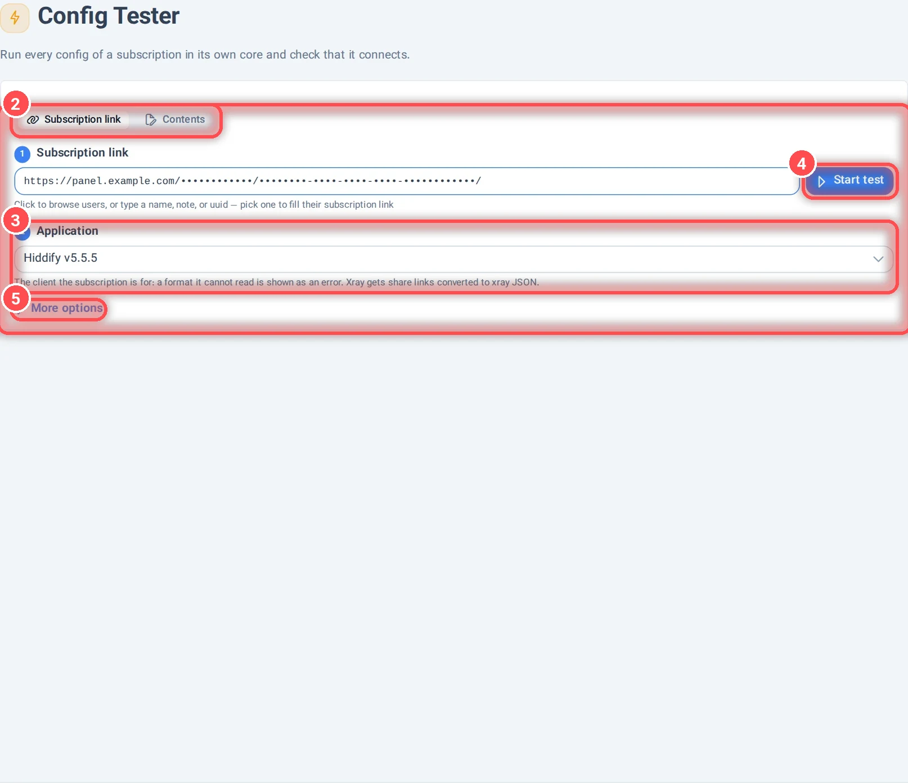
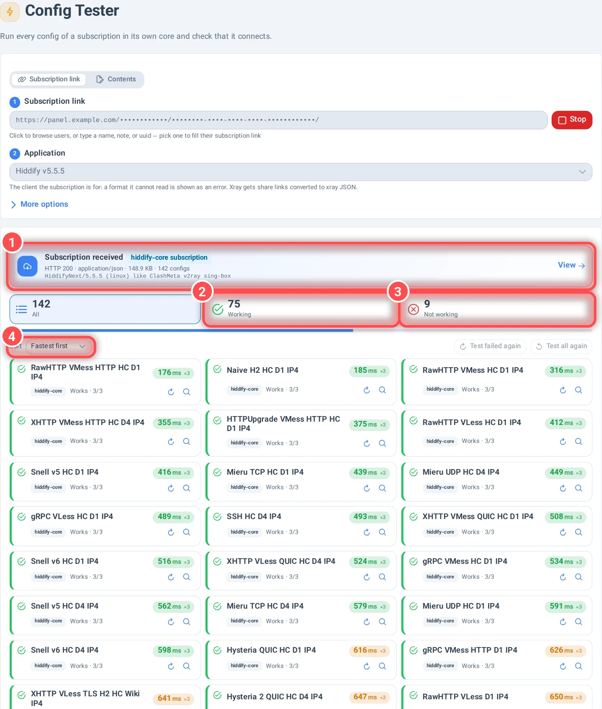
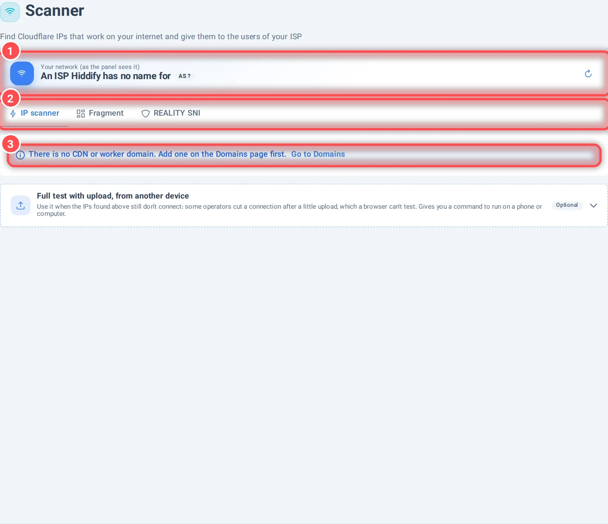
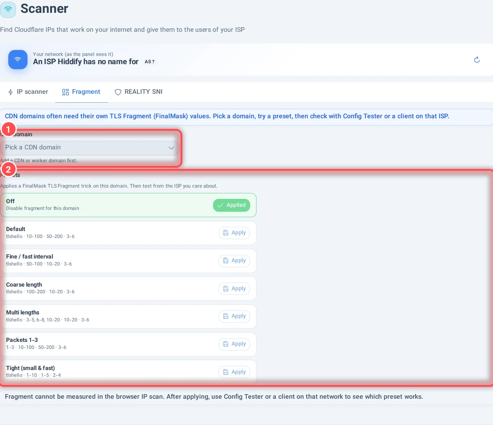
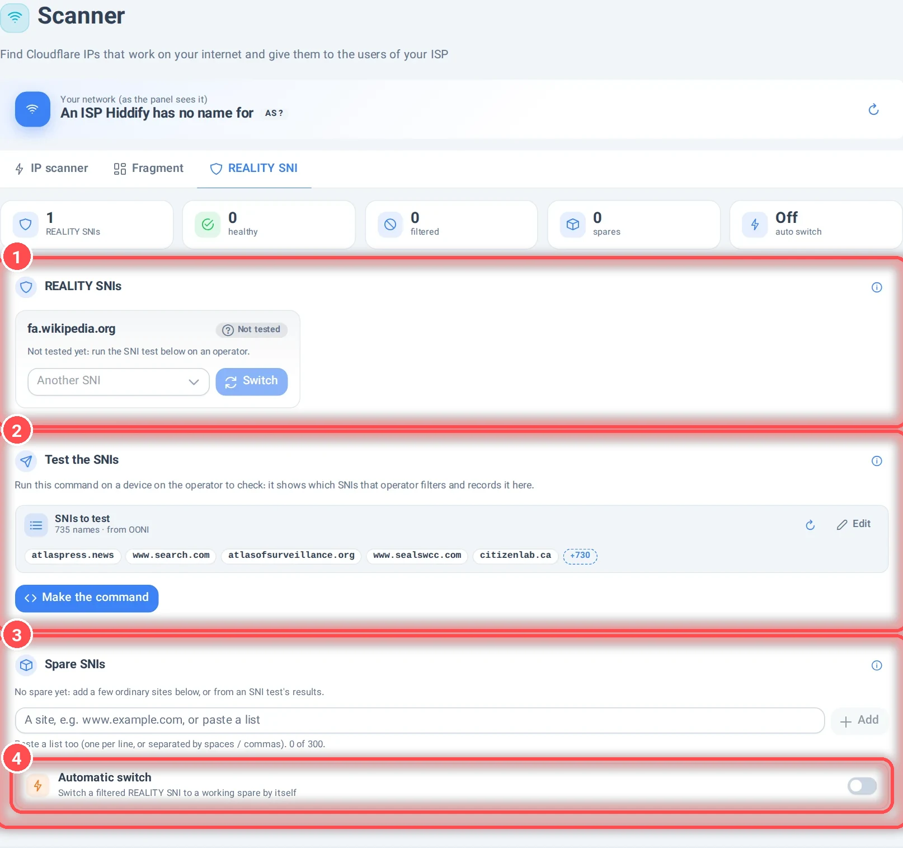
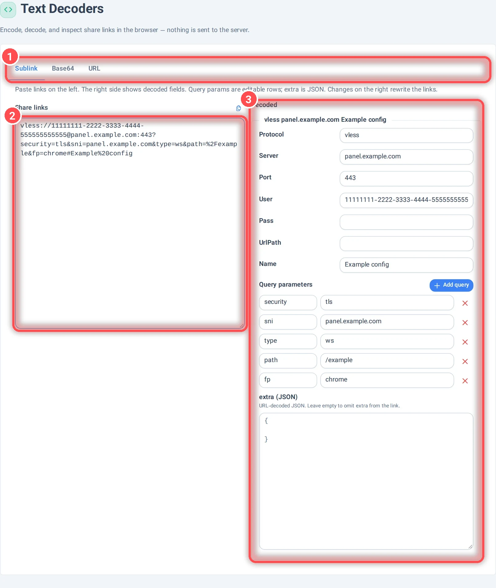
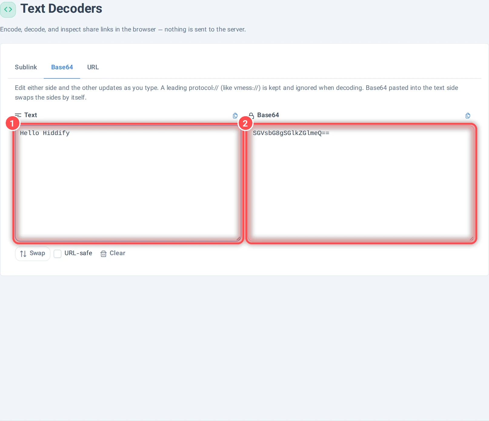
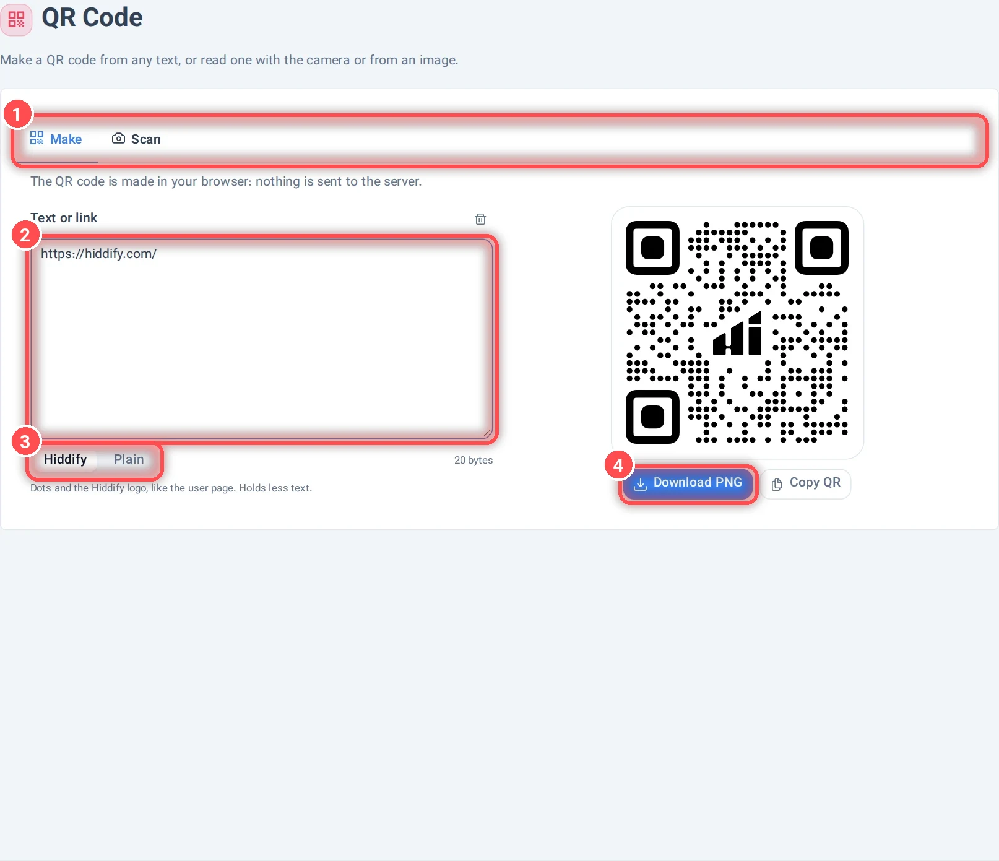
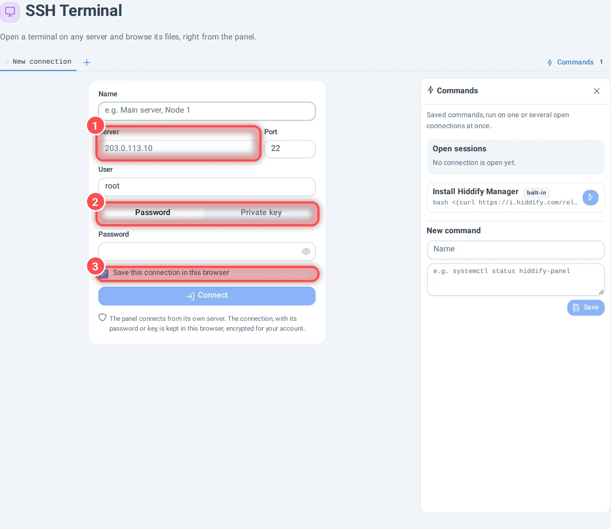

# How to use the panel tools in Hiddify Manager

!!! info "Written for Hiddify Manager v14.5"
    The menus and names on this page are those of version 14.5. In older versions some of these tools do not exist.

The **Tools** menu of the panel has five helpers for everyday work:

| Tool | What it does |
|---|---|
| [Config Tester](#config-tester) | Connects through every config of a subscription, from the server, and shows which ones work. |
| [Scanner](#scanner) | Finds Cloudflare IPs that work on your users' internet, tunes TLS Fragment, and checks your REALITY SNIs. |
| [Text Decoders](#text-decoders) | Opens up share links, Base64 and URL-encoded text so you can read and edit them. |
| [QR Code](#qr-code) | Makes a QR code from any text, or reads one. |
| [SSH Terminal](#ssh-terminal) | A terminal and file manager for any server, inside the panel. |

## Config Tester { #config-tester }

The Config Tester runs each config of a subscription in its own core and checks that it connects. Use it after you change domains, protocols or the [Proxy Editor](How-to-use-the-Proxy-Editor-in-HiddifyManager.md), or when a user says "nothing works".

1. **What to test:** a **Subscription link**, or **Contents** you paste (share links, a base64 subscription, an Xray, Hiddify Core or sing-box JSON, or a Clash Meta YAML).
2. **Subscription link:** paste a link, or click the box to pick one of your users: their link is filled in.
3. **Application:** the app the subscription is for. The panel gives each app its own format, so the test checks exactly what that app gets. A format the app can't read is shown as an error.
4. **Start test.**
5. **More options:** the **User agent** sent when the link is fetched, the **Test URL**, how many configs are tested at the same time (**Parallel workers**), **Tests per config** and the **Timeout**.

The test runs on the panel's server and goes on even if you close the page (results are kept for an hour).

1. **Subscription received:** what the panel sent (format, size, number of configs). **View** opens it, so you can read or edit a link and test it again.
2. **Working:** configs that connected, with their delay.
3. **Not working:** configs that failed. Click a config to see why (its log) and its ping history.
4. **Sort:** fastest first, by name, or in subscription order. **Test failed again** and **Test all again** are on the same line.

!!! tip "This panel's configs"
    Under the results, **This panel's configs** lists the configs of this panel that failed on every link. You can turn them off in one click: they leave the users' subscriptions after Apply. They don't come back by themselves; **Restore all** at the top of the page turns them on again. Only do this when you are sure the problem is not your own internet.

The panel can also run this test by itself every 6 hours and warn you on Telegram: **Settings › General Settings › Automatic config health checks**. It is off by default, because some hosting companies take the many connections of a test for an attack.

## Scanner { #scanner }

The Scanner has three tabs. The first two run **in your browser, on the internet you are on now**: the panel's server is abroad and can't see how your users' internet behaves. So open this page on the operator you care about (for example a phone on MCI, then on Irancell), **with the VPN off**.

1. **Your network (as the panel sees it):** your operator and its AS number. If a VPN is on, the page warns you: then you would be testing the VPN, not your operator.
2. The three tabs: **IP scanner**, **Fragment** and **REALITY SNI**.
3. The IP scanner needs a CDN or worker domain. If the panel has none, add one on the **Domains** page first ([Cloudflare CDN](../domain-worker-cdn-and-tunneling/How-to-use-Cloudflare-CDN.md), [worker domain](../domain-worker-cdn-and-tunneling/How-to-use-the-Cloudflare-worker-domain-on-Hiddify.md)).

### IP scanner

With a CDN domain, the tab walks you through three steps:

1. **Where and for whom?** Pick the CDN domain, and the operator whose users get the IPs.
2. **Find IPs that work:** **Scan** tests random IPs from Cloudflare's ranges. **Scan settings** changes the ranges, the number of IPs per range and the timeout per IP.
3. **Add them to the domain:** the fastest IPs are saved in the domain's **CDN IP** field as `IP operator` pairs. The IPs of other operators stay as they are. Users get them with their next subscription update.

**Full test with upload, from another device** is for operators that cut a connection after a little upload, which a browser can't test. It makes a command (Python) to run on a phone (Termux) or a computer on that operator. The command is valid for 24 hours and saves its results here by itself.

More about clean IPs: [What is Cloudflare's clean IP](../domain-worker-cdn-and-tunneling/Guide-for-finding-a-clean-Cloudflare-IP.md) and [using your own clean IPs](../domain-worker-cdn-and-tunneling/How-to-use-desired-clean-IPs-based-on-a-specific-format.md).

### Fragment

CDN domains often need their own TLS Fragment values.

1. **CDN domain:** pick the domain.
2. **Presets:** ready values (Default, Fine, Coarse, Multi lengths, Packets 1-3, Tight). **Apply** puts one on the domain; **Off** turns fragment off for it.

A browser can't measure fragment. After you apply a preset, check it with the [Config Tester](#config-tester) or an app on that operator. More: [How the TLS trick works](../basic-concepts-and-troubleshooting/How-the-TLS-Trick-works-and-its-usage.md).

### REALITY SNI

A REALITY config looks like a visit to another site (its SNI). If an operator filters that site, the config stops working there.

1. **REALITY SNIs:** the SNIs your REALITY domains use, and on which operators each one is filtered. **Switch** changes an SNI to another one.
2. **Test the SNIs:** **Make the command** gives a command to run on a device on the operator to check (VPN off). It connects to your server with each SNI, as a REALITY app does, and records here which ones that operator filters. The list of **SNIs to test** comes from OONI (sites seen reachable in Iran); you can edit it.
3. **Spare SNIs:** ordinary sites (up to 300) to switch to when an SNI is filtered.
4. **Automatic switch:** when on, a filtered SNI is changed to a working spare by itself.

See also the [Hiddify Reality Scanner](How-to-use-Hiddify-Reality-Scanner.md) and [setting up REALITY](How-to-use-Reality-on-Hiddify.md).

## Text Decoders { #text-decoders }

Everything here happens in your browser; nothing is sent to the server.

1. Three tabs: **Sublink**, **Base64** and **URL**.
2. **Share links:** paste one or more `vless://`, `vmess://`, `ss://`, `trojan://` links, or a base64 subscription (it is opened into links).
3. **Decoded:** each link as fields (server, port, user, path, name), its **Query parameters** as rows, and `extra` as JSON. Change a field and the link on the left is rewritten. Handy to fix a link by hand, or to see why an app rejects it.

1. **Text** and 2. **Base64:** type in either side, the other updates. **URL-safe** uses the URL-safe Base64 alphabet; **Swap** exchanges the sides. The **URL** tab does the same for percent-encoded text (`%20`…).

## QR Code { #qr-code }

1. **Make** a QR code, or **Scan** one (with the camera, or from an image or a pasted screenshot).
2. **Text or link:** any text, for example a subscription link.
3. **Style:** **Hiddify** (dots and the Hiddify logo, like the user page) or **Plain** (holds about twice as much text).
4. **Download PNG** or copy the image.

The camera works only when the panel is open on `https`. A scanned code can be opened in the Text Decoders with **Inspect in Text Decoders**.

## SSH Terminal { #ssh-terminal }

A terminal and a file manager for any server, without an SSH app. Useful on a phone, or to manage your nodes and relay servers.

1. **Server** and **Port** of the server (and a **Name** for it, and the **User**, usually `root`).
2. Sign in with a **Password** or a **Private key**.
3. **Save this connection in this browser:** it is kept in this browser, encrypted for your admin account. Then click **Connect**.

The connection is made **from the panel's server**, not from your device. The first time you connect to a server, the panel shows its key and asks **Trust this server?**: check it is your server's key before you send your password.

Each connection opens in a tab with a **Terminal** and **Files** (browse, upload, download, edit, extract archives). On the right, **Commands** are saved commands you can run on one or several open connections at once; **Install Hiddify Manager** is built in. **Copy link** makes a link that opens the same connection again, for your account only.

!!! warning "Careful"
    Anyone who can open your admin panel can use this terminal. Protect your account with a password or a passkey: see [My account and admin security](My-account-and-admin-security-in-HiddifyManager.md). More about SSH: [How to connect to server via SSH](../installation-and-setup/How-to-connect-to-server-via-SSH.md).

## Related articles

- [The Proxy Editor](/manager/configuration-and-advanced-settings/How-to-use-the-Proxy-Editor-in-HiddifyManager/)
- [My account and admin security](/manager/configuration-and-advanced-settings/My-account-and-admin-security-in-HiddifyManager/)
- [Every part and setting of the panel](/manager/configuration-and-advanced-settings/How-to-configure-Hiddify-panel-properly/)
- [All panel settings, one by one](/manager/configuration-and-advanced-settings/Settings-reference/)

