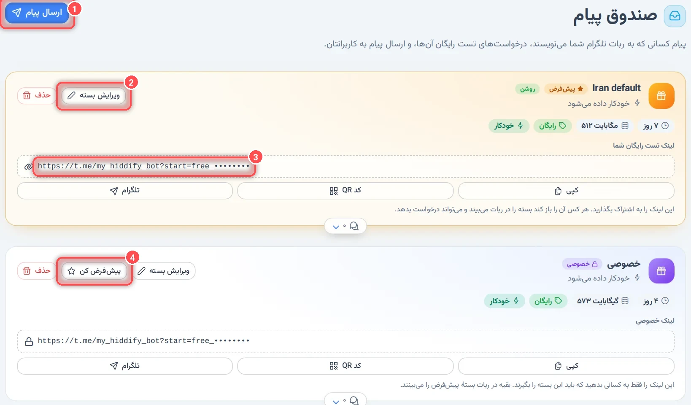
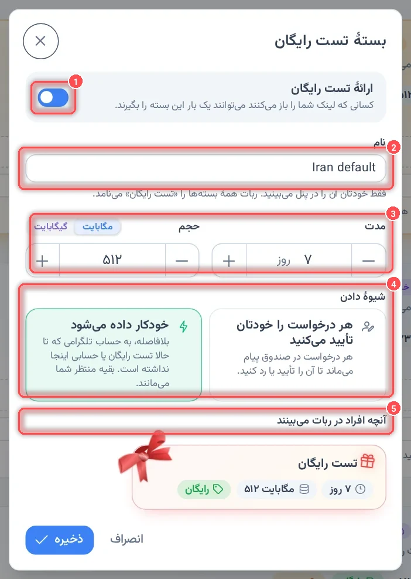
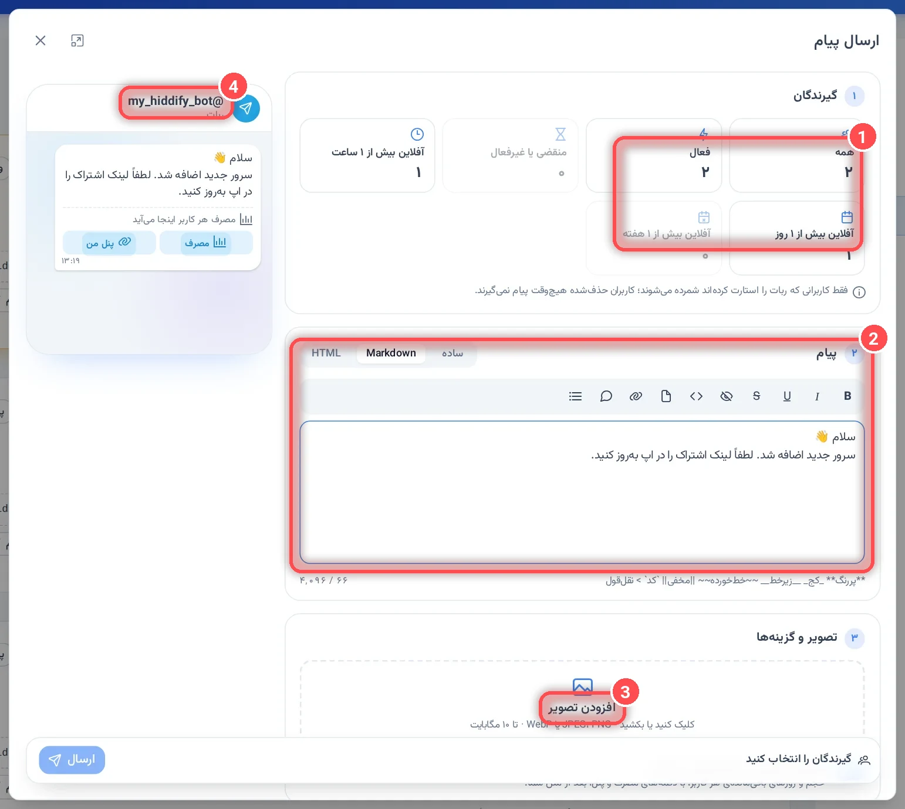

# صندوق پیام، تست رایگان و پیام به کاربران در هیدیفای‌منیجر

!!! info "نوشته‌شده برای هیدیفای‌منیجر نسخهٔ ۱۴.۵"
    تصویرها و مراحل این صفحه از هیدیفای‌منیجر نسخهٔ ۱۴.۵ هستند.

صفحهٔ **صندوق پیام** (Inbox) همهٔ کارهایی را که از طریق بات تلگرام شما انجام می‌شود یک‌جا جمع می‌کند:

- **تست رایگان**: لینکی که به اشتراک می‌گذارید؛ هر کس آن را در تلگرام باز کند می‌تواند یک حساب تست رایگان درخواست کند و آن را خودکار یا بعد از تأیید شما بگیرد.
- **گفتگوها**: پیام‌هایی که افراد به بات شما می‌فرستند و شما از داخل پنل می‌خوانید و جواب می‌دهید.
- **ارسال پیام**: پیامی از طرف شما به کاربرانتان در تلگرام.

!!! note "اول بات تلگرام را راه بیندازید"
    همهٔ این‌ها از طریق بات تلگرام پنل کار می‌کند. اگر بات تنظیم نشده باشد، صفحه اول همین را از شما می‌خواهد. ببینید: [آموزش تنظیم بات تلگرام](How-to-set-up-and-use-Telegram-bot-on-Hiddify-panel.md).

## بسته‌های تست رایگان

**بستهٔ تست رایگان** تعیین می‌کند تست رایگان چقدر است: چند روز و چه حجمی. می‌توانید چند بسته داشته باشید:

- بستهٔ **پیش‌فرض** همان است که همه در بات می‌بینند. **لینک تست رایگان شما** (۳) مال همین بسته است: آن را در کانال، گروه یا سایتتان بگذارید.
- بقیهٔ بسته‌ها **خصوصی** هستند: هر کدام **لینک خصوصی** خودش را دارد و فقط کسانی که این لینک را به آن‌ها بدهید می‌توانند آن را درخواست کنند. بقیه در بات همان بستهٔ پیش‌فرض را می‌بینند. با **پیش‌فرض کن** (۴) یک بستهٔ خصوصی پیش‌فرض می‌شود.

زیر هر لینک این دکمه‌ها هست: **کپی**، **کد QR** (برای نشان دادن یا چاپ لینک به شکل QR) و **تلگرام** (لینک را در تلگرام باز می‌کند).

### ساختن یا ویرایش بسته

روی یک بسته **ویرایش بسته** (۲) را بزنید، یا **افزودن بسته** را در پایین صفحه.

1. **ارائهٔ تست رایگان**: روشن یا خاموش. اگر خاموش باشد، به کسانی که لینک شما را باز کنند گفته می‌شود تست رایگان فعلاً در دسترس نیست (ولی هنوز می‌توانند به شما پیام بدهند).
2. **نام**: فقط شما آن را در پنل می‌بینید. در بات اسم همهٔ بسته‌ها *تست رایگان* است.
3. **مدت** به روز و **حجم** به مگابایت یا گیگابایت.
4. **شیوهٔ دادن**:
    - **هر درخواست را خودتان تأیید می‌کنید**: هر درخواست در صندوق پیام می‌ماند تا آن را تأیید یا رد کنید.
    - **خودکار داده می‌شود**: حساب بلافاصله ساخته می‌شود، ولی فقط برای حساب تلگرامی که تا حالا تست رایگان یا حسابی در پنل شما نداشته. بقیه منتظر تأیید شما می‌مانند. به این ترتیب یک نفر نمی‌تواند بارها تست رایگان بگیرد.
5. **آنچه افراد در ربات می‌بینند**: پیش‌نمایش بسته همان‌طور که در تلگرام دیده می‌شود.

**ذخیره** را بزنید.

هر نفر فقط **یک بار** می‌تواند تست رایگان بگیرد. اگر به **سقف تعداد کاربران** خود رسیده باشید (برای ادمین‌هایی که سقف دارند)، درخواست‌ها منتظر می‌مانند تا جا باز شود.

زیرادمین‌ها هم بسته‌ها و لینک‌های خودشان را دارند. زیرادمین می‌تواند **استفاده از بستهٔ ادمین بالادست** را هم انتخاب کند؛ در این صورت کنار بسته نوشته می‌شود که ادمین بالادست آن را تعیین کرده.

### در تلگرام چه اتفاقی می‌افتد

1. فرد لینک شما را باز می‌کند. بات بسته (روز و حجم) را با یک دکمه نشان می‌دهد.
2. در حالت **خودکار داده می‌شود**، دکمهٔ **دریافت تست رایگان** را می‌زند و حسابش چند ثانیه بعد در همان گفتگو می‌رسد.
3. در حالت تأیید، دکمهٔ **درخواست تست رایگان** را می‌زند. درخواست در صندوق پیام شما ظاهر می‌شود و بات هم آن را با دکمه‌های **تأیید**، **رد** و **پاسخ** در تلگرام برایتان می‌فرستد، پس از هر دو جا می‌توانید جواب بدهید. وقتی تأیید کنید، حساب در تلگرام برای فرد فرستاده می‌شود. اگر رد کنید، به او خبر داده می‌شود و هنوز می‌تواند به شما پیام بدهد.

پیام‌های تازهٔ افراد هم با دکمهٔ **پاسخ** در تلگرام به دستتان می‌رسد.

## گفتگوها

وقتی کسی لینک تست رایگان شما را باز کند یا به بات پیام بدهد، یک گفتگو در صفحهٔ صندوق پیام ظاهر می‌شود. با باز کردن آن می‌توانید:

- پیام‌ها را بخوانید و **جواب بدهید**: جواب شما در تلگرام به او می‌رسد؛
- برای درخواست تست رایگان، **تأیید** یا **رد** کنید. درخواست نشان می‌دهد که آیا این **اولین بار** است یا فرد *قبلاً تست رایگان گرفته یا حساب دارد*؛
- به کسی که درخواست نکرده **تست رایگان بدهید**؛
- **گفتگو را حذف کنید** (حساب فرد باقی می‌ماند).

فهرست را می‌شود با **خوانده‌نشده** و **درخواست‌ها** فیلتر کرد.

## ارسال پیام به کاربران

**ارسال پیام** (۱ در تصویر اول) را بزنید.

1. **گیرندگان**: **همه**، **فعال**، **منقضی یا غیرفعال**، یا کاربرانی که بیش از یک ساعت، یک روز یا یک هفته **آفلاین** بوده‌اند. عدد هر گزینه تعداد کسانی است که پیام را می‌گیرند. فقط کاربرانی شمرده می‌شوند که **بات شما را استارت کرده‌اند**، چون تلگرام فقط به آن‌ها اجازه می‌دهد بات پیام بدهد.
2. **پیام**: متن را به صورت **ساده**، **Markdown** یا **HTML** بنویسید. نوار ابزار، متن پررنگ، کج، لینک، کد، نقل‌قول، اسپویلر و فهرست اضافه می‌کند. حداکثر ۴۰۹۶ نویسه.
3. **تصویر و گزینه‌ها**: یک تصویر اضافه کنید (JPEG، PNG یا WebP، تا ۱۰ مگابایت). **افزودن مصرف و دکمه‌های هر کاربر** بعد از متن شما حجم و روزهای باقی‌ماندهٔ هر کاربر را با دکمه‌هایی برای دیدن مصرف و صفحهٔ کاربری‌اش اضافه می‌کند.
4. **پیش‌نمایش** پیام را همان‌طور که کاربران در تلگرام می‌بینند نشان می‌دهد.

**ارسال** را بزنید و تأیید کنید. پیام فرستاده‌شده پس گرفته نمی‌شود. یک نوار پیشرفت نشان می‌دهد پیام به چند نفر رسید و چرا به بعضی نرسید (مثلاً کاربری که بات را بلاک کرده).

!!! tip "به چند کاربر یا ادمین خاص"
    در صفحهٔ **کاربران** چند کاربر را انتخاب کنید و پیام را فقط برای آن‌ها بفرستید. در صفحهٔ **ادمین‌ها** هم می‌شود همین کار را برای ادمین‌ها کرد (فقط ادمین‌هایی که شناسهٔ تلگرام دارند و بات را استارت کرده‌اند پیام را می‌گیرند).

## مقاله‌های مرتبط

- [آشنایی کامل با پنل و تنظیمات آن](/fa/manager/configuration-and-advanced-settings/How-to-configure-Hiddify-panel-properly/)
- [همهٔ تنظیمات پنل، یکی‌یکی](/fa/manager/configuration-and-advanced-settings/Settings-reference/)
- [منوی هیدیفای‌منیجر در SSH](/fa/manager/configuration-and-advanced-settings/How-to-connect-and-troubleshoot-via-SSH/)
- [انتقال کاربران از پنل X-UI](/fa/manager/configuration-and-advanced-settings/how-to-import-xui-to-hiddifymanager/)

