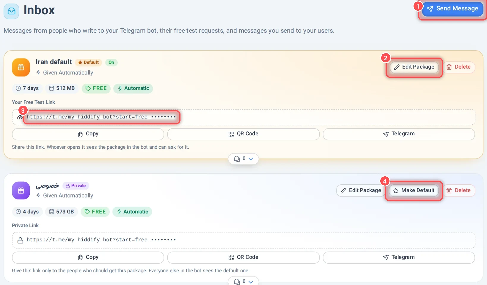
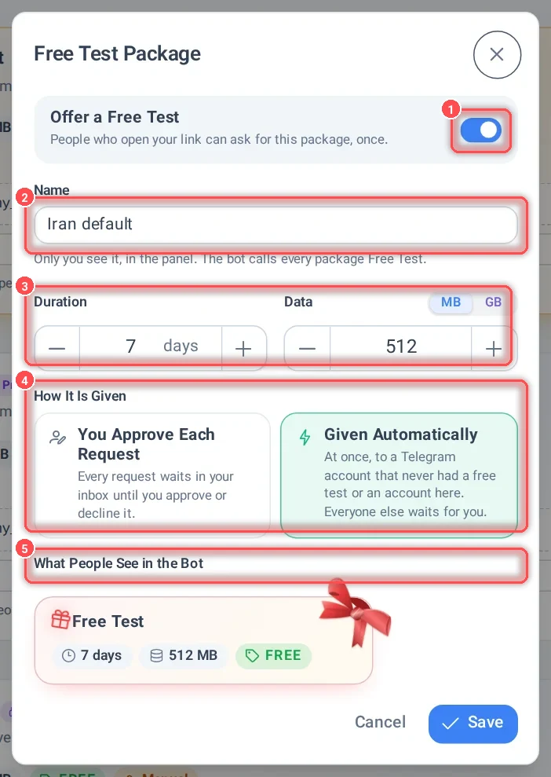
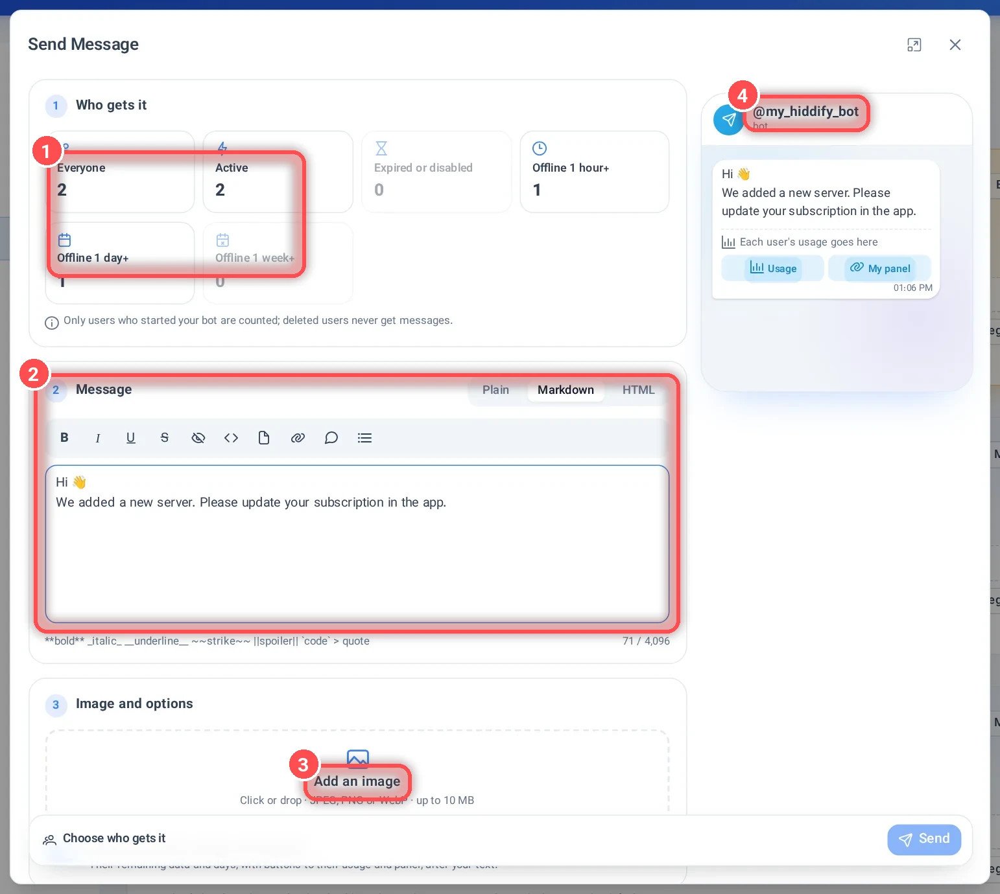

# Inbox, free test and messages to users on Hiddify Manager

!!! info "Written for Hiddify Manager v14.5"
    The pictures and steps on this page are from Hiddify Manager v14.5.

The **Inbox** page brings together everything that goes through your Telegram bot:

- **Free test**: a link you share; whoever opens it in Telegram can ask for a free test account, and gets it automatically or after you approve it.
- **Conversations**: messages people send to your bot, which you can read and answer from the panel.
- **Send Message**: a message from you to your users in Telegram.

!!! note "You need the Telegram bot first"
    All of this works through the panel's Telegram bot. If it is not set up, the page asks you to do it first. See [how to set up the Telegram bot](How-to-set-up-and-use-Telegram-bot-on-Hiddify-panel.md).

## Free test packages

A **free test package** says how much a free test gives: how many days and how much data. You can have several packages:

- The **Default** package is the one everyone in the bot sees. It has **Your Free Test Link** (3): share it in your channel, group or website.
- Every other package is **Private**: it has its own **Private Link**, and only the people you give that link to can ask for it. Everyone else in the bot still sees the default package. **Make Default** (4) makes a private package the default.

Under each link: **Copy**, **QR Code** (to show or print the link as a QR code) and **Telegram** (opens the link in Telegram).

### Make or edit a package

Click **Edit Package** (2) on a package, or **Add Package** at the bottom of the page.

1. **Offer a Free Test**: on or off. When it is off, people who open your link are told the free test is not available (they can still write to you).
2. **Name**: only you see it, in the panel. In the bot, every package is called *Free Test*.
3. **Duration** in days and **Data** in MB or GB.
4. **How It Is Given**:
    - **You Approve Each Request**: every request waits in your Inbox until you approve or decline it.
    - **Given Automatically**: the account is made at once, but only for a Telegram account that never had a free test or an account on your panel. Everyone else waits for your approval. This stops the same person from taking free tests again and again.
5. **What People See in the Bot**: a preview of the package as it appears in Telegram.

Click **Save**.

A person can get the free test **once**. If you have reached your **user limit** (for admins with a limit), requests wait until there is room.

Sub-admins have their own packages and links. A sub-admin can also choose **Use My Parent's Package**; then the package says *set by* the parent admin.

### What happens in Telegram

1. The person opens your link. The bot shows the package (days and data) and a button.
2. With **Given Automatically**, they tap **Get my free test** and their account arrives in the chat in a few seconds.
3. With approval, they tap **Request the free test**. The request appears in your Inbox, and the bot also sends it to you in Telegram with **Approve**, **Decline** and **Reply** buttons, so you can answer from either place. When you approve it, the account is sent to them in Telegram. If you decline it, they are told, and they can still write to you.

New messages from people also reach you in Telegram, with a **Reply** button.

## Conversations

When someone opens your free test link or writes to your bot, a conversation appears on the Inbox page. Open it to:

- read the messages and **answer**: your answer goes to them in Telegram;
- for a free test request: **Approve** or **Decline**. The request shows whether it is the person's **first time** or whether they *already had a free test, or have an account*;
- **Give a Free Test** to someone who did not ask for one;
- **Delete Conversation** (the person's account stays).

You can filter the list by **Unread** and **Requests**.

## Send a message to your users

Click **Send Message** (1 in the first picture).

1. **Who gets it**: **Everyone**, **Active**, **Expired or disabled**, or the users who have been **offline** for more than an hour, a day or a week. The number on each choice is how many users will get it. Only users who **started your bot** are counted, because Telegram lets a bot write only to them.
2. **Message**: write it as **Plain** text, **Markdown** or **HTML**. The toolbar adds bold, italic, links, code, quotes, spoilers and lists. Up to 4096 characters.
3. **Image and options**: add one image (JPEG, PNG or WebP, up to 10 MB). **Add each user's usage and buttons** adds each user's remaining data and days after your text, with buttons to their usage and their page.
4. The **preview** shows the message as users will see it in Telegram.

Click **Send** and confirm. The message cannot be taken back. A progress bar shows how many were delivered and why some were not (for example, a user who blocked the bot).

!!! tip "To a few users or admins"
    On the **Users** page, select some users and send the message only to them. On the **Admins** page you can do the same for admins (only admins with a Telegram ID who started your bot get it).

## Related articles

- [Every part and setting of the panel](/manager/configuration-and-advanced-settings/How-to-configure-Hiddify-panel-properly/)
- [All panel settings, one by one](/manager/configuration-and-advanced-settings/Settings-reference/)
- [The Hiddify Manager menu over SSH](/manager/configuration-and-advanced-settings/How-to-connect-and-troubleshoot-via-SSH/)
- [Import users from X-UI](/manager/configuration-and-advanced-settings/how-to-import-xui-to-hiddifymanager/)

