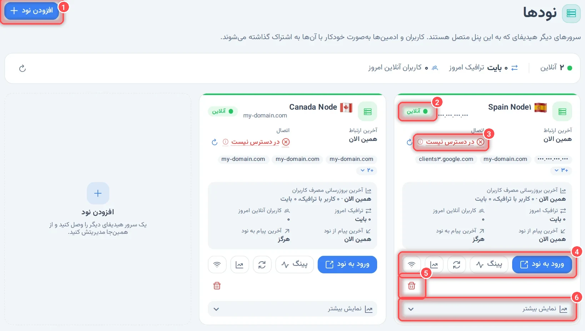
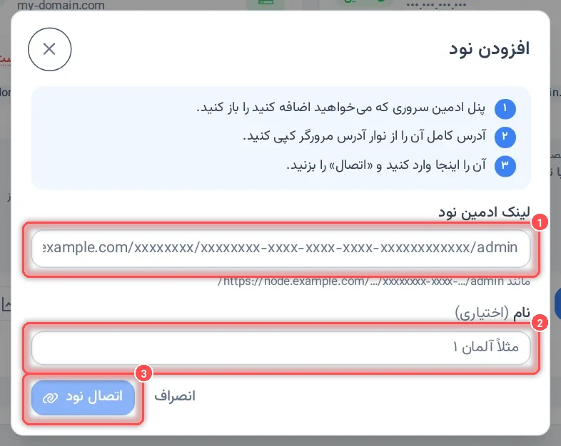
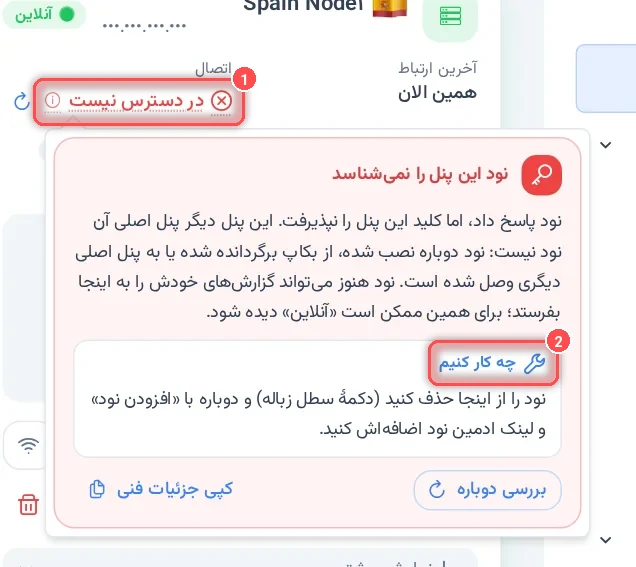

# چندسروره کردن هیدیفای‌منیجر با نودها

!!! info "نوشته‌شده برای هیدیفای‌منیجر نسخهٔ ۱۴.۵"
    تصویرها و مراحل این صفحه از هیدیفای‌منیجر نسخهٔ ۱۴.۵ هستند.

با **نودها** می‌توانید چند سرور هیدیفای را مثل یک سرویس واحد اداره کنید. یکی از سرورها **پنل مرکزی** است و بقیه **نود**هایی هستند که به آن وصل می‌شوند. کاربران و ادمین‌ها را فقط یک بار، روی پنل مرکزی، تعریف می‌کنید و روی همهٔ نودها کار می‌کنند. ترافیکی هم که کاربران روی نودها مصرف می‌کنند روی پنل مرکزی جمع زده می‌شود.

مثلاً می‌توانید یک سرور اصلی در آلمان و دو نود در فنلاند و هلند داشته باشید. هر کاربر یک لینک اشتراک می‌گیرد که کانفیگ‌های هر سه سرور در آن هست.

## چه چیزی مشترک است و چه چیزی مال هر نود

| | روی پنل مرکزی | روی هر نود |
|---|---|---|
| کاربران و ادمین‌ها | بله: اینجا اضافه، ویرایش و حذف می‌شوند و خودکار به همهٔ نودها کپی می‌شوند | نه: نود فقط آن‌ها را نشان می‌دهد |
| ترافیک کاربران | ترافیک همهٔ نودها اینجا جمع می‌شود | هر نود هر چند دقیقه ترافیک کاربرانش را می‌فرستد |
| داشبورد | اینجا | نه |
| خروجی‌ها (وارپ، Socks، Tor و…) | اینجا، و به نودها کپی می‌شوند | نه |
| دامنه‌ها، پروتکل‌ها و تنظیمات سرور | هر سرور مال خودش را دارد | بله |

روی یک نود، پنل با صفحهٔ کوتاه **نود** باز می‌شود. این صفحه می‌گوید کاربران، ادمین‌ها و داشبورد در پنل مرکزی مدیریت می‌شوند و دکمهٔ **باز کردن داشبورد مرکزی** دارد. روی نود فقط دامنه‌ها، پروکسی‌ها و تنظیمات همان سرور را مدیریت می‌کنید.

## پیش از شروع

- هیدیفای‌منیجر را روی همهٔ سرورها نصب کنید، همه با **یک نسخه**. اگر نسخهٔ نودی فرق داشته باشد، صفحهٔ نودها هشدار می‌دهد.
- نود باید یک **دامنهٔ اصلی با گواهی معتبر** داشته باشد (صفحهٔ دامنه‌ها). نودی که فقط آی‌پی دارد اضافه نمی‌شود.
- **پنل مرکزی را با دامنهٔ خودش باز کنید**، نه با آی‌پی. نود با همین آدرسی که باز کرده‌اید به پنل مرکزی وصل می‌شود.
- دو سرور باید از پورت ۴۴۳ به هم دسترسی داشته باشند. فایروال یا فیلترینگ بین آن‌ها ارتباط را قطع می‌کند.

## افزودن نود

1. پنل ادمین سروری را که می‌خواهید اضافه کنید باز کنید و **آدرس کامل** آن را از نوار آدرس مرورگر کپی کنید. شبیه این است: `https://node.example.com/…/xxxxxxxx-xxxx-…/admin/`
2. در پنل مرکزی به صفحهٔ **نودها** بروید و **افزودن نود** (۱) را بزنید.
3. آدرس را در **لینک ادمین نود** بچسبانید (۱ در تصویر بعدی). اگر خواستید یک **نام** هم بدهید، مثلاً `آلمان ۱` (۲). اگر نام ندهید، نام خود نود استفاده می‌شود.
4. **اتصال نود** (۳) را بزنید و صبر کنید. وصل شدن ممکن است تا یک دقیقه طول بکشد.

اگر کار کند، نود در صفحهٔ نودها نشان داده می‌شود و کاربران و ادمین‌های پنل مرکزی به آن کپی می‌شوند. اگر نشود، پنجره می‌گوید مشکل از کدام طرف است (پنل مرکزی، نود یا ارتباط بین آن‌ها) و در بخش **چه کار کنیم** راه‌حل را می‌گوید. چند نمونه:

- *نود دامنهٔ اصلی با گواهی معتبر ندارد*: روی نود یک دامنه اضافه کنید و صبر کنید تا گواهی‌اش صادر شود.
- *پنل نود خیلی قدیمی است*: نود را به‌روز کنید (روی نود: **اقدامات ← به‌روزرسانی هیدیفای**).
- *نود آدرس این پنل را نمی‌داند*: پنل مرکزی را با دامنه‌اش باز کنید، نه آی‌پی، و دوباره امتحان کنید.
- *این لینک خود همین پنل است*: لینک پنل مرکزی را چسبانده‌اید. لینک نود را بچسبانید.

اگر باز هم نشد، **کپی جزئیات فنی** را بزنید و آن را برای پشتیبانی بفرستید.

## کارت نود

هر نود در صفحهٔ نودها یک کارت دارد (تصویر بالا):

- **وضعیت** (۲): **آنلاین** یعنی نود به‌تازگی گزارش فرستاده. **با تأخیر** یعنی آخرین گزارشش قدیمی است و **آفلاین** یعنی دیگر گزارش نمی‌فرستد. **هنوز متصل نشده** یعنی هیچ‌وقت گزارش نداده.
- **اتصال** (۳): اینکه پنل مرکزی همین الان می‌تواند به نود برسد یا نه. **در دسترس** یعنی مشکلی نیست. **در دسترس نیست** با علامت قرمز نشان داده می‌شود؛ روی آن بزنید تا دلیل و راه‌حل را ببینید (پایین‌تر توضیح داده شده).
- آدرس‌های نود، آخرین باری که ترافیک کاربرانش را فرستاده، ترافیک و کاربران آنلاین امروز، و زمان آخرین پیام در هر طرف.
- دکمه‌ها (۴):
    - **ورود به نود**: پنل ادمین نود را در یک تب جدید باز می‌کند.
    - **پینگ**: از پنل مرکزی به نود پینگ می‌گیرد تا وقتی پنجره را ببندید (اگر ICMP ممکن نباشد، از TCP استفاده می‌کند).
    - **همگام‌سازی**: از نود می‌خواهد همین حالا همگام شود (کاربران، ادمین‌ها و دامنه‌هایش)، به جای اینکه منتظر همگام‌سازی خودکار بعدی بماند.
    - **جزئیات همگام‌سازی**: نشان می‌دهد نود چه چیزهایی دارد و هر نوع داده آخرین بار کی از پنل مرکزی رسیده. فقط برای دیدن است و برای پیدا کردن مشکل به کار می‌آید.
    - **بررسی اتصال**: دوباره بررسی می‌کند که نود در دسترس است یا نه.
- **حذف** (۵): نود و دامنه‌هایش را از پنل مرکزی حذف می‌کند و نود دوباره یک پنل مستقل می‌شود. اگر نود در آن لحظه در دسترس نباشد، هنوز پنل مرکزی را والد خودش می‌داند: در تنظیمات نود، **پنل مرکزی (مالتی سرور)** را خالی کنید، وگرنه مدام سعی می‌کند همگام شود.
- **نمایش بیشتر** (۶): نمودارهای زندهٔ شبکه، CPU و RAM نود.

برای تغییر نام نود روی نامش بزنید. روی خود نود، این نام همان تنظیم **نام نود** است (تنظیمات ← تنظیمات ادمین).

## وقتی نود «در دسترس نیست»

روی **در دسترس نیست** در کارت نود بزنید. یک کادر، دلیل را به زبان ساده توضیح می‌دهد و می‌گوید چه کار کنید.

رایج‌ترین دلیل‌ها:

| پیام | چه کار کنیم |
|---|---|
| نود به‌موقع جواب نداد | ببینید سرور نود روشن است و پنلش با **ورود به نود** باز می‌شود. مطمئن شوید فایروال نود اجازهٔ ورود سرور مرکزی را از پورت ۴۴۳ می‌دهد. |
| نود اتصال را رد کرد | سرویس‌های نود را راه‌اندازی مجدد کنید (صفحهٔ **اقدامات** نود) و ببینید پورت ۴۴۳ باز است. |
| اتصال امن به نود ناموفق بود | گواهی دامنهٔ نود منقضی شده یا هنوز صادر نشده: آن را در صفحهٔ **دامنه‌ها**ی نود بررسی کنید. |
| دامنهٔ نود پیدا نمی‌شود | رکورد DNS دامنه دیگر به نود اشاره نمی‌کند. رکورد را درست کنید، یا نود را حذف کنید و با لینک جدیدش دوباره اضافه کنید. |
| نود این پنل را نمی‌شناسد | نود دوباره نصب شده، از پشتیبان بازیابی شده یا به پنل دیگری وصل شده. آن را اینجا حذف کنید (دکمهٔ سطل زباله) و دوباره اضافه کنید. |
| CDN به نود نرسید | آدرس نود از یک CDN عبور می‌کند و پنل نود متوقف شده یا در حال راه‌اندازی مجدد است. یک دقیقه صبر کنید؛ اگر ماند، سرویس‌های نود را راه‌اندازی مجدد کنید. |

!!! tip "آنلاین ولی در دسترس نیست"
    یک نود می‌تواند هم‌زمان **آنلاین** و **در دسترس نیست** باشد. یعنی نود هنوز گزارش‌هایش را به پنل مرکزی می‌فرستد، ولی پنل مرکزی نمی‌تواند به نود پیام بدهد. در این حالت کاربران کار می‌کنند، ولی تغییراتی که روی پنل مرکزی می‌دهید تا وقتی ارتباط درست نشود به آن نود نمی‌رسد.

## چند نکته

- همهٔ سرورها را روی **یک نسخه** نگه دارید و پنل مرکزی و نودها را با هم به‌روز کنید.
- هر نود دامنه‌های خودش را لازم دارد (صفحهٔ دامنه‌های نود). لینک اشتراک کاربران کانفیگ‌های همهٔ سرورها را دارد.
- از پنل مرکزی (که کاربران و ادمین‌ها را دارد) و از هر نود (برای دامنه‌ها و تنظیمات خودش) پشتیبان بگیرید. ببینید: [پشتیبان‌گیری و بازیابی](How-to-backup-and-restore-panel-on-Hiddify.md).

## مقاله‌های مرتبط

- [خروجی‌ها (WARP، Socks، Tor و …)](/fa/manager/configuration-and-advanced-settings/How-to-use-Outbounds-on-HiddifyManager/)
- [آشنایی کامل با پنل و تنظیمات آن](/fa/manager/configuration-and-advanced-settings/How-to-configure-Hiddify-panel-properly/)
- [همهٔ تنظیمات پنل، یکی‌یکی](/fa/manager/configuration-and-advanced-settings/Settings-reference/)
- [منوی هیدیفای‌منیجر در SSH](/fa/manager/configuration-and-advanced-settings/How-to-connect-and-troubleshoot-via-SSH/)

