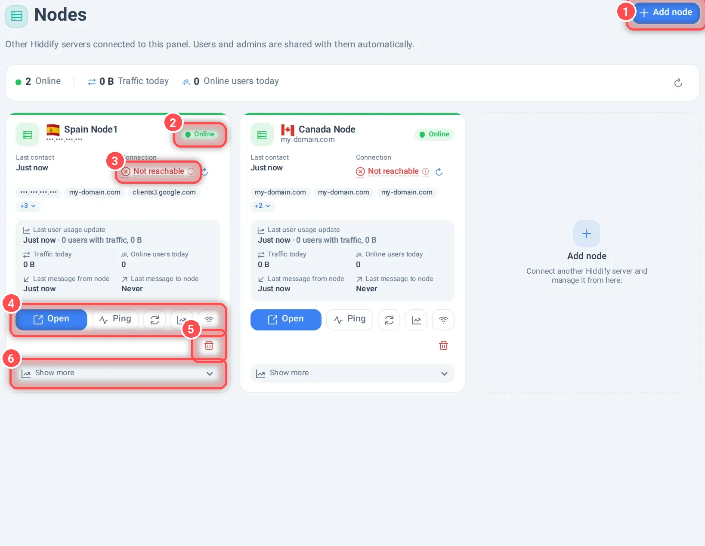
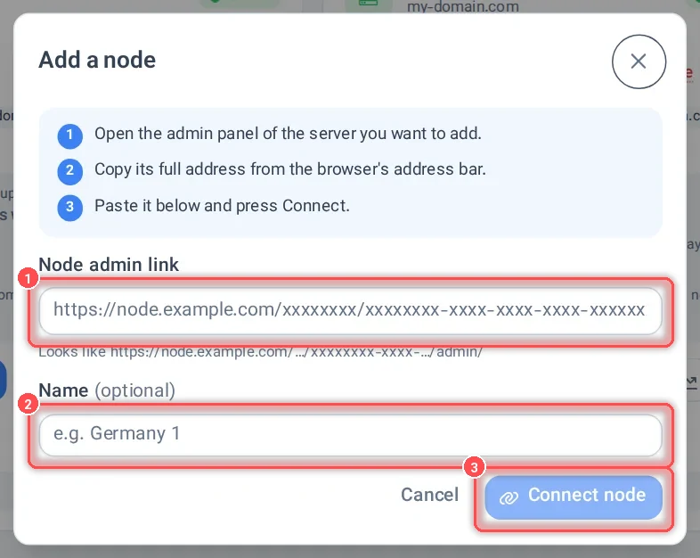
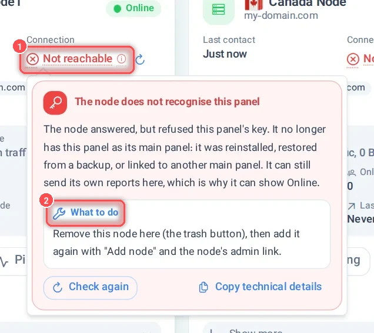

# Multi-server with nodes on Hiddify Manager

!!! info "Written for Hiddify Manager v14.5"
    The pictures and steps on this page are from Hiddify Manager v14.5.

With **nodes** you run several Hiddify servers as one service. One server is the **main panel** (the parent). The other servers are **nodes** connected to it. You add users and admins only once, on the main panel, and they work on every node. The traffic your users use on the nodes is added up on the main panel.

For example, you can have a main server in Germany and nodes in Finland and the Netherlands. A user gets one subscription link, and it has configs for all three servers.

## What is shared, and what stays on each node

| | Managed on the main panel | Managed on each node |
|---|---|---|
| Users and admins | Yes: added, edited and deleted here, and copied to every node automatically | No: the node only shows them |
| Users' traffic | Added up here from all nodes | Each node sends its users' traffic every few minutes |
| Dashboard | Here | No |
| Outbounds (WARP, Socks, Tor…) | Here, copied to the nodes | No |
| Domains, protocols, server settings | Each server has its own | Yes |

On a node, the panel opens to a short **Node** page. It says that users, admins and the dashboard are managed on the parent panel, and it has an **Open parent dashboard** button. On a node you manage only that server's domains, proxies and server settings.

## Before you start

- Install Hiddify Manager on every server, all with **the same version**. The Nodes page warns you when a node runs another version.
- The node needs a **main domain with a valid certificate** (Domains page). A node with only an IP cannot be added.
- Open the **main panel through its own domain**, not through an IP. The node uses the address you opened to reach the main panel.
- The two servers must reach each other on port 443. A firewall or filtering between them breaks the link.

## Add a node

1. On the server you want to add, open its admin panel. Copy the **full address** from the browser's address bar. It looks like `https://node.example.com/…/xxxxxxxx-xxxx-…/admin/`.
2. On the main panel, open **Nodes** and click **Add node** (1).
3. Paste the address into **Node admin link** (1 in the next picture). Give it a **Name** if you like, for example `Germany 1` (2). Without a name, the node's own name is used.
4. Click **Connect node** (3) and wait. Connecting can take up to a minute.

When it works, the node appears on the Nodes page, and the main panel's users and admins are copied to it. When it fails, the window says which side has the problem (the main panel, the node, or the connection between them) and **What to do**. For example:

- *The node has no main domain with a valid certificate*: add a domain on the node and wait for its certificate.
- *The node's panel is too old*: update the node (on the node: **Actions → Update Hiddify**).
- *The node does not know this panel's address*: open the main panel through its domain, not its IP, and try again.
- *This is the link of this same panel*: you pasted the main panel's own link. Paste the node's link.

If it still fails, click **Copy technical details** and send them to support.

## The node card

Each node has a card on the Nodes page (picture above):

- **Status** (2): **Online** means the node sent a report recently. **Late** means its last report is old, and **Offline** means it stopped reporting. **Not connected yet** means it never reported.
- **Connection** (3): whether the main panel can reach the node right now. **Reachable** is good. **Not reachable** shows a red mark; click it to see why and what to do (see below).
- The node's addresses, the last time it sent its users' traffic, today's traffic and online users, and when the last message went each way.
- The buttons (4):
    - **Open**: opens the node's admin panel in a new tab.
    - **Ping**: pings the node from the main panel until you close the window (when ICMP is not possible, it uses TCP).
    - **Sync now**: asks the node to sync now (users, admins and its domains), instead of waiting for the next automatic sync.
    - **Sync details**: what the node holds and when each kind of data last came from the main panel. It is read only, for finding problems.
    - **Check connection**: checks again whether the node is reachable.
- **Remove** (5): removes the node and its domains from the main panel. The node becomes a standalone panel again. If the node cannot be reached at that moment, it still has the main panel as its parent: clear **Parent Panel (Multi Server)** in the node's settings, or it keeps trying to sync.
- **Show more** (6): live charts of the node's network, CPU and RAM.

To rename a node, click its name. On the node itself, the name is the **Node name** setting (Settings → Admin Settings).

## When a node is "Not reachable"

Click **Not reachable** on the node's card. A box explains the reason in plain words and says what to do.

The most common reasons:

| What it says | What to do |
|---|---|
| The node did not answer in time | Check that the node's server is on and its panel opens with **Open**. Make sure its firewall lets the main server in on port 443. |
| The node refused the connection | Restart the services on the node (its **Actions** page) and check that port 443 is open. |
| Secure connection to the node failed | The node's certificate is expired or not issued yet: check it on the node's **Domains** page. |
| The node's domain cannot be found | The domain's DNS record does not point to the node any more. Fix the record, or remove the node and add it again with its new link. |
| The node does not recognise this panel | The node was reinstalled, restored from a backup or linked to another panel. Remove it here (the trash button) and add it again. |
| The CDN could not reach the node | The node's address goes through a CDN, and the node's panel is stopped or restarting. Wait a minute; if it stays, restart the node's services. |

!!! tip "Online but Not reachable"
    A node can be **Online** and **Not reachable** at the same time. The node can still send its reports to the main panel, but the main panel cannot call the node. Users then work, but changes you make on the main panel do not reach that node until you fix the connection.

## Good to know

- Keep all servers on the **same version**. Update the main panel and the nodes together.
- Each node needs its own domains (Domains page on the node). The users' subscription link has the configs of every server.
- Back up the main panel (it has the users and admins) and each node (for its own domains and settings). See [backup and restore](How-to-backup-and-restore-panel-on-Hiddify.md).

## Related articles

- [Outbounds (WARP, Socks, Tor…)](/manager/configuration-and-advanced-settings/How-to-use-Outbounds-on-HiddifyManager/)
- [Every part and setting of the panel](/manager/configuration-and-advanced-settings/How-to-configure-Hiddify-panel-properly/)
- [All panel settings, one by one](/manager/configuration-and-advanced-settings/Settings-reference/)
- [The Hiddify Manager menu over SSH](/manager/configuration-and-advanced-settings/How-to-connect-and-troubleshoot-via-SSH/)

