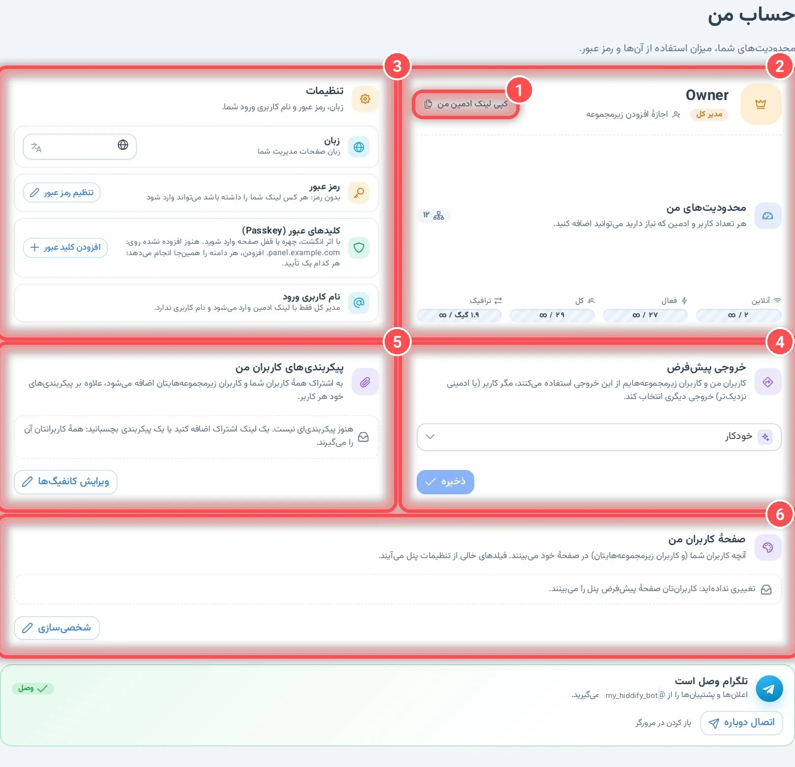
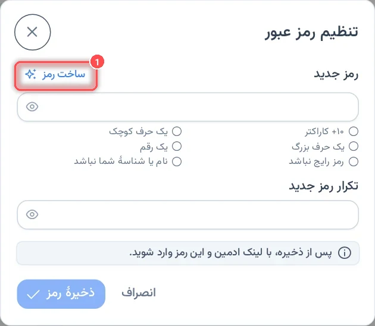
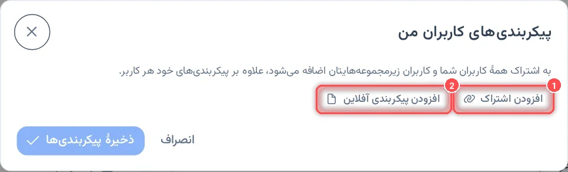
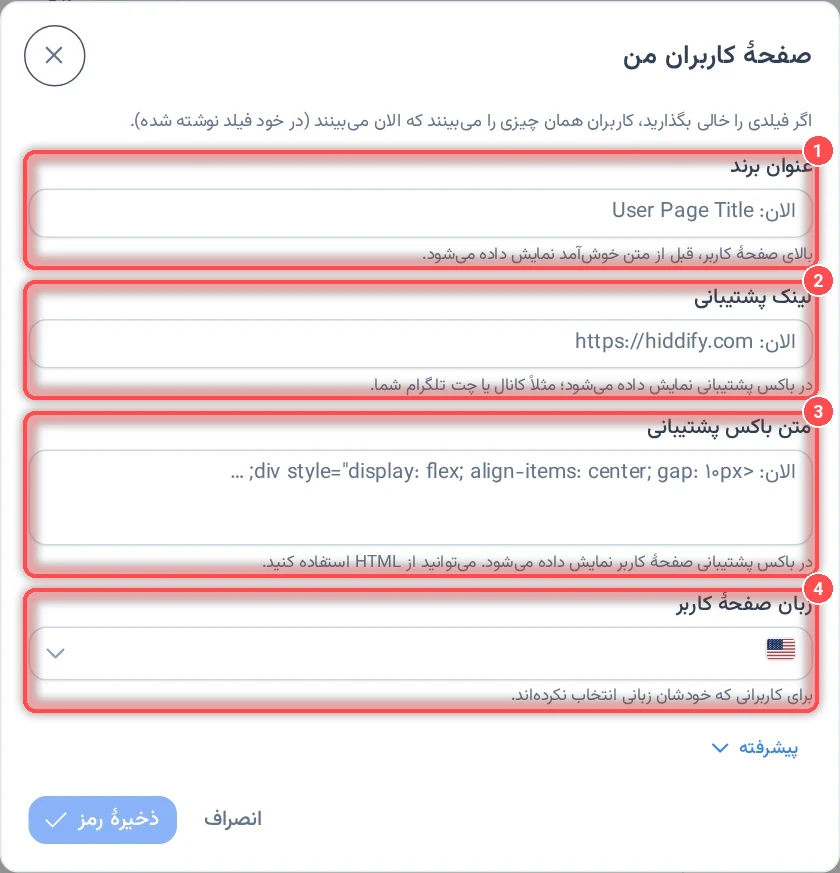

# حساب من و امنیت ادمین در هیدیفای‌منیجر

!!! info "نوشته‌شده برای هیدیفای‌منیجر نسخهٔ ۱۴.۵"
    نام منوها و گزینه‌های این صفحه مربوط به نسخهٔ ۱۴.۵ است. رمز عبور، کلید عبور (Passkey) و نام کاربری ورود برای ادمین‌ها در نسخه‌های قدیمی‌تر وجود ندارد.

هر ادمین پنل (خود شما، و ادمین‌ها و نماینده‌هایی که اضافه می‌کنید) یک صفحهٔ **حساب من** دارد: نقش و محدودیت‌های شما، روش ورودتان، و چند تنظیم که روی همهٔ کاربران شما اعمال می‌شود. برای باز کردن آن، روی آیکون آدمک بالای پنل بزنید و **حساب من** را انتخاب کنید.

1. **کپی لینک ادمین من:** لینک شخصی شما برای ورود به پنل. هر کسی این لینک را داشته باشد می‌تواند به‌جای شما وارد شود، مگر اینکه رمز عبور بگذارید (پایین‌تر توضیح داده شده). آن را به کسی ندهید. بیشتر بخوانید: [لینک ادمین](../domain-worker-cdn-and-tunneling/The-correct-format-of-admin-link.md).
2. **نقش و محدودیت‌های شما.** کنار نامتان نقشتان (**مدیر کل**، **ادمین** یا **نماینده**) و اینکه اجازهٔ افزودن زیرمجموعه دارید یا نه نوشته شده است. **محدودیت‌های من** تعداد کاربران آنلاین، فعال و کل، و ترافیک مصرف‌شده را در کنار سقفی که ادمین بالادستتان داده نشان می‌دهد. کاربران خودتان و کاربران همهٔ زیرمجموعه‌هایتان در این عددها حساب می‌شوند. مدیر کل محدودیتی ندارد.
3. **تنظیمات:** زبان، رمز عبور، کلیدهای عبور و نام کاربری ورود ([پایین‌تر](#sign-in-and-security)).
4. **خروجی پیش‌فرض:** ترافیک کاربران شما از چه راهی از سرور خارج شود (مثلاً از وارپ یا مستقیم)، مگر اینکه یک کاربر یا ادمینی نزدیک‌تر به او، راه دیگری انتخاب کند. خروجی‌ها در صفحهٔ **خروجی‌ها** ساخته می‌شوند. اگر ادمین بالادستتان آن را تعیین کرده باشد، آن را می‌بینید ولی نمی‌توانید تغییرش دهید. بعد از تغییر، تنظیمات را اعمال کنید.
5. **پیکربندی‌های کاربران من:** کانفیگ‌های اضافه‌ای که به لینک اشتراک همهٔ کاربران شما و کاربران زیرمجموعه‌هایتان اضافه می‌شود ([پایین‌تر](#configs-for-my-users)).
6. **صفحهٔ کاربران من:** برند و اطلاعات پشتیبانی خودتان در صفحهٔ کاربرانتان ([پایین‌تر](#my-users-page)).

در پایین صفحه، یک کارت نشان می‌دهد که تلگرام شما به بات پنل وصل است یا نه. با وصل کردن آن، اعلان‌ها و پشتیبان‌ها را دریافت می‌کنید و می‌توانید از داخل تلگرام کاربران را مدیریت کنید ([بات تلگرام](How-to-set-up-and-use-Telegram-bot-on-Hiddify-panel.md)).

## ورود و امنیت { #sign-in-and-security }

### رمز عبور

در حالت پیش‌فرض ادمین رمز عبور ندارد و خود لینک ادمین برای ورود کافی است. با **تنظیم رمز عبور** کاری کنید که لو رفتن لینک برای ورود کافی نباشد.

1. **ساخت رمز** یک رمز قوی می‌سازد و آن را کپی می‌کند.

رمز باید دست‌کم ۱۰ کاراکتر داشته باشد، یک حرف کوچک، یک حرف بزرگ و یک رقم در آن باشد، و رمز رایج یا نام و شناسهٔ شما نباشد. با رعایت هر شرط، علامت کنار آن در فهرست زیر کادر سبز می‌شود. بعد از ذخیره، با لینک ادمین **و** این رمز وارد می‌شوید. اگر رمز را فراموش کردید، ادمینی که شما را اضافه کرده می‌تواند آن را ریست کند.

### کلیدهای عبور (Passkey)

با کلید عبور می‌توانید با اثر انگشت، تشخیص چهره یا قفل صفحهٔ گوشی یا کامپیوترتان وارد شوید؛ نه چیزی برای تایپ کردن هست و نه چیزی برای دزدیده شدن. روی **افزودن کلید عبور** بزنید و روی دستگاهتان تأیید کنید.

- کلید عبور فقط روی **دامنه** کار می‌کند، نه روی آدرس IP. اول پنل را با یکی از دامنه‌هایش باز کنید.
- هر دامنهٔ پنل کلید عبور جداگانه می‌خواهد. **افزودن کلید عبور** دامنه‌ها را یکی‌یکی جلو می‌برد و برای هرکدام یک بار تأیید می‌کنید.
- برای حذف یک دستگاه، روی **حذف** کنار آن بزنید.

### نام کاربری ورود

ادمین‌ها و نماینده‌ها (نه مدیر کل) می‌توانند یک **نام کاربری ورود** بگذارند. در این صورت با همین نام کاربری و رمزشان وارد می‌شوند و لینک‌هایی که به دیگران می‌دهند شناسه‌ای ندارد. برای این کار اول باید رمز قوی گذاشته باشند. مدیر کل فقط با لینک ادمین وارد می‌شود.

## پیکربندی‌های کاربران من { #configs-for-my-users }

با این بخش می‌توانید یک سرور اضافه به همهٔ کاربرانتان بدهید؛ مثلاً لینک اشتراک یک پنل دیگر یا کانفیگی که خودتان ساخته‌اید.

1. **افزودن اشتراک:** یک لینک (`https://…`) که برای هر کاربر دریافت می‌شود.
2. **افزودن پیکربندی آفلاین:** کانفیگی که خودتان می‌چسبانید (یک لینک `vless://…`، یا یک کانفیگ JSON یا YAML).

برای هرکدام انتخاب کنید برای کدام فرمت اپ است، یا **خودکار (همهٔ قالب‌ها)**. این کانفیگ‌ها به کانفیگ‌های خود هر کاربر اضافه می‌شوند. کانفیگ‌هایی که ادمین‌های بالادست شما تعیین کرده‌اند هم اضافه می‌شوند (تعدادشان در صفحه نوشته می‌شود). همین کار را در صفحهٔ **ادمین‌ها** برای یک ادمین، و در تنظیمات هر کاربر برای همان کاربر هم می‌توانید انجام دهید.

## صفحهٔ کاربران من { #my-users-page }

چیزی که کاربران شما (و کاربران زیرمجموعه‌هایتان) در صفحهٔ خودشان می‌بینند. اگر فیلدی را خالی بگذارید، همان چیزی که الان می‌بینند (و در فیلد نوشته شده) باقی می‌ماند.

1. **عنوان برند:** بالای صفحهٔ کاربر نمایش داده می‌شود.
2. **لینک پشتیبانی:** مثلاً کانال یا چت تلگرام شما.
3. **متن باکس پشتیبانی:** در باکس پشتیبانی نمایش داده می‌شود (HTML هم مجاز است).
4. **زبان صفحهٔ کاربر:** برای کاربرانی که خودشان زبانی انتخاب نکرده‌اند.

در بخش **پیشرفته** گزینهٔ **صفحهٔ کاربر دلخواه** هست: آدرس یک صفحهٔ کاربر ایستای مخصوص خودتان (مثلاً نسخهٔ خودتان از [hiddify-user-front](https://github.com/hiddify/hiddify-user-front)) که پنل آن را از دامنهٔ خودش نمایش می‌دهد.

## ارتباط با صفحهٔ ادمین‌ها

در صفحهٔ **ادمین‌ها** ادمین‌های زیرمجموعهٔ خودتان را اضافه می‌کنید (به‌صورت نماینده ساخته می‌شوند). هرکدام یک لینک و یک رمز می‌گیرند که موقع ذخیره ساخته می‌شود (فقط همان یک بار نمایش داده می‌شود؛ همان موقع کپی‌اش کنید). برای هر ادمین این‌ها را تعیین می‌کنید:

- **محدودیت‌ها:** حداکثر کاربر آنلاین، حداکثر کاربر فعال، حداکثر کل کاربران و حداکثر ترافیک مصرفی، که روی خود آن ادمین و همهٔ زیرمجموعه‌هایش حساب می‌شود. سقف ترافیک می‌تواند همیشگی باشد یا هر روز، هفته یا ماه ریست شود. فقط تا سقف خودتان می‌توانید بدهید.
- **اجازهٔ افزودن زیرمجموعه** و **مجوزها:** افزودن لینک اشتراک اضافه، افزودن زیر‌ادمین، مدیریت دامنه‌ها، تعریف تست رایگان، مدیریت خروجی‌ها، سفارشی‌سازی صفحه کاربر و تغییر خروجی ترجیحی. فقط مجوزهایی را می‌توانید بدهید که خودتان دارید.
- **خروجی پیش‌فرض** و **پیکربندی‌های کاربران این ادمین**: همان گزینه‌های صفحهٔ حساب من، برای شاخهٔ آن ادمین.

چیزی که آنجا تعیین می‌کنید، همان چیزی است که آن ادمین در صفحهٔ **حساب من** خودش می‌بیند.

!!! tip "امن نگه داشتن پنل"
    - رمز عبور بگذارید، و اگر پنل را با دامنه باز می‌کنید، کلید عبور هم اضافه کنید.
    - به جای دادن لینک خودتان به دیگران، برای هر نفر یک ادمین جدا با همان مجوزها و محدودیت‌هایی که لازم دارد بسازید.
    - اگر لینکی لو رفت، در صفحهٔ **ادمین‌ها** لینک آن ادمین را عوض کنید (UUID جدید) یا رمزش را ریست کنید.

## مقاله‌های مرتبط

- [ابزارهای پنل (تست کانفیگ، اسکنر، SSH و …)](/fa/manager/configuration-and-advanced-settings/How-to-use-the-panel-tools-in-HiddifyManager/)
- [ویرایشگر پروکسی](/fa/manager/configuration-and-advanced-settings/How-to-use-the-Proxy-Editor-in-HiddifyManager/)
- [آشنایی کامل با پنل و تنظیمات آن](/fa/manager/configuration-and-advanced-settings/How-to-configure-Hiddify-panel-properly/)
- [همهٔ تنظیمات پنل، یکی‌یکی](/fa/manager/configuration-and-advanced-settings/Settings-reference/)

