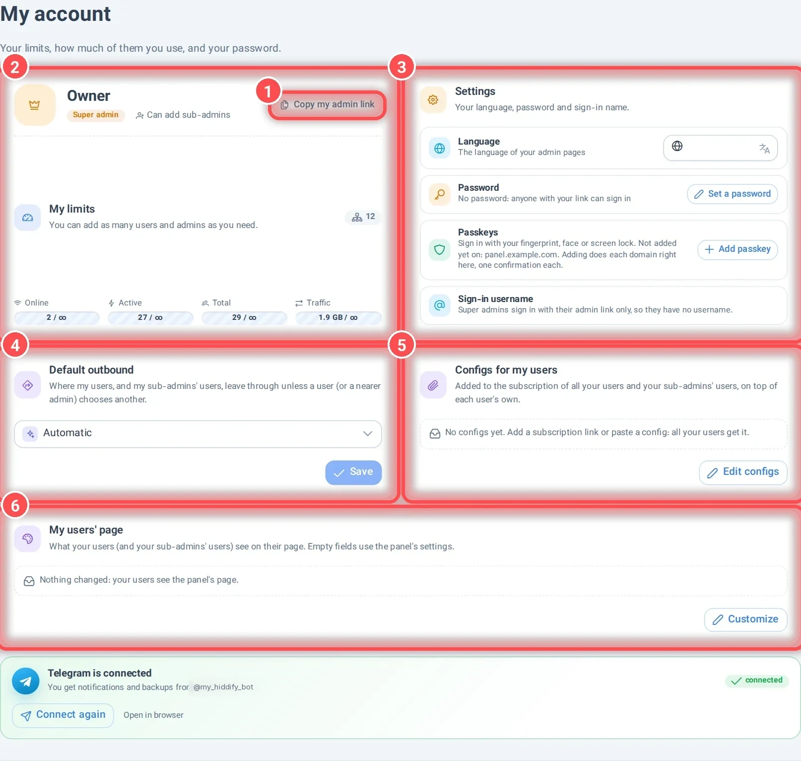
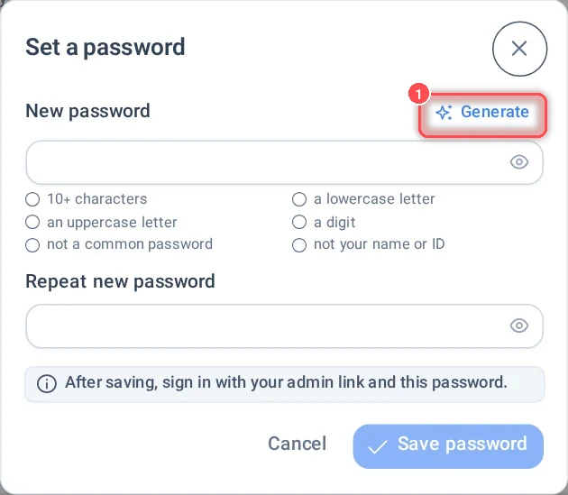
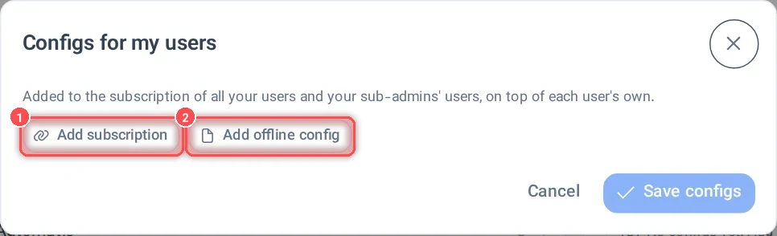
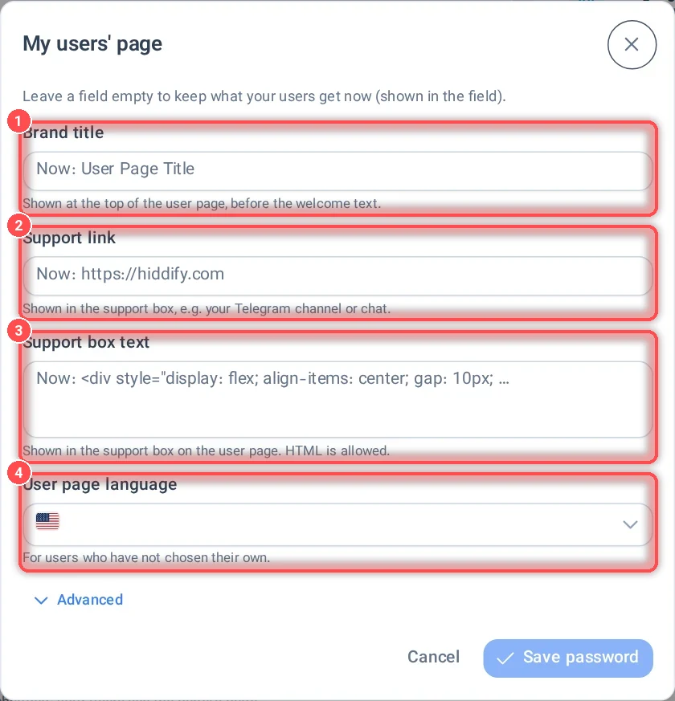

# My account and admin security in Hiddify Manager

!!! info "Written for Hiddify Manager v14.5"
    The menus and names on this page are those of version 14.5. Passwords, passkeys and sign-in usernames for admins do not exist in older versions.

Every admin of the panel (you, and the admins and agents you add) has a **My account** page: your role and limits, how you sign in, and a few things that apply to all of your users. Open it from the person icon at the top of the panel, then **My account**.

1. **Copy my admin link:** your personal link to the panel. Anyone who has it can sign in as you, unless you set a password (see below). Keep it private. More: [the admin link](../domain-worker-cdn-and-tunneling/The-correct-format-of-admin-link.md).
2. **Your role and limits.** Next to your name is your role (**Super admin**, **Admin** or **Agent**) and whether you can add sub-admins. **My limits** shows how many users are online, active and in total, and the traffic used, against the limits the admin above you gave you. Your users and all your sub-admins' users count toward them. Super admins have no limits.
3. **Settings:** your language, password, passkeys and sign-in username ([below](#sign-in-and-security)).
4. **Default outbound:** where your users' traffic leaves the server (for example through WARP or directly), unless a user, or an admin nearer to them, picks another. Outbounds are made on the **Outbounds** page. If an admin above you set it, you see it but can't change it. Apply the configs after a change.
5. **Configs for my users:** extra configs added to the subscription of all your users and your sub-admins' users ([below](#configs-for-my-users)).
6. **My users' page:** your own branding on your users' page ([below](#my-users-page)).

At the bottom, a card shows whether your Telegram is connected to the panel's bot. With it you get notifications and backups, and can manage users from Telegram ([Telegram bot](How-to-set-up-and-use-Telegram-bot-on-Hiddify-panel.md)).

## Sign-in and security { #sign-in-and-security }

### Password

Out of the box an admin has no password: the admin link alone signs you in. **Set a password** so that a leaked link is not enough.

1. **Generate** makes a strong password and copies it.

A password needs at least 10 characters, a lowercase and an uppercase letter and a digit, and must not be a common password or your name or ID: the list under the box turns green as each rule is met. After saving, you sign in with your admin link **and** this password. If you forget it, the admin who added you can reset it.

### Passkeys

A passkey lets you sign in with your fingerprint, face or the screen lock of your phone or computer, with nothing to type and nothing to steal. Click **Add passkey** and confirm on your device.

- Passkeys work only on a **domain**, not on an IP address: open the panel on one of its domains first.
- Each domain of the panel needs its own passkey. **Add passkey** goes through them one by one; you confirm once on each.
- To remove a device, click **Remove** next to it.

### Sign-in username

Admins and agents (not super admins) can set a **Sign-in username**. Then they sign in with that username and their password, and the links they share carry no ID. It needs a strong password first. Super admins sign in with their admin link only.

## Configs for my users { #configs-for-my-users }

Use it to give all your users one more server, for example the subscription of another panel or a config you made yourself.

1. **Add subscription:** a link (`https://…`) that is fetched for each user.
2. **Add offline config:** a config you paste (a `vless://…` link, or a JSON or YAML config).

For each one, choose which app format it is for, or **Auto (All Formats)**. They are added on top of each user's own configs. Configs set by the admins above you are added too (the page shows how many). The same can be done for one admin on the **Admins** page, and for one user in the user's settings.

## My users' page { #my-users-page }

What your users (and your sub-admins' users) see on their page. Leave a field empty to keep what they get now (shown in the field).

1. **Brand title:** shown at the top of the user page.
2. **Support link:** for example your Telegram channel or chat.
3. **Support box text:** shown in the support box (HTML is allowed).
4. **User page language:** for users who have not picked their own.

**Advanced** has **Custom user page**: the address of your own static user page (for example your build of [hiddify-user-front](https://github.com/hiddify/hiddify-user-front)), which the panel then serves from its own domain.

## How this relates to the Admins page

On the **Admins** page you add admins under you (they are created as agents). Each one gets a link and a password, made for them when you save (shown only once: copy it then). For each admin you set:

- **Limits:** max online users, max active users, max total users and max used traffic, counted over the admin and all of their sub-admins. The traffic limit can be for all time or reset every day, week or month. You can only give what you have.
- **Can add sub-admins**, and the **Permissions**: add extra subscription links, add sub-admins, manage domains, define the free test, manage outbounds, customize the user page, change the preferred outbound. You can only give permissions you have yourself.
- Their **Default outbound** and **Configs for this admin's users**: the same as on My account, for their branch.

What you set there is what they see on their own **My account** page.

!!! tip "Keep the panel safe"
    - Set a password, and add a passkey if you open the panel on a domain.
    - Give each person their own admin, with only the permissions and limits they need, instead of sharing your link.
    - If a link leaked, change the admin's link (a new UUID) or reset their password on the **Admins** page.

## Related articles

- [Panel tools (Config Tester, Scanner, SSH…)](/manager/configuration-and-advanced-settings/How-to-use-the-panel-tools-in-HiddifyManager/)
- [The Proxy Editor](/manager/configuration-and-advanced-settings/How-to-use-the-Proxy-Editor-in-HiddifyManager/)
- [Every part and setting of the panel](/manager/configuration-and-advanced-settings/How-to-configure-Hiddify-panel-properly/)
- [All panel settings, one by one](/manager/configuration-and-advanced-settings/Settings-reference/)

