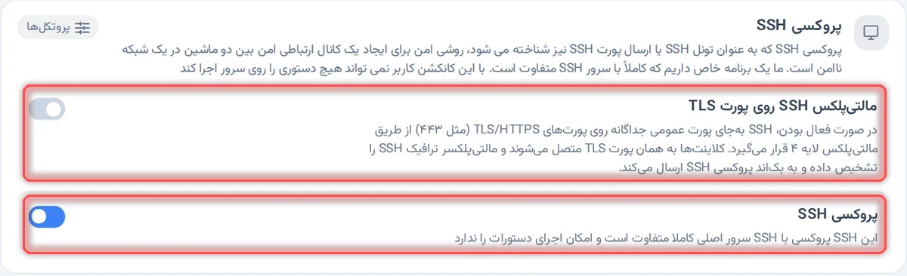
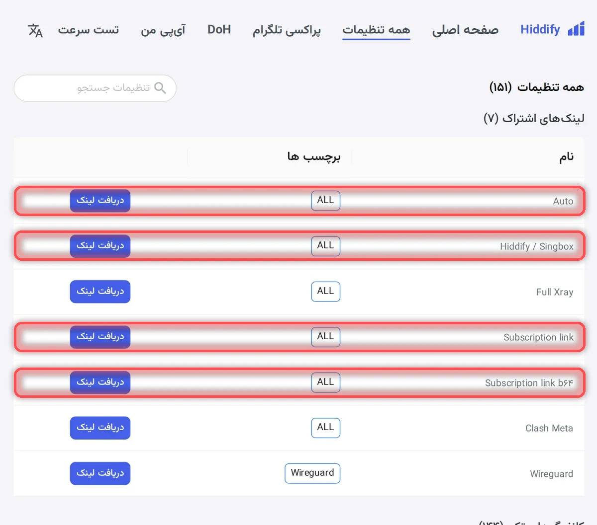
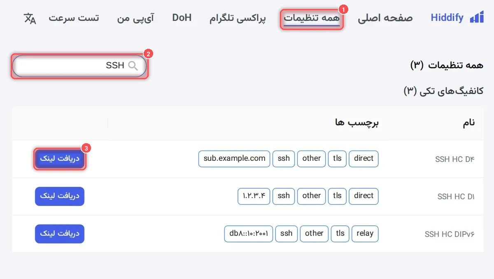
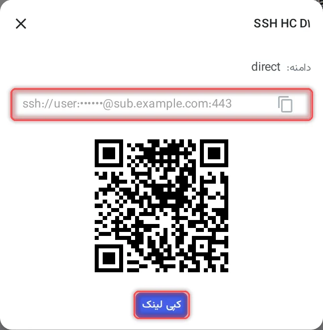

# تنظیم پروکسی SSH در هیدیفای‌منیجر

همانطور که می‌دانید در نسخه ۸ پنل هیدیفای‌منیجر یک پروکسی برای سرویس SSH درست شده که هیچ‌گونه دسترسی به سرور ندارد و فقط می‌تواند به عنوان پروکسی استفاده شود. این پروکسی کاملا امن شده و هیچ فینگرپرینتی برای شناسایی ندارد. (به جز خود پروتکل SSH که استفاده عمومی دارد)

در ادامه با این آموزش همراه باشید تا با نحوه انجام تنظیمات آن در پنل هیدیفای‌منیجر آشنا شوید.

## انجام تنظیمات پروکسی SSH
ابتدا در منوی کناری پنل روی `تنظیمات` کلیک کنید و کارت `پروکسی SSH` را پیدا کنید.

 

در اینجا با کلید **پروکسی SSH** می‌توانید این پروتکل را فعال یا غیرفعال کنید. اگر گزینه **مالتی‌پلکس SSH روی پورت TLS** روشن باشد، SSH به‌جای پورت عمومی جداگانه روی پورت‌های TLS/HTTPS (مثل ۴۴۳) قرار می‌گیرد و کلاینت‌ها به همان پورت TLS متصل می‌شوند.

## فعال‌سازی یا غیرفعال‌سازی پروکسی
 این کار را از صفحه `پروتکل‌ها` هم می‌توانید انجام دهید: در منوی کناری روی `پروتکل‌ها` کلیک کنید، کارت **پروکسی SSH** را روشن یا خاموش کنید و ذخیره کنید.

 

اگر پنل پیام اعمال تغییرات را نشان داد، آن را انجام دهید تا تغییرات روی سرور اعمال شوند.

## استفاده از کانفیگ برای اتصال

بعد از اعمال تغییرات، کانفیگ‌های SSH خودکار به کانفیگ‌های کاربران شما اضافه می‌شوند. کاربران به دو روش می‌توانند از آن‌ها استفاده کنند.

### از طریق لینک اشتراک (پیشنهادی)

کانفیگ‌های SSH خودکار در این لینک‌های اشتراکِ صفحهٔ کاربری قرار می‌گیرند: **Auto**، **Hiddify / Singbox** و **Subscription link** (و نسخهٔ **Subscription link b64**). کاربرانی که از یکی از این لینک‌ها استفاده می‌کنند، کافی است اشتراک را در اپ خود به‌روزرسانی کنند. بعد کانفیگ‌های SSH در فهرست پروکسی‌های اپ دیده می‌شوند، مثلاً `SSH HC D1`.

لینک‌های **Full Xray** و **Clash Meta** کانفیگ‌های SSH را ندارند، چون این کلاینت‌ها از SSH پشتیبانی نمی‌کنند.

*لینک‌های اشتراک در صفحهٔ کاربری (همه تنظیمات). لینک‌های Auto، Hiddify / Singbox و Subscription link کانفیگ‌های SSH را دارند.*

### به‌صورت کانفیگ تکی

1. در صفحهٔ کاربری، از منوی بالای صفحه **همه تنظیمات** را باز کنید و در کادر جستجو `SSH` را بنویسید. کانفیگ‌های SSH در بخش **کانفیگ‌های تکی** دیده می‌شوند.

    

2. کنار یکی از آن‌ها روی **دریافت لینک** بزنید. پنجره‌ای باز می‌شود که لینک کانفیگ، کد QR آن و دکمهٔ **کپی لینک** را نشان می‌دهد. لینک را کپی کنید و به اپ کلاینت اضافه کنید، یا کد QR را با اپ اسکن کنید.

    

    *پنجرهٔ «دریافت لینک» یک کانفیگ SSH. لینک و کد QR این تصویر نمونه هستند.*

برای استفاده از این پروکسی در کلاینت، در حال حاضر می‌بایست از [اپ هیدیفای](/fa/app/How-to-use-Hiddify-app/) و [اپ SingBox](/fa/manager/client-software-on-ios/Tutorial-for-SingBox-app/) استفاده نمایید.
