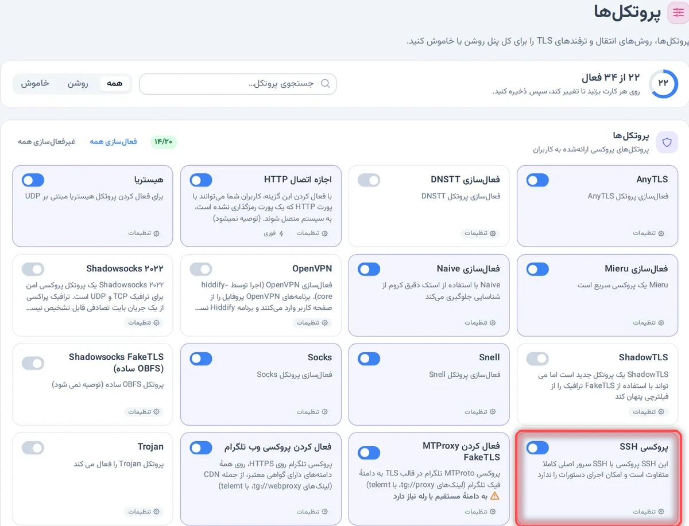

# تنظیم پروکسی SSH در هیدیفای‌منیجر

همانطور که می‌دانید در نسخه ۸ پنل هیدیفای یک پروکسی برای سرویس SSH درست شده که هیچ‌گونه دسترسی به سرور ندارد و فقط می‌تواند به عنوان پروکسی استفاده شود. این پروکسی کاملا امن شده و هیچ فینگرپرینتی برای شناسایی ندارد. (به جز خود پروتکل SSH که استفاده عمومی دارد)

در ادامه با این آموزش همراه باشید تا با نحوه انجام تنظیمات آن در پنل هیدیفای آشنا شوید.

## انجام تنظیمات پروکسی SSH
ابتدا در منوی کناری پنل روی `تنظیمات` کلیک کنید و کارت `پروکسی SSH` را پیدا کنید.

 

در اینجا با کلید **پروکسی SSH** می‌توانید این پروتکل را فعال یا غیرفعال کنید. اگر گزینه **مالتی‌پلکس SSH روی پورت TLS** روشن باشد، SSH به‌جای پورت عمومی جداگانه روی پورت‌های TLS/HTTPS (مثل ۴۴۳) قرار می‌گیرد و کلاینت‌ها به همان پورت TLS متصل می‌شوند.

## فعال‌سازی یا غیرفعال‌سازی پروکسی
 این کار را از صفحه `پروتکل‌ها` هم می‌توانید انجام دهید: در منوی کناری روی `پروتکل‌ها` کلیک کنید، کارت **پروکسی SSH** را روشن یا خاموش کنید و ذخیره کنید.

 

اگر پنل پیام اعمال تغییرات را نشان داد، آن را انجام دهید تا تغییرات روی سرور اعمال شوند.

## استفاده از کانفیگ برای اتصال
حالا اگر به صفحه کاربری خود در پنل بروید، می‌بینید که کانفیگ SSH به کانفیگ‌های قبلی اضافه شده است. این کانفیگ به صورت مجزا قابلیت اضافه شدن به نرم‌افزارهای کلاینت را دارد.

 

برای استفاده از این پروکسی در کلاینت، در حال حاضر می‌بایست از [هیدیفای‌اپ](/fa/app/How-to-use-Hiddify-app/) و [اپ SingBox](/fa/manager/client-software-on-ios/Tutorial-for-SingBox-app/) استفاده نمایید.
