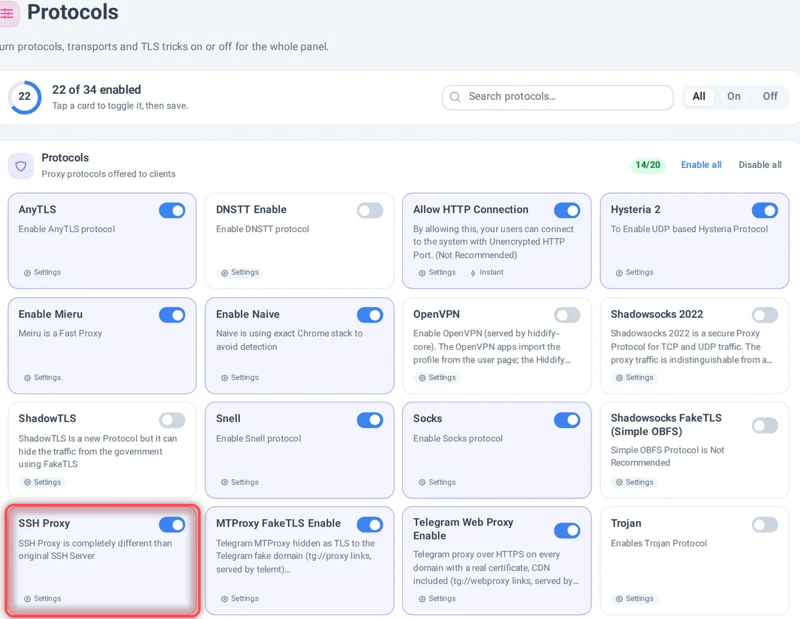
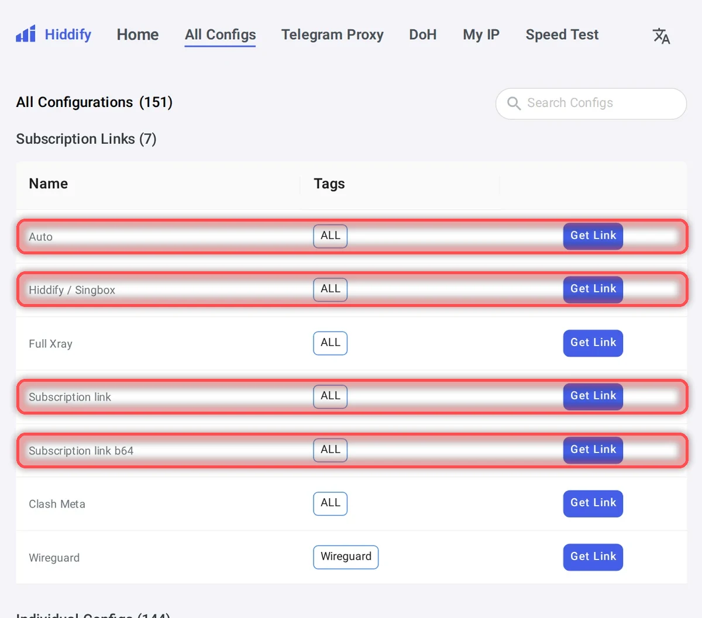
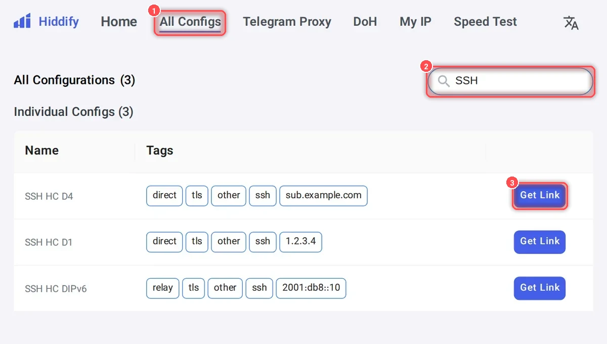
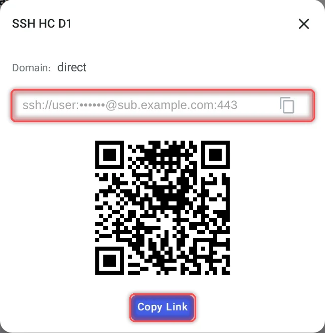

# SSH proxy setting on HiddifyManager

As you know, in version 8 of the HiddifyManager, a proxy for the SSH service has been created, which does not have any access to the server and can only be used as a proxy. This proxy is completely secure and has no fingerprints for identification. (except the SSH protocol itself, which is in general use)

Continue with this tutorial to learn how to make its settings on HiddifyManager panel.

## Configure SSH proxy settings
First, click **Settings** in the panel sidebar and find the **SSH Proxy** card.

  

Here you can enable or disable this protocol with the **SSH Proxy** switch. With **Multiplex SSH on TLS Port** on, SSH shares the TLS/HTTPS ports (such as 443) instead of using a dedicated public SSH port; clients connect to the same TLS port.

## Enable or disable proxy

You can also do this from the **Protocols** page: click **Protocols** in the sidebar, turn the **SSH Proxy** card on or off, and save.

  

If the panel asks you to apply the changes, do it so that they are applied to the server.

## Use config to connect

After you apply the changes, the SSH configs are added to your users' configs automatically. Users can get them in two ways.

### Through the subscription link (recommended)

The SSH configs are included automatically in these subscription links of the user page: **Auto**, **Hiddify / Singbox** and **Subscription link** (also **Subscription link b64**). Users who already use one of these links only need to update their subscription in their app. The SSH configs then appear in the app's list of proxies, for example `SSH HC D1`.

The **Full Xray** and **Clash Meta** links do not include the SSH configs, because those clients don't support SSH.

*The subscription links on the user page (All Configs). Auto, Hiddify / Singbox and Subscription link include the SSH configs.*

### As a single config

1. On the user page, open **All Configs** in the menu at the top and type `SSH` in the search box. The SSH configs are listed under **Individual Configs**.

    

2. Click **Get Link** next to one of them. A window opens with the config's link, its QR code and a **Copy Link** button. Copy the link and add it to your client app, or scan the QR code with the app.

    

    *The Get Link window of an SSH config. The link and QR code in this picture are examples.*

To use this proxy, use the [Hiddify app](/app/How-to-use-Hiddify-app/) or the [SingBox app](/manager/client-software-on-ios/Tutorial-for-SingBox-app/).

