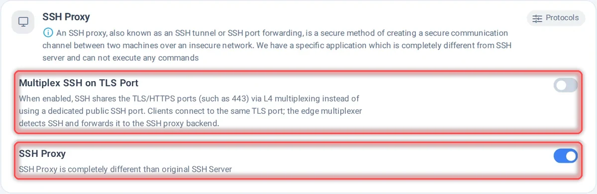

# SSH proxy setting on HiddifyManager

As you know, in version 8 of the HiddifyManager, a proxy for the SSH service has been created, which does not have any access to the server and can only be used as a proxy. This proxy is completely secure and has no fingerprints for identification. (except the SSH protocol itself, which is in general use)

Continue with this tutorial to learn how to make its settings on Hiddify panel.

## Configure SSH proxy settings
First, click **Settings** in the panel sidebar and find the **SSH Proxy** card.

  

Here you can enable or disable this protocol with the **SSH Proxy** switch. With **Multiplex SSH on TLS Port** on, SSH shares the TLS/HTTPS ports (such as 443) instead of using a dedicated public SSH port; clients connect to the same TLS port.

## Enable or disable proxy

You can also do this from the **Protocols** page: click **Protocols** in the sidebar, turn the **SSH Proxy** card on or off, and save.

  

If the panel asks you to apply the changes, do it so that they are applied to the server.

## Use config to connect

Now, if you go to your user page in the panel, you will see that the SSH configuration has been added to the previous configurations. This configuration can be added to client app separately.

  

To use this proxy in the client, you must currently use the SingBox app, which is explained in [this tutorial](/manager/client-software-on-ios/Tutorial-for-SingBox-app/).

