<!-- این صفحه خودکار از کد پنل ساخته می‌شود (scripts/sync_manager_settings.py). دستی ویرایشش نکنید. -->

# همهٔ تنظیمات هیدیفای‌منیجر

همهٔ گزینه‌های صفحهٔ **تنظیمات** پنل، به ترتیب خود پنل و با توضیح خود پنل. این صفحه از روی کد هیدیفای‌منیجر **نسخهٔ ۱۴.۵.۰b۰** ساخته شده و دقیقاً همان چیزی را دارد که آن نسخه دارد.

**روش استفاده:** در پنل، **تنظیمات** را باز کنید. تنظیمات رایج اول نشان داده می‌شوند؛ برای دیدن بقیه (آن‌هایی که این‌جا *پیشرفته* علامت خورده‌اند) **نمایش تنظیمات پیشرفته** را روشن کنید. کادر جستجوی بالای صفحهٔ تنظیمات هر تنظیمی را با نامش پیدا می‌کند. برای آشنایی با کل پنل، [راهنمای پیکربندی پنل](How-to-configure-Hiddify-panel-properly.md) را ببینید.

## تنظیمات ادمین { #admin }

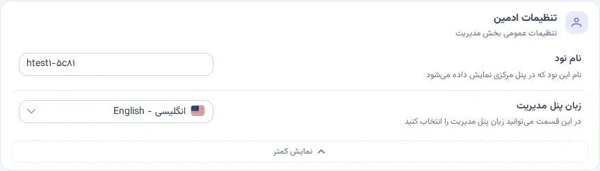

تنظیمات عمومی بخش مدیریت

*۳ تنظیم*

### پنل مرکزی (مالتی سرور) { #parent_panel }

می‌توانید به پنل مرکزی وصل شوید، تا فقط یک یوزر را تعریف کنید و میزان استفاده همه سرورها به صورت تجمعی اضافه می‌شود.

نوع: متن · بعد از ذخیره: همان لحظه اعمال می‌شود

فقط در پنل نود دیده می‌شود: پنلی که به یک پنل مرکزی وصل است.

### نام نود { #node_name }

نام این نود که در پنل مرکزی نمایش داده می‌شود

نوع: متن · بعد از ذخیره: همان لحظه اعمال می‌شود

### 🗺️ زبان پنل مدیریت { #admin_lang }

در این قسمت می‌توانید زبان پنل مدیریت را انتخاب کنید

نوع: انتخابی · بعد از ذخیره: همان لحظه اعمال می‌شود

گزینه‌ها: 🇺🇸 انگلیسی - English، 🇮🇷 فارسی، 🇨🇳 Chinese - 简体中文، 🇵🇹 پرتغالی - Português، 🇷🇺 Russian - Русский، 🇲🇲 زبان برمه‌ای - မြန်မာဘာသာ

## شخصی‌سازی صفحه کاربران { #branding }

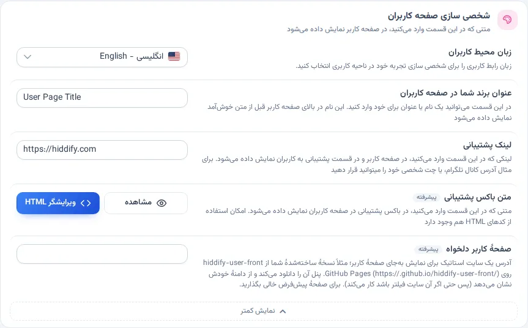

متنی که در این قسمت وارد می‌کنید، در صفحه کاربر نمایش داده می‌شود

*۱۰ تنظیم*

### 🗺️ زبان محیط کاربران { #lang }

زبان رابط کاربری را برای شخصی‌سازی تجربه خود در ناحیه کاربری انتخاب کنید.

نوع: انتخابی · بعد از ذخیره: همان لحظه اعمال می‌شود

گزینه‌ها: 🇺🇸 انگلیسی - English، 🇮🇷 فارسی، 🇨🇳 Chinese - 简体中文، 🇵🇹 پرتغالی - Português، 🇷🇺 Russian - Русский، 🇲🇲 زبان برمه‌ای - မြန်မာဘာသာ

### 👁‍🗨 عنوان برند شما در صفحه کاربران { #branding_title }

در این قسمت می‌توانید یک نام یا عنوان برای خود وارد کنید. این نام در بالای صفحه کاربر قبل از متن خوش‌آمد نمایش داده می‌شود

نوع: متن · بعد از ذخیره: همان لحظه اعمال می‌شود

### 🆔 لینک پشتیبانی { #branding_site }

لینکی که در این قسمت وارد می‌کنید، در صفحه کاربر و در قسمت پشتیبانی به کاربران نمایش داده می‌شود.

برای مثال آدرس کانال تلگرام، یا چت شخصی خود را می‌توانید قرار دهید

نوع: متن · بعد از ذخیره: همان لحظه اعمال می‌شود

### 📢 متن باکس پشتیبانی { #branding_freetext }

متنی که در این قسمت وارد می‌کنید، در باکس پشتیبانی در صفحه کاربران نمایش داده می‌شود. امکان استفاده از کدهای HTML هم وجود دارد

نوع: متن · بعد از ذخیره: همان لحظه اعمال می‌شود · *پیشرفته*

### عنوان کادر پشتیبانی { #branding_support_title }

عنوانی که بالای متن پشتیبانی نشان داده می‌شود. خالی: «پشتیبانی».

نوع: متن · بعد از ذخیره: همان لحظه اعمال می‌شود · *پیشرفته*

داخل ویرایشگر [📢 متن باکس پشتیبانی](#branding_freetext) تنظیم می‌شود.

### نمایش عنوان کادر پشتیبانی { #branding_support_title_show }

نوع: روشن / خاموش · بعد از ذخیره: همان لحظه اعمال می‌شود · *پیشرفته*

داخل ویرایشگر [📢 متن باکس پشتیبانی](#branding_freetext) تنظیم می‌شود.

### متن دکمه «بیشتر» { #branding_support_more }

لینک «وب‌سایت پشتیبانی» را باز می‌کند. خالی: «مشاهده بیشتر».

نوع: متن · بعد از ذخیره: همان لحظه اعمال می‌شود · *پیشرفته*

داخل ویرایشگر [📢 متن باکس پشتیبانی](#branding_freetext) تنظیم می‌شود.

### نمایش دکمه «بیشتر» { #branding_support_more_show }

نوع: روشن / خاموش · بعد از ذخیره: همان لحظه اعمال می‌شود · *پیشرفته*

داخل ویرایشگر [📢 متن باکس پشتیبانی](#branding_freetext) تنظیم می‌شود.

### متن کامل پشتیبانی (Full) { #branding_freetext_full }

با «ادامهٔ مطلب» در صفحهٔ کاربر نشان داده می‌شود. خالی: «ادامهٔ مطلب» متن پشتیبانی را نشان می‌دهد، وقتی در کادر جا نشود.

نوع: متن · بعد از ذخیره: همان لحظه اعمال می‌شود · *پیشرفته*

داخل ویرایشگر [📢 متن باکس پشتیبانی](#branding_freetext) تنظیم می‌شود.

### 🎨 صفحهٔ کاربر دلخواه { #user_page_url }

آدرس یک سایت استاتیک برای نمایش به‌جای صفحهٔ کاربر؛ مثلاً نسخهٔ ساخته‌شدهٔ شما از hiddify-user-front روی GitHub Pages (https://.github.io/hiddify-user-front/). پنل آن را دانلود می‌کند و از دامنهٔ خودش نشان می‌دهد (پس حتی اگر آن سایت فیلتر باشد کار می‌کند). برای صفحهٔ پیش‌فرض خالی بگذارید.

نوع: متن · بعد از ذخیره: همان لحظه اعمال می‌شود · *پیشرفته*

## تنظیمات عمومی { #general }

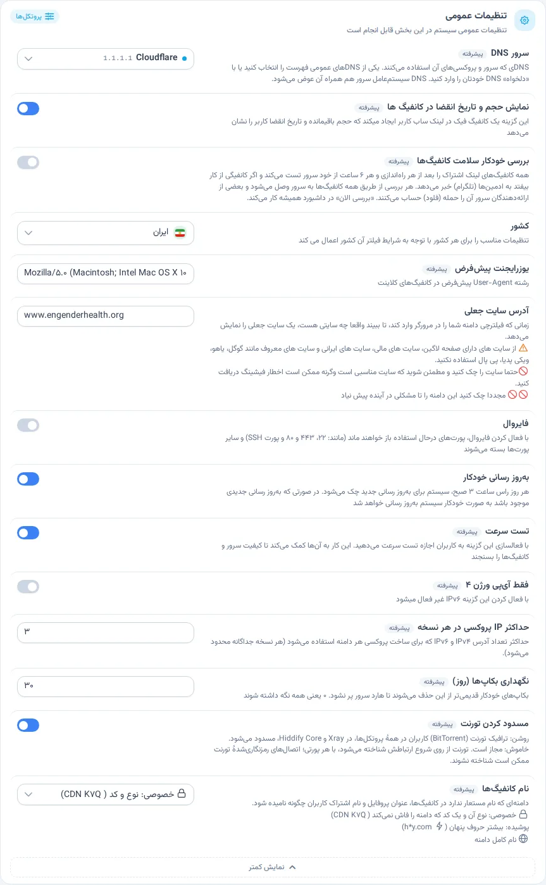

تنظیمات عمومی سیستم در این بخش قابل انجام است

*۱۴ تنظیم*

### 🖥 سرور DNS { #dns_server }

DNSی که سرور و پروکسی‌های آن استفاده می‌کنند. یکی از DNSهای عمومی فهرست را انتخاب کنید یا با «دلخواه» DNS خودتان را وارد کنید. DNS سیستم‌عامل سرور هم همراه آن عوض می‌شود.

نوع: متن · بعد از ذخیره: **اعمال تغییرات** لازم است · *پیشرفته*

### 👁️‍🗨️ نمایش حجم و تاریخ انقضا در کانفیگ‌ها { #show_usage_in_sublink }

این گزینه یک کانفیگ فیک در لینک ساب کاربر ایجاد می‌کند که حجم باقیمانده و تاریخ انقضا کاربر را نشان می‌دهد

نوع: روشن / خاموش · بعد از ذخیره: همان لحظه اعمال می‌شود · *پیشرفته*

### 🩺 بررسی خودکار سلامت کانفیگ‌ها { #config_health_enable }

همه کانفیگ‌های لینک اشتراک را بعد از هر راه‌اندازی و هر ۶ ساعت از خود سرور تست می‌کند و اگر کانفیگی از کار بیفتد به ادمین‌ها (تلگرام) خبر می‌دهد. هر بررسی از طریق همه کانفیگ‌ها به سرور وصل می‌شود و بعضی از ارائه‌دهندگان سرور آن را حمله (فلود) حساب می‌کنند. «بررسی الان» در داشبورد همیشه کار می‌کند.

نوع: روشن / خاموش · بعد از ذخیره: همان لحظه اعمال می‌شود · *پیشرفته*

### 🌍 کشور { #country }

تنظیمات مناسب را برای هر کشور با توجه به شرایط فیلتر آن کشور اعمال می‌کند

نوع: انتخابی · بعد از ذخیره: **نصب دوباره** لازم است

گزینه‌ها: 🇮🇷 ایران، 🇨🇳 چین، روسیه، 🇺🇳 سایر

### 🪪 یوزرایجنت پیش‌فرض { #default_useragent_string }

رشته User-Agent پیش‌فرض در کانفیگ‌های کلاینت

نوع: متن · بعد از ذخیره: همان لحظه اعمال می‌شود · *پیشرفته*

### 📺 آدرس سایت جعلی { #decoy_domain }

زمانی که فیلترچی دامنه شما را در مرورگر وارد کند، تا ببیند واقعا چه سایتی هست، یک سایت جعلی را نمایش می‌دهد.

⚠️ از سایت‌های دارای صفحه لاگین، سایت‌های مالی، سایت‌های ایرانی و سایت‌های معروف مانند گوگل، یاهو، ویکی پدیا، پی پال استفاده نکنید.

⛔حتما سایت را چک کنید و مطمئن شوید که سایت مناسبی است وگرنه ممکن است اخطار فیشینگ دریافت کنید.

⛔⛔ مجددا چک کنید این دامنه را تا مشکلی در آینده پیش نیاد

نوع: متن · بعد از ذخیره: **اعمال تغییرات** لازم است

### 🛡️ فایروال { #firewall }

با فعال کردن فایروال، پورت‌های درحال استفاده باز خواهند ماند (مانند: ۲۲، ۴۴۳ و ۸۰ و پورت SSH) و سایر پورت‌ها بسته می‌شوند

نوع: روشن / خاموش · بعد از ذخیره: **اعمال تغییرات** لازم است

### 🔄 به‌روزرسانی خودکار { #auto_update }

هر روز راس ساعت ۳ صبح، سیستم برای به‌روزرسانی جدید چک می‌شود. در صورتی که به‌روزرسانی جدیدی موجود باشد به صورت خودکار سیستم به‌روزرسانی خواهد شد

نوع: روشن / خاموش · بعد از ذخیره: **اعمال تغییرات** لازم است

### 🚀 تست سرعت { #speed_test }

با فعالسازی این گزینه به کاربران اجازه تست سرعت می‌دهید. این کار به آن‌ها کمک می‌کند تا کیفیت سرور و کانفیگ‌ها را بسنجند

نوع: روشن / خاموش · بعد از ذخیره: **نصب دوباره** لازم است · *پیشرفته*

### ℹ️ فقط آی‌پی ورژن 4 { #only_ipv4 }

با فعال کردن این گزینه IPv۶ غیرفعال می‌شود

نوع: روشن / خاموش · بعد از ذخیره: **اعمال تغییرات** لازم است · *پیشرفته*

### حداکثر IP پروکسی در هر نسخه { #max_proxy_ips_per_version }

حداکثر تعداد آدرس IPv4 و IPv6 که برای ساخت پروکسی هر دامنه استفاده می‌شود (هر نسخه جداگانه محدود می‌شود).

نوع: عدد · بعد از ذخیره: **اعمال تغییرات** لازم است · *پیشرفته*

### 🗄️ نگهداری بکاپ‌ها (روز) { #backup_keep_days }

بکاپ‌های خودکار قدیمی‌تر از این حذف می‌شوند تا هارد سرور پر نشود. ۰ یعنی همه نگه داشته شوند

نوع: عدد · بعد از ذخیره: همان لحظه اعمال می‌شود · *پیشرفته*

### 🚫 مسدود کردن تورنت { #torrent_block }

روشن: ترافیک تورنت (BitTorrent) کاربران در همهٔ پروتکل‌ها، در Xray و Hiddify Core، مسدود می‌شود. خاموش: مجاز است. تورنت از روی شروع ارتباطش شناخته می‌شود، با هر پورتی؛ اتصال‌های رمزنگاری‌شدهٔ تورنت ممکن است شناخته نشوند.

نوع: روشن / خاموش · بعد از ذخیره: **اعمال تغییرات** لازم است · *پیشرفته*

### 🏷️ نام کانفیگ‌ها { #domain_label_mode }

دامنه‌ای که نام مستعار ندارد در کانفیگ‌ها، عنوان پروفایل و نام اشتراک کاربران چگونه نامیده شود.

🔒 خصوصی: نوع آن و یک کد که دامنه را فاش نمی‌کند (☁️ CDN K7Q)

🫥 پوشیده: بیشتر حروف پنهان (⚡ h*y.com)

🌐 نام کامل دامنه

نوع: انتخابی · بعد از ذخیره: همان لحظه اعمال می‌شود · *پیشرفته*

## تنظیمات پروکسی { #proxies }

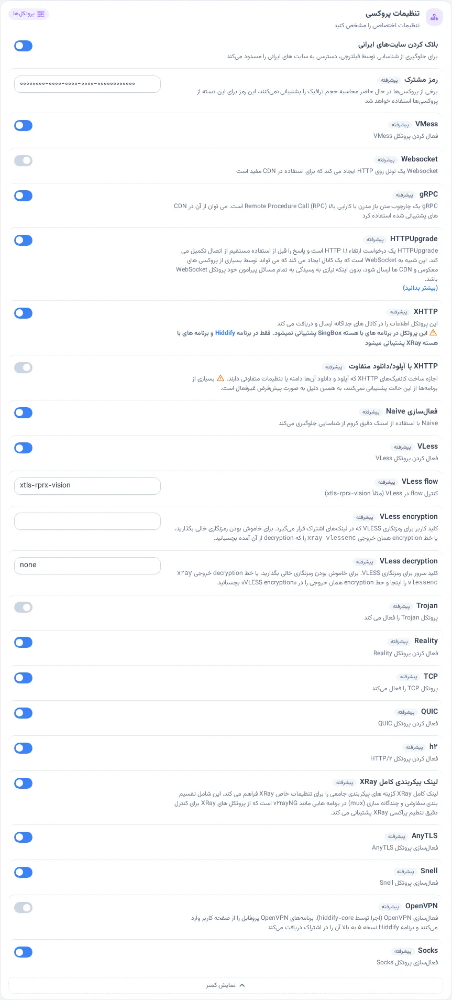

تنظیمات اختصاصی را مشخص کنید

*۲۳ تنظیم*

### ⛔️ بلاک کردن سایت‌های ایرانی { #block_iran_sites }

برای جلوگیری از شناسایی توسط فیلترچی، دسترسی به سایت‌های ایرانی را مسدود می‌کند

نوع: روشن / خاموش · بعد از ذخیره: **اعمال تغییرات** لازم است

### 🔐 رمز مشترک { #shared_secret }

برخی از پروکسی‌ها در حال حاضر محاسبه حجم ترافیک را پشتیبانی نمی‌کنند، این رمز برای این دسته از پروکسی‌ها استفاده خواهد شد

نوع: متن · بعد از ذخیره: **اعمال تغییرات** لازم است · *پیشرفته*

### 🟣 VMess { #vmess_enable }

فعال کردن پروتکل VMess

نوع: روشن / خاموش · بعد از ذخیره: **اعمال تغییرات** لازم است · *پیشرفته*

### 🔰 Websocket { #ws_enable }

Websocket یک تونل روی HTTP ایجاد می‌کند که برای استفاده در CDN مفید است

نوع: روشن / خاموش · بعد از ذخیره: **اعمال تغییرات** لازم است · *پیشرفته*

### ➿ gRPC { #grpc_enable }

gRPC یک چارچوب متن باز مدرن با کارایی بالا Remote Procedure Call (RPC) است. می‌توان از آن در CDN‌های پشتیبانی شده استفاده کرد

نوع: روشن / خاموش · بعد از ذخیره: **اعمال تغییرات** لازم است · *پیشرفته*

### 🆙 HTTPUpgrade { #httpupgrade_enable }

HTTPUpgrade یک درخواست ارتقاء HTTP ۱.۱ است و پاسخ را قبل از استفاده مستقیم از اتصال تکمیل می‌کند. این شبیه به WebSocket است که یک کانال ایجاد می‌کند که می‌تواند توسط بسیاری از پروکسی‌های معکوس و CDN‌ها ارسال شود، بدون اینکه نیازی به رسیدگی به تمام مسائل پیرامون خود پروتکل WebSocket باشد.

[**(بیشتر بدانید)**](https://hiddify.com/fa/manager/basic-concepts-and-troubleshooting/Basic-Concepts/#http-upgrade)

نوع: روشن / خاموش · بعد از ذخیره: **اعمال تغییرات** لازم است · *پیشرفته*

### 🈁 XHTTP { #xhttp_enable }

این پروتکل اطلاعات را در کانال‌های جداگانه ارسال و دریافت می‌کند

⚠️** این پروتکل در برنامه‌های با هسته SingBox پشتیبانی نمی‌شود. فقط در برنامه [Hiddify](https://app.hiddify.com) و برنامه‌های با هسته XRay پشتیبانی می‌شود**

نوع: روشن / خاموش · بعد از ذخیره: **اعمال تغییرات** لازم است · *پیشرفته*

### 🈁 XHTTP با آپلود/دانلود متفاوت { #xhttp_different_up_down_enable }

اجازه ساخت کانفیگ‌های XHTTP که آپلود و دانلود آن‌ها دامنه یا تنظیمات متفاوتی دارند. ⚠️ بسیاری از برنامه‌ها از این حالت پشتیبانی نمی‌کنند، به همین دلیل به صورت پیش‌فرض غیرفعال است.

نوع: روشن / خاموش · بعد از ذخیره: **اعمال تغییرات** لازم است · *پیشرفته*

### 🛡 فعال‌سازی Naive { #naive_enable }

Naive با استفاده از استک دقیق کروم از شناسایی جلوگیری می‌کند

نوع: روشن / خاموش · بعد از ذخیره: **اعمال تغییرات** لازم است · *پیشرفته*

### ⚫️ VLess { #vless_enable }

فعال کردن پروتکل VLess

نوع: روشن / خاموش · بعد از ذخیره: **اعمال تغییرات** لازم است · *پیشرفته*

### VLess flow { #vless_flow }

کنترل flow در VLess (مثلاً xtls-rprx-vision)

نوع: متن · بعد از ذخیره: **اعمال تغییرات** لازم است · *پیشرفته*

### VLess encryption { #vless_encryption }

کلید کاربر برای رمزنگاری VLESS که در لینک‌های اشتراک قرار می‌گیرد. برای خاموش بودن رمزنگاری خالی بگذارید، یا خط encryption همان خروجی `xray vlessenc` را که decryption از آن آمده بچسبانید.

نوع: متن · بعد از ذخیره: **اعمال تغییرات** لازم است · *پیشرفته*

### VLess decryption { #vless_decryption }

کلید سرور برای رمزنگاری VLESS. برای خاموش بودن رمزنگاری خالی بگذارید، یا خط decryption خروجی `xray vlessenc` را اینجا و خط encryption همان خروجی را در «VLESS encryption» بچسبانید.

نوع: متن · بعد از ذخیره: **اعمال تغییرات** لازم است · *پیشرفته*

### 🟤 Trojan { #trojan_enable }

پروتکل Trojan  را فعال می‌کند

نوع: روشن / خاموش · بعد از ذخیره: **اعمال تغییرات** لازم است · *پیشرفته*

### 🔴 Reality { #reality_enable }

فعال کردن پروتکل Reality

نوع: روشن / خاموش · بعد از ذخیره: **اعمال تغییرات** لازم است · *پیشرفته*

### 🟠 TCP { #tcp_enable }

پروتکل TCP را فعال می‌کند

نوع: روشن / خاموش · بعد از ذخیره: **اعمال تغییرات** لازم است · *پیشرفته*

### 🟡 QUIC { #quic_enable }

فعال کردن پروتکل QUIC

نوع: روشن / خاموش · بعد از ذخیره: **اعمال تغییرات** لازم است · *پیشرفته*

### 🔵 h2 { #h2_enable }

فعال کردن پروتکل HTTP/2

نوع: روشن / خاموش · بعد از ذخیره: **اعمال تغییرات** لازم است · *پیشرفته*

### ⚙️ لینک پیکربندی کامل XRay { #sub_full_xray_json_enable }

لینک کامل XRay  گزینه‌های پیکربندی جامعی را برای تنظیمات خاص XRay فراهم می‌کند. این شامل تقسیم‌بندی سفارشی و چندگانه‌سازی (mux) در برنامه‌هایی مانند v2rayNG است که از پروتکل‌های XRay برای کنترل دقیق تنظیم پروکسی XRay پشتیبانی می‌کند.

نوع: روشن / خاموش · بعد از ذخیره: همان لحظه اعمال می‌شود · *پیشرفته*

### AnyTLS { #anytls_enable }

فعال‌سازی پروتکل AnyTLS

نوع: روشن / خاموش · بعد از ذخیره: **اعمال تغییرات** لازم است · *پیشرفته*

### Snell { #snell_enable }

فعال‌سازی پروتکل Snell

نوع: روشن / خاموش · بعد از ذخیره: **اعمال تغییرات** لازم است · *پیشرفته*

### OpenVPN { #openvpn_enable }

فعال‌سازی OpenVPN (اجرا توسط hiddify-core). برنامه‌های OpenVPN پروفایل را از صفحه کاربر وارد می‌کنند و برنامه Hiddify نسخه ۵ به بالا آن را در اشتراک دریافت می‌کند

نوع: روشن / خاموش · بعد از ذخیره: **اعمال تغییرات** لازم است · *پیشرفته*

### Socks { #socks_enable }

فعال‌سازی پروتکل Socks

نوع: روشن / خاموش · بعد از ذخیره: **اعمال تغییرات** لازم است · *پیشرفته*

## کانفیگ‌های تلگرام { #telegram }

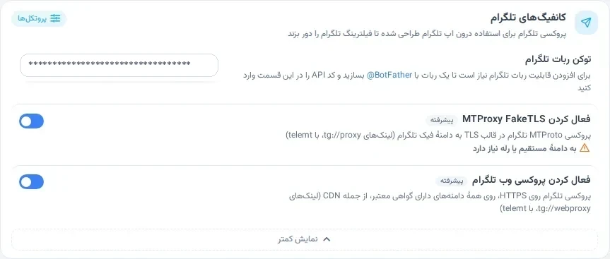

پروکسی تلگرام برای استفاده درون اپ تلگرام طراحی شده تا فیلترینگ تلگرام را دور بزند

*۳ تنظیم*

### 🔐 توکن ربات تلگرام { #telegram_bot_token }

برای افزودن قابلیت ربات تلگرام نیاز است تا یک ربات با [BotFather@](https://t.me/BotFather) بسازید و کد API را در این قسمت وارد کنید

نوع: متن · بعد از ذخیره: همان لحظه اعمال می‌شود

### ✔️ فعال کردن MTProxy FakeTLS { #telegram_enable }

پروکسی MTProto تلگرام در قالب TLS به دامنهٔ فیک تلگرام (لینک‌های tg://proxy، با telemt)

⚠️ **به دامنهٔ مستقیم یا رله نیاز دارد**

نوع: روشن / خاموش · بعد از ذخیره: **نصب دوباره** لازم است · *پیشرفته*

### ✔️ فعال کردن پروکسی وب تلگرام { #telegram_webproxy_enable }

پروکسی تلگرام روی HTTPS، روی همهٔ دامنه‌های دارای گواهی معتبر، از جمله CDN (لینک‌های tg://webproxy، با telemt)

نوع: روشن / خاموش · بعد از ذخیره: **اعمال تغییرات** لازم است · *پیشرفته*

## تنظیمات HTTP { #http }

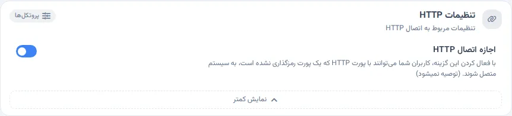

تنظیمات مربوط به اتصال HTTP

*۱ تنظیم*

### ☑️ اجازه اتصال HTTP { #http_proxy_enable }

با فعال کردن این گزینه، کاربران شما می‌توانند با پورت HTTP  که یک پورت رمزگذاری نشده است، به سیستم متصل شوند. (توصیه نمی‌شود)

نوع: روشن / خاموش · بعد از ذخیره: همان لحظه اعمال می‌شود · *پیشرفته*

## تنظیمات TLS { #tls }

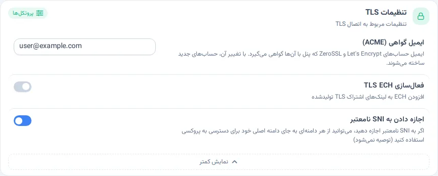

تنظیمات مربوط به اتصال TLS

*۳ تنظیم*

### 📧 ایمیل گواهی (ACME) { #acme_email }

ایمیل حساب‌های Let's Encrypt و ZeroSSL که پنل با آن‌ها گواهی می‌گیرد. با تغییر آن، حساب‌های جدید ساخته می‌شوند.

نوع: متن · بعد از ذخیره: همان لحظه اعمال می‌شود · *پیشرفته*

### 🔐 فعال‌سازی TLS ECH { #tls_ech_enable }

افزودن ECH به لینک‌های اشتراک TLS تولیدشده

نوع: روشن / خاموش · بعد از ذخیره: **اعمال تغییرات** لازم است · *پیشرفته*

### 🆗 اجازه دادن به SNI نامعتبر { #allow_invalid_sni }

اگر به SNI نامعتبر اجازه دهید، می‌توانید از هر دامنه‌ای به جای دامنه اصلی خود برای دسترسی به پروکسی استفاده کنید (توصیه نمی‌شود)

نوع: روشن / خاموش · بعد از ذخیره: **اعمال تغییرات** لازم است · *پیشرفته*

## تنظیمات MUX { #mux }

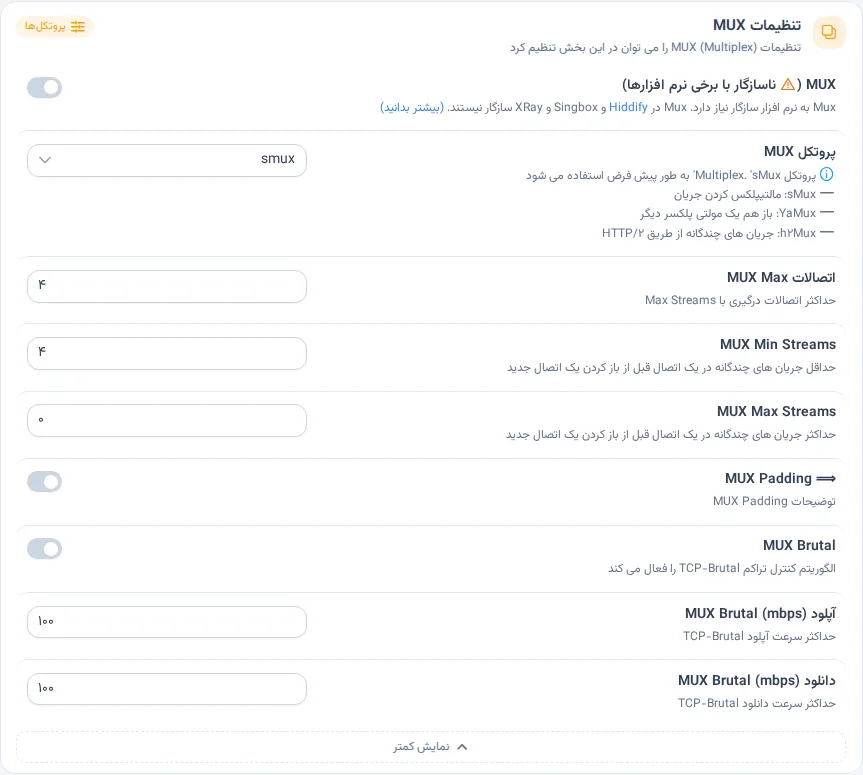

تنظیمات MUX (Multiplex) را می‌توان در این بخش تنظیم کرد

*۹ تنظیم*

### Ⓜ️ MUX (⚠️ ناسازگار با برخی نرم‌افزارها) { #mux_enable }

Mux به نرم‌افزار سازگار نیاز دارد. Mux در [Hiddify](https://app.hiddify.com) و Singbox و XRay سازگار نیستند. [(بیشتر بدانید)](https://hiddify.com/fa/manager/basic-concepts-and-troubleshooting/How-MUX-works-and-its-usage/)

نوع: روشن / خاموش · بعد از ذخیره: **اعمال تغییرات** لازم است · *پیشرفته*

### ♍️ پروتکل MUX { #mux_protocol }

ℹ️ پروتکل Multiplex. 'sMux' به طور پیش‌فرض استفاده می‌شود

➖ sMux: مالتیپلکس کردن جریان

➖ YaMux: باز هم یک مولتی پلکسر دیگر

➖ h2Mux: جریان‌های چندگانه از طریق HTTP/2

نوع: انتخابی · بعد از ذخیره: **اعمال تغییرات** لازم است · *پیشرفته*

گزینه‌ها: smux، yamux، h2mux

### ⛓ اتصالات MUX Max { #mux_max_connections }

حداکثر اتصالات درگیری با Max Streams

نوع: عدد · بعد از ذخیره: **اعمال تغییرات** لازم است · *پیشرفته*

### ↘️ MUX Min Streams { #mux_min_streams }

حداقل جریان‌های چندگانه در یک اتصال قبل از باز کردن یک اتصال جدید

نوع: عدد · بعد از ذخیره: **اعمال تغییرات** لازم است · *پیشرفته*

### ↗️ MUX Max Streams { #mux_max_streams }

حداکثر جریان‌های چندگانه در یک اتصال قبل از باز کردن یک اتصال جدید

نوع: عدد · بعد از ذخیره: **اعمال تغییرات** لازم است · *پیشرفته*

### ⟹ MUX Padding { #mux_padding_enable }

توضیحات MUX Padding

نوع: روشن / خاموش · بعد از ذخیره: **اعمال تغییرات** لازم است · *پیشرفته*

### ☣️ MUX Brutal { #mux_brutal_enable }

الگوریتم کنترل تراکم TCP-Brutal را فعال می‌کند

نوع: روشن / خاموش · بعد از ذخیره: **اعمال تغییرات** لازم است · *پیشرفته*

### ⬆️ آپلود (mbps) MUX Brutal { #mux_brutal_up_mbps }

حداکثر سرعت آپلود TCP-Brutal

نوع: عدد · بعد از ذخیره: **اعمال تغییرات** لازم است · *پیشرفته*

### ⬇️ دانلود (mbps) MUX Brutal { #mux_brutal_down_mbps }

حداکثر سرعت دانلود TCP-Brutal

نوع: عدد · بعد از ذخیره: **اعمال تغییرات** لازم است · *پیشرفته*

## ترفند TLS { #tls_trick }

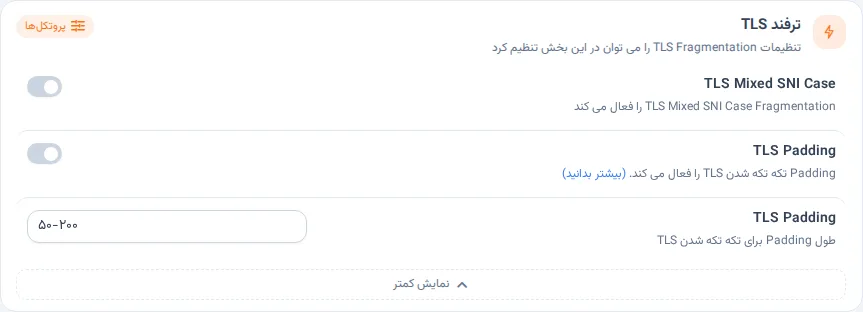

تنظیمات TLS Fragmentation را می‌توان در این بخش تنظیم کرد

*۳ تنظیم*

### 🔠 TLS Mixed SNI Case { #tls_mixed_case }

TLS Mixed SNI Case Fragmentation را فعال می‌کند

نوع: روشن / خاموش · بعد از ذخیره: همان لحظه اعمال می‌شود · *پیشرفته*

### ♒️ TLS Padding { #tls_padding_enable }

Padding تکه تکه شدن TLS را فعال می‌کند. [(بیشتر بدانید)](https://hiddify.com/fa/manager/basic-concepts-and-troubleshooting/How-the-TLS-Trick-works-and-its-usage/#tls-padding)

نوع: روشن / خاموش · بعد از ذخیره: **اعمال تغییرات** لازم است · *پیشرفته*

### 📏 TLS Padding { #tls_padding_length }

طول Padding برای تکه تکه شدن TLS

نوع: متن · بعد از ذخیره: **اعمال تغییرات** لازم است · *پیشرفته*

## پروکسی SSH { #ssh }

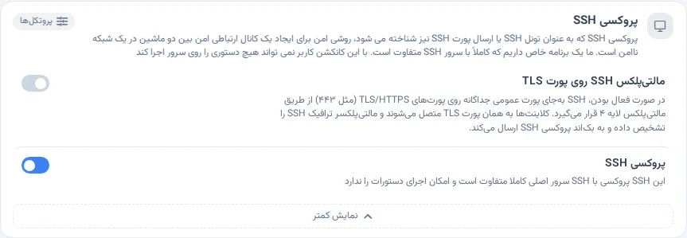

پروکسی SSH که به عنوان تونل SSH یا ارسال پورت SSH نیز شناخته می‌شود، روشی امن برای ایجاد یک کانال ارتباطی امن بین دو ماشین در یک شبکه ناامن است. ما یک برنامه خاص داریم که کاملاً با سرور SSH متفاوت است. با این کانکشن کاربر نمی‌تواند هیچ دستوری را روی سرور اجرا کند

*۲ تنظیم*

### 🔀 مالتی‌پلکس SSH روی پورت TLS { #ssh_use_tls_port }

در صورت فعال بودن، SSH به‌جای پورت عمومی جداگانه روی پورت‌های TLS/HTTPS (مثل ۴۴۳) از طریق مالتی‌پلکس لایه ۴ قرار می‌گیرد. کلاینت‌ها به همان پورت TLS متصل می‌شوند و مالتی‌پلکسر ترافیک SSH را تشخیص داده و به بک‌اند پروکسی SSH ارسال می‌کند.

نوع: روشن / خاموش · بعد از ذخیره: **اعمال تغییرات** لازم است · *پیشرفته*

### ✔️ پروکسی SSH { #ssh_server_enable }

این SSH پروکسی با SSH سرور اصلی کاملا متفاوت است و امکان اجرای دستورات را ندارد

نوع: روشن / خاموش · بعد از ذخیره: **نصب دوباره** لازم است · *پیشرفته*

## ⚡️ Mieru { #mieru }

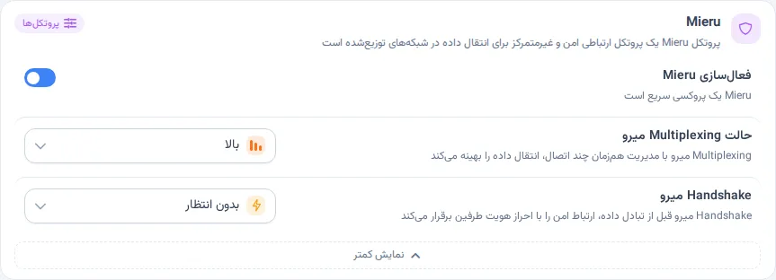

پروتکل Mieru یک پروتکل ارتباطی امن و غیرمتمرکز برای انتقال داده در شبکه‌های توزیع‌شده است

*۳ تنظیم*

### ⚡️ فعال‌سازی Mieru { #mieru_enable }

Mieru یک پروکسی سریع است

نوع: روشن / خاموش · بعد از ذخیره: **اعمال تغییرات** لازم است · *پیشرفته*

### 🔄 حالت Multiplexing میرو { #mieru_multiplexing }

Multiplexing میرو با مدیریت هم‌زمان چند اتصال، انتقال داده را بهینه می‌کند

نوع: انتخابی · بعد از ذخیره: همان لحظه اعمال می‌شود · *پیشرفته*

گزینه‌ها: 📄 پیش‌فرض، 📉 پایین، 📊 متوسط، 📈 بالا

### 🤝 Handshake میرو { #mieru_handshake }

Handshake میرو قبل از تبادل داده، ارتباط امن را با احراز هویت طرفین برقرار می‌کند

نوع: انتخابی · بعد از ذخیره: همان لحظه اعمال می‌شود · *پیشرفته*

گزینه‌ها: 📄 پیش‌فرض، ⏳ بدون انتظار، 📝 استاندارد

## TUIC { #tuic }

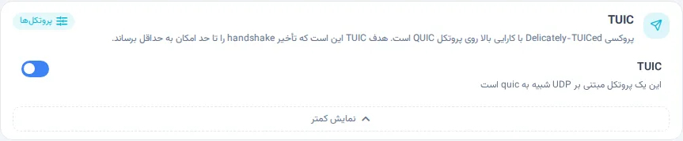

پروکسی Delicately-TUICed با کارایی بالا روی پروتکل QUIC است.

هدف TUIC این است که تأخیر handshake را تا حد امکان به حداقل برساند.

*۱ تنظیم*

### ⚫️ TUIC { #tuic_enable }

این یک پروتکل مبتنی بر UDP شبیه به quic است

نوع: روشن / خاموش · بعد از ذخیره: **اعمال تغییرات** لازم است · *پیشرفته*

## هیستریا { #hysteria }

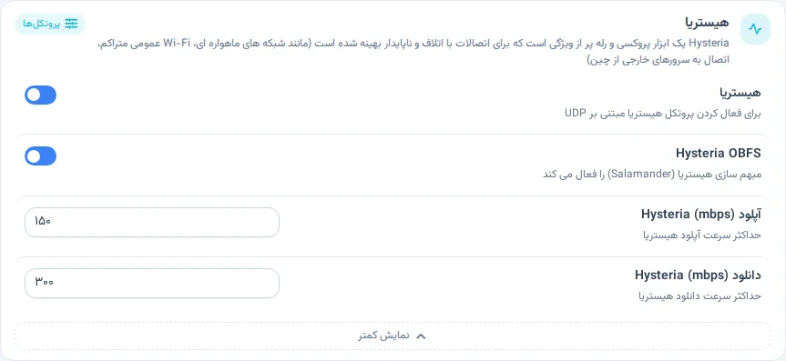

Hysteria یک ابزار پروکسی و رله پر از ویژگی است که برای اتصالات با اتلاف و ناپایدار بهینه شده است (مانند شبکه‌های ماهواره ای، Wi-Fi عمومی متراکم، اتصال به سرورهای خارجی از چین)

*۴ تنظیم*

### ⚪️ هیستریا { #hysteria_enable }

برای فعال کردن پروتکل هیستریا مبتنی بر UDP

نوع: روشن / خاموش · بعد از ذخیره: **اعمال تغییرات** لازم است · *پیشرفته*

### 🎛 Hysteria OBFS { #hysteria_obfs_enable }

مبهم‌سازی هیستریا (Salamander) را فعال می‌کند

نوع: روشن / خاموش · بعد از ذخیره: **اعمال تغییرات** لازم است · *پیشرفته*

### ⬆️ آپلود (mbps) Hysteria { #hysteria_up_mbps }

حداکثر سرعت آپلود هیستریا

نوع: متن · بعد از ذخیره: **اعمال تغییرات** لازم است · *پیشرفته*

### ⬇️ دانلود (mbps) Hysteria { #hysteria_down_mbps }

حداکثر سرعت دانلود هیستریا

نوع: متن · بعد از ذخیره: **اعمال تغییرات** لازم است · *پیشرفته*

## تنظیمات پیشرفته { #advanced }

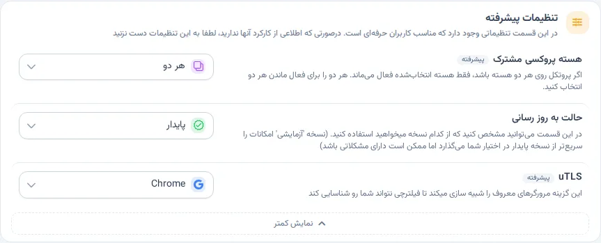

در این قسمت تنظیماتی وجود دارد که مناسب کاربران حرفه‌ای است. درصورتی که اطلاعی از کارکرد آنها ندارید، لطفا به این تنظیمات دست نزنید

*۳ تنظیم*

### 🎛️ هسته پروکسی مشترک { #common_proxy_core }

اگر پروتکل روی هر دو هسته باشد، فقط هسته انتخاب‌شده فعال می‌ماند. هر دو را برای فعال ماندن هر دو انتخاب کنید.

نوع: انتخابی · بعد از ذخیره: **اعمال تغییرات** لازم است · *پیشرفته*

گزینه‌ها: Xray، Hiddify Core (singbox)، هر دو

### 🔄 حالت به‌روزرسانی { #package_mode }

در این قسمت می‌توانید مشخص کنید که از کدام نسخه می‌خواهید استفاده کنید. (نسخه 'آزمایشی' امکانات را سریع‌تر از نسخه پایدار در اختیار شما می‌گذارد اما ممکن است دارای مشکلاتی باشد)

نوع: انتخابی · بعد از ذخیره: همان لحظه اعمال می‌شود

گزینه‌ها: ✅ پایدار، ☑️ نسخه آزمایشی

### ❇️ uTLS { #utls }

این گزینه مرورگرهای معروف را شبیه‌سازی می‌کند تا فیلترچی نتواند شما رو شناسایی کند

نوع: انتخابی · بعد از ذخیره: همان لحظه اعمال می‌شود · *پیشرفته*

گزینه‌ها: None، Chrome، Edge، iOS، Android، Safari، Firefox، random، randomized

## تنظیمات خیلی پیشرفته { #too_advanced }

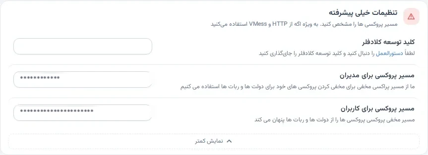

مسیر پروکسی‌ها را مشخص کنید. به ویژه اگه از HTTP و VMess استفاده می‌کنید

*۳ تنظیم*

### 🔑 کلید توسعه کلادفلر { #cloudflare }

لطفاً [دستورالعمل](/fa/manager/domain-worker-cdn-and-tunneling/Get-Cloudflare-API/) را دنبال کنید و کلید توسعه کلادفلر را جای‌گذاری کنید

نوع: متن · بعد از ذخیره: همان لحظه اعمال می‌شود · *پیشرفته*

### مسیر پروکسی برای مدیران { #proxy_path_admin }

ما از مسیر پروکسی مخفی برای مخفی کردن پروکسی‌های خود برای دولت‌ها و ربات‌ها استفاده می‌کنیم

نوع: متن · بعد از ذخیره: **اعمال تغییرات** لازم است · *پیشرفته*

### 🔏 مسیر پروکسی برای کاربران { #proxy_path_client }

مسیر مخفی پروکسی پروکسی‌ها را از دولت‌ها و ربات‌ها پنهان می‌کند

نوع: متن · بعد از ذخیره: **اعمال تغییرات** لازم است · *پیشرفته*

## WARP { #warp }

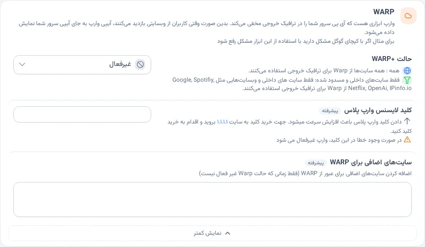

وارپ ابزاری هست که آی‌پی سرور شما را در ترافیک خروجی مخفی می‌کند. بدین صورت وقتی کاربران از وبسایتی بازدید می‌کنند، آی‌پی وارپ به جای آی‌پی سرور شما نمایش داده می‌شود.

برای مثال اگر با کپچای گوگل مشکل دارید با استفاده از این ابزار مشکل رفع شود

*۳ تنظیم*

### ✴️ حالت +WARP { #warp_mode }

✴️ همه : همه سایت‌ها از Warp برای ترافیک خروجی استفاده می‌کنند.

☑️ فقط سایت‌های داخلی و مسدود شده: فقط سایت‌های داخلی و وبسایت‌هایی مثل Google, Spotifiy, Netflix, OpenAi, IPinfo.io از Warp برای ترافیک خروجی استفاده می‌کنند.

نوع: انتخابی · بعد از ذخیره: **اعمال تغییرات** لازم است

گزینه‌ها: غیرفعال، همه، ☑️ فقط سایت‌های داخلی و مسدود شده‌ی خارجی

### 🔑 کلید لایسنس وارپ پلاس { #warp_plus_code }

🔝 دادن کلید وارپ پلاس باعث افزایش سرعت می‌شود. جهت خرید کلید به سایت [1.1.1.1](https://1.1.1.1/)

بروید و اقدام به خرید کلید کنید.

⚠️ در صورت وجود خطا در این کلید، وارپ غیرفعال می‌شود

نوع: متن · بعد از ذخیره: **اعمال تغییرات** لازم است · *پیشرفته*

### 🆚 سایت‌های اضافی برای WARP { #warp_sites }

اضافه کردن سایت‌های اضافی برای عبور از WARP (فقط زمانی که حالت Warp غیرفعال نیست)

نوع: متن · بعد از ذخیره: **اعمال تغییرات** لازم است · *پیشرفته*

## ریالتی { #reality }

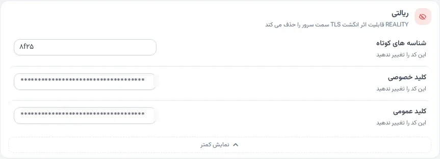

REALITY قابلیت اثر انگشت TLS سمت سرور را حذف می‌کند

*۳ تنظیم*

### 🆔 شناسه‌های کوتاه { #reality_short_ids }

این کد را تغییر ندهید

نوع: متن · بعد از ذخیره: **اعمال تغییرات** لازم است · *پیشرفته*

### 🔑 کلید خصوصی { #reality_private_key }

این کد را تغییر ندهید

نوع: متن · بعد از ذخیره: **اعمال تغییرات** لازم است · *پیشرفته*

### 🔑 کلید عمومی { #reality_public_key }

این کد را تغییر ندهید

نوع: متن · بعد از ذخیره: **اعمال تغییرات** لازم است · *پیشرفته*

## وایرگارد { #wireguard }

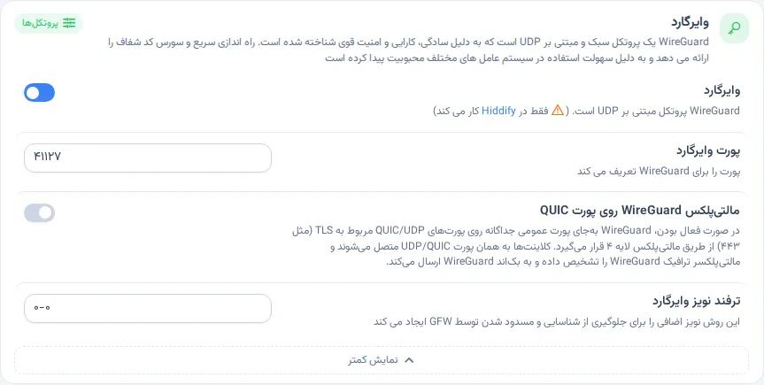

WireGuard یک پروتکل سبک و مبتنی بر UDP است که به دلیل سادگی، کارایی و امنیت قوی شناخته شده است. راه اندازی سریع و سورس کد شفاف را ارائه می‌دهد و به دلیل سهولت استفاده در سیستم عامل‌های مختلف محبوبیت پیدا کرده است

*۴ تنظیم*

### 🐉 وایرگارد { #wireguard_enable }

WireGuard پروتکل مبتنی بر UDP است. (⚠️ فقط در [Hiddify](https://app.hiddify.com/) کار می‌کند)

نوع: روشن / خاموش · بعد از ذخیره: **نصب دوباره** لازم است · *پیشرفته*

### ↔️ پورت وایرگارد { #wireguard_port }

پورت را برای WireGuard تعریف می‌کند

نوع: متن · بعد از ذخیره: **اعمال تغییرات** لازم است · *پیشرفته*

### 🔀 مالتی‌پلکس WireGuard روی پورت QUIC { #wireguard_use_quic_port }

در صورت فعال بودن، WireGuard به‌جای پورت عمومی جداگانه روی پورت‌های QUIC/UDP مربوط به TLS (مثل ۴۴۳) از طریق مالتی‌پلکس لایه ۴ قرار می‌گیرد. کلاینت‌ها به همان پورت UDP/QUIC متصل می‌شوند و مالتی‌پلکسر ترافیک WireGuard را تشخیص داده و به بک‌اند WireGuard ارسال می‌کند.

نوع: روشن / خاموش · بعد از ذخیره: **اعمال تغییرات** لازم است · *پیشرفته*

### 💥 ترفند نویز وایرگارد { #wireguard_noise_trick }

این روش نویز اضافی را برای جلوگیری از شناسایی و مسدود شدن توسط GFW ایجاد می‌کند

نوع: متن · بعد از ذخیره: **اعمال تغییرات** لازم است · *پیشرفته*

## شادوساکس { #shadowsocks }

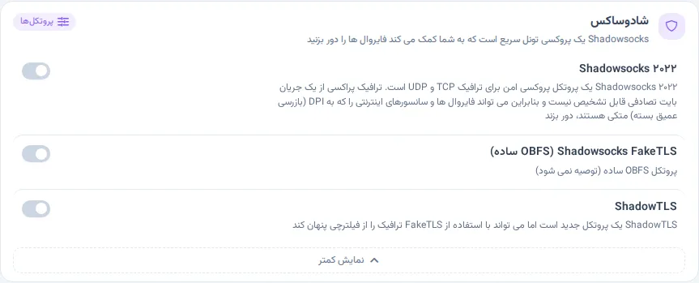

Shadowsocks یک پروکسی تونل سریع است که به شما کمک می‌کند فایروال‌ها را دور بزنید

*۳ تنظیم*

### ⭕️ Shadowsocks 2022 { #shadowsocks2022_enable }

Shadowsocks 2022 یک پروتکل پروکسی امن برای ترافیک TCP و UDP است. ترافیک پروکسی از یک جریان بایت تصادفی قابل تشخیص نیست و بنابراین می‌تواند فایروال‌ها و سانسورهای اینترنتی را که به DPI (بازرسی عمیق بسته) متکی هستند، دور بزند

نوع: روشن / خاموش · بعد از ذخیره: **اعمال تغییرات** لازم است · *پیشرفته*

### Shadowsocks FakeTLS (OBFS ساده) { #ssfaketls_enable }

پروتکل OBFS ساده (توصیه نمی‌شود)

نوع: روشن / خاموش · بعد از ذخیره: **نصب دوباره** لازم است · *پیشرفته*

### ☑️ ShadowTLS { #shadowtls_enable }

ShadowTLS یک پروتکل جدید است اما می‌تواند با استفاده از FakeTLS ترافیک را از فیلترچی پنهان کند

نوع: روشن / خاموش · بعد از ذخیره: **اعمال تغییرات** لازم است · *پیشرفته*

## DNSTT { #dnstt }

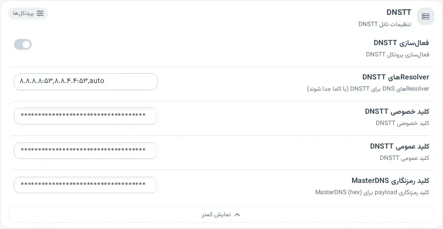

تنظیمات تونل DNSTT

*۵ تنظیم*

### فعال‌سازی DNSTT { #dnstt_enable }

فعال‌سازی پروتکل DNSTT

نوع: روشن / خاموش · بعد از ذخیره: **اعمال تغییرات** لازم است · *پیشرفته*

### Resolverهای DNSTT { #dnstt_resolvers }

Resolverهای DNS برای DNSTT (با کاما جدا شوند)

نوع: متن · بعد از ذخیره: **اعمال تغییرات** لازم است · *پیشرفته*

### کلید خصوصی DNSTT { #dnstt_private_key }

کلید خصوصی DNSTT

نوع: متن · بعد از ذخیره: **اعمال تغییرات** لازم است · *پیشرفته*

### کلید عمومی DNSTT { #dnstt_public_key }

کلید عمومی DNSTT

نوع: متن · بعد از ذخیره: **اعمال تغییرات** لازم است · *پیشرفته*

### کلید رمزنگاری MasterDNS { #master_dns_encrypt_key }

کلید رمزنگاری payload برای MasterDNS (hex)

نوع: متن · بعد از ذخیره: **اعمال تغییرات** لازم است · *پیشرفته*

## مقاله‌های مرتبط

- [آشنایی کامل با پنل و تنظیمات آن](/fa/manager/configuration-and-advanced-settings/How-to-configure-Hiddify-panel-properly/)
- [منوی هیدیفای‌منیجر در SSH](/fa/manager/configuration-and-advanced-settings/How-to-connect-and-troubleshoot-via-SSH/)
- [انتقال کاربران از پنل X-UI](/fa/manager/configuration-and-advanced-settings/how-to-import-xui-to-hiddifymanager/)
- [لینک ادمین و فرمت آن](/fa/manager/domain-worker-cdn-and-tunneling/The-correct-format-of-admin-link/)
