<!-- Made automatically from the panel's code (scripts/sync_manager_settings.py). Do not edit by hand. -->

# All Hiddify Manager settings

Every option of the panel's **Settings** page, in the panel's order, with the panel's own explanation. This page is made from the panel's code for Hiddify Manager **v14.5.0b0**, so it lists exactly what that version has.

**How to use it:** in the panel, open **Settings**. The common settings are shown first; turn on **Show Advanced Settings** to see the others (the ones marked *advanced* here). The search box at the top of the Settings page finds any setting by its name. For a tour of the whole panel, see [the panel guide](How-to-configure-Hiddify-panel-properly.md).

## Admin Settings { #admin }

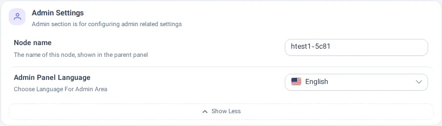

Admin section is for configuring admin related settings

*3 settings*

### Parent Panel (Multi Server) { #parent_panel }

You can Connect to the Central Panel to define only one user and the usage of all Servers will be added cumulatively.

Type: text · After saving: takes effect at once

Shown only on a node: a panel that is linked to a parent panel.

### Node name { #node_name }

The name of this node, shown in the parent panel

Type: text · After saving: takes effect at once

### 🗺️ Admin Panel Language { #admin_lang }

Choose Language For Admin Area

Type: a choice · After saving: takes effect at once

Choices: 🇺🇸 English, 🇮🇷 Persian - فارسی, 🇨🇳 Chinese - 简体中文, 🇵🇹 Portuguese - Português, 🇷🇺 Russian - Русский, 🇲🇲 Burmese - မြန်မာဘာသာ

## Customizing User Page { #branding }

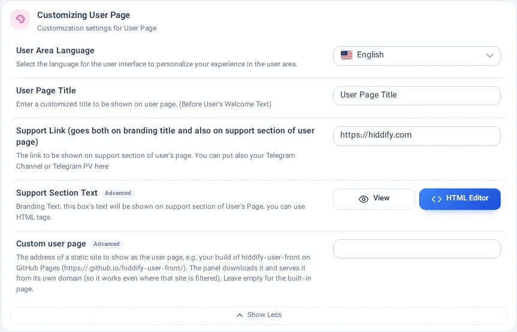

Customization settings for User Page

*10 settings*

### 🗺️ User Area Language { #lang }

Select the language for the user interface to personalize your experience in the user area.

Type: a choice · After saving: takes effect at once

Choices: 🇺🇸 English, 🇮🇷 Persian - فارسی, 🇨🇳 Chinese - 简体中文, 🇵🇹 Portuguese - Português, 🇷🇺 Russian - Русский, 🇲🇲 Burmese - မြန်မာဘာသာ

### 👁‍🗨 User Page Title { #branding_title }

Enter a customized title to be shown on user page. (Before User's Welcome Text)

Type: text · After saving: takes effect at once

### 🆔 Support Link (goes both on branding title and also on support section of user page) { #branding_site }

The link to be shown on support section of user's page.

You can put also your Telegram Channel or Telegram PV here

Type: text · After saving: takes effect at once

### 📢 Support Section Text { #branding_freetext }

Branding Text. this box's text will be shown on support section of User's Page. you can use HTML tags

Type: text · After saving: takes effect at once · *advanced*

### Support box title { #branding_support_title }

The title above the support text. Empty: "Support".

Type: text · After saving: takes effect at once · *advanced*

Set inside the editor of [📢 Support Section Text](#branding_freetext).

### Show the support box title { #branding_support_title_show }

Type: on / off · After saving: takes effect at once · *advanced*

Set inside the editor of [📢 Support Section Text](#branding_freetext).

### "View More" button text { #branding_support_more }

Opens the Support Website link. Empty: "View More".

Type: text · After saving: takes effect at once · *advanced*

Set inside the editor of [📢 Support Section Text](#branding_freetext).

### Show the "View More" button { #branding_support_more_show }

Type: on / off · After saving: takes effect at once · *advanced*

Set inside the editor of [📢 Support Section Text](#branding_freetext).

### Support text, Full { #branding_freetext_full }

Shown by “Read More” on the user page. Empty: “Read More” shows the support text when it does not fit.

Type: text · After saving: takes effect at once · *advanced*

Set inside the editor of [📢 Support Section Text](#branding_freetext).

### 🎨 Custom user page { #user_page_url }

The address of a static site to show as the user page, e.g. your build of hiddify-user-front on GitHub Pages (https://.github.io/hiddify-user-front/). The panel downloads it and serves it from its own domain (so it works even where that site is filtered). Leave empty for the built-in page.

Type: text · After saving: takes effect at once · *advanced*

## General Settings { #general }

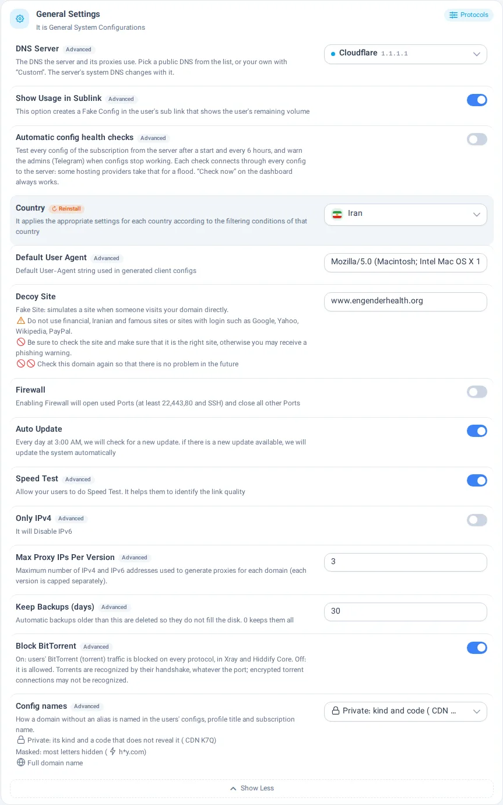

It is General System Configurations

*14 settings*

### 🖥 DNS Server { #dns_server }

The DNS the server and its proxies use. Pick a public DNS from the list, or your own with “Custom”. The server's system DNS changes with it.

Type: text · After saving: needs **Apply changes** · *advanced*

### 👁️‍🗨️ Show Usage in Sublink { #show_usage_in_sublink }

This option creates a Fake Config in the user's sub link that shows the user's remaining volume

Type: on / off · After saving: takes effect at once · *advanced*

### 🩺 Automatic config health checks { #config_health_enable }

Test every config of the subscription from the server after a start and every 6 hours, and warn the admins (Telegram) when configs stop working. Each check connects through every config to the server: some hosting providers take that for a flood. “Check now” on the dashboard always works.

Type: on / off · After saving: takes effect at once · *advanced*

### 🌍 Country { #country }

It applies the appropriate settings for each country according to the filtering conditions of that country

Type: a choice · After saving: needs **Reinstall**

Choices: 🇮🇷 Iran, 🇨🇳 China, Russia, 🇺🇳 Others

### 🪪 Default User Agent { #default_useragent_string }

Default User-Agent string used in generated client configs

Type: text · After saving: takes effect at once · *advanced*

### 📺 Decoy Site { #decoy_domain }

Fake Site: simulates a site when someone visits your domain directly.

⚠️ Do not use financial, Iranian and famous sites or sites with login such as Google, Yahoo, Wikipedia, PayPal.

⛔ Be sure to check the site and make sure that it is the right site, otherwise you may receive a phishing warning.

⛔⛔ Check this domain again so that there is no problem in the future

Type: text · After saving: needs **Apply changes**

### 🛡️ Firewall { #firewall }

Enabling Firewall will open used Ports (at least 22,443,80 and SSH) and close all other Ports

Type: on / off · After saving: needs **Apply changes**

### 🔄 Auto Update { #auto_update }

Every day at 3:00 AM, we will check for a new update. if there is a new update available, we will update the system automatically

Type: on / off · After saving: needs **Apply changes**

### 🚀 Speed Test { #speed_test }

Allow your users to do Speed Test. It helps them to identify the link quality

Type: on / off · After saving: needs **Reinstall** · *advanced*

### ℹ️ Only IPv4 { #only_ipv4 }

It will Disable IPv6

Type: on / off · After saving: needs **Apply changes** · *advanced*

### Max Proxy IPs Per Version { #max_proxy_ips_per_version }

Maximum number of IPv4 and IPv6 addresses used to generate proxies for each domain (each version is capped separately).

Type: number · After saving: needs **Apply changes** · *advanced*

### 🗄️ Keep Backups (days) { #backup_keep_days }

Automatic backups older than this are deleted so they do not fill the disk. 0 keeps them all

Type: number · After saving: takes effect at once · *advanced*

### 🚫 Block BitTorrent { #torrent_block }

On: users' BitTorrent (torrent) traffic is blocked on every protocol, in Xray and Hiddify Core. Off: it is allowed. Torrents are recognized by their handshake, whatever the port; encrypted torrent connections may not be recognized.

Type: on / off · After saving: needs **Apply changes** · *advanced*

### 🏷️ Config names { #domain_label_mode }

How a domain without an alias is named in the users' configs, profile title and subscription name.

🔒 Private: its kind and a code that does not reveal it (☁️ CDN K7Q)

🫥 Masked: most letters hidden (⚡ h*y.com)

🌐 Full domain name

Type: a choice · After saving: takes effect at once · *advanced*

## Proxies Settings { #proxies }

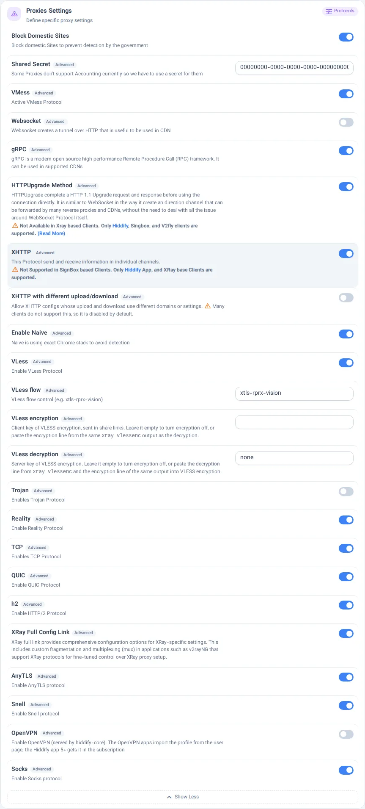

Define specific proxy settings

*23 settings*

### ⛔️ Block Domestic Sites { #block_iran_sites }

Block domestic Sites to prevent detection by the government

Type: on / off · After saving: needs **Apply changes**

### 🔐 Shared Secret { #shared_secret }

Some Proxies don't support Accounting currently so we have to use a secret for them

Type: text · After saving: needs **Apply changes** · *advanced*

### 🟣 VMess { #vmess_enable }

Active VMess Protocol

Type: on / off · After saving: needs **Apply changes** · *advanced*

### 🔰 Websocket { #ws_enable }

Websocket creates a tunnel over HTTP that is useful to be used in CDN

Type: on / off · After saving: needs **Apply changes** · *advanced*

### ➿ gRPC { #grpc_enable }

gRPC is a modern open source high performance Remote Procedure Call (RPC) framework. It can be used in supported CDNs

Type: on / off · After saving: needs **Apply changes** · *advanced*

### 🆙 HTTPUpgrade Method { #httpupgrade_enable }

HTTPUpgrade complete a HTTP 1.1 Upgrade request and response before using the connection directly. It is similar to WebSocket in the way it create an direction channel that can be forwarded by many reverse proxies and CDNs, without the need to deal with all the issue around WebSocket Protocol itself.

⚠️ **Not Available in Xray based Clients. Only [Hiddify](https://app.hiddify.com), Singbox, and V2fly clients are supported.** [**(Read More)**](https://hiddify.com/manager/basic-concepts-and-troubleshooting/Basic-Concepts/#http-upgrade)

Type: on / off · After saving: needs **Apply changes** · *advanced*

### 🈁 XHTTP { #xhttp_enable }

This Protocol send and receive information in individual channels.

⚠️ **Not Supported in SignBox based Clients. Only [Hiddify](https://app.hiddify.com) App, and XRay base Clients are supported.**

Type: on / off · After saving: needs **Apply changes** · *advanced*

### 🈁 XHTTP with different upload/download { #xhttp_different_up_down_enable }

Allow XHTTP configs whose upload and download use different domains or settings. ⚠️ Many clients do not support this, so it is disabled by default.

Type: on / off · After saving: needs **Apply changes** · *advanced*

### 🛡 Enable Naive { #naive_enable }

Naive is using exact Chrome stack to avoid detection

Type: on / off · After saving: needs **Apply changes** · *advanced*

### ⚫️ VLess { #vless_enable }

Enable VLess Protocol

Type: on / off · After saving: needs **Apply changes** · *advanced*

### VLess flow { #vless_flow }

VLess flow control (e.g. xtls-rprx-vision)

Type: text · After saving: needs **Apply changes** · *advanced*

### VLess encryption { #vless_encryption }

Client key of VLESS encryption, sent in share links. Leave it empty to turn encryption off, or paste the encryption line from the same `xray vlessenc` output as the decryption.

Type: text · After saving: needs **Apply changes** · *advanced*

### VLess decryption { #vless_decryption }

Server key of VLESS encryption. Leave it empty to turn encryption off, or paste the decryption line from `xray vlessenc` and the encryption line of the same output into VLESS encryption.

Type: text · After saving: needs **Apply changes** · *advanced*

### 🟤 Trojan { #trojan_enable }

Enables Trojan Protocol

Type: on / off · After saving: needs **Apply changes** · *advanced*

### 🔴 Reality { #reality_enable }

Enable Reality Protocol

Type: on / off · After saving: needs **Apply changes** · *advanced*

### 🟠 TCP { #tcp_enable }

Enables TCP Protocol

Type: on / off · After saving: needs **Apply changes** · *advanced*

### 🟡 QUIC { #quic_enable }

Enable QUIC Protocol

Type: on / off · After saving: needs **Apply changes** · *advanced*

### 🔵 h2 { #h2_enable }

Enable HTTP/2 Protocol

Type: on / off · After saving: needs **Apply changes** · *advanced*

### ⚙️ XRay Full Config Link { #sub_full_xray_json_enable }

XRay full link provides comprehensive configuration options for XRay-specific settings. This includes custom fragmentation and multiplexing (mux) in applications such as v2rayNG that support XRay protocols for fine-tuned control over XRay proxy setup.

Type: on / off · After saving: takes effect at once · *advanced*

### AnyTLS { #anytls_enable }

Enable AnyTLS protocol

Type: on / off · After saving: needs **Apply changes** · *advanced*

### Snell { #snell_enable }

Enable Snell protocol

Type: on / off · After saving: needs **Apply changes** · *advanced*

### OpenVPN { #openvpn_enable }

Enable OpenVPN (served by hiddify-core). The OpenVPN apps import the profile from the user page; the Hiddify app 5+ gets it in the subscription

Type: on / off · After saving: needs **Apply changes** · *advanced*

### Socks { #socks_enable }

Enable Socks protocol

Type: on / off · After saving: needs **Apply changes** · *advanced*

## Telegram Configs { #telegram }

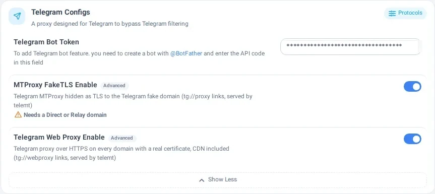

A proxy designed for Telegram to bypass Telegram filtering

*3 settings*

### 🔐 Telegram Bot Token { #telegram_bot_token }

To add Telegram bot feature. you need to create a bot with [@BotFather](https://t.me/BotFather) and enter the API code in this field

Type: text · After saving: takes effect at once

### ✔️ MTProxy FakeTLS Enable { #telegram_enable }

Telegram MTProxy hidden as TLS to the Telegram fake domain (tg://proxy links, served by telemt)

⚠️ **Needs a Direct or Relay domain**

Type: on / off · After saving: needs **Reinstall** · *advanced*

### ✔️ Telegram Web Proxy Enable { #telegram_webproxy_enable }

Telegram proxy over HTTPS on every domain with a real certificate, CDN included (tg://webproxy links, served by telemt)

Type: on / off · After saving: needs **Apply changes** · *advanced*

## HTTP Configuration { #http }

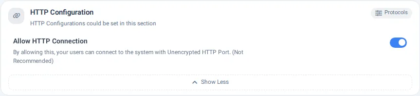

HTTP Configurations could be set in this section

*1 settings*

### ☑️ Allow HTTP Connection { #http_proxy_enable }

By allowing this, your users can connect to the system with Unencrypted HTTP Port. (Not Recommended)

Type: on / off · After saving: takes effect at once · *advanced*

## TLS Settings { #tls }

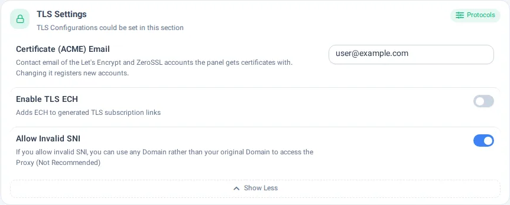

TLS Configurations could be set in this section

*3 settings*

### 📧 Certificate (ACME) Email { #acme_email }

Contact email of the Let's Encrypt and ZeroSSL accounts the panel gets certificates with. Changing it registers new accounts.

Type: text · After saving: takes effect at once · *advanced*

### 🔐 Enable TLS ECH { #tls_ech_enable }

Adds ECH to generated TLS subscription links

Type: on / off · After saving: needs **Apply changes** · *advanced*

### 🆗 Allow Invalid SNI { #allow_invalid_sni }

If you allow invalid SNI, you can use any Domain rather than your original Domain to access the Proxy (Not Recommended)

Type: on / off · After saving: needs **Apply changes** · *advanced*

## MUX Config { #mux }

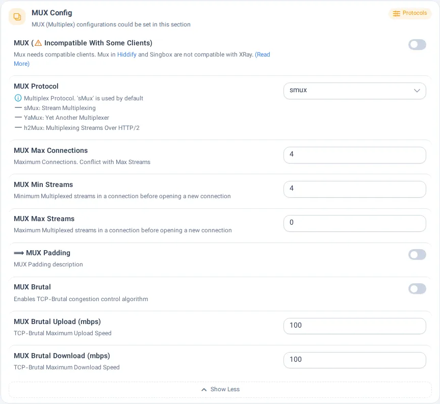

MUX (Multiplex) configurations could be set in this section

*9 settings*

### Ⓜ️ MUX (⚠️ Incompatible With Some Clients) { #mux_enable }

Mux needs compatible clients. Mux in [Hiddify](https://app.hiddify.com) and Singbox are not compatible with XRay. [(Read More)](https://hiddify.com/manager/basic-concepts-and-troubleshooting/How-MUX-works-and-its-usage/)

Type: on / off · After saving: needs **Apply changes** · *advanced*

### ♍️ MUX Protocol { #mux_protocol }

ℹ️ Multiplex Protocol. 'sMux' is used by default

➖ sMux: Stream Multiplexing

➖ YaMux: Yet Another Multiplexer

➖ h2Mux: Multiplexing Streams Over HTTP/2

Type: a choice · After saving: needs **Apply changes** · *advanced*

Choices: smux, yamux, h2mux

### ⛓ MUX Max Connections { #mux_max_connections }

Maximum Connections. Conflict with Max Streams

Type: number · After saving: needs **Apply changes** · *advanced*

### ↘️ MUX Min Streams { #mux_min_streams }

Minimum Multiplexed streams in a connection before opening a new connection

Type: number · After saving: needs **Apply changes** · *advanced*

### ↗️ MUX Max Streams { #mux_max_streams }

Maximum Multiplexed streams in a connection before opening a new connection

Type: number · After saving: needs **Apply changes** · *advanced*

### ⟹ MUX Padding { #mux_padding_enable }

MUX Padding description

Type: on / off · After saving: needs **Apply changes** · *advanced*

### ☣️ MUX Brutal { #mux_brutal_enable }

Enables TCP-Brutal congestion control algorithm

Type: on / off · After saving: needs **Apply changes** · *advanced*

### ⬆️ MUX Brutal Upload (mbps) { #mux_brutal_up_mbps }

TCP-Brutal Maximum Upload Speed

Type: number · After saving: needs **Apply changes** · *advanced*

### ⬇️ MUX Brutal Download (mbps) { #mux_brutal_down_mbps }

TCP-Brutal Maximum Download Speed

Type: number · After saving: needs **Apply changes** · *advanced*

## TLS Trick { #tls_trick }

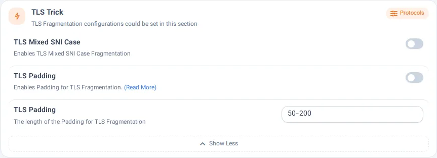

TLS Fragmentation configurations could be set in this section

*3 settings*

### 🔠 TLS Mixed SNI Case { #tls_mixed_case }

Enables TLS Mixed SNI Case Fragmentation

Type: on / off · After saving: takes effect at once · *advanced*

### ♒️ TLS Padding { #tls_padding_enable }

Enables Padding for TLS Fragmentation. [(Read More)](https://hiddify.com/manager/basic-concepts-and-troubleshooting/How-the-TLS-Trick-works-and-its-usage/#tls-padding)

Type: on / off · After saving: needs **Apply changes** · *advanced*

### 📏 TLS Padding { #tls_padding_length }

The length of the Padding for TLS Fragmentation

Type: text · After saving: needs **Apply changes** · *advanced*

## SSH Proxy { #ssh }

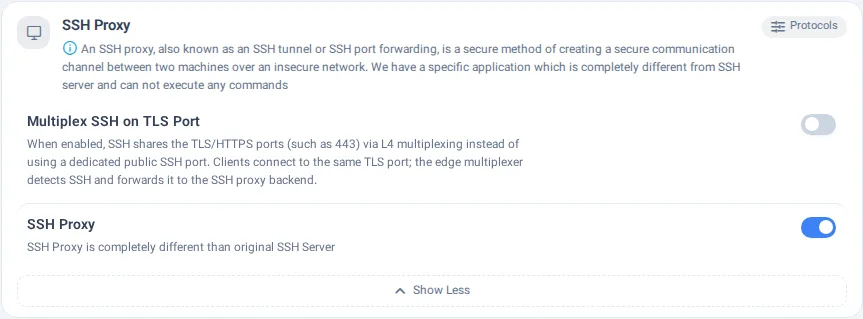

ℹ️ An SSH proxy, also known as an SSH tunnel or SSH port forwarding, is a secure method of creating a secure communication channel between two machines over an insecure network. We have a specific application which is completely different from SSH server and can not execute any commands

*2 settings*

### 🔀 Multiplex SSH on TLS Port { #ssh_use_tls_port }

When enabled, SSH shares the TLS/HTTPS ports (such as 443) via L4 multiplexing instead of using a dedicated public SSH port. Clients connect to the same TLS port; the edge multiplexer detects SSH and forwards it to the SSH proxy backend.

Type: on / off · After saving: needs **Apply changes** · *advanced*

### ✔️ SSH Proxy { #ssh_server_enable }

SSH Proxy is completely different than original SSH Server

Type: on / off · After saving: needs **Reinstall** · *advanced*

## ⚡️ Mieru { #mieru }

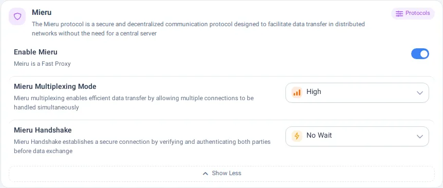

The Mieru protocol is a secure and decentralized communication protocol designed to facilitate data transfer in distributed networks without the need for a central server

*3 settings*

### ⚡️ Enable Mieru { #mieru_enable }

Meiru is a Fast Proxy

Type: on / off · After saving: needs **Apply changes** · *advanced*

### 🔄 Mieru Multiplexing Mode { #mieru_multiplexing }

Mieru multiplexing enables efficient data transfer by allowing multiple connections to be handled simultaneously

Type: a choice · After saving: takes effect at once · *advanced*

Choices: 📄 Default, 📉 Low, 📊 Middle, 📈 High

### 🤝 Mieru Handshake { #mieru_handshake }

Mieru Handshake establishes a secure connection by verifying and authenticating both parties before data exchange

Type: a choice · After saving: takes effect at once · *advanced*

Choices: 📄 Default, ⏳ No Wait, 📝 Standard

## TUIC { #tuic }

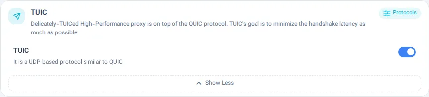

Delicately-TUICed High-Performance proxy is on top of the QUIC protocol.

TUIC's goal is to minimize the handshake latency as much as possible

*1 settings*

### ⚫️ TUIC { #tuic_enable }

It is a UDP based protocol similar to QUIC

Type: on / off · After saving: needs **Apply changes** · *advanced*

## Hysteria { #hysteria }

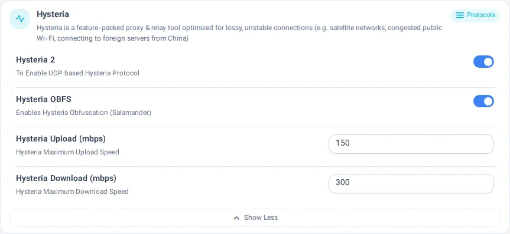

Hysteria is a feature-packed proxy & relay tool optimized for lossy, unstable connections (e.g. satellite networks, congested public Wi-Fi, connecting to foreign servers from China)

*4 settings*

### ⚫️ Hysteria 2 { #hysteria_enable }

To Enable UDP based Hysteria Protocol

Type: on / off · After saving: needs **Apply changes** · *advanced*

### 🎛 Hysteria OBFS { #hysteria_obfs_enable }

Enables Hysteria Obfuscation (Salamander)

Type: on / off · After saving: needs **Apply changes** · *advanced*

### ⬆️ Hysteria Upload (mbps) { #hysteria_up_mbps }

Hysteria Maximum Upload Speed

Type: text · After saving: needs **Apply changes** · *advanced*

### ⬇️ Hysteria Download (mbps) { #hysteria_down_mbps }

Hysteria Maximum Download Speed

Type: text · After saving: needs **Apply changes** · *advanced*

## Advanced Settings { #advanced }

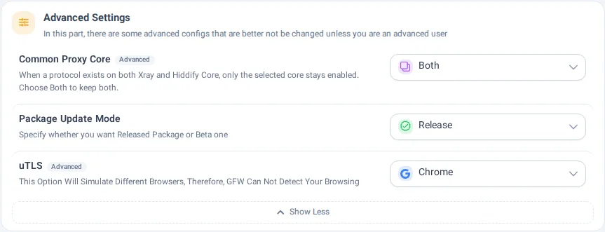

In this part, there are some advanced configs that are better not be changed unless you are an advanced user

*3 settings*

### 🎛️ Common Proxy Core { #common_proxy_core }

When a protocol exists on both Xray and Hiddify Core, only the selected core stays enabled. Choose Both to keep both.

Type: a choice · After saving: needs **Apply changes** · *advanced*

Choices: Xray, Hiddify Core (singbox), Both

### 🔄 Package Update Mode { #package_mode }

Specify whether you want Released Package or Beta one

Type: a choice · After saving: takes effect at once

Choices: ✅ Release, ☑️ Beta

### ❇️ uTLS { #utls }

This Option Will Simulate Different Browsers, Therefore, GFW Can Not Detect Your Browsing

Type: a choice · After saving: takes effect at once · *advanced*

Choices: None, Chrome, Edge, iOS, Android, Safari, Firefox, random, randomized

## Very Advanced Settings { #too_advanced }

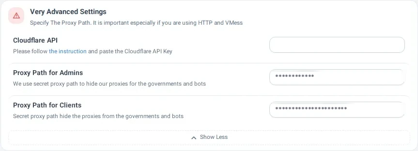

Specify The Proxy Path. It is important especially if you are using HTTP and VMess

*3 settings*

### 🔑 Cloudflare API { #cloudflare }

Please follow [the instruction](/manager/domain-worker-cdn-and-tunneling/Get-Cloudflare-API/) and paste the Cloudflare API Key

Type: text · After saving: takes effect at once · *advanced*

### 🔐 Proxy Path for Admins { #proxy_path_admin }

We use secret proxy path to hide our proxies for the governments and  bots

Type: text · After saving: needs **Apply changes** · *advanced*

### 🔏 Proxy Path for Clients { #proxy_path_client }

Secret proxy path hide the proxies from the governments and bots

Type: text · After saving: needs **Apply changes** · *advanced*

## WARP { #warp }

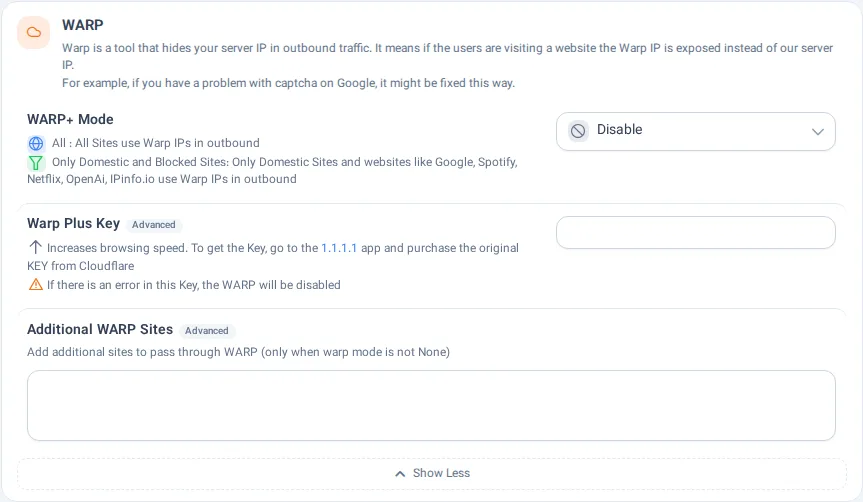

Warp is a tool that hides your server IP in outbound traffic. It means if the users are visiting a website the Warp IP is exposed instead of our server IP.

For example, if you have a problem with captcha on Google, it might be fixed this way.

*3 settings*

### ✴️ WARP+ Mode { #warp_mode }

✴️ All : All Sites use Warp IPs in outbound

☑️ Only Domestic and Blocked Sites: Only Domestic Sites and websites like Google, Spotify, Netflix, OpenAi, IPinfo.io use Warp IPs in outbound

Type: a choice · After saving: needs **Apply changes**

Choices: Disable, All, ☑️ Only Blocked and Local Websites

### 🔑 Warp Plus Key { #warp_plus_code }

🔝 Increases browsing speed. To get the Key, go to the [1.1.1.1](https://1.1.1.1/)

app and purchase the original KEY from Cloudflare

⚠️ If there is an error in this Key, the WARP will be disabled

Type: text · After saving: needs **Apply changes** · *advanced*

### 🆚 Additional WARP Sites { #warp_sites }

Add additional sites to pass through WARP (only when warp mode is not None)

Type: text · After saving: needs **Apply changes** · *advanced*

## Reality { #reality }

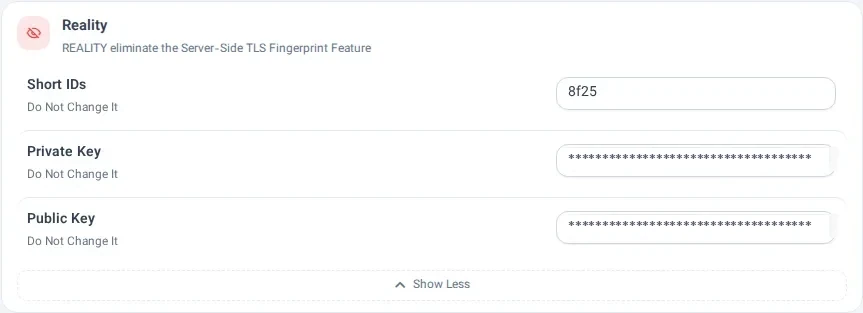

REALITY eliminate the Server-Side TLS Fingerprint Feature

*3 settings*

### 🆔 Short IDs { #reality_short_ids }

Do Not Change It

Type: text · After saving: needs **Apply changes** · *advanced*

### 🔑 Private Key { #reality_private_key }

Do Not Change It

Type: text · After saving: needs **Apply changes** · *advanced*

### 🔑 Public Key { #reality_public_key }

Do Not Change It

Type: text · After saving: needs **Apply changes** · *advanced*

## WireGuard { #wireguard }

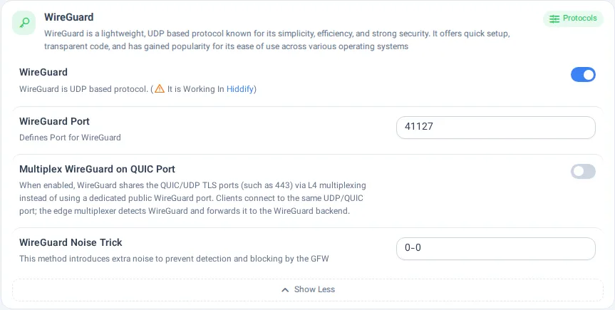

WireGuard is a lightweight, UDP  based protocol known for its simplicity, efficiency, and strong security. It offers quick setup, transparent code, and has gained popularity for its ease of use across various operating systems

*4 settings*

### 🐉 WireGuard { #wireguard_enable }

WireGuard is UDP based protocol. (⚠️ It is Working In [Hiddify](https://app.hiddify.com/))

Type: on / off · After saving: needs **Reinstall** · *advanced*

### ↔️ WireGuard Port { #wireguard_port }

Defines Port for WireGuard

Type: text · After saving: needs **Apply changes** · *advanced*

### 🔀 Multiplex WireGuard on QUIC Port { #wireguard_use_quic_port }

When enabled, WireGuard shares the QUIC/UDP TLS ports (such as 443) via L4 multiplexing instead of using a dedicated public WireGuard port. Clients connect to the same UDP/QUIC port; the edge multiplexer detects WireGuard and forwards it to the WireGuard backend.

Type: on / off · After saving: needs **Apply changes** · *advanced*

### 💥 WireGuard Noise Trick { #wireguard_noise_trick }

This method introduces extra noise to prevent detection and blocking by the GFW

Type: text · After saving: needs **Apply changes** · *advanced*

## Shadowsocks { #shadowsocks }

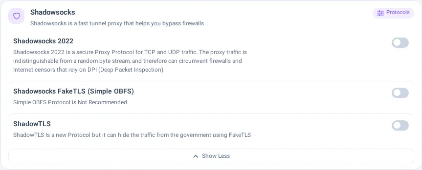

Shadowsocks is a fast tunnel proxy that helps you bypass firewalls

*3 settings*

### ⭕️ Shadowsocks 2022 { #shadowsocks2022_enable }

Shadowsocks 2022 is a secure Proxy Protocol for TCP and UDP traffic. The proxy traffic is indistinguishable from a random byte stream, and therefore can circumvent firewalls and Internet censors that rely on DPI (Deep Packet Inspection)

Type: on / off · After saving: needs **Apply changes** · *advanced*

### 🆎 Shadowsocks FakeTLS (Simple OBFS) { #ssfaketls_enable }

Simple OBFS Protocol is Not Recommended

Type: on / off · After saving: needs **Reinstall** · *advanced*

### ☑️ ShadowTLS { #shadowtls_enable }

ShadowTLS Is a new Protocol but it can hide the traffic from the government using FakeTLS

Type: on / off · After saving: needs **Apply changes** · *advanced*

## DNSTT { #dnstt }

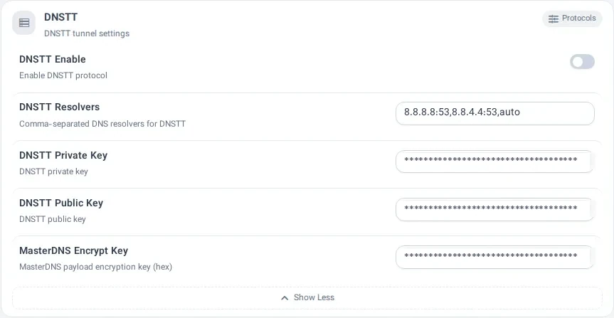

DNSTT tunnel settings

*5 settings*

### DNSTT Enable { #dnstt_enable }

Enable DNSTT protocol

Type: on / off · After saving: needs **Apply changes** · *advanced*

### DNSTT Resolvers { #dnstt_resolvers }

Comma-separated DNS resolvers for DNSTT

Type: text · After saving: needs **Apply changes** · *advanced*

### DNSTT Private Key { #dnstt_private_key }

DNSTT private key

Type: text · After saving: needs **Apply changes** · *advanced*

### DNSTT Public Key { #dnstt_public_key }

DNSTT public key

Type: text · After saving: needs **Apply changes** · *advanced*

### MasterDNS Encrypt Key { #master_dns_encrypt_key }

MasterDNS payload encryption key (hex)

Type: text · After saving: needs **Apply changes** · *advanced*

## Related articles

- [Every part and setting of the panel](/manager/configuration-and-advanced-settings/How-to-configure-Hiddify-panel-properly/)
- [The Hiddify Manager menu over SSH](/manager/configuration-and-advanced-settings/How-to-connect-and-troubleshoot-via-SSH/)
- [Import users from X-UI](/manager/configuration-and-advanced-settings/how-to-import-xui-to-hiddifymanager/)
- [The admin link and its format](/manager/domain-worker-cdn-and-tunneling/The-correct-format-of-admin-link/)
