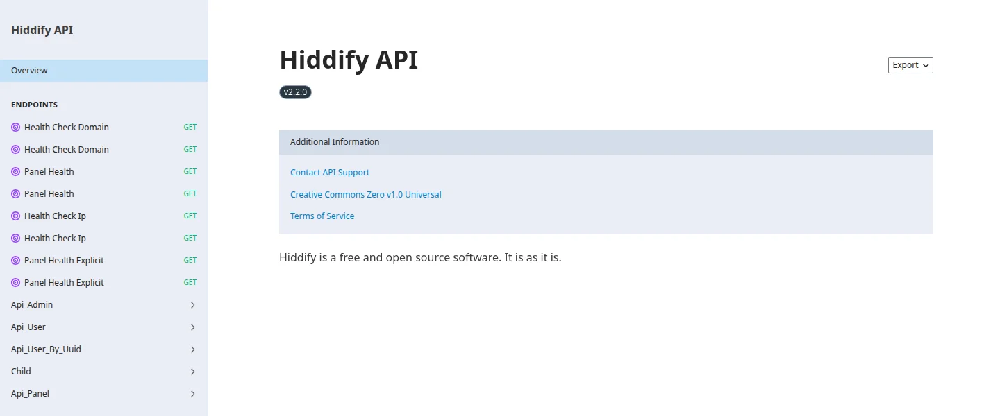

# آموزش استفاده از API هیدیفای‌منیجر

!!! info "نوشته‌شده برای هیدیفای‌منیجر نسخهٔ ۱۴.۵ (API v2.2)"
    با پنل نسخهٔ ۱۴.۵ بررسی شده است. آدرس‌ها ممکن است بین نسخه‌ها تغییر کنند: مستندات داخل پنل خودتان (پایین‌تر) همیشه با همان نسخه می‌خواند.

با API می‌توانید پنل را از برنامه‌ها یا بات‌های خودتان مدیریت کنید: کاربر بسازید، تغییر دهید و حذف کنید، مصرفشان را بخوانید، ادمین‌ها را ببینید و وضعیت سرور را بگیرید.

## مستندات کجاست { #where-is-the-documentation }

در پنل روی **API** در نوار کناری (گروه **تنظیمات**) بزنید. مستندات تعاملی خود پنل باز می‌شود: همهٔ آدرس‌ها، فیلدهایشان، دکمهٔ **Try it** و کد آمادهٔ درخواست برای زبان‌های برنامه‌نویسی مختلف. آدرس آن این است:

<div dir="ltr" markdown="1">

```plaintext
https://<your domain>/<admin proxy path>/api/docs
```

صفحهٔ مستندات در پنل همهٔ آدرس‌ها را بخش‌به‌بخش نشان می‌دهد (**Api_Admin**، **Api_User**، **Api_Panel**، و **Child** برای نودها):



</div>

## چه چیزهایی لازم است { #what-you-need }

- **دامنه** و **مسیر پروکسی ادمین**: بخشی از لینک ادمین که بعد از دامنه می‌آید (`https://<your domain>/<admin proxy path>/…`). آن را در **تنظیمات** › **تنظیمات خیلی پیشرفته** › **مسیر پروکسی برای مدیران** هم می‌بینید و می‌توانید عوضش کنید.
- **کلید API:** **UUID یک ادمین**، یعنی شناسهٔ بلند داخل لینک همان ادمین ([لینک ادمین و فرمت آن](/fa/manager/domain-worker-cdn-and-tunneling/The-correct-format-of-admin-link/) را ببینید). آن را در هدر `Hiddify-API-Key` بفرستید. API با دسترسی همان ادمین کار می‌کند: مثلاً یک نماینده فقط کاربران خودش را می‌بیند.

!!! warning "کلید را مخفی نگه دارید"
    کلید API پنل را با دسترسی همان ادمین باز می‌کند، حتی اگر آن ادمین رمز داشته باشد. برای برنامه‌تان یک ادمین جدا با کمترین دسترسی لازم بسازید و کلید را فقط از طریق https بفرستید.

## بخش‌های API (نسخهٔ ۲) { #the-sections-of-the-api-v2 }

| بخش | آدرس پایه | کاربرد |
|---|---|---|
| پنل | `/<admin proxy path>/api/v2/panel/` | `info/` (نسخهٔ پنل) و `ping/` |
| ادمین | `/<admin proxy path>/api/v2/admin/` | کاربران (`user/`)، ادمین‌ها (`admin_user/`)، ادمین خودتان (`me/`)، وضعیت سرور (`server_status/`)، لاگ‌ها و … |
| کاربر | `/<client proxy path>/api/v2/user/` | برای یک کاربر، با UUID **خود او** به‌عنوان کلید: `me/` (مصرف و زمان باقی‌مانده)، `all-configs/`، `mtproxies/`، `apps/`، `short/` (لینک کوتاه موقت) |

مسیر پروکسی کاربران در **تنظیمات** › **تنظیمات خیلی پیشرفته** › **مسیر پروکسی برای کاربران** است.

## کارهای رایج { #common-tasks }

آدرس‌های زیر زیر `/<admin proxy path>/api/v2/admin/` هستند. همهٔ آن‌ها با فیلدهایشان در مستندات پنل خودتان آمده‌اند.

| می‌خواهید | درخواست |
|---|---|
| فهرست، افزودن، تغییر یا حذف کاربران | `GET` / `POST` `user/`، بعد `GET` / `PATCH` / `DELETE` `user/<uuid>/` |
| افزودن تعداد زیادی کاربر با هم | `POST` `users/bulk-create/` |
| دیدن وضعیت سرور (CPU، RAM، ترافیک) | `GET` `server_status/` |
| اعمال تغییرات، نصب دوباره، به‌روزرسانی یا راه‌اندازی دوباره | `POST` `apply/apply/`، `apply/install/`، `apply/update/`، `apply/restart/` |
| دانلود پشتیبان | `GET` `backup/download/` |
| دیدن خروجی‌ها | `GET` `outbounds/` |
| دیدن نودهای چندسروره | `GET` `nodes/` |

## مثال‌ها { #examples }

نسخهٔ پنل:

```bash
curl "https://example.com/ADMIN_PATH/api/v2/panel/info/" \
  -H "Hiddify-API-Key: ADMIN_UUID"
```

فهرست کاربران:

```bash
curl "https://example.com/ADMIN_PATH/api/v2/admin/user/" \
  -H "Hiddify-API-Key: ADMIN_UUID"
```

افزودن یک کاربر با ۳۰ گیگابایت برای ۳۰ روز، با ریست ماهانه:

```bash
curl -X POST "https://example.com/ADMIN_PATH/api/v2/admin/user/" \
  -H "Hiddify-API-Key: ADMIN_UUID" \
  -H "Content-Type: application/json" \
  -d '{"name": "Ali", "usage_limit_GB": 30, "package_days": 30, "mode": "monthly"}'
```

پاسخ، `uuid` کاربر جدید را دارد. با آن می‌توانید کاربر را بخوانید (`GET …/admin/user/<uuid>/`)، تغییر دهید (`PATCH`، فقط فیلدهایی که می‌فرستید) یا حذف کنید (`DELETE`). `mode` دورهٔ ریست است: `no_reset`، `monthly`، `weekly` یا `daily`.

## نکته‌ها { #notes }

- از نسخهٔ ۲ API (`/api/v2/`) استفاده کنید. نسخهٔ ۱ قدیمی است.
- فیلدها و آدرس‌ها ممکن است در نسخهٔ جدید تغییر کنند: بعد از هر به‌روزرسانی، مستندات داخل پنل را نگاه کنید.
- آدرس‌ها با `/` تمام می‌شوند.

اگر سؤال یا پیشنهادی برای این صفحه دارید، در بخش نظرات پایین بنویسید.

## مقاله‌های مرتبط

- [چگونه می‌توان در این پروژه همکاری نمود](/fa/manager/contribution/How-to-contribute-to-this-project/)
- [چگونه در پروژهٔ اپ هیدیفای مشارکت کنیم](/fa/app/How-to-contribute-to-this-project/)
