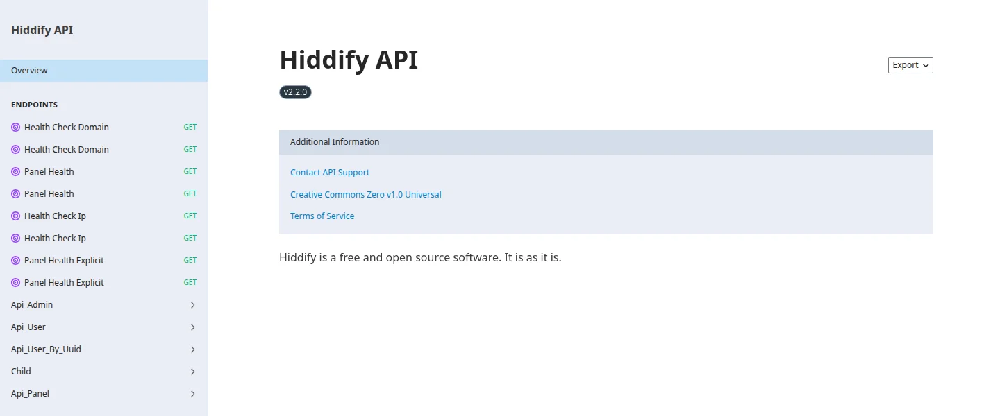

# How to use the API of Hiddify Manager

!!! info "Written for Hiddify Manager v14.5 (API v2.2)"
    Checked against the v14.5 panel. The endpoints can change between versions: the documentation inside your own panel (below) is always the one that matches it.

With the API you can manage the panel from your own programs or bots: create, change and delete users, read their usage, list admins and see the server's state.

## Where is the documentation

In the panel, click **API** in the sidebar (in the **Settings** group). It opens the panel's own interactive API documentation: every endpoint, its fields, a **Try it** button, and ready request code for many programming languages. Its address is:

```plaintext
https://<your domain>/<admin proxy path>/api/docs
```

The documentation page in the panel lists every endpoint by section (**Api_Admin**, **Api_User**, **Api_Panel**, **Child** for nodes):



## What you need

- **Your domain** and the **admin proxy path**: the part after the domain in your admin link (`https://<your domain>/<admin proxy path>/…`). You can also see and change it in **Settings** › **Very Advanced Settings** › **Proxy Path for Admins**.
- **The API key:** the **UUID of an admin**, the long ID in that admin's link (see [the admin link and its format](/manager/domain-worker-cdn-and-tunneling/The-correct-format-of-admin-link/)). Send it in the `Hiddify-API-Key` header. The API acts with that admin's rights: an agent only sees its own users.

!!! warning "Keep the key secret"
    The API key opens the panel with that admin's rights, even when the admin has a password. Use a separate admin with only the rights your program needs, and send the key only over https.

## The sections of the API (v2)

| Section | Base address | What it is for |
|---|---|---|
| Panel | `/<admin proxy path>/api/v2/panel/` | `info/` (the panel's version) and `ping/` |
| Admin | `/<admin proxy path>/api/v2/admin/` | users (`user/`), admins (`admin_user/`), your own admin (`me/`), server state (`server_status/`), logs and more |
| User | `/<client proxy path>/api/v2/user/` | for one user, with **their** UUID as the key: `me/` (usage and time left), `all-configs/`, `mtproxies/`, `apps/`, `short/` (a short temporary link) |

The client proxy path is in **Settings** › **Very Advanced Settings** › **Proxy Path for Clients**.

## Common tasks

Addresses below are under `/<admin proxy path>/api/v2/admin/`. All of them are in the documentation of your panel, with their fields.

| You want to | Request |
|---|---|
| List, add, change or delete users | `GET` / `POST` `user/`, then `GET` / `PATCH` / `DELETE` `user/<uuid>/` |
| Add many users at once | `POST` `users/bulk-create/` |
| See the server's state (CPU, RAM, traffic) | `GET` `server_status/` |
| Apply changes, reinstall, update or restart | `POST` `apply/apply/`, `apply/install/`, `apply/update/`, `apply/restart/` |
| Download a backup | `GET` `backup/download/` |
| See the outbounds | `GET` `outbounds/` |
| See the nodes of a multi-server setup | `GET` `nodes/` |

## Examples

The panel's version:

```bash
curl "https://example.com/ADMIN_PATH/api/v2/panel/info/" \
  -H "Hiddify-API-Key: ADMIN_UUID"
```

The list of users:

```bash
curl "https://example.com/ADMIN_PATH/api/v2/admin/user/" \
  -H "Hiddify-API-Key: ADMIN_UUID"
```

Add a user with 30 GB for 30 days, with a monthly reset:

```bash
curl -X POST "https://example.com/ADMIN_PATH/api/v2/admin/user/" \
  -H "Hiddify-API-Key: ADMIN_UUID" \
  -H "Content-Type: application/json" \
  -d '{"name": "Ali", "usage_limit_GB": 30, "package_days": 30, "mode": "monthly"}'
```

The answer has the new user's `uuid`. With it you can read the user (`GET …/admin/user/<uuid>/`), change it (`PATCH`, only the fields you send) or delete it (`DELETE`). The `mode` is the reset period: `no_reset`, `monthly`, `weekly` or `daily`.

## Notes

- Use version 2 of the API (`/api/v2/`). Version 1 is old.
- The fields and endpoints can change in a new version: after an update, check the documentation in your panel.
- The paths end with `/`.

If you have a question or an idea for this page, write it in the comments below.

## Related articles

- [How to contribute to this project](/manager/contribution/How-to-contribute-to-this-project/)
- [How to contribute to this project](/app/How-to-contribute-to-this-project/)
